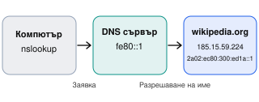
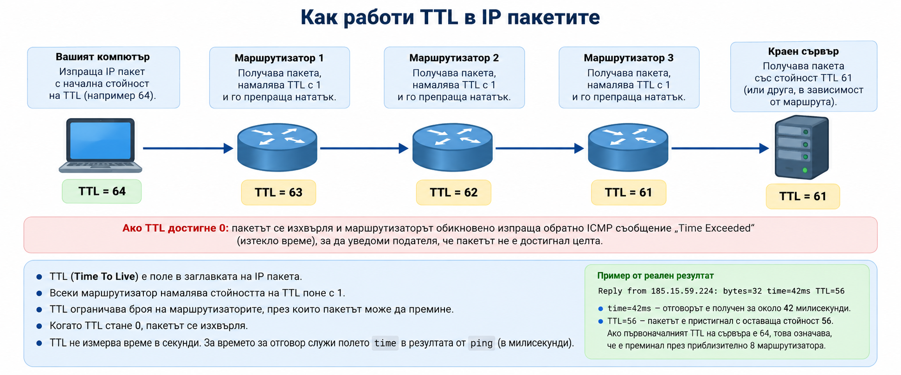

# Практика 1. Мрежов детектив — изследвай собствената си мрежа

**Учебна практика:** Интернет програмиране · **Клас:** XII · **Раздел 1:** Въведение в интернет, мрежови протоколи и модел „Клиент–сървър“ · **Продължителност:** 2 учебни часа (90 минути)

!!! abstract "Практически казус"
    Ти си мрежов детектив. Твоята задача е да изследваш настройките на своя компютър, да провериш кои адреси отговарят, да проследиш пътя на пакетите и да обясниш наблюденията чрез изучените мрежови модели. **Не променяш настройки — само наблюдаваш и анализираш.**

**Връзка с теорията:** [Урок 1. Основи на интернет и мрежови протоколи](../../teoria/razdel-1/urok-01-osnovi-na-internet.md) — IP адреси, DNS, мрежови протоколи, пакети, маршрутизиране и модели OSI/TCP/IP.

## Цели на занятието

След края на практиката ще можеш да:

- намираш IPv4 адрес, маска, шлюз, DNS сървър, MAC адрес и наличен IPv6 адрес;
- използваш `nslookup` за откриване на адреси по домейн име;
- проверяваш отговори с `ping` и разчиташ загуба, време и TTL;
- наблюдаваш междинни мрежови преходи с `tracert`;
- свързваш резултатите с подходящите слоеве на OSI и TCP/IP;
- записваш **реални резултати** и формулираш обоснован диагностичен извод.

## Необходими инструменти

- Компютър с Windows 10/11 и **Command Prompt (CMD)**; не са необходими администраторски права.
- Достъп до училищната мрежа; интернет е желателен, но за част от задачите има резервни варианти.
- **[Протокол за разпечатване (PDF)](../../resursi/protokol-01-mrezhov-detektiv.pdf)** — разпечатай и попълвай на ръка по време на работа.
- **[Редактируем протокол (Word)](../../resursi/protokol-01-mrezhov-detektiv.docx)** — използвай при необходимост от електронно попълване или редакция.

!!! warning "Правила за безопасна работа"
    Работи само на своя компютър и с одобрени от учителя публични адреси. Не сканирай чужди устройства. Не променяй IP настройки и не изпълнявай `ipconfig /release` или `ipconfig /renew`. Не публикувай снимки на вътрешните мрежови настройки извън учебната среда.

## План на работа

| Етап | Време |
|---|---:|
| Кратка теория и подготовка | 10 мин |
| Мисия 1. Моят компютър в мрежата | 15 мин |
| Мисия 2. От домейн към IP адрес | 15 мин |
| Мисия 3. Има ли връзка? | 15 мин |
| Мисия 4. Пътят на пакетите | 15 мин |
| Мисия 5. Подреди по OSI/TCP/IP | 10 мин |
| Финален диагностичен отчет | 10 мин |
| **Общо** | **90 мин** |

## Кратка теория: как да четем мрежата (10 мин)

Интернет е мрежа от свързани мрежи. За да достигнат данните до правилното устройство, то използва **IP адресиране**. В локалната мрежа устройствата обменят данни чрез мрежови интерфейси, които имат **MAC адреси**. Когато данните трябва да достигнат друга мрежа, компютърът обикновено ги изпраща към **шлюза по подразбиране** — маршрутизатор, който препраща трафика нататък.

**DNS** позволява да намерим IP адреси по запомнящо се домейн име, например `example.com`. Данните се пренасят в пакети, които могат да преминават през няколко маршрутизатора. **OSI** и **TCP/IP** ни помагат да подредим различните функции на комуникацията по слоеве.

| Понятие | Какво означава | Пример |
|---|---|---|
| IPv4 адрес | Логически адрес на мрежов интерфейс | `192.168.1.25` |
| Маска на подмрежата | Определя мрежовата част на IPv4 адреса | `255.255.255.0` |
| Шлюз по подразбиране | Обичайният път към други мрежи | `192.168.1.1` |
| DNS сървър | Помага за намиране на IP адреси по имена | `192.168.1.1` (пример) |
| MAC адрес | Адрес на мрежов интерфейс на канално ниво | `00-1A-2B-3C-4D-5E` |
| IPv6 адрес | Адрес от по-новата версия на IP | `2001:db8::25` (примерен документационен адрес) |

!!! note "Как да отвориш командния ред"
    Натисни **Win + R**, въведи `cmd` и натисни **Enter**. Пиши командите точно както са показани. **Адресите в примерите не са резултатите на твоя компютър.**

---

## Мисия 1. Моят компютър в мрежата (15 мин)

### 1. Какво ще научиш

Да откриваш параметрите на активната мрежова връзка и да ги сравняваш с тези на друг компютър.

### 2. Обяснение

Командата `ipconfig /all` показва информация за всички мрежови адаптери. Възможно е да виждаш Ethernet, Wi-Fi, виртуални и изключени адаптери. Търси **активния адаптер**, чрез който компютърът е свързан в момента. Не смесвай стойности от различни адаптери.

### 3. Демонстрация

```bat
ipconfig /all
```

Примерен съкратен резултат (измислени стойности):

```text
Ethernet adapter Ethernet:
   Physical Address. . . . . . . . : 00-1A-2B-3C-4D-5E
   IPv4 Address. . . . . . . . . . : 192.168.1.25(Preferred)
   Subnet Mask . . . . . . . . . . : 255.255.255.0
   Default Gateway . . . . . . . . : 192.168.1.1
   DNS Servers . . . . . . . . . . : 192.168.1.1
```

Тук **компютърът** има адрес `192.168.1.25`, а **шлюзът** е `192.168.1.1`. Двата адреса изпълняват различни роли. Ако има IPv6 адрес, запиши и него; ако няма, отбележи „не е показан“.

### 4. Твоята задача

1. Изпълни `ipconfig /all`.
2. В **Мисия 1** на протокола попълни IPv4 адрес, маска, шлюз, DNS сървър, MAC адрес и IPv6 адрес (ако е наличен).
3. Сравни **само с разрешение на съученика** настройките на своя компютър с тези на съседния.
4. Запиши кои параметри са еднакви и кои се различават. Обясни защо два компютъра в една подмрежа обикновено имат различни IPv4 адреси.

### 5. Проверка

- Използвал ли си стойности от един и същ активен адаптер?
- Различаваш ли IPv4 адреса на компютъра от адреса на шлюза?
- Ако двата компютъра имат еднакъв шлюз, доказва ли това само по себе си, че всичките им настройки са еднакви? **Не.**

### 6. Извод

Допълни: „Моят компютър използва IPv4 адрес ________. Шлюзът му е ________. Разликата между тях е, че ________.“

---

## Мисия 2. От домейн към IP адрес (15 мин)

### 1. Какво ще научиш

Да извършваш DNS справки и да различаваш IPv4 (**A**) и IPv6 (**AAAA**) записи.

### 2. Обяснение

DNS (Domain Name System) преобразува имената на домейните в IP адреси. Един домейн може да има IPv4 адреси (DNS записи от тип **A**) и IPv6 адреси (DNS записи от тип **AAAA**). Възможно е да има няколко адреса от един и същи тип.

При изпълнение на `nslookup` без посочен тип на записа Windows може да покаже едновременно IPv4 и IPv6 адреси. За да проверим конкретен тип запис, използваме `-type=A` или `-type=AAAA`.

Важно е да различаваме **адреса на DNS сървъра**, който отговаря на заявката, от **IP адресите на търсения домейн**. DNS сървърът връща информация за адресите, но не е задължително самият той да установява връзка с уебсайта.



### 3. Демонстрация

**Пример: DNS проверка на реален домейн — `wikipedia.org`**

Отвори Command Prompt (CMD) и изпълни последователно:

```bat
nslookup -type=A wikipedia.org
nslookup -type=AAAA wikipedia.org
nslookup wikipedia.org
```

| Команда | Какво проверява |
|---|---|
| `nslookup -type=A wikipedia.org` | IPv4 адресите (записи A) |
| `nslookup -type=AAAA wikipedia.org` | IPv6 адресите (записи AAAA) |
| `nslookup wikipedia.org` | При обичайната настройка на Windows може да покаже IPv4 и IPv6 адреси |

**Реален резултат от проверка с `nslookup wikipedia.org`:**

```text
Server:  UnKnown
Address: fe80::1

Non-authoritative answer:
Name:    wikipedia.org
Addresses: 2a02:ec80:300:ed1a::1
           185.15.59.224
```

**Как да прочетем резултата?**

- `Server: UnKnown` — DNS сървърът е отговорил, но `nslookup` не е установил неговото име. Това не е грешка в DNS заявката.
- `Address: fe80::1` — адресът на DNS сървъра, към който е изпратена заявката. `fe80::1` е локален IPv6 адрес (link-local), а не адрес на Wikipedia.
- `Non-authoritative answer` — отговорът идва от DNS сървър, който не е авторитетен за домейна; възможно е да използва кеширана информация.
- `185.15.59.224` — IPv4 адрес, получен за `wikipedia.org`.
- `2a02:ec80:300:ed1a::1` — IPv6 адрес, получен за `wikipedia.org`.


!!! note "Важно"
    Един домейн може да има няколко IPv4 или IPv6 адреса. Получените резултати може да се различават според момента на проверката и използвания DNS сървър. Записвай **реално получените адреси**, а не копирай тези от примера.

**Помисли:** Защо адресът на DNS сървъра е IPv6 (`fe80::1`), а сред резултатите за Wikipedia има и IPv4 адрес?

**Отговор:** DNS заявката и последващата връзка с уебсайта са различни процеси. Компютърът може да използва IPv6 за комуникация с DNS сървъра и да получи IPv4 адрес за търсения домейн.

### 4. Твоята задача


1. Изпълни трите DNS команди за `wikipedia.org`, показани в демонстрацията.
2. Повтори проверката за `cloudflare.com`, като използваш `nslookup -type=A`, `nslookup -type=AAAA` и `nslookup`.
3. Попълни **Мисия 2** в протокола: домейн, DNS сървър, IPv4 адрес(и), IPv6 адрес(и) или „няма отговор/няма AAAA запис“.
4. Отговори: **Защо едно домейн име може да има няколко IP адреса?**


### 5. Проверка

Отговори на следните въпроси:

1. Каква е разликата между DNS записите **A** и **AAAA**?
2. Какво показва редът `Server` в резултата от `nslookup`?
3. Каква е разликата между адреса на DNS сървъра и IP адресите на търсения домейн?
4. Защо един домейн може да има няколко IP адреса?
5. Ако за даден домейн няма AAAA запис, означава ли това, че DNS услугата не работи? **Обоснови отговора си.**

### 6. Извод

Попълни изреченията въз основа на собствените си резултати:

- DNS преобразува домейн имена в __________.
- DNS записът от тип **A** съдържа __________ адрес.
- DNS записът от тип **AAAA** съдържа __________ адрес.
- При проверката на `wikipedia.org` получих __________ IPv4 адрес(а) и __________ IPv6 адрес(а).
- Адресът на използвания DNS сървър е __________.

**Заключение:** Обясни с 2–3 изречения как DNS помага на компютъра да открива сървъри в интернет.

---

## Мисия 3. Има ли връзка? (15 мин)

### 1. Какво ще научиш

Да използваш `ping` и да разчиташ получени отговори, време, загуба на пакети и TTL.

### 2. Обяснение

`ping` изпраща диагностични **ICMP Echo Request** съобщения и очаква **ICMP Echo Reply**. `127.0.0.1` е **loopback адрес**: проверява локалната TCP/IP обработка на компютъра, а **не** интернет връзката. Публичен адрес като `1.1.1.1` позволява да проверим дали получаваме ICMP отговор извън локалния компютър.

!!! warning "Важна особеност"
    Ако публичен адрес не отговори, **не заключавай автоматично, че интернет не работи**. Някои мрежи блокират ICMP. Запиши действителния резултат и го обсъди.



### 3. Демонстрация

Изпълни последователно трите команди в Command Prompt (CMD):

```bat
ping -n 4 127.0.0.1
ping -n 4 1.1.1.1
ping -n 4 wikipedia.org
```

**Проверка 1. Локален адрес — `127.0.0.1`**

```text
Reply from 127.0.0.1: bytes=32 time<1ms TTL=128
Packets: Sent = 4, Received = 4, Lost = 0 (0% loss)
```

Адресът `127.0.0.1` е **loopback адрес**. Той проверява локалната TCP/IP обработка на компютъра, а не връзката с интернет.

**Проверка 2. Публичен IP адрес — `1.1.1.1`**

```text
Reply from 1.1.1.1: bytes=32 time=12ms TTL=59
Reply from 1.1.1.1: bytes=32 time=13ms TTL=59
Reply from 1.1.1.1: bytes=32 time=13ms TTL=59
Reply from 1.1.1.1: bytes=32 time=13ms TTL=59
Packets: Sent = 4, Received = 4, Lost = 0 (0% loss)
Minimum = 12ms, Maximum = 13ms, Average = 12ms
```

Получени са четири отговора без загуба на пакети. `time` показва времето за отговор, а `TTL=59` е останалата стойност на полето TTL в получения IP пакет. **TTL не е време в секунди и от него самостоятелно не можем да определим точния брой маршрутизатори.**

**Проверка 3. Домейн — `wikipedia.org`**

```text
Pinging wikipedia.org [185.15.59.224] with 32 bytes of data:
Reply from 185.15.59.224: bytes=32 time=42ms TTL=56
Reply from 185.15.59.224: bytes=32 time=42ms TTL=56
Reply from 185.15.59.224: bytes=32 time=42ms TTL=56
Reply from 185.15.59.224: bytes=32 time=42ms TTL=56
Packets: Sent = 4, Received = 4, Lost = 0 (0% loss)
Minimum = 42ms, Maximum = 42ms, Average = 42ms
```

Преди изпращането на ICMP заявките домейнът `wikipedia.org` е преобразуван чрез DNS в IP адрес `185.15.59.224`. Това е адресът, получен при конкретната проверка; при други условия е възможен различен резултат.

**Как да разчетем резултатите?**

- **`Reply from`** — получен е отговор от посочения адрес.
- **`bytes=32`** — размерът на данните в ICMP диагностичната заявка.
- **`time`** — измереното време за отговор в милисекунди.
- **`TTL`** — оставащият лимит на мрежовите преходи на получения IP пакет; маршрутизаторите намаляват стойността му при препращане.
- **`Lost`** — броят заявки, за които не е получен отговор.

!!! note "Важно"
    Показаните резултати са от реална проверка, но времената, TTL и IP адресите могат да се различават при друг компютър или мрежа. Записвай **собствените си резултати**. Липсата на отговор при `ping` не доказва непременно, че даден сайт не работи, защото ICMP може да бъде ограничен или блокиран.


### 4. Твоята задача

**1. Провери собствения си компютър.**

```bat
ping -n 4 127.0.0.1
```

**2. Провери връзката с публичен IP адрес.**

```bat
ping -n 4 1.1.1.1
```

**3. Провери реален домейн.**

```bat
ping -n 4 wikipedia.org
```

Сравни получения IP адрес с резултата от DNS проверката в Мисия 2.

**4. Попълни Мисия 3 в протокола.**

Запиши броя изпратени и получени пакети, процента загуба, средното време за отговор и TTL (ако има отговор).

**5. Обясни резултатите.**

Обясни със свои думи какво показват `Reply from`, `time` и `TTL`.

### 5. Проверка

- Успешен `ping 127.0.0.1` доказва ли достъп до интернет? **Не.**
- `Request timed out` винаги ли означава, че целта е изключена? **Не.**

### 6. Извод

Допълни: „При проверката на ________ получих ________ отговора от четири. Това показва ________, но не доказва ________.“

---

## Мисия 4. Пътят на пакетите (15 мин)

### 1. Какво ще научиш

Да проследяваш **видимите** мрежови преходи по пътя към даден адрес.

### 2. Обяснение

`tracert` използва диагностични проби с различен TTL, за да получи информация за междинните възли. Всеки ред е **преход (hop)**, за който може да се получи отговор. Не всеки маршрутизатор отговаря и показаният маршрут не е задължително пълен.

### 3. Демонстрация

```bat
tracert -d -h 20 example.com
```

`-d` пропуска преобразуването на адресите в имена и обикновено ускорява проверката. `-h 20` ограничава максималния брой преходи до 20.

Примерен съкратен резултат:

```text
  1    <1 ms    <1 ms    <1 ms   192.168.1.1
  2     8 ms     9 ms     8 ms   10.0.0.1
  3       *        *        *    Request timed out.
  4    25 ms    24 ms    26 ms   ...
```

`*` означава, че за съответната проба **не е получен отговор навреме**. Това **не доказва**, че връзката е прекъсната. В този пример първият видим преход е `192.168.1.1`, но в твоята мрежа може да е различен или да не се вижда.

### 4. Твоята задача

1. Изпълни `tracert -d -h 20 example.com`.
2. Запиши в **Мисия 4** на протокола първия видим преход, броя на видимите преходи и дали има звездички.
3. Сравни първия видим преход със шлюза от Мисия 1. **Не приемай, че задължително съвпадат.**
4. Ако командата не достигне целта, запиши това. Използвай резервна цел само ако учителят е посочил такава.

### 5. Проверка

- Всяка звездичка означава ли повреден маршрутизатор? **Не.**
- Можеш ли да твърдиш, че си видял всички възли по маршрута? **Не.**

### 6. Извод

Допълни: „До целта наблюдавах ________ видими прехода. Първият видим адрес беше ________. Наличието/липсата на звездички означава ________.“

---

## Мисия 5. Подреди наблюденията по OSI/TCP/IP (10 мин)

### 1. Какво ще научиш

Да свързваш наблюдавани мрежови явления с **основните им функции** в моделите OSI и TCP/IP.

### 2. Обяснение

OSI разделя мрежовата комуникация на седем слоя, а TCP/IP я описва с по-малко функционални слоя. **Командите не са самостоятелни протоколи и могат да показват информация от повече от един слой.** В таблицата посочваме най-подходящия слой за съответното наблюдение.

### 3. Демонстрация

| Наблюдение | OSI | TCP/IP | Защо |
|---|---|---|---|
| MAC адрес / Ethernet | 2. Канален | Мрежов достъп | Кадри и локална доставка |
| IP адрес / маршрутизиране | 3. Мрежов | Интернет | Логическо адресиране и път между мрежи |
| ICMP при `ping` и `tracert` | 3. Мрежов | Интернет | Диагностични съобщения, свързани с IP |
| DNS справка | 7. Приложен | Приложен | Откриване на адреси по имена |

### 4. Твоята задача

Попълни **Мисия 5** в протокола **без да преписваш таблицата**, а като използваш резултатите от предишните мисии. Към всяко наблюдение добави едно кратко обяснение устно или в свободното поле на протокола.

### 5. Проверка

- На кой слой се отнася IP маршрутизирането? **OSI 3 — мрежов.**
- DNS на кой слой е услуга? **Приложен.**
- `ping` използва ли HTTP? **Не, използва ICMP.**

### 6. Извод

Обясни в едно изречение защо една успешна DNS справка и един успешен `ping` показват **различни** аспекти на мрежовата комуникация.

---

## Финален диагностичен отчет (10 мин)

В последната част на протокола напиши **4–5 свързани изречения**, като използваш само **своите действителни наблюдения**:

1. Какъв IPv4 адрес, шлюз и DNS сървър установи?
2. Какво показа DNS справката?
3. Кои `ping` проверки получиха отговор и каква беше загубата?
4. Какъв маршрут наблюдава с `tracert`?
5. Какво можеш да заключиш и какво **не можеш** да докажеш от тези резултати?

!!! success "Готов си, когато…"
    Петте мисии в протокола са попълнени, липсващите отговори са отбелязани честно и диагностичният отчет съдържа обосновани изводи. Не се оценява дали училищната мрежа позволява всяка проверка, а **правилното наблюдение и тълкуване**.

## Оценяване — 10 точки

| Критерий | Точки |
|---|---:|
| Мисия 1 — мрежови настройки и сравнение | 2 |
| Мисия 2 — DNS справки и обяснение | 2 |
| Мисия 3 — `ping` и тълкуване | 2 |
| Мисия 4 — `tracert` и тълкуване | 2 |
| Мисия 5 — OSI/TCP/IP и финален отчет | 2 |
| **Общо** | **10** |

## Ключови понятия

**IPv4**, **IPv6**, **MAC адрес**, **маска на подмрежата**, **шлюз по подразбиране**, **DNS**, **ICMP**, **TTL**, **пакет**, **маршрутизатор**, **OSI**, **TCP/IP**.

## Домашна работа (по избор)

Избери **една** от използваните команди. Напиши кратко обяснение: какво проверява, как се изпълнява и кои са две възможни грешки при тълкуване на резултата. **Не публикувай вътрешни мрежови адреси.**

!!! note "За учителя"
    Преди часа проверете дали училищната мрежа допуска `ping` и `tracert` към избраните адреси. Подгответе разрешени резервни цели. При блокиран ICMP или липсващ IPv6 не отнемайте точки за липсата на отговор — оценявайте правилното описание на наблюдението. Протоколът е съгласуван с петте мисии и разпределението 15 + 15 + 15 + 15 + 10 + 10 минути след 10-минутното въведение. **HTTP, DevTools, `curl` и `netstat :443` не са включени в тази практика.**

[Към Раздел 1 на практиката](index.md) · [Към началото на модула](../index.md)
