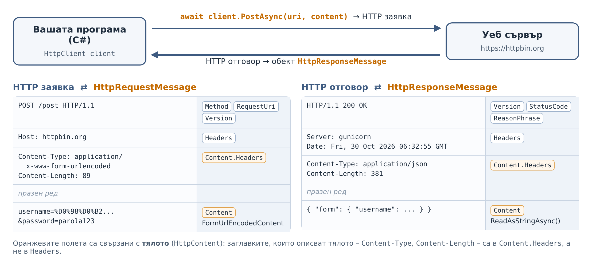

# Упражнение 3. HTTP GET и POST заявки с C# — конзолно приложение

**Учебна практика:** Интернет програмиране · **Клас:** XII · **Раздел 1:** Въведение в интернет, мрежови протоколи и модел „Клиент–сървър“ · **Продължителност:** 2 учебни часа (90 минути)

!!! abstract "Практически казус"
    В упражнение 2 изпращахте HTTP заявки с готов инструмент – Postman. Сега сте **програмист**: пишете собствен малък HTTP клиент на C#. Програмата пита за адрес и метод, изпраща GET заявка или POST заявка с данни от формуляр или с JSON и показва всичко, което сървърът е върнал: статус, заглавки, време, размер и тяло. В упражнение 4 същата програма ще получи графичен интерфейс.

**Връзка с теорията:** [Урок 2. HTTP. Видове HTTP заявки](../../teoria/razdel-1/urok-02-http-vidove-zayavki.md) – структура на заявката и отговора, методи, статус кодове, URL параметри и `Content-Type`.

**Връзка с предходно упражнение:** [Упражнение 2. Изпращане и анализ на HTTP заявки с Postman](uprazhnenie-urok-02-postman.md) – ще изпращате същите заявки към същата тестова услуга, но с програмен код.

## Цели на упражнението

След упражнението ученикът трябва да може да:

- обяснява ролята на класовете `HttpClient`, `HttpRequestMessage`, `HttpResponseMessage` и `HttpContent` и как обектите им работят заедно;
- свързва частите на HTTP заявката и отговора със свойствата на тези класове;
- изпраща GET заявки със `SendAsync` и с `GetAsync`;
- изпраща POST заявки с данни от формуляр (`FormUrlEncodedContent`) и с JSON (`StringContent`) и обяснява ролята на `Content-Type`;
- извежда статус, заглавки, време за отговор, размер и тяло на отговора;
- обработва неуспешни отговори и грешки при връзката;
- използва `async`/`await` и освобождава ресурсите с `using`.

## Необходими инструменти

- **Visual Studio 2026** с работното натоварване (*workload*) **.NET desktop development** – то съдържа шаблоните за конзолно приложение и за Windows Forms.
- **.NET 10** (версия с дългосрочна поддръжка – LTS). Инсталира се заедно с Visual Studio 2026. Всички класове в упражнението са част от **стандартната библиотека на .NET 10** – не е нужно да инсталирате NuGet пакети.
- Достъп до интернет. Тестовата услуга е [httpbin.org](https://httpbin.org) – същата като в упражнение 2.
- Протокол за записване на резултатите – тетрадка или документ.

!!! tip "Ако httpbin.org не отговаря"
    Използвайте резервните адреси `https://postman-echo.com/get`, `https://postman-echo.com/post` и `https://postman-echo.com/status/404`. Отговорите се различават в подробностите, но изводите са същите.

!!! warning "Правила за работа"
    Изпращай заявки само към посочените тестови адреси. В полето за парола въвеждай **измислена** парола – тестовата услуга я връща обратно в отговора и тя се вижда на екрана.

## План на работа

Цялото упражнение е **един проект**, който надграждате мисия след мисия. Накрая имате работещ HTTP клиент, написан от вас.

| Етап | Време |
|---|---:|
| **Първи учебен час** | |
| 1. Класовете на .NET за HTTP | 12 мин |
| 2. Подготовка на проекта | 5 мин |
| Мисия 1. Първа GET заявка – по два начина | 10 мин |
| Мисия 2. Пълна информация за отговора | 18 мин |
| **Втори учебен час** | |
| Мисия 3. POST заявка с данни от формуляр | 10 мин |
| Мисия 4. POST заявка с JSON | 12 мин |
| Мисия 5. Неуспешни отговори и грешки | 13 мин |
| Мисия 6. Собствени заглавки | 5 мин |
| Сравнителна таблица и предаване | 5 мин |

Самостоятелните задачи (т. 10) са за учениците, които работят по-бързо, или за домашна работа.

## 1. Класовете на .NET за HTTP (12 мин)

### 1.1. Как HTTP заявката и отговорът стават C# обекти

В урок 2 видяхте, че HTTP заявката и отговорът са текстови съобщения с начален ред, заглавки, празен ред и тяло. В .NET не пишете този текст ръчно. Създавате **обекти**, а класовете от пространството от имена `System.Net.Http` ги превръщат в HTTP съобщения и обратно.



Обърнете внимание на една подробност: заглавките, които **описват тялото** (`Content-Type`, `Content-Length`), не са в `Headers`, а в `Content.Headers`. Затова програмата ще извежда и двете групи.

### 1.2. Как обектите работят заедно

Една GET заявка, написана с отделни обекти:

```csharp
HttpClient client = new HttpClient();

HttpRequestMessage request = new HttpRequestMessage(HttpMethod.Get, "https://httpbin.org/get");

HttpResponseMessage response = await client.SendAsync(request);
```

| Въпрос | Отговор |
|---|---|
| **Кой** изпраща заявката? | `client` – обект от класа `HttpClient`. |
| **Какво** изпраща? | `request` – обект от класа `HttpRequestMessage`. |
| **С какъв метод?** | `HttpMethod.Get` – свойството `Method` на заявката. |
| **Къде** е отговорът? | В `response` – обект от класа `HttpResponseMessage`. |

Тъй като GET заявките са много чести, `HttpClient` има **съкратен** метод, който сам създава `HttpRequestMessage` и извиква `SendAsync`:

```csharp
HttpResponseMessage response = await client.GetAsync("https://httpbin.org/get");
```

Аналогично `PostAsync(адрес, тяло)` създава заявка с метод `HttpMethod.Post` и свойство `Content` = тялото. Двата начина изпращат **една и съща** HTTP заявка.

### 1.3. Основните класове

| Клас | Роля | Важни членове |
|---|---|---|
| `HttpClient` | Изпраща заявки и получава отговори – това е „браузърът“ на програмата | `SendAsync`, `GetAsync`, `PostAsync`, `PutAsync`, `DeleteAsync`, `Timeout`, `DefaultRequestHeaders` |
| `HttpRequestMessage` | Една HTTP заявка | `Method`, `RequestUri`, `Version`, `Headers`, `Content` |
| `HttpMethod` | HTTP метод | `HttpMethod.Get`, `HttpMethod.Post`, `HttpMethod.Put`, `HttpMethod.Delete` |
| `HttpResponseMessage` | Един HTTP отговор | `StatusCode`, `ReasonPhrase`, `Version`, `Headers`, `Content`, `IsSuccessStatusCode`, `EnsureSuccessStatusCode()` |
| `HttpStatusCode` | Изброим тип (`enum`) със статус кодовете | `HttpStatusCode.OK` = 200, `HttpStatusCode.NotFound` = 404 |
| `HttpContent` | Тяло на заявка или отговор (абстрактен клас) | `Headers`, `ReadAsStringAsync()`, `ReadAsByteArrayAsync()` |
| `FormUrlEncodedContent` | Наследник на `HttpContent`: тяло с данни от формуляр `ключ=стойност&ключ=стойност` | задава `Content-Type: application/x-www-form-urlencoded` |
| `StringContent` | Наследник на `HttpContent`: тяло с произволен текст, напр. JSON | задава посочения `Content-Type`, напр. `application/json` |
| `HttpRequestException` | Изключение при неуспешна връзка – няма такъв сървър, няма мрежа | `Message`, `HttpRequestError`, `StatusCode` |
| `OperationCanceledException` | Изключение при прекратена операция – когато сървърът не отговори навреме (изтекъл `Timeout`) или заявката е отказана. `HttpClient` хвърля неговия наследник `TaskCanceledException`, затова `catch (OperationCanceledException)` хваща и двата | `Message` |

Методи от `System.Net.Http.Json` – по-кратък запис при работа с JSON (използват се в самостоятелните задачи и в домашната работа):

| Член | Роля |
|---|---|
| `GetFromJsonAsync<T>(uri)` | Изпраща GET и превръща JSON тялото на отговора в обект от тип `T` |
| `PostAsJsonAsync(uri, обект)` | Превръща обекта в JSON и го изпраща с POST и `Content-Type: application/json` |
| `JsonContent.Create(обект)` | Създава JSON тяло (наследник на `HttpContent`) |

Помощни класове извън `System.Net.Http`:

- `Stopwatch` (`System.Diagnostics`) – измерва времето за отговор;
- `Encoding` (`System.Text`) – превръща байтовете на тялото в текст (UTF-8);
- `JsonSerializer` (`System.Text.Json`) – превръща обект в JSON текст и обратно;
- `Uri` (`System`) – представя и проверява URL адрес.

!!! info "Защо в кода няма `using System.Net.Http;`?"
    Проектите в .NET 10 са с включена настройка **ImplicitUsings** (в `.csproj` файла: `<ImplicitUsings>enable</ImplicitUsings>`). Тя автоматично добавя най-често използваните пространства от имена: `System`, `System.IO`, `System.Linq`, `System.Collections.Generic`, `System.Threading.Tasks` и **`System.Net.Http`**. Затова в кода пишем само `using` за `System.Diagnostics`, `System.Text` и `System.Text.Json`. В проект за Windows Forms автоматично се добавят и `System.Drawing` и `System.Windows.Forms`.

### 1.4. Един `HttpClient` за цялата програма, `using` за отговорите

`HttpClient` поддържа отворени мрежови връзки към сървърите и ги използва многократно. Затова **създавайте един обект за цялата програма** и го използвайте за всички заявки. Ако създавате нов `HttpClient` за всяка заявка, програмата отваря излишни връзки и при много заявки може да изчерпа мрежовите ресурси на компютъра.

```csharp
static readonly HttpClient client = new HttpClient
{
    Timeout = TimeSpan.FromSeconds(5)    // по подразбиране е 100 секунди
};
```

Обратно – всеки **отговор** (`HttpResponseMessage`), заявка (`HttpRequestMessage`) и тяло (`HttpContent`) се използва веднъж. Тези класове реализират интерфейса `IDisposable`: заемат ресурси (памет, връзка), които трябва да се освободят, когато обектът не е нужен. Това става с **`using`**:

```csharp
using HttpResponseMessage response = await client.GetAsync(uri);
// ... работа с response ...
// в края на блока { } response се освобождава автоматично (извиква се response.Dispose())
```

### 1.5. Защо `async` и `await`?

Отговорът от сървъра пристига след десетки или стотици милисекунди. През това време програмата няма какво да прави, освен да чака. Методите, които работят с мрежата, са **асинхронни** – името им завършва на `Async` и връщат `Task`.

- `GetAsync` **започва** изпращането на заявката и веднага връща задача (`Task<HttpResponseMessage>`).
- `await` **изчаква** задачата да завърши и взема резултата – обекта `HttpResponseMessage`. Докато се чака, нишката не е блокирана: в графично приложение прозорецът продължава да реагира.
- Метод, в който използвате `await`, се отбелязва с `async` и връща `Task` (или `Task<T>`). Затова `Main` става `static async Task Main`.

!!! warning "Не използвайте `.Result` и `.Wait()`"
    Записът `client.GetAsync(url).Result` също връща отговора, но **блокира** нишката, докато чака. В графично приложение прозорецът „замръзва“. Използвайте `await`.

### 1.6. Конструкции на C#, които ще срещнете

| Конструкция | Пример | Значение |
|---|---|---|
| Пространство от имена за целия файл | `namespace HttpKlient;` | Всичко във файла е в `HttpKlient` – без допълнителни фигурни скоби. |
| Инициализатор на обект | `new HttpClient { Timeout = ... }` | Създава обекта и задава свойства в една конструкция. |
| Тип, допускащ `null` | `Uri? uri` | Знакът `?` показва, че стойността може да е `null`. В проектите на .NET 10 компилаторът предупреждава при възможен `null`. |
| Оператор `??` | `Console.ReadLine() ?? ""` | Ако отляво е `null`, се използва стойността отдясно. `ReadLine()` връща `null`, когато входът е приключил. |
| Интерполиран низ | `$"HTTP/{response.Version}"` | Изразите във `{ }` се заместват със стойностите си. |
| `out` променлива | `Uri.TryCreate(url, UriKind.Absolute, out Uri? uri)` | Методът връща `true`/`false`, а резултатът се записва в `uri`. |
| `using` декларация | `using HttpResponseMessage response = ...;` | Обектът се освобождава автоматично в края на блока. |
| Условен оператор | `format == "2" ? A() : B()` | Ако условието е вярно – `A()`, иначе – `B()`. |

## 2. Подготовка на проекта (5 мин)

1. Стартирайте Visual Studio 2026 и изберете **Create a new project**.
2. Изберете шаблона **Console App** за **C#**. Внимавайте да **не** е *Console App (.NET Framework)*.
3. Име на проекта: `HttpKlient`. Изберете папка за проекта.
4. **Framework:** .NET 10.0 (Long Term Support).
5. Поставете отметка на **Do not use top-level statements** – така файлът `Program.cs` ще съдържа клас `Program` с метод `Main`, както в примерите тук.
6. Натиснете **Create**.

<!-- СНИМКА (Visual Studio 2026): images/razdel-1/uprazhnenie-urok-02-csharp/vs2026-01-console-app.png – избор на шаблона Console App (C#) -->
<!-- СНИМКА (Visual Studio 2026): images/razdel-1/uprazhnenie-urok-02-csharp/vs2026-02-dotnet10.png – Additional information: .NET 10.0 (LTS) и отметка Do not use top-level statements -->

!!! tip "Без Visual Studio"
    Ако е инсталиран само .NET 10 SDK, създайте проекта от командния ред с `dotnet new console -n HttpKlient --use-program-main` и го стартирайте с `dotnet run` от папката `HttpKlient`. Може да пишете кода във Visual Studio Code с разширението **C# Dev Kit**.

## 3. Мисия 1 — Първа GET заявка – по два начина (10 мин)

**Начин А – заявката като обект.** Заменете съдържанието на `Program.cs` със следния код и стартирайте програмата (**F5** или **Ctrl+F5**):

```csharp
using System.Text;

namespace HttpKlient;

class Program
{
    static readonly HttpClient client = new HttpClient();

    static async Task Main(string[] args)
    {
        Console.OutputEncoding = Encoding.UTF8;

        using HttpRequestMessage request = new HttpRequestMessage(HttpMethod.Get, "https://httpbin.org/get");
        using HttpResponseMessage response = await client.SendAsync(request);

        Console.WriteLine($"HTTP/{response.Version} {(int)response.StatusCode} {response.ReasonPhrase}");

        string body = await response.Content.ReadAsStringAsync();
        Console.WriteLine(body);
    }
}
```

<!-- СНИМКА (Visual Studio 2026): images/razdel-1/uprazhnenie-urok-02-csharp/vs2026-03-first-run.png – конзолният прозорец след първото стартиране -->

Примерен изход:

```text
HTTP/1.1 200 OK
{
  "args": {},
  "headers": {
    "Host": "httpbin.org"
  },
  "origin": "<вашият публичен IP адрес>",
  "url": "https://httpbin.org/get"
}
```

**Начин Б – съкратен запис.** Заменете двата реда с `request` и `response` с един ред и стартирайте отново:

```csharp
        using HttpResponseMessage response = await client.GetAsync("https://httpbin.org/get");
```

Резултатът е същият: `GetAsync` създава `HttpRequestMessage` с метод `HttpMethod.Get` вместо вас. В останалата част от програмата използваме съкратения запис.

!!! note "Стойностите при вас ще се различават"
    Примерите в упражнението показват реален изход на програмата. При вас датата, времето за отговор, `origin` и някои заглавки ще са други. В отговора на истинския `httpbin.org` може да видите и допълнителна заглавка, например `X-Amzn-Trace-Id`.

**Какво прави кодът?**

| Ред | Обяснение |
|---|---|
| `Console.OutputEncoding = Encoding.UTF8;` | Кирилицата в конзолата се изписва правилно. |
| `new HttpRequestMessage(HttpMethod.Get, ...)` | Създава обект „заявка“ с метод GET и адрес. |
| `client.SendAsync(request)` | Изпраща заявката и връща `HttpResponseMessage`. |
| `response.Version` | Версията на протокола – `1.1`. |
| `(int)response.StatusCode` | `StatusCode` е от тип `HttpStatusCode` (`enum`). Без `(int)` ще се изведе името `OK`, с `(int)` – числото `200`. |
| `response.ReasonPhrase` | Текстът на статуса – `OK`. |
| `response.Content.ReadAsStringAsync()` | Чете тялото на отговора като текст. |

**Въпроси за протокола:**

1. Сравнете `headers` в отговора с отговора от Мисия 1 в Postman. Кои заглавки липсват сега? Защо?
2. Какво ще се изведе, ако махнете `(int)` пред `response.StatusCode`?

!!! info "Отговор на въпрос 1 – след като помислите"
    Postman добавя заглавки като `User-Agent: PostmanRuntime/...` и `Accept: */*`. `HttpClient` по подразбиране **не изпраща** `User-Agent` и `Accept` – изпраща само това, което сте задали. Заглавката `Host` се добавя винаги, защото без нея HTTP/1.1 заявката е невалидна. В Мисия 6 ще добавите свои заглавки.

## 4. Мисия 2 — Пълна информация за отговора (18 мин)

Сега програмата става **интерактивна**: пита за адрес и метод, повтаря се, докато потребителят не въведе `exit`, проверява адреса и извежда всичко за отговора. Заменете целия `Program.cs`:

```csharp
using System.Diagnostics;   // Stopwatch – измерване на времето
using System.Text;          // Encoding – кодиране на текста (UTF-8)

namespace HttpKlient;

class Program
{
    // Един HttpClient за цялата програма: създава се веднъж и се използва за всички заявки.
    static readonly HttpClient client = new HttpClient
    {
        Timeout = TimeSpan.FromSeconds(5)    // след 5 секунди без отговор заявката се прекратява
    };

    static async Task Main(string[] args)
    {
        // Кирилицата в конзолата да се изписва и въвежда правилно
        Console.OutputEncoding = Encoding.UTF8;
        Console.InputEncoding = Encoding.UTF8;

        while (true)
        {
            Console.Write("URL адрес (или exit за изход): ");
            string url = (Console.ReadLine() ?? "").Trim();

            if (url.ToLower() == "exit")
                break;

            // Проверка на адреса, преди да изпратим заявката
            if (!Uri.TryCreate(url, UriKind.Absolute, out Uri? uri) ||
                (uri.Scheme != Uri.UriSchemeHttp && uri.Scheme != Uri.UriSchemeHttps))
            {
                Console.WriteLine("Невалиден адрес. Пример: https://httpbin.org/get\n");
                continue;
            }

            Console.Write("Метод (GET/POST): ");
            string method = (Console.ReadLine() ?? "").Trim().ToUpper();

            if (method == "GET")
            {
                await SendGetRequest(uri);
            }
            else
            {
                Console.WriteLine("Непознат метод. Въведете GET или POST.\n");
            }
        }

        Console.WriteLine("Програмата приключи.");
    }

    // Изпраща GET заявка и извежда отговора
    static async Task SendGetRequest(Uri uri)
    {
        Stopwatch stopwatch = Stopwatch.StartNew();
        using HttpResponseMessage response = await client.GetAsync(uri);
        stopwatch.Stop();

        await PrintResponse(response, stopwatch.ElapsedMilliseconds);
    }

    // Извежда информацията от HTTP отговора – обща за GET и POST
    static async Task PrintResponse(HttpResponseMessage response, long elapsedMs)
    {
        byte[] bodyBytes = await response.Content.ReadAsByteArrayAsync();
        string body = Encoding.UTF8.GetString(bodyBytes);

        // Начален ред на отговора: протокол и версия, статус код, текст на статуса
        Console.WriteLine();
        Console.WriteLine($"HTTP/{response.Version} {(int)response.StatusCode} {response.ReasonPhrase}");
        Console.WriteLine($"Успешен отговор (2xx): {(response.IsSuccessStatusCode ? "да" : "не")}");

        Console.WriteLine("\n--- Заглавки на отговора (response.Headers) ---");
        foreach (var header in response.Headers)
            Console.WriteLine($"{header.Key}: {string.Join(", ", header.Value)}");

        Console.WriteLine("\n--- Заглавки на съдържанието (response.Content.Headers) ---");
        foreach (var header in response.Content.Headers)
            Console.WriteLine($"{header.Key}: {string.Join(", ", header.Value)}");

        Console.WriteLine($"\nВреме за отговор: {elapsedMs} ms");
        Console.WriteLine($"Големина на тялото: {bodyBytes.Length} байта");

        Console.WriteLine("\n--- Тяло на отговора ---");
        Console.WriteLine(body);
        Console.WriteLine();
    }
}
```

Стартирайте програмата, въведете `https://httpbin.org/get` и метод `GET`. Примерен изход:

```text
URL адрес (или exit за изход): https://httpbin.org/get
Метод (GET/POST): GET

HTTP/1.1 200 OK
Успешен отговор (2xx): да

--- Заглавки на отговора (response.Headers) ---
Server: gunicorn
Date: Fri, 30 Oct 2026 06:32:39 GMT
Connection: close
Access-Control-Allow-Origin: *
Access-Control-Allow-Credentials: true

--- Заглавки на съдържанието (response.Content.Headers) ---
Content-Type: application/json
Content-Length: 124

Време за отговор: 281 ms
Големина на тялото: 124 байта

--- Тяло на отговора ---
{
  "args": {},
  "headers": {
    "Host": "httpbin.org"
  },
  "origin": "<вашият публичен IP адрес>",
  "url": "https://httpbin.org/get"
}

URL адрес (или exit за изход): exit
Програмата приключи.
```

**Как работи програмата?**

| Код | Обяснение |
|---|---|
| `Uri.TryCreate(url, UriKind.Absolute, out Uri? uri)` | Опитва се да създаде обект `Uri` от въведения текст. Ако не успее, връща `false`, без да хвърля изключение. Допълнително проверяваме дали схемата е `http` или `https`. Методът `GetAsync` получава готовия обект `uri`. |
| `using HttpResponseMessage response = ...` | Отговорът се освобождава в края на `SendGetRequest`, след като е изведен. |
| `ReadAsByteArrayAsync()` | Тялото се чете като масив от **байтове**. Така знаем точния му размер – `bodyBytes.Length`. |
| `Encoding.UTF8.GetString(bodyBytes)` | Байтовете се превръщат в текст по кодировката UTF-8. |
| `response.IsSuccessStatusCode` | `true`, ако статус кодът е в интервала 200–299. |
| `foreach (var header in response.Headers)` | Всяка заглавка е двойка ключ–стойности: `header.Key` е името, а `header.Value` – **списък** от стойности, защото една заглавка може да има няколко стойности. `string.Join(", ", ...)` ги събира в един ред. |
| `response.Content.Headers` | Заглавките на тялото – `Content-Type`, `Content-Length` и др. |
| `Stopwatch.StartNew()` / `Stop()` | Таймерът се стартира преди заявката и се спира след получаването на отговора. `ElapsedMilliseconds` е изминалото време в милисекунди. |

!!! note "Защо отделен метод `PrintResponse`?"
    Отговорът на GET и на POST заявка е обект от един и същ клас – `HttpResponseMessage`. Затова кодът за извеждане е общ и се пише **веднъж**. Така няма повтарящ се код и промяна в извеждането се прави на едно място.

**Въпроси за протокола:**

1. Запишете статуса, времето за отговор и големината на тялото. Изпратете същата заявка още 2 пъти. Променя ли се времето? Защо първата заявка обикновено е най-бавна?
2. Съвпада ли `Content-Length` с „Големина на тялото“? Какво показва тази заглавка?

    *Уточнение:* при нашите заявки двете стойности съвпадат, но това не е задължително. `Content-Length` може да липсва – например когато сървърът изпраща тялото на части (`Transfer-Encoding: chunked`). Ако клиентът е настроен да разархивира автоматично сгъстени отговори (`Content-Encoding: gzip`), прочетеното тяло е по-голямо от изпратеното. `HttpClient`, създаден с `new HttpClient()`, не разархивира автоматично, затова тук получаваме точно изпратените байтове.
3. В коя група заглавки е `Content-Type` и защо?
4. Въведете `httpbin.org/get` (без `https://`). Какво се случва? Защо проверката с `Uri.TryCreate` е направена **преди** изпращането?

## 5. Мисия 3 — POST заявка с данни от формуляр (10 мин)

При POST програмата пита за потребителско име и парола и ги изпраща в **тялото** на заявката – както HTML формуляр за вход.

**Стъпка 1.** В `Main` добавете клона за POST **между** клона за GET и `else`:

```csharp
            else if (method == "POST")
            {
                Console.Write("Потребителско име: ");
                string username = Console.ReadLine() ?? "";
                Console.Write("Парола: ");
                string password = Console.ReadLine() ?? "";

                using HttpContent content = CreateFormContent(username, password);
                await SendPostRequest(uri, content);
            }
```

**Стъпка 2.** Добавете два нови метода след `SendGetRequest`:

```csharp
    // Изпраща POST заявка с подаденото тяло и извежда отговора
    static async Task SendPostRequest(Uri uri, HttpContent content)
    {
        // Само за учебни цели: показваме какво точно ще бъде изпратено
        Console.WriteLine($"\nContent-Type: {content.Headers.ContentType}");
        Console.WriteLine($"Тяло на заявката: {await content.ReadAsStringAsync()}");

        Stopwatch stopwatch = Stopwatch.StartNew();
        using HttpResponseMessage response = await client.PostAsync(uri, content);
        stopwatch.Stop();

        await PrintResponse(response, stopwatch.ElapsedMilliseconds);
    }

    // Тяло във формат application/x-www-form-urlencoded – като HTML формуляр
    static HttpContent CreateFormContent(string username, string password)
    {
        return new FormUrlEncodedContent(new[]
        {
            new KeyValuePair<string, string>("username", username),
            new KeyValuePair<string, string>("password", password)
        });
    }
```

**Как се създава тялото?**

- `KeyValuePair<string, string>` е **структура** с две полета – ключ (`Key`) и стойност (`Value`). Тук ключовете са имената на полетата във формуляра: `username` и `password`.
- `new[] { ... }` създава **масив**. Типът на елементите не се пише, защото компилаторът го определя сам – `KeyValuePair<string, string>[]`.
- `FormUrlEncodedContent` получава двойките и ги кодира като `username=...&password=...`. Той задава и заглавката `Content-Type: application/x-www-form-urlencoded` – същия формат, в който браузърът изпраща HTML формуляр с `method="post"`.
- Методът `CreateFormContent` връща тип **`HttpContent`** – общия базов клас на всички видове тяло. Затова `SendPostRequest` приема `HttpContent` и ще работи без промяна и с JSON тяло в Мисия 4.
- `client.PostAsync(uri, content)` изпраща POST заявка с това тяло.

Стартирайте програмата и изпратете POST към `https://httpbin.org/post` с потребител `Иван Петров` и парола `parola123`. Примерен изход (част):

```text
Content-Type: application/x-www-form-urlencoded
Тяло на заявката: username=%D0%98%D0%B2%D0%B0%D0%BD+%D0%9F%D0%B5%D1%82%D1%80%D0%BE%D0%B2&password=parola123

HTTP/1.1 200 OK
Успешен отговор (2xx): да
...
--- Тяло на отговора ---
{
  "args": {},
  "data": "",
  "files": {},
  "form": {
    "password": "parola123",
    "username": "Иван Петров"
  },
  "headers": {
    "Content-Length": "89",
    "Content-Type": "application/x-www-form-urlencoded",
    "Host": "httpbin.org"
  },
  "json": null,
  "origin": "<вашият публичен IP адрес>",
  "url": "https://httpbin.org/post"
}
```

**Какво наблюдаваме?**

- **Кодиране на URL (percent-encoding).** Всяка кирилска буква заема 2 байта в UTF-8 и всеки байт се записва като `%` и две шестнадесетични цифри: `И` → `%D0%98` (6 знака). Интервалът става `+`. Пребройте: `username=` (9) + 10 букви × 6 + `+` (1) + `&password=parola123` (19) = **89 байта** – точно колкото показва `Content-Length`, въпреки че „Иван Петров“ е само 11 знака.
- **`form`** – httpbin е разпознал данните като формуляр, защото `Content-Type` е `application/x-www-form-urlencoded`.
- **`Ив...`** – JSON позволява знаците извън ASCII да се запишат или директно („Иван“), или като **екраниращи последователности** (`\u` + шестнадесетичен код на знака). И двата записа означават един и същ текст. httpbin използва втория начин; други сървъри изпращат кирилицата директно. JSON библиотеките разчитат и двата записа.

!!! warning "Паролата се вижда!"
    Тестовата услуга връща паролата в отговора и програмата я показва. HTTPS **шифрира** данните по пътя между клиента и сървъра, но сървърът ги получава в четим вид. Затова никога не изпращайте истински пароли към тестови услуги. Истинските системи **не връщат** паролата в отговора.

**Въпроси за протокола:**

1. Колко байта е тялото, ако името е `Ivan` и паролата е `parola123`? Пресметнете и проверете с програмата.
2. Изпратете **GET** заявка към `https://httpbin.org/post`. Какъв статус получавате? Каква е заглавката `Allow` и в коя група заглавки е тя?

## 6. Мисия 4 — POST заявка с JSON (12 мин)

В упражнение 2 (Мисия 3) изпращахте с Postman POST заявка с **JSON** тяло. Сега програмата ще може да изпраща **същите данни** в два формата – като формуляр и като JSON – и ще видите как сървърът разбира кой формат е получил.

**Стъпка 1.** В началото на файла добавете:

```csharp
using System.Text.Json;     // JsonSerializer – превръщане на обект в JSON
```

**Стъпка 2.** Добавете метода `CreateJsonContent` след `CreateFormContent`:

```csharp
    // Тяло във формат application/json
    static HttpContent CreateJsonContent(string username, string password)
    {
        string json = JsonSerializer.Serialize(new { username = username, password = password });
        return new StringContent(json, Encoding.UTF8, "application/json");
    }
```

- `new { username = ..., password = ... }` създава **анонимен обект** с две свойства.
- `JsonSerializer.Serialize` го превръща в JSON текст: `{"username":"...","password":"..."}`. Сериализаторът сам поставя кавичките и екранира специалните знаци – затова не сглобяваме JSON ръчно с `+`.
- `StringContent(текст, кодировка, тип)` създава тяло с посочения `Content-Type` – тук `application/json; charset=utf-8`.

**Стъпка 3.** Заменете клона за POST в `Main` с този, в който потребителят избира формата:

```csharp
            else if (method == "POST")
            {
                Console.Write("Формат на тялото (1 – формуляр, 2 – JSON): ");
                string format = (Console.ReadLine() ?? "").Trim();
                Console.Write("Потребителско име: ");
                string username = Console.ReadLine() ?? "";
                Console.Write("Парола: ");
                string password = Console.ReadLine() ?? "";

                using HttpContent content = format == "2"
                    ? CreateJsonContent(username, password)
                    : CreateFormContent(username, password);

                await SendPostRequest(uri, content);
            }
```

`SendPostRequest` **не се променя** – той работи с всеки наследник на `HttpContent`.

Изпратете към `https://httpbin.org/post` същите данни, като изберете формат `2`. Примерен изход (част):

```text
Content-Type: application/json; charset=utf-8
Тяло на заявката: {"username":"Иван Петров","password":"parola123"}
...
  "data": "{\"username\":\"\\u0418\\u0432\\u0430\\u043D \\u041F\\u0435\\u0442\\u0440\\u043E\\u0432\",\"password\":\"parola123\"}",
  "files": {},
  "form": {},
  "headers": {
    "Content-Length": "99",
    "Content-Type": "application/json; charset=utf-8",
    "Host": "httpbin.org"
  },
  "json": {
    "password": "parola123",
    "username": "Иван Петров"
  },
```

**Сравнете двата формата** и попълнете таблицата в протокола:

| | Формуляр (`1`) | JSON (`2`) |
|---|---|---|
| Клас за тялото | `FormUrlEncodedContent` | |
| `Content-Type` на заявката | `application/x-www-form-urlencoded` | |
| Как изглежда тялото | `username=...&password=...` | |
| Размер на тялото (`Content-Length`) | 89 байта | |
| В кое поле на отговора на httpbin са данните? | `form` | |

!!! question "Как сървърът разбира какво е получил?"
    Тялото е просто поредица от байтове. Сървърът разбира как да ги прочете **само** от заглавката `Content-Type`. При `application/x-www-form-urlencoded` httpbin попълва `form`, а при `application/json` – `json` (и `data` със суровия текст). Ако изпратите JSON текст, но с грешен `Content-Type`, сървърът няма да го разпознае като JSON.

## 7. Мисия 5 — Неуспешни отговори и грешки (13 мин)

Проверете какво прави програмата в следните случаи. Запишете резултатите в протокола.

| № | Въведете | Метод | Какво се случва? |
|---|---|---|---|
| 1 | `https://httpbin.org/status/404` | GET | |
| 2 | `https://nyama-takav-sarvar.bg/` | GET | |
| 3 | `https://httpbin.org/delay/8` | GET | |

**Случай 1 – 404 не е изключение.** Програмата извежда `HTTP/1.1 404 NOT FOUND` и `Успешен отговор (2xx): не`. От гледна точка на `HttpClient` всичко е наред: **сървърът е отговорил**. Статус кодът е част от отговора и програмата сама решава какво да прави с него. (httpbin връща текста на статуса с главни букви – `NOT FOUND`.)

**Случаи 2 и 3 – програмата спира с грешка.** Тук отговор от сървъра **няма**:

| Случай | Изключение | Причина |
|---|---|---|
| 2 | `HttpRequestException` | Няма сървър с такова име (DNS не намира адреса) или няма мрежа. В Windows съобщението е подобно на `No such host is known. (nyama-takav-sarvar.bg:443)`. Свойството `HttpRequestError` е `NameResolutionError`. |
| 3 | `TaskCanceledException` (наследник на `OperationCanceledException`) | Сървърът отговаря след 8 секунди, а `Timeout` е 5 секунди. |

!!! info "`HttpRequestError` – какъв точно е проблемът?"
    Свойството `HttpRequestError` на `HttpRequestException` казва **вида** на грешката, без да се разчита на текста на съобщението: `NameResolutionError` (няма такъв сървър), `ConnectionError` (сървърът не приема връзка), `SecureConnectionError` (проблем с HTTPS сертификата) и др. Текстът на съобщението (`Message`) зависи от операционната система, а `HttpRequestError` – не.

**Поправката – една промяна в `Main`.** Оградете целия блок `if (method == "GET") ... else { ... }` с `try` и добавете два блока `catch`. Заменете в `Main` всичко от `if (method == "GET")` до затварящата скоба на последния `else` със следния код (клонът за POST е същият като в Мисия 4 – показан е целият, за да може да се копира):

```csharp
            try
            {
                if (method == "GET")
                {
                    await SendGetRequest(uri);
                }
                else if (method == "POST")
                {
                    Console.Write("Формат на тялото (1 – формуляр, 2 – JSON): ");
                    string format = (Console.ReadLine() ?? "").Trim();
                    Console.Write("Потребителско име: ");
                    string username = Console.ReadLine() ?? "";
                    Console.Write("Парола: ");
                    string password = Console.ReadLine() ?? "";

                    using HttpContent content = format == "2"
                        ? CreateJsonContent(username, password)
                        : CreateFormContent(username, password);

                    await SendPostRequest(uri, content);
                }
                else
                {
                    Console.WriteLine("Непознат метод. Въведете GET или POST.\n");
                }
            }
            catch (HttpRequestException e)
            {
                Console.WriteLine($"\nГрешка при връзката ({e.HttpRequestError}): {e.Message}\n");
            }
            catch (OperationCanceledException)
            {
                Console.WriteLine($"\nСървърът не отговори за {client.Timeout.TotalSeconds} секунди.\n");
            }
```

Методите `SendGetRequest`, `SendPostRequest` и `PrintResponse` **не се променят**: изключението, възникнало в тях, „изплува“ до `Main` и се прихваща там. Така обработката на грешките е на **едно** място. `HttpClient` при изтекло време хвърля `TaskCanceledException`; прихващаме по-общия тип `OperationCanceledException`, който обхваща и него – така, както и в упражнение 4. Повторете трите случая – програмата вече не спира, а извежда съобщение и пита за нов адрес.

!!! question "А `EnsureSuccessStatusCode()`?"
    В много примери след заявката се извиква `response.EnsureSuccessStatusCode();`. Методът хвърля `HttpRequestException`, ако статусът **не е** 2xx. Това е удобно, когато програмата се нуждае само от успешен отговор. Нашата програма обаче трябва да **покаже** и неуспешните отговори – статус, заглавки и тяло. Ако извикаме метода веднага след `GetAsync`, при 404 ще получим само съобщение за грешка и ще загубим информацията от отговора. Затова използваме свойството `IsSuccessStatusCode`.

## 8. Мисия 6 — Собствени заглавки (5 мин)

Когато искате да зададете **заглавки** на конкретна заявка, създавате `HttpRequestMessage` сами – както в Мисия 1, начин А – и я изпращате със `SendAsync`.

Временно добавете следния код в `Main` **след** двата реда с `Encoding.UTF8` и **преди** `while (true)`. Така той се изпълнява веднъж при стартиране, а след това програмата продължава както досега с цикъла. Временният код е извън `try`–`catch` в цикъла, затова има **собствен** `try`–`catch` – иначе при липса на връзка програмата би спряла още при стартиране. Стартирайте и разгледайте отговора:

```csharp
        // ВРЕМЕНЕН КОД – Мисия 6
        try
        {
            using HttpRequestMessage request = new HttpRequestMessage(HttpMethod.Get, "https://httpbin.org/headers");
            request.Headers.Add("X-Student", "Ivan Petrov");           // собствена заглавка
            request.Headers.UserAgent.ParseAdd("HttpKlient/1.0");      // кой клиент изпраща заявката

            using HttpResponseMessage test = await client.SendAsync(request);
            Console.WriteLine(await test.Content.ReadAsStringAsync());
        }
        catch (HttpRequestException e)
        {
            Console.WriteLine($"Грешка при пробната заявка: {e.Message}\n");
        }
        catch (OperationCanceledException)
        {
            Console.WriteLine("Пробната заявка не получи отговор навреме.\n");
        }
        // КРАЙ НА ВРЕМЕННИЯ КОД
```

`https://httpbin.org/headers` връща в JSON обекта `headers` заглавките, **които сървърът е получил**. Така проверявате, че вашите заглавки наистина са изпратени:

```text
{
  "headers": {
    "Host": "httpbin.org",
    "User-Agent": "HttpKlient/1.0",
    "X-Student": "Ivan Petrov"
  }
}
```

!!! note "Кирилица в заглавките"
    Сменете `"Ivan Petrov"` с `"Иван Петров"` и стартирайте. В .NET 10 `HttpClient` по подразбиране **отказва** да изпрати заявката и хвърля `HttpRequestException` със съобщение, че заглавките трябва да съдържат само ASCII знаци – програмата го извежда като „Грешка при пробната заявка: …“. Точният текст може да се различава според версията.

    Това е ограничение на **клиента**, а не забрана в HTTP. Стандартът препоръчва стойностите на заглавките да са в ASCII, защото не всички сървъри и междинни устройства разчитат правилно други знаци. Когато все пак е нужен текст извън ASCII, той се **кодира** – например с percent-encoding, както в URL, или по специални правила за конкретни заглавки (така сървърът изпраща име на файл на кирилица в заглавката `Content-Disposition` при изтегляне). В .NET кодировката на заглавките може да се настрои, но в учебни и в повечето реални приложения текст на кирилица се изпраща в **тялото** на заявката.

Ако една заглавка трябва да се изпраща с **всички** заявки, задайте я веднъж на клиента: `client.DefaultRequestHeaders.UserAgent.ParseAdd("HttpKlient/1.0");`.

След като разгледате резултата, **изтрийте** временния код – всичко от коментара `// ВРЕМЕНЕН КОД – Мисия 6` до `// КРАЙ НА ВРЕМЕННИЯ КОД` включително – и стартирайте програмата отново, за да се уверите, че работи както преди.

## 9. Пълният код на конзолното приложение

Сравнете своя `Program.cs` с пълния код:

```csharp
using System.Diagnostics;   // Stopwatch – измерване на времето
using System.Text;          // Encoding – кодиране на текста (UTF-8)
using System.Text.Json;     // JsonSerializer – превръщане на обект в JSON

namespace HttpKlient;

class Program
{
    // Един HttpClient за цялата програма: създава се веднъж и се използва за всички заявки.
    static readonly HttpClient client = new HttpClient
    {
        Timeout = TimeSpan.FromSeconds(5)    // след 5 секунди без отговор заявката се прекратява
    };

    static async Task Main(string[] args)
    {
        // Кирилицата в конзолата да се изписва и въвежда правилно
        Console.OutputEncoding = Encoding.UTF8;
        Console.InputEncoding = Encoding.UTF8;

        while (true)
        {
            Console.Write("URL адрес (или exit за изход): ");
            string url = (Console.ReadLine() ?? "").Trim();

            if (url.ToLower() == "exit")
                break;

            // Проверка на адреса, преди да изпратим заявката
            if (!Uri.TryCreate(url, UriKind.Absolute, out Uri? uri) ||
                (uri.Scheme != Uri.UriSchemeHttp && uri.Scheme != Uri.UriSchemeHttps))
            {
                Console.WriteLine("Невалиден адрес. Пример: https://httpbin.org/get\n");
                continue;
            }

            Console.Write("Метод (GET/POST): ");
            string method = (Console.ReadLine() ?? "").Trim().ToUpper();

            try
            {
                if (method == "GET")
                {
                    await SendGetRequest(uri);
                }
                else if (method == "POST")
                {
                    Console.Write("Формат на тялото (1 – формуляр, 2 – JSON): ");
                    string format = (Console.ReadLine() ?? "").Trim();
                    Console.Write("Потребителско име: ");
                    string username = Console.ReadLine() ?? "";
                    Console.Write("Парола: ");
                    string password = Console.ReadLine() ?? "";

                    using HttpContent content = format == "2"
                        ? CreateJsonContent(username, password)
                        : CreateFormContent(username, password);

                    await SendPostRequest(uri, content);
                }
                else
                {
                    Console.WriteLine("Непознат метод. Въведете GET или POST.\n");
                }
            }
            catch (HttpRequestException e)
            {
                Console.WriteLine($"\nГрешка при връзката ({e.HttpRequestError}): {e.Message}\n");
            }
            catch (OperationCanceledException)
            {
                Console.WriteLine($"\nСървърът не отговори за {client.Timeout.TotalSeconds} секунди.\n");
            }
        }

        Console.WriteLine("Програмата приключи.");
    }

    // Изпраща GET заявка и извежда отговора
    static async Task SendGetRequest(Uri uri)
    {
        Stopwatch stopwatch = Stopwatch.StartNew();
        using HttpResponseMessage response = await client.GetAsync(uri);
        stopwatch.Stop();

        await PrintResponse(response, stopwatch.ElapsedMilliseconds);
    }

    // Изпраща POST заявка с подаденото тяло и извежда отговора
    static async Task SendPostRequest(Uri uri, HttpContent content)
    {
        // Само за учебни цели: показваме какво точно ще бъде изпратено
        Console.WriteLine($"\nContent-Type: {content.Headers.ContentType}");
        Console.WriteLine($"Тяло на заявката: {await content.ReadAsStringAsync()}");

        Stopwatch stopwatch = Stopwatch.StartNew();
        using HttpResponseMessage response = await client.PostAsync(uri, content);
        stopwatch.Stop();

        await PrintResponse(response, stopwatch.ElapsedMilliseconds);
    }

    // Тяло във формат application/x-www-form-urlencoded – като HTML формуляр
    static HttpContent CreateFormContent(string username, string password)
    {
        return new FormUrlEncodedContent(new[]
        {
            new KeyValuePair<string, string>("username", username),
            new KeyValuePair<string, string>("password", password)
        });
    }

    // Тяло във формат application/json
    static HttpContent CreateJsonContent(string username, string password)
    {
        string json = JsonSerializer.Serialize(new { username = username, password = password });
        return new StringContent(json, Encoding.UTF8, "application/json");
    }

    // Извежда информацията от HTTP отговора – обща за GET и POST
    static async Task PrintResponse(HttpResponseMessage response, long elapsedMs)
    {
        byte[] bodyBytes = await response.Content.ReadAsByteArrayAsync();
        string body = Encoding.UTF8.GetString(bodyBytes);

        // Начален ред на отговора: протокол и версия, статус код, текст на статуса
        Console.WriteLine();
        Console.WriteLine($"HTTP/{response.Version} {(int)response.StatusCode} {response.ReasonPhrase}");
        Console.WriteLine($"Успешен отговор (2xx): {(response.IsSuccessStatusCode ? "да" : "не")}");

        Console.WriteLine("\n--- Заглавки на отговора (response.Headers) ---");
        foreach (var header in response.Headers)
            Console.WriteLine($"{header.Key}: {string.Join(", ", header.Value)}");

        Console.WriteLine("\n--- Заглавки на съдържанието (response.Content.Headers) ---");
        foreach (var header in response.Content.Headers)
            Console.WriteLine($"{header.Key}: {string.Join(", ", header.Value)}");

        Console.WriteLine($"\nВреме за отговор: {elapsedMs} ms");
        Console.WriteLine($"Големина на тялото: {bodyBytes.Length} байта");

        Console.WriteLine("\n--- Тяло на отговора ---");
        Console.WriteLine(body);
        Console.WriteLine();
    }
}
```

## 10. Самостоятелни задачи (за бързо напредналите или за домашна работа)

### 10.1. GET заявка с URL параметри

Добавете избор `GET+`, който пита за име и предмет и изпраща GET заявка към `https://httpbin.org/get` с параметри `name` и `subject`. Стойностите трябва да се кодират, защото могат да съдържат кирилица и интервали:

```csharp
string address = $"https://httpbin.org/get?name={Uri.EscapeDataString(name)}&subject={Uri.EscapeDataString(subject)}";
```

Къде в отговора се виждат параметрите? Сравнете с Мисия 2 в Postman.

### 10.2. JSON с кирилица без `\u`

`JsonSerializer` по подразбиране записва кирилицата като `И...`, затова JSON тялото в Мисия 4 е 99 байта. Задайте настройки, които разрешават кирилицата:

```csharp
using System.Text.Encodings.Web;
using System.Text.Unicode;

JsonSerializerOptions options = new JsonSerializerOptions
{
    Encoder = JavaScriptEncoder.Create(UnicodeRanges.BasicLatin, UnicodeRanges.Cyrillic)
};
string json = JsonSerializer.Serialize(new { username = username, password = password }, options);
```

Как изглежда тялото сега и колко байта е? Защо?

### 10.3. PUT и DELETE

Добавете изборите `PUT` (с JSON тяло, `client.PutAsync`) и `DELETE` (`client.DeleteAsync`) към адресите `https://httpbin.org/put` и `https://httpbin.org/delete`. Какъв статус получавате, ако изпратите DELETE към `https://httpbin.org/get`?

### 10.4. По-кратък запис с `System.Net.Http.Json`

Пренапишете изпращането на JSON с `await client.PostAsJsonAsync(uri, new { username = username, password = password })` (добавете `using System.Net.Http.Json;`). Какъв е `Content-Type` на заявката? Какви са предимствата и недостатъците спрямо `StringContent`, когато искате да покажете тялото преди изпращане?

### 10.5. Скрита парола

Сега паролата се вижда, докато се въвежда. Напишете метод `ReadPassword()`, който чете клавиш по клавиш с `Console.ReadKey(true)` (клавишът не се показва), извежда `*` за всеки знак, обработва **Backspace** и спира при **Enter**.

## 11. Сравнителна таблица в протокола (5 мин)

Попълнете таблицата: как се прави всяко действие в Postman и в C#.

| Действие | Postman | C# |
|---|---|---|
| Избор на метода GET | Падащо меню **GET** | `client.GetAsync(uri)` или `HttpMethod.Get` |
| Изпращане на POST с данни от формуляр | **Body → x-www-form-urlencoded** | |
| Изпращане на POST с JSON | **Body → raw → JSON** | |
| Задаване на собствена заглавка | **Headers** | |
| Прочитане на статус кода | Поле **Status** | |
| Прочитане на заглавките на отговора | Раздел **Headers** на отговора | |
| Прочитане на тялото на отговора | Раздел **Body** на отговора | |
| Време за отговор | Поле **Time** | |

Под таблицата напишете **2–3 изречения**: кога е по-удобен Postman и кога – собствена програма.

## 12. Предаване

1. Затворете Visual Studio. От папката на проекта `HttpKlient` **изтрийте** подпапките `bin` и `obj` – те се създават наново при компилиране.
2. Архивирайте папката в ZIP файл: `HttpKlient-<име>-<фамилия>.zip`.
3. Предайте ZIP файла и протокола по указания от учителя начин. В протокола трябва да има **екранни снимки** на конзолата за POST с формуляр, POST с JSON и трите случая от Мисия 5.

!!! success "Готов си, когато…"
    Програмата изпраща GET и POST заявки (с формуляр и с JSON), извежда статус, двете групи заглавки, време, размер и тяло и не спира при невалиден адрес, несъществуващ сървър или изтекло време.

## Проверка на знанията

1. Кой обект изпраща заявката, кой я представя и къде получаваме отговора? Какво прави `GetAsync` вместо нас?
2. Защо в програмата има **един** обект `HttpClient`, а отговорите се създават с `using`?
3. На кои свойства на `HttpResponseMessage` съответства редът `HTTP/1.1 200 OK`?
4. Защо `Content-Type` на отговора е в `response.Content.Headers`, а не в `response.Headers`?
5. С какво се различават `FormUrlEncodedContent` и `StringContent` и как сървърът разбира кой формат е получил?
6. Защо статус `404` не предизвиква изключение, а несъществуващ сървър – предизвиква?
7. Какво връща `GetAsync` и какво прави `await`?

## Оценяване — 12 точки

| Критерий | Точки |
|---|---:|
| Мисии 1–2 — GET заявка по двата начина; извеждане на статус, двете групи заглавки, време, размер и тяло | 2 |
| Мисия 3 — POST с `FormUrlEncodedContent`; обяснение на кодирането и на размера на тялото | 2 |
| Мисия 4 — POST с JSON; попълнена таблица за сравнение на двата формата | 2 |
| Мисия 5 — обработка на `HttpRequestException` и `OperationCanceledException` на едно място | 2 |
| Мисия 6 и сравнителната таблица с Postman | 2 |
| Протокол — отговори на въпросите и екранни снимки | 2 |
| **Общо** | **12** |

Оценява се работещият код и правилното обяснение. Конкретните стойности за време и IP адрес **не се оценяват**. Самостоятелните задачи от т. 10 могат да се използват за допълнителна оценка.

## Ключови понятия

**`HttpClient`**, **`HttpRequestMessage`**, **`HttpMethod`**, **`HttpResponseMessage`**, **`HttpContent`**, **`FormUrlEncodedContent`**, **`StringContent`**, **`JsonSerializer`**, **`HttpStatusCode`**, **`HttpRequestException`**, **`OperationCanceledException`** и **`TaskCanceledException`**, **`IDisposable` и `using`**, **асинхронен метод**, **`async`/`await`**, **`Task`**, **timeout**, **percent-encoding**, **`application/x-www-form-urlencoded`**, **`application/json`**.

## Домашна работа (по избор)

Тестовата услуга [JSONPlaceholder](https://jsonplaceholder.typicode.com) връща JSON данни за публикации. Напишете програма, която изпраща `GET https://jsonplaceholder.typicode.com/posts/1` и превръща отговора в обект на C#:

```csharp
using System.Net.Http.Json;   // GetFromJsonAsync, PostAsJsonAsync

class Post
{
    public int UserId { get; set; }
    public int Id { get; set; }
    public string Title { get; set; } = "";
    public string Body { get; set; } = "";
}
```

```csharp
Post? post = await client.GetFromJsonAsync<Post>("https://jsonplaceholder.typicode.com/posts/1");
Console.WriteLine(post?.Title);
```

`GetFromJsonAsync` изпраща GET заявката и превръща JSON тялото в обект от класа `Post`. Имената на свойствата не зависят от малки и главни букви – полето `title` попада в свойството `Title`.

Изведете заглавието и текста на публикацията. После изпратете POST към `https://jsonplaceholder.typicode.com/posts` с JSON тяло с полета `title`, `body` и `userId`. Какъв статус връща сървърът? (Услугата не записва данните реално.)

!!! note "За учителя"
    Упражнението е подготвено за **Visual Studio 2026 и .NET 10**; кодът на всяка мисия е компилиран и изпълнен с .NET 10 SDK. Преди часа проверете дали `httpbin.org` отговаря от училищната мрежа. `HttpClient` използва системните настройки за прокси на Windows, затова в мрежа с прокси програмата обикновено работи без промени в кода. Примерите за изход са получени с кода от упражнението срещу копие на услугата httpbin – при `httpbin.org` датата, времето, `origin` и част от заглавките ще са различни. В текста има HTML коментари `<!-- СНИМКА ... -->` с предложени места и имена за екранни снимки от Visual Studio 2026. Изходните материали на „ИТ Кариера“ използват `response.EnsureSuccessStatusCode()` веднага след заявката и извеждат само `response.Headers`; тук те са заменени с `IsSuccessStatusCode` и двете групи заглавки, за да се виждат и неуспешните отговори, и `Content-Type`/`Content-Length` (вижте Мисия 5).

## Следваща стъпка

В [Упражнение 4. HTTP клиент с графичен интерфейс (Windows Forms)](uprazhnenie-urok-02-csharp-winforms.md) ще пренесете същата логика в прозорец с полета, бутони и асинхронна обработка на събития.

[Към Раздел 1 на учебната практика](index.md) · [Към началото на модула](../index.md)
