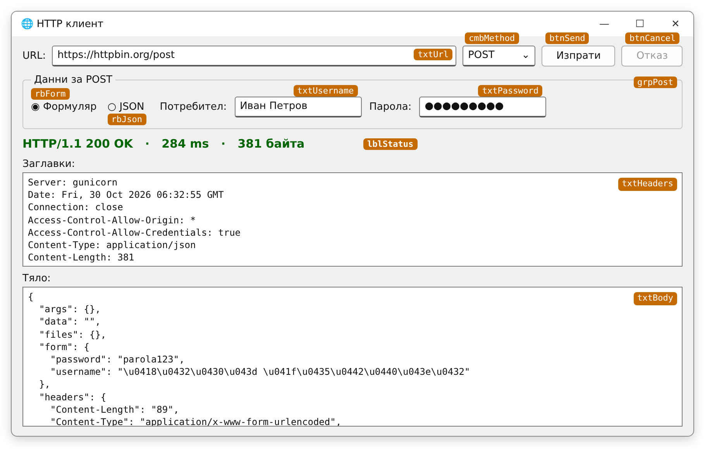

# Упражнение 4. HTTP клиент с графичен интерфейс (Windows Forms)

**Учебна практика:** Интернет програмиране · **Клас:** XII · **Раздел 1:** Въведение в интернет, мрежови протоколи и модел „Клиент–сървър“ · **Продължителност:** 2 учебни часа (90 минути)

!!! abstract "Практически казус"
    В упражнение 3 написахте конзолен HTTP клиент. Потребителите обаче предпочитат прозорец: поле за адрес, падащо меню за метода, бутон **Изпрати** и прегледно показан отговор. Сега пренасяте **същата логика** в приложение с Windows Forms – стъпка по стъпка, като след всяка мисия приложението работи и може повече.

**Връзка с практиката:** [Упражнение 3. HTTP GET и POST заявки с C# — конзолно приложение](uprazhnenie-urok-02-csharp-http.md) – класовете `HttpClient`, `HttpResponseMessage`, `FormUrlEncodedContent` и `StringContent` се използват без промяна.

**Връзка с теорията:** [Урок 2. HTTP. Видове HTTP заявки](../../teoria/razdel-1/urok-02-http-vidove-zayavki.md).

## Цели на упражнението

След упражнението ученикът трябва да може да:

- проектира форма с контроли за HTTP заявка и за показване на отговора;
- изпраща HTTP заявки от асинхронен обработчик на събитие (`async void`), без прозорецът да замръзва;
- изпраща GET и POST заявки (формуляр и JSON) според избора на потребителя;
- показва статус, заглавки и тяло на отговора в контролите на формата;
- обработва грешки и отказва заявка с `CancellationTokenSource`.

## Необходими инструменти

- **Visual Studio 2026** с работното натоварване **.NET desktop development** и **.NET 10**.
- Завършено [упражнение 3](uprazhnenie-urok-02-csharp-http.md) – оттам ще копирате методите за създаване на тялото на заявката.
- Достъп до [httpbin.org](https://httpbin.org) (резервно: `postman-echo.com`).

!!! warning "Правила за работа"
    Изпращай заявки само към посочените тестови адреси и въвеждай **измислена** парола – тестовата услуга я връща в отговора.

## План на работа

| Етап | Време |
|---|---:|
| **Първи учебен час** | |
| Мисия 1. Проект и форма | 20 мин |
| Мисия 2. Първа GET заявка от бутона | 15 мин |
| Мисия 3. Статус в цвят и заглавки | 10 мин |
| **Втори учебен час** | |
| Мисия 4. POST заявка – формуляр и JSON | 20 мин |
| Мисия 5. Грешки и бутон „Отказ“ | 15 мин |
| Самостоятелни задачи, проверка и предаване | 10 мин |

## 1. Мисия 1 — Проект и форма (20 мин)

### 1.1. Създаване на проекта

1. **Create a new project** → шаблон **Windows Forms App** за **C#** (не *Windows Forms App (.NET Framework)*).
2. Име: `HttpKlientGui`. **Framework:** .NET 10.0 (Long Term Support).
3. Във формата `Form1` задайте `Text` = `HTTP клиент` и `Size` = `920; 700`.

<!-- СНИМКА (Visual Studio 2026): images/razdel-1/uprazhnenie-urok-02-csharp/vs2026-04-winforms-designer.png – дизайнерът с празната Form1 и Toolbox -->

### 1.2. Контролите

Ето как ще изглежда приложението след упражнението:



*Макет на формата. Оранжевите етикети показват свойството **Name** на всяка контрола – те не са част от прозореца.*

От **Toolbox** добавете контролите отгоре надолу и задайте свойствата им в прозореца **Properties**. Името (**Name**) е важно – кодът използва точно тези имена.

| Контрола | Name | Свойства |
|---|---|---|
| `Label` | – | `Text` = `URL:` |
| `TextBox` | `txtUrl` | `Text` = `https://httpbin.org/get` |
| `ComboBox` | `cmbMethod` | `DropDownStyle` = `DropDownList`; `Items`: `GET` и `POST` (всеки на отделен ред) |
| `Button` | `btnSend` | `Text` = `Изпрати` |
| `Button` | `btnCancel` | `Text` = `Отказ` |
| `GroupBox` | `grpPost` | `Text` = `Данни за POST` |
| `RadioButton` в `grpPost` | `rbForm` | `Text` = `Формуляр` |
| `RadioButton` в `grpPost` | `rbJson` | `Text` = `JSON` |
| `Label` + `TextBox` в `grpPost` | `txtUsername` | `Label`: `Text` = `Потребител:` |
| `Label` + `TextBox` в `grpPost` | `txtPassword` | `UseSystemPasswordChar` = `True`; `Label`: `Text` = `Парола:` |
| `Label` | `lblStatus` | `Text` = празно; `Font` → удебелен, 12 pt; `AutoSize` = `False`; `AutoEllipsis` = `True`; `Size` ≈ `712; 29` при форма с клиентска ширина 900 px |
| `Label` | – | `Text` = `Заглавки:` |
| `TextBox` | `txtHeaders` | `Multiline` = `True`; `ReadOnly` = `True`; `ScrollBars` = `Both`; `WordWrap` = `False`; `Font` = `Consolas`, 10 pt |
| `Label` | – | `Text` = `Тяло:` |
| `TextBox` | `txtBody` | същите свойства като `txtHeaders` |

!!! tip "Как се правят нещата в дизайнера"
    - **Радиобутоните** в една и съща група (`GroupBox`) се изключват взаимно – може да е избран само един.
    - **Items** на `ComboBox`: в **Properties** натиснете `...` до `Items` и въведете стойностите на отделни редове.
    - За да се разпъват полетата заедно с прозореца, задайте `Anchor` = `Top, Left, Right` на `txtUrl` и `txtHeaders` и `Top, Bottom, Left, Right` на `txtBody`.
    - За `lblStatus` задайте `AutoSize = False`, `AutoEllipsis = True`, `Anchor = Top, Left, Right` и ограничете ширината му така, че да остава разстояние до бутона **Отказ**. При малък прозорец проверете дали текстът не се припокрива. Тези свойства се задават през **Properties**, без ръчно редактиране на `Form1.Designer.cs`.

### 1.3. Обработчици на събития

**Щракнете два пъти** върху бутона `btnSend` – Visual Studio създава метода `btnSend_Click` в `Form1.cs` и го свързва със събитието `Click` (връзката се записва във файла `Form1.Designer.cs`, който не редактирате ръчно). Обработчиците за `cmbMethod` и `btnCancel` ще създадете по същия начин в Мисия 4 и 5.

!!! note "Подписът на обработчика"
    Visual Studio може да създаде обработчика като `(object sender, EventArgs e)` или като `(object? sender, EventArgs e)`. И двата варианта работят. В примерите по-долу е `object?` – ако копирате кода, запазете подписа, който е създал Visual Studio.

Стартирайте (**F5**) – прозорецът се показва, но бутоните още не правят нищо.

## 2. Мисия 2 — Първа GET заявка от бутона (15 мин)

Отворете кода на формата (**F7**) и заменете съдържанието на `Form1.cs` със следния код:

```csharp
using System.Diagnostics;   // Stopwatch – измерване на времето
using System.Text;          // Encoding, StringBuilder

namespace HttpKlientGui;

public partial class Form1 : Form
{
    // Един HttpClient за цялото приложение
    private static readonly HttpClient client = new HttpClient
    {
        Timeout = TimeSpan.FromSeconds(5)
    };

    public Form1()
    {
        InitializeComponent();
    }

    private async void btnSend_Click(object? sender, EventArgs e)
    {
        if (!Uri.TryCreate(txtUrl.Text.Trim(), UriKind.Absolute, out Uri? uri) ||
            (uri.Scheme != Uri.UriSchemeHttp && uri.Scheme != Uri.UriSchemeHttps))
        {
            MessageBox.Show("Невалиден адрес. Пример: https://httpbin.org/get", "Грешка",
                MessageBoxButtons.OK, MessageBoxIcon.Warning);
            return;
        }

        lblStatus.Text = "Изпращане...";
        txtBody.Clear();

        Stopwatch stopwatch = Stopwatch.StartNew();
        using HttpResponseMessage response = await client.GetAsync(uri);
        stopwatch.Stop();

        byte[] bodyBytes = await response.Content.ReadAsByteArrayAsync();

        lblStatus.Text = $"HTTP/{response.Version} {(int)response.StatusCode} {response.ReasonPhrase}" +
                         $"   ·   {stopwatch.ElapsedMilliseconds} ms   ·   {bodyBytes.Length} байта";
        txtBody.Text = Encoding.UTF8.GetString(bodyBytes).ReplaceLineEndings("\r\n");
    }
}
```

Стартирайте, изберете `GET` и натиснете **Изпрати**.

**Какво е новото спрямо конзолата?**

| Конзолно приложение | Графично приложение |
|---|---|
| Данните се въвеждат с `Console.ReadLine()` | Данните се четат от свойството `Text` на контролите – `txtUrl.Text` |
| Програмата се движи в цикъл `while` | Програмата чака **събитие** – щракване на бутона |
| `static async Task SendGetRequest(...)` | `private async void btnSend_Click(...)` |
| Резултатът се извежда с `Console.WriteLine` | Резултатът се записва в `lblStatus.Text` и `txtBody.Text` |
| Грешният адрес се съобщава в конзолата | Показва се прозорец със съобщение – `MessageBox.Show` |

- **`async void`** се използва **само** за обработчици на събития, защото подписът им е зададен от Windows Forms. Във всички други асинхронни методи връщайте `Task`.
- **Прозорецът не замръзва.** Докато `await` чака отговора, нишката на интерфейса е свободна – прозорецът се премества, а бутоните реагират. След отговора кодът продължава в **същата** нишка, затова може да променя контролите директно.

!!! note "Защо е нужно ReplaceLineEndings?"
    Многоредовият `TextBox` в Windows Forms приема за край на реда само двойката знаци `\r\n`. Ако текстът е разделен само със `\n`, всичко се показва на **един** ред. Сървърите често разделят редовете на JSON само със `\n` – така прави и httpbin. `ReplaceLineEndings("\r\n")` уеднаквява всички краища на редове: заменя `\n` и `\r` с `\r\n`, а вече правилните `\r\n` оставя. Затова замяната е безопасна независимо какво е изпратил сървърът. (`RichTextBox` разпознава и `\n`, но при `TextBox` замяната е нужна.)

!!! question "Опит: какво става, ако не използваме `await`?"
    Сменете временно адреса на `https://httpbin.org/delay/3` и реда със заявката на:

    `using HttpResponseMessage response = client.GetAsync(uri).Result;`

    Натиснете **Изпрати** и веднага опитайте да преместите прозореца. Какво наблюдавате? Върнете `await` и повторете. Запишете разликата в протокола.

## 3. Мисия 3 — Статус в цвят и заглавки (10 мин)

**Стъпка 1.** Заменете метода `btnSend_Click` с тази версия. Новите редове са четири: два за цвета на `lblStatus` (черен при изпращане, зелен или червен след отговора) и два за `txtHeaders` (изчистване и попълване).

```csharp
    private async void btnSend_Click(object? sender, EventArgs e)
    {
        if (!Uri.TryCreate(txtUrl.Text.Trim(), UriKind.Absolute, out Uri? uri) ||
            (uri.Scheme != Uri.UriSchemeHttp && uri.Scheme != Uri.UriSchemeHttps))
        {
            MessageBox.Show("Невалиден адрес. Пример: https://httpbin.org/get", "Грешка",
                MessageBoxButtons.OK, MessageBoxIcon.Warning);
            return;
        }

        lblStatus.Text = "Изпращане...";
        lblStatus.ForeColor = Color.Black;
        txtHeaders.Clear();
        txtBody.Clear();

        Stopwatch stopwatch = Stopwatch.StartNew();
        using HttpResponseMessage response = await client.GetAsync(uri);
        stopwatch.Stop();

        byte[] bodyBytes = await response.Content.ReadAsByteArrayAsync();

        lblStatus.Text = $"HTTP/{response.Version} {(int)response.StatusCode} {response.ReasonPhrase}" +
                         $"   ·   {stopwatch.ElapsedMilliseconds} ms   ·   {bodyBytes.Length} байта";
        lblStatus.ForeColor = response.IsSuccessStatusCode ? Color.DarkGreen : Color.Firebrick;

        txtHeaders.Text = FormatHeaders(response);
        txtBody.Text = Encoding.UTF8.GetString(bodyBytes).ReplaceLineEndings("\r\n");
    }
```

**Стъпка 2.** Добавете метода `FormatHeaders` след `btnSend_Click`:

```csharp
    // Събира заглавките на отговора и на съдържанието в един текст
    private static string FormatHeaders(HttpResponseMessage response)
    {
        StringBuilder sb = new StringBuilder();

        foreach (var header in response.Headers)
            sb.AppendLine($"{header.Key}: {string.Join(", ", header.Value)}");

        foreach (var header in response.Content.Headers)
            sb.AppendLine($"{header.Key}: {string.Join(", ", header.Value)}");

        return sb.ToString();
    }
```

`FormatHeaders` прави същото като частта за заглавките в `PrintResponse` от упражнение 3, но вместо да извежда на конзолата, събира редовете в `StringBuilder` и връща един текст. `AppendLine` добавя `Environment.NewLine` – в Windows това е `\r\n`, затова тук не е нужна замяна.

Проверете с `https://httpbin.org/get` и `https://httpbin.org/status/404`. В какъв цвят е статусът? Коя заглавка от отговора на 404 показва дължината на тялото?

## 4. Мисия 4 — POST заявка: формуляр и JSON (20 мин)

**Стъпка 1.** В началото на файла добавете `using System.Text.Json;`. Щракнете два пъти върху `cmbMethod` в дизайнера – създава се `cmbMethod_SelectedIndexChanged`. Допълнете конструктора и обработчика така:

```csharp
    public Form1()
    {
        InitializeComponent();
        cmbMethod.SelectedIndex = 0;   // GET по подразбиране
        grpPost.Enabled = false;       // полетата за POST са неактивни при GET
        rbForm.Checked = true;         // формат по подразбиране – формуляр
    }

    private void cmbMethod_SelectedIndexChanged(object? sender, EventArgs e)
    {
        grpPost.Enabled = cmbMethod.Text == "POST";
    }
```

**Стъпка 2.** Копирайте от упражнение 3 методите `CreateFormContent` и `CreateJsonContent` и ги поставете след `btnSend_Click`. Сменете думата `static` с `private static`:

```csharp
    // Тяло във формат application/x-www-form-urlencoded – като HTML формуляр
    private static HttpContent CreateFormContent(string username, string password)
    {
        return new FormUrlEncodedContent(new[]
        {
            new KeyValuePair<string, string>("username", username),
            new KeyValuePair<string, string>("password", password)
        });
    }

    // Тяло във формат application/json
    private static HttpContent CreateJsonContent(string username, string password)
    {
        string json = JsonSerializer.Serialize(new { username = username, password = password });
        return new StringContent(json, Encoding.UTF8, "application/json");
    }
```

**Стъпка 3.** Добавете метод, който изпраща GET или POST според избора във формата:

```csharp
    // Изпраща GET или POST заявка според избора във формата
    private async Task<HttpResponseMessage> SendRequestAsync(Uri uri)
    {
        if (cmbMethod.Text == "POST")
        {
            using HttpContent content = rbJson.Checked
                ? CreateJsonContent(txtUsername.Text, txtPassword.Text)
                : CreateFormContent(txtUsername.Text, txtPassword.Text);

            return await client.PostAsync(uri, content);
        }

        return await client.GetAsync(uri);
    }
```

**Стъпка 4.** В `btnSend_Click` заменете реда

```csharp
        using HttpResponseMessage response = await client.GetAsync(uri);
```

с

```csharp
        using HttpResponseMessage response = await SendRequestAsync(uri);
```

**Как работи?**

- `SendRequestAsync` връща `Task<HttpResponseMessage>` – асинхронен метод, който **връща резултат**. Затова го извикваме с `await`, както `GetAsync`.
- При POST тялото се създава според избрания радиобутон. И двата метода връщат `HttpContent`, затова условният оператор `? :` може да избере между тях.
- `using HttpContent content` освобождава тялото, когато методът приключи.
- `grpPost.Enabled = cmbMethod.Text == "POST";` – полетата за POST са активни само когато е избран POST.

Изпратете към `https://httpbin.org/post` едни и същи данни веднъж като **Формуляр** и веднъж като **JSON**. В кое поле на отговора са данните всеки път (`form` или `json`)? Каква е големината на тялото на отговора?

## 5. Мисия 5 — Грешки и бутон „Отказ“ (15 мин)

Опитайте `https://nyama-takav-sarvar.bg/` и `https://httpbin.org/delay/8`. Изключението не е обработено: при стартиране от Visual Studio изпълнението спира на реда със заявката, а без дебъгер Windows Forms показва прозорец за необработена грешка – както конзолното приложение преди Мисия 5 от упражнение 3. Освен това потребителят не може да откаже заявка, която чака дълго.

**Стъпка 1.** Добавете поле след `client`:

```csharp
    // Позволява да откажем заявката, докато чакаме отговора
    private CancellationTokenSource? cts;
```

и в края на конструктора:

```csharp
        btnCancel.Enabled = false;
```

**Стъпка 2.** Уверете се, че `lblStatus` е с ограничена ширина и `AutoEllipsis = True` (виж Мисия 1). Щракнете два пъти върху бутона `btnCancel` в дизайнера – създава се `btnCancel_Click`. Заменете `btnSend_Click` с окончателната версия и попълнете `btnCancel_Click`:

```csharp
    private async void btnSend_Click(object? sender, EventArgs e)
    {
        if (!Uri.TryCreate(txtUrl.Text.Trim(), UriKind.Absolute, out Uri? uri) ||
            (uri.Scheme != Uri.UriSchemeHttp && uri.Scheme != Uri.UriSchemeHttps))
        {
            MessageBox.Show("Невалиден адрес. Пример: https://httpbin.org/get", "Грешка",
                MessageBoxButtons.OK, MessageBoxIcon.Warning);
            return;
        }

        btnSend.Enabled = false;            // не позволяваме втора заявка, докато чакаме
        btnCancel.Enabled = true;
        cts = new CancellationTokenSource();

        lblStatus.Text = "Изпращане...";
        lblStatus.ForeColor = Color.Black;
        txtHeaders.Clear();
        txtBody.Clear();

        try
        {
            Stopwatch stopwatch = Stopwatch.StartNew();
            using HttpResponseMessage response = await SendRequestAsync(uri, cts.Token);
            stopwatch.Stop();

            byte[] bodyBytes = await response.Content.ReadAsByteArrayAsync(cts.Token);

            lblStatus.Text = $"HTTP/{response.Version} {(int)response.StatusCode} {response.ReasonPhrase}" +
                             $"   ·   {stopwatch.ElapsedMilliseconds} ms   ·   {bodyBytes.Length} байта";
            lblStatus.ForeColor = response.IsSuccessStatusCode ? Color.DarkGreen : Color.Firebrick;

            txtHeaders.Text = FormatHeaders(response);
            txtBody.Text = Encoding.UTF8.GetString(bodyBytes).ReplaceLineEndings("\r\n");
        }
        catch (HttpRequestException ex)
        {
            string summary = ex.HttpRequestError == HttpRequestError.NameResolutionError
                ? "Сървърът не е намерен. Проверете адреса."
                : "Неуспешна връзка със сървъра.";
            ShowError(summary, ex);
        }
        catch (OperationCanceledException ex) when (cts?.IsCancellationRequested == true)
        {
            ShowError("Заявката е отказана.", ex);
        }
        catch (OperationCanceledException ex)
        {
            ShowError($"Изтече времето за отговор ({client.Timeout.TotalSeconds:0} сек.).", ex);
        }
        finally
        {
            // изпълнява се винаги – и при успех, и при грешка
            cts.Dispose();
            cts = null;
            btnSend.Enabled = true;
            btnCancel.Enabled = false;
        }
    }

    private void btnCancel_Click(object? sender, EventArgs e)
    {
        cts?.Cancel();
    }
```

**Стъпка 3.** Предайте „жетона за отказ“ на заявките. Заменете `SendRequestAsync`:

```csharp
    // Изпраща GET или POST заявка според избора във формата
    private async Task<HttpResponseMessage> SendRequestAsync(Uri uri, CancellationToken token)
    {
        if (cmbMethod.Text == "POST")
        {
            using HttpContent content = rbJson.Checked
                ? CreateJsonContent(txtUsername.Text, txtPassword.Text)
                : CreateFormContent(txtUsername.Text, txtPassword.Text);

            return await client.PostAsync(uri, content, token);
        }

        return await client.GetAsync(uri, token);
    }
```

**Стъпка 4.** Добавете метода за показване на грешка. Краткото обяснение се показва в `lblStatus`, а техническите подробности — в `txtBody`:

```csharp
    private void ShowError(string summary, Exception exception)
    {
        lblStatus.Text = summary;
        lblStatus.ForeColor = Color.Firebrick;
        txtBody.Text = exception.ToString().ReplaceLineEndings("\r\n");
    }
```

**Как работи отказът?**

`OperationCanceledException` е общият тип за отменена операция, а `TaskCanceledException` е негов наследник. Подаваме `cts.Token` и при четенето на тялото, за да може отказът да прекъсне и този етап. Методът `ShowError` не показва целия технически текст в етикета, защото той може да излезе извън прозореца.

| Елемент | Роля |
|---|---|
| `CancellationTokenSource cts` | „Дистанционно“ за отказ. Създава се ново за всяка заявка. |
| `cts.Token` | „Жетонът“, който се подава на `GetAsync`/`PostAsync`. Заявката периодично проверява дали е поискан отказ. |
| `cts.Cancel()` | Натискането на **Отказ** иска прекратяване – `await` може да завърши с `OperationCanceledException` (или негов наследник). |
| `catch (OperationCanceledException) when (cts?.IsCancellationRequested == true)` | **Филтър на изключението**: този `catch` се изпълнява само ако отказът е поискан от потребителя. Ако отказ не е поискан, следващият `catch` обработва прекратяването като изтекъл `Timeout` в рамките на тази задача. |
| `finally` | Изпълнява се винаги: освобождава `cts` и връща бутоните в изходно състояние. |
| `btnSend.Enabled = false` | Не позволява втора заявка, докато първата не е завършила. |

**Проверете** четирите случая и запишете резултата в протокола:

| Адрес | Действие | Очакван резултат |
|---|---|---|
| `https://httpbin.org/status/404` | Изпрати | Статус в червено, без изключение |
| `https://nyama-takav-sarvar.bg/` | Изпрати | `Сървърът не е намерен. Проверете адреса.`; технически подробности в `txtBody` |
| `https://httpbin.org/delay/8` | Изпрати и изчакайте | `Изтече времето за отговор (5 сек.).` |
| `https://httpbin.org/delay/8` | Изпрати и веднага **Отказ** | `Заявката е отказана.` |

## 6. Пълният код на формата

```csharp
using System.Diagnostics;   // Stopwatch – измерване на времето
using System.Text;          // Encoding, StringBuilder
using System.Text.Json;     // JsonSerializer

namespace HttpKlientGui;

public partial class Form1 : Form
{
    // Един HttpClient за цялото приложение
    private static readonly HttpClient client = new HttpClient
    {
        Timeout = TimeSpan.FromSeconds(5)
    };

    // Позволява да откажем заявката, докато чакаме отговора
    private CancellationTokenSource? cts;

    public Form1()
    {
        InitializeComponent();
        cmbMethod.SelectedIndex = 0;   // GET по подразбиране
        grpPost.Enabled = false;       // полетата за POST са неактивни при GET
        rbForm.Checked = true;         // формат по подразбиране – формуляр
        btnCancel.Enabled = false;
    }

    private void cmbMethod_SelectedIndexChanged(object? sender, EventArgs e)
    {
        grpPost.Enabled = cmbMethod.Text == "POST";
    }

    private async void btnSend_Click(object? sender, EventArgs e)
    {
        if (!Uri.TryCreate(txtUrl.Text.Trim(), UriKind.Absolute, out Uri? uri) ||
            (uri.Scheme != Uri.UriSchemeHttp && uri.Scheme != Uri.UriSchemeHttps))
        {
            MessageBox.Show("Невалиден адрес. Пример: https://httpbin.org/get", "Грешка",
                MessageBoxButtons.OK, MessageBoxIcon.Warning);
            return;
        }

        btnSend.Enabled = false;            // не позволяваме втора заявка, докато чакаме
        btnCancel.Enabled = true;
        cts = new CancellationTokenSource();

        lblStatus.Text = "Изпращане...";
        lblStatus.ForeColor = Color.Black;
        txtHeaders.Clear();
        txtBody.Clear();

        try
        {
            Stopwatch stopwatch = Stopwatch.StartNew();
            using HttpResponseMessage response = await SendRequestAsync(uri, cts.Token);
            stopwatch.Stop();

            byte[] bodyBytes = await response.Content.ReadAsByteArrayAsync(cts.Token);

            lblStatus.Text = $"HTTP/{response.Version} {(int)response.StatusCode} {response.ReasonPhrase}" +
                             $"   ·   {stopwatch.ElapsedMilliseconds} ms   ·   {bodyBytes.Length} байта";
            lblStatus.ForeColor = response.IsSuccessStatusCode ? Color.DarkGreen : Color.Firebrick;

            txtHeaders.Text = FormatHeaders(response);
            txtBody.Text = Encoding.UTF8.GetString(bodyBytes).ReplaceLineEndings("\r\n");
        }
        catch (HttpRequestException ex)
        {
            string summary = ex.HttpRequestError == HttpRequestError.NameResolutionError
                ? "Сървърът не е намерен. Проверете адреса."
                : "Неуспешна връзка със сървъра.";
            ShowError(summary, ex);
        }
        catch (OperationCanceledException ex) when (cts?.IsCancellationRequested == true)
        {
            ShowError("Заявката е отказана.", ex);
        }
        catch (OperationCanceledException ex)
        {
            ShowError($"Изтече времето за отговор ({client.Timeout.TotalSeconds:0} сек.).", ex);
        }
        finally
        {
            // изпълнява се винаги – и при успех, и при грешка
            cts.Dispose();
            cts = null;
            btnSend.Enabled = true;
            btnCancel.Enabled = false;
        }
    }

    private void btnCancel_Click(object? sender, EventArgs e)
    {
        cts?.Cancel();
    }

    // Изпраща GET или POST заявка според избора във формата
    private async Task<HttpResponseMessage> SendRequestAsync(Uri uri, CancellationToken token)
    {
        if (cmbMethod.Text == "POST")
        {
            using HttpContent content = rbJson.Checked
                ? CreateJsonContent(txtUsername.Text, txtPassword.Text)
                : CreateFormContent(txtUsername.Text, txtPassword.Text);

            return await client.PostAsync(uri, content, token);
        }

        return await client.GetAsync(uri, token);
    }

    // Тяло във формат application/x-www-form-urlencoded – като HTML формуляр
    private static HttpContent CreateFormContent(string username, string password)
    {
        return new FormUrlEncodedContent(new[]
        {
            new KeyValuePair<string, string>("username", username),
            new KeyValuePair<string, string>("password", password)
        });
    }

    // Тяло във формат application/json
    private static HttpContent CreateJsonContent(string username, string password)
    {
        string json = JsonSerializer.Serialize(new { username = username, password = password });
        return new StringContent(json, Encoding.UTF8, "application/json");
    }

    // Събира заглавките на отговора и на съдържанието в един текст
    private static string FormatHeaders(HttpResponseMessage response)
    {
        StringBuilder sb = new StringBuilder();

        foreach (var header in response.Headers)
            sb.AppendLine($"{header.Key}: {string.Join(", ", header.Value)}");

        foreach (var header in response.Content.Headers)
            sb.AppendLine($"{header.Key}: {string.Join(", ", header.Value)}");

        return sb.ToString();
    }

    private void ShowError(string summary, Exception exception)
    {
        lblStatus.Text = summary;
        lblStatus.ForeColor = Color.Firebrick;
        txtBody.Text = exception.ToString().ReplaceLineEndings("\r\n");
    }
}
```

## 7. Самостоятелни задачи

Изпълнете поне **една** задача.

1. **Бутон по подразбиране.** Задайте на формата `AcceptButton` = `btnSend`, за да се изпраща заявката с клавиша **Enter**.
2. **История.** Добавете `ListBox` `lstHistory`. След всеки отговор добавяйте ред `часът  метод  адрес  статус` (`DateTime.Now.ToString("HH:mm:ss")`). При двойно щракване върху ред – попълнете `txtUrl` с адреса.
3. **Записване на тялото.** Добавете бутон **Запиши…**, който с `SaveFileDialog` записва `txtBody.Text` във файл (`File.WriteAllText`).
4. **PUT и DELETE.** Добавете `PUT` и `DELETE` в `cmbMethod` и ги обработете в `SendRequestAsync` с `client.PutAsync` (с тяло) и `client.DeleteAsync`.

## 8. Предаване

1. Затворете Visual Studio. От папката на проекта `HttpKlientGui` **изтрийте** подпапките `bin` и `obj`.
2. Архивирайте папката в ZIP файл: `HttpKlientGui-<име>-<фамилия>.zip`.
3. Предайте ZIP файла и протокола. В протокола трябва да има **екранни снимки** на прозореца след POST като формуляр, след POST като JSON и след отказана заявка, както и отговорът на опита с `.Result` от Мисия 2.

!!! success "Готов си, когато…"
    Приложението изпраща GET и POST (формуляр и JSON), показва статуса в цвят, заглавките и тялото на отделни редове, не замръзва по време на заявка, не спира при грешка и позволява отказ на заявката.

## Проверка на знанията

1. Защо обработчикът `btnSend_Click` е `async void`, а `SendRequestAsync` връща `Task<HttpResponseMessage>`?
2. Какво се случва с прозореца при `.Result` и защо при `await` това не става?
3. Защо след `await` кодът може да променя контролите на формата директно?
4. Кога е нужно `ReplaceLineEndings("\r\n")` и кога не?
5. Как приложението различава отказ от потребителя от изтекъл `Timeout`?
6. Защо бутонът **Изпрати** е неактивен по време на заявката и къде се активира отново?

## Оценяване — 12 точки

| Критерий | Точки |
|---|---:|
| Мисия 1 — форма с всички контроли, правилни имена и свойства | 2 |
| Мисия 2 — GET заявка от `async` обработчик; обяснен опитът с `.Result` | 2 |
| Мисия 3 — статус в цвят, заглавки и тяло на отделни редове | 2 |
| Мисия 4 — POST като формуляр и като JSON според избора | 2 |
| Мисия 5 — обработка на грешките, `finally` и работещ бутон **Отказ** | 2 |
| Самостоятелна задача и протокол с екранни снимки | 2 |
| **Общо** | **12** |

## Ключови понятия

**Windows Forms**, **контрола**, **събитие**, **обработчик на събитие**, **`async void`**, **`Task<T>`**, **нишка на интерфейса**, **`MessageBox`**, **`StringBuilder`**, **`CancellationTokenSource`**, **`CancellationToken`**, **филтър на изключение (`when`)**, **`finally`**.

!!! note "За учителя"
    Упражнението е за **Visual Studio 2026 и .NET 10** и изисква Windows. Предходната версия на приложението е проверена на реален Windows компютър с GET, POST (формуляр и JSON), 404, DNS грешка, изтекло време и отказ. Окончателният код е компилиран с .NET 10 без грешки и предупреждения, а сценариите GET, POST (формуляр и JSON), 404, изтекло време, отказ и невалиден адрес са проверени автоматично, без реален прозорец. Преди часа пуснете окончателния вариант веднъж на училищен компютър. Макетът на формата е схема, а не екранна снимка – в текста има коментар `<!-- СНИМКА ... -->` за снимка на дизайнера от Visual Studio 2026. Ако времето не стига, Мисия 5 може да се ограничи до `try`–`catch`–`finally` без бутона **Отказ**.

[Към Раздел 1 на практиката](index.md) · [Към началото на модула](../index.md)
