# Практическо упражнение 2. Изпращане и анализ на HTTP заявки с Postman

> **Статус:** Работна версия — актуализирана с проверените екрани 1–23 от Postman. Мисии 1–5 са изпълнени; Мисия 6 включва потвърдени статуси 404 и 500, предстои 201.
>
> **Продължителност:** 2 учебни часа (2 × 45 минути)  
> **Предмет:** Интернет програмиране, 12. клас  
> **Раздел:** Въведение в Интернет, мрежови протоколи и модел „Клиент–сървър“

## Цели на упражнението

След упражнението ученикът трябва да може да:

- организира HTTP заявки в работно пространство (**Workspace**) и колекция (**Collection**) в Postman;
- създава, изпраща и запазва HTTP заявки;
- използва методите GET, POST, PUT и DELETE;
- задава URL параметри, HTTP заглавки и JSON тяло;
- разчита HTTP статус кодове и анализира отговорите на сървъра;
- сравнява съдържанието на заявка и отговор.

## 1. Подготовка на работната среда

### 1.1. Стартиране на Postman и вход

1. Стартирайте инсталираното приложение **Postman**.
2. Ако приложението изисква вход, използвайте съществуващ профил или следвайте указанията на учителя за създаване на профил.
3. Проверете кое работно пространство е отворено — името му се вижда горе вляво.

> **Важно:** Ако вече виждате **My Workspace**, не е необходимо да създавате ново работно пространство.

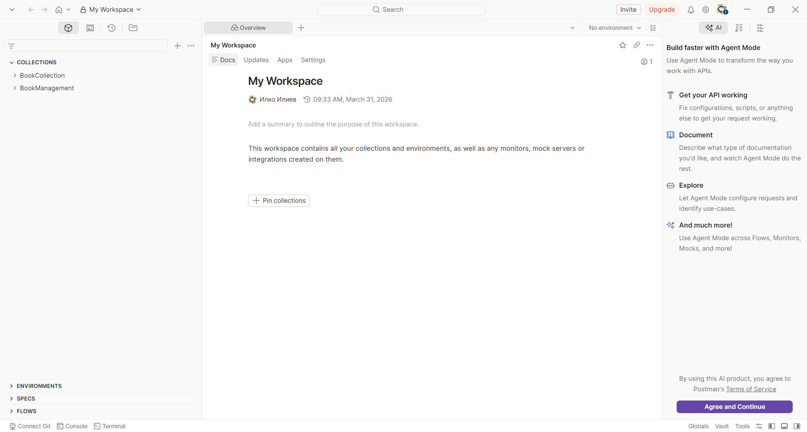

*Фигура 1. Начален екран на Postman — работно пространство My Workspace и панел Collections.*

> **Забележка:** На снимката се виждат колекции от предишни проекти (`BookCollection` и `BookManagement`). При първо стартиране списъкът може да е празен.

### 1.2. Проверка или създаване на Workspace

**Вариант А — вече имате My Workspace:** използвайте го и продължете към т. 1.3.

**Вариант Б — нямате Workspace:**

1. Отворете менюто за избор на работно пространство в горната лява част на Postman.
2. Изберете командата за създаване на ново работно пространство (надписът може да се различава според версията).
3. Въведете име `Internet Programming - 12 Class`.
4. Изберете личен/частен достъп, ако интерфейсът предлага такава възможност и тя е разрешена за профила ви.
5. Потвърдете създаването.

<!-- TODO: При възможност да се добави снимка от създаването на нов Workspace. -->

### 1.3. Създаване на Collection

В Postman колекцията е организирана група от запазени HTTP заявки. За упражнението ще създадем отделна колекция, за да не смесваме заявките с други проекти.

1. В лявата част намерете **COLLECTIONS**.
2. Натиснете бутона **+** над списъка с колекциите.
3. В отвореното меню изберете **Collection**.

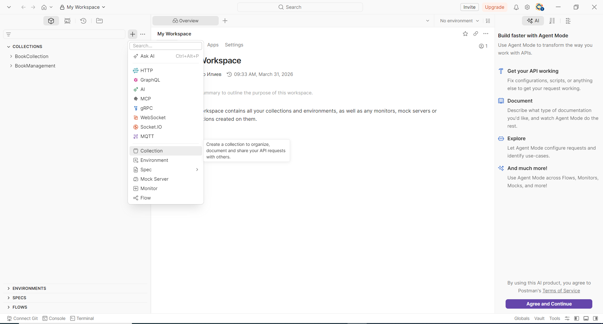

*Фигура 2. Избор на командата Collection от менюто на бутона +.*

4. Postman създава колекция с временно име **New Collection**. Името е маркирано и може да бъде заменено.

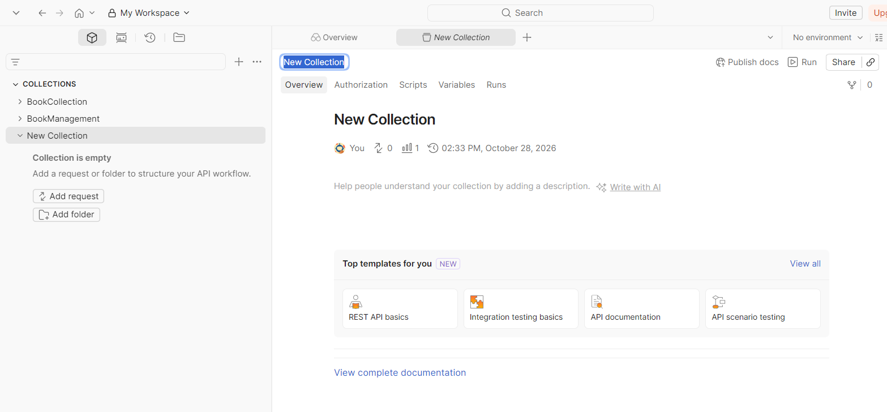

*Фигура 3. Новосъздадена колекция — редактиране на името New Collection.*

5. Въведете **`HTTP Requests - Exercise 2`** и натиснете **Enter**.
6. Уверете се, че колекцията се вижда вляво, под **COLLECTIONS**.

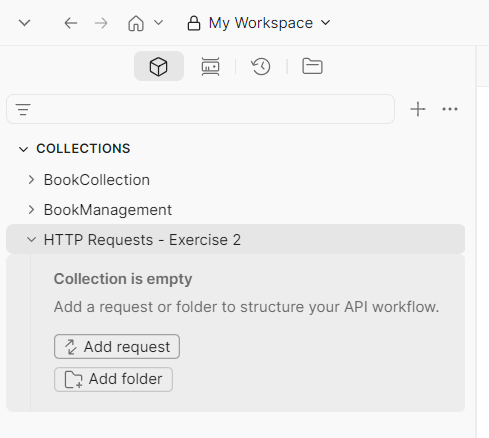

*Фигура 4. Колекцията HTTP Requests - Exercise 2 е създадена и все още е празна.*

### 1.4. Създаване на първата заявка

1. Разгънете колекцията `HTTP Requests - Exercise 2`.
2. Натиснете **Add request**.
3. Отваря се редактор за нова HTTP заявка с временно име **New Request**.

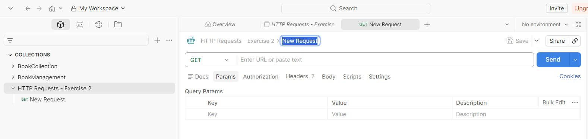

*Фигура 5. Редактор на нова заявка в Postman, преди въвеждане на URL адрес.*

4. Заменете маркираното име **New Request** с **`01 - GET Basic`** и натиснете **Enter**.
5. Уверете се, че е избран метод **GET**.
6. В полето **Enter URL or paste text** въведете `https://httpbin.org/get`.
7. Натиснете **Save**, за да запазите заявката в колекцията.

> **На този етап не натискайте Send.** Първо разгледайте полетата за HTTP метод, URL, параметри, заглавки и тяло.

| Елемент в редактора | Предназначение |
|---|---|
| **GET** (падащо меню) | Избор на HTTP метод |
| **Enter URL or paste text** | Адрес на заявката |
| **Params** | Параметри в URL адреса |
| **Authorization** | Настройки за удостоверяване |
| **Headers** | HTTP заглавки |
| **Body** | Тяло на заявката |
| **Send** | Изпращане на заявката |
| **Save** | Запазване на заявката в колекцията |

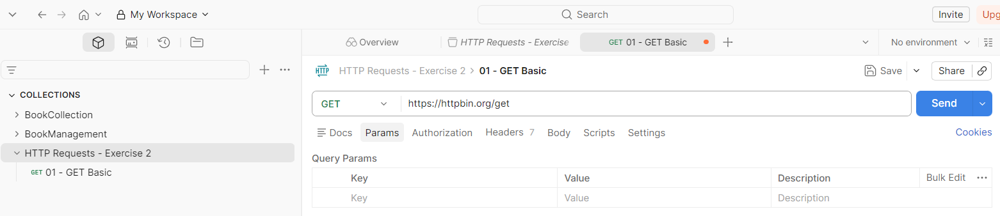

*Фигура 6. Заявката `01 - GET Basic` с избран метод GET и адрес `https://httpbin.org/get`.*

> **Проверка преди изпращане:** Ако до името на заявката има оранжева точка, промените още не са запазени. Натиснете **Save**.

### 1.5. Какво създадохме?

```text
Workspace: My Workspace
└── Collection: HTTP Requests - Exercise 2
    └── Request: 01 - GET Basic
```

| Понятие | Предназначение |
|---|---|
| Workspace | Работно пространство за организиране на дейността |
| Collection | Група свързани, запазени HTTP заявки |
| Request | Конкретна HTTP заявка |
| HTTP Method | Метод на заявката (GET, POST, PUT, DELETE и др.) |
| URL | Адрес на ресурса или услугата |

## 2. Мисия 1 — Първа GET заявка

**Адрес:** `https://httpbin.org/get`

1. Отворете запазената заявка `01 - GET Basic`.
2. Проверете метода **GET** и адреса.
3. Натиснете **Send**.
4. Наблюдавайте статус кода и времето за отговор.
5. Разгледайте JSON отговора: обърнете внимание на `args`, `headers`, `method`, `origin` и `url`.

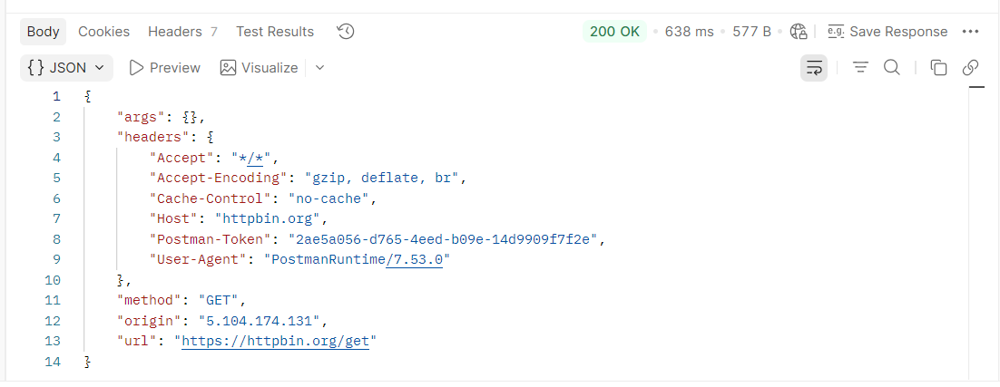

*Фигура 7. Успешна GET заявка — статус `200 OK` и JSON отговор.*

### 2.1. Какво показва Postman?

При проверката на упражнението получихме следните **примерни** резултати (при учениците стойностите може да се различават):

| Показател | Наблюдавана стойност | Значение |
|---|---|---|
| HTTP статус | `200 OK` | Сървърът е обработил успешно заявката |
| Време | `638 ms` | Отчетено време за изпълнение |
| Размер | `577 B` | Размер на отговора, показан от Postman |
| Представяне на тялото | `JSON` | Отговорът е представен като JSON документ |

> **Важно:** Статусът `200 OK` не означава, че е върната HTML страница. HTTP отговорът може да съдържа JSON, HTML, изображение или друг вид данни.

### 2.2. Анализ на JSON отговора

В наблюдавания отговор присъстват следните полета:

| Поле | Значение |
|---|---|
| `args` | URL параметрите на заявката |
| `headers` | Заглавките на заявката, получени от сървъра |
| `method` | Използваният HTTP метод — `GET` |
| `origin` | Публичният IP адрес, който сървърът вижда |
| `url` | Пълният адрес на изпратената заявка |

В нашия пример:

```json
"args": {}
```

Празният обект `{}` означава, че **не са изпратени URL параметри**. В следващата мисия ще добавим такива чрез раздела **Params**.

В `headers` се виждат например `Accept`, `Accept-Encoding`, `Host` и `User-Agent`. Заглавката `User-Agent` указва софтуера, изпратил заявката (в нашия пример — Postman Runtime). Конкретните стойности, токени, IP адреси и времена не са задължително еднакви за всички ученици.

**Въпроси за анализ:**

1. Кой HTTP метод използвахте?
2. Какъв статус код върна сървърът?
3. Защо полето `args` е празно?
4. Каква информация предоставя заглавката `User-Agent`?
5. Означава ли `200 OK`, че сървърът е върнал HTML? Обяснете.
6. Има ли тяло на HTTP отговора?


## 3. Мисия 2 — GET заявка с URL параметри

**Цел:** Да изпратите два параметъра чрез URL и да проверите как сървърът ги получава.

1. В колекцията `HTTP Requests - Exercise 2` натиснете **Add request**.
2. Преименувайте заявката на **`02 - GET Parameters`**. Изберете метод **GET** и адрес `https://httpbin.org/get`.
3. Отворете **Params** и попълнете таблицата:

   | Key | Value |
   |---|---|
   | `student` | `Ivan` |
   | `class` | `12` |

4. Уверете се, че отметките пред двата параметъра са включени. Postman автоматично изгражда URL:

   `https://httpbin.org/get?student=Ivan&class=12`

5. Натиснете **Save**, след това **Send**.

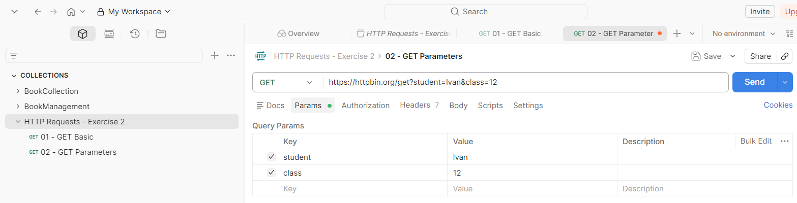

*Фигура 8. Добавяне на параметри към GET заявка чрез раздела Params.*

### 3.1. Как се изгражда URL с параметри?

- `?` поставя началото на **query string** — частта от URL с параметрите.
- `&` разделя двойките `ключ=стойност`.
- Параметрите в URL са видими и не са подходящи за пароли и други чувствителни данни.
- При изключване на отметката пред даден параметър Postman го премахва от изпращаната заявка.

### 3.2. Проверка на отговора

При изпълнението на упражнението сървърът върна **`200 OK`**, време **`536 ms`** и размер **`643 B`**. Тези стойности са примерни и могат да се различават при учениците.

В JSON отговора се появи:

```json
"args": {
  "class": "12",
  "student": "Ivan"
}
```

Редът на полетата може да е различен. Стойността `"12"` е **низ**, защото параметрите от URL се получават като текстови стойности.

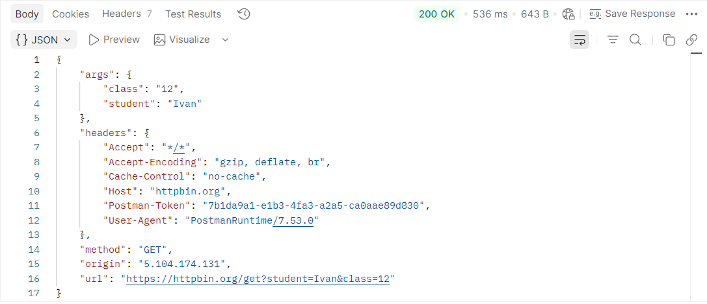

*Фигура 9. HTTP отговор `200 OK` — сървърът връща URL параметрите в полето `args`.*

### 3.3. Сравнение с Мисия 1

| Характеристика | Мисия 1 — GET Basic | Мисия 2 — GET Parameters |
|---|---|---|
| HTTP метод | GET | GET |
| URL параметри | Няма | `student=Ivan`, `class=12` |
| `args` в отговора | `{}` | Обект с двата параметъра |
| HTTP статус при проверката | `200 OK` | `200 OK` |

**Извод:** GET заявка може да изпраща данни чрез параметри в URL. В нашия пример сървърът ги показва в полето `args`.

**Въпроси за анализ:**

1. Какво обозначава символът `?` в URL?
2. За какво служи `&`?
3. Защо `args` е празен обект в Мисия 1?
4. Защо стойността на `class` е `"12"`, а не числото `12`?
5. Какво очаквате да се промени, ако махнете отметката пред `student`? Проверете експериментално, след което върнете отметката.

## 4. Мисия 3 — POST заявка с JSON тяло

**Цел:** Да изпратите структурирани данни в тялото на HTTP заявката и да анализирате как сървърът ги е получил.

### 4.1. Създаване на заявката

1. В колекцията `HTTP Requests - Exercise 2` изберете **Add request**.
2. Преименувайте заявката на **`03 - POST JSON`**.
3. От падащото меню за HTTP метода изберете **POST** (вместо GET).
4. Въведете URL `https://httpbin.org/post` и натиснете **Save**.

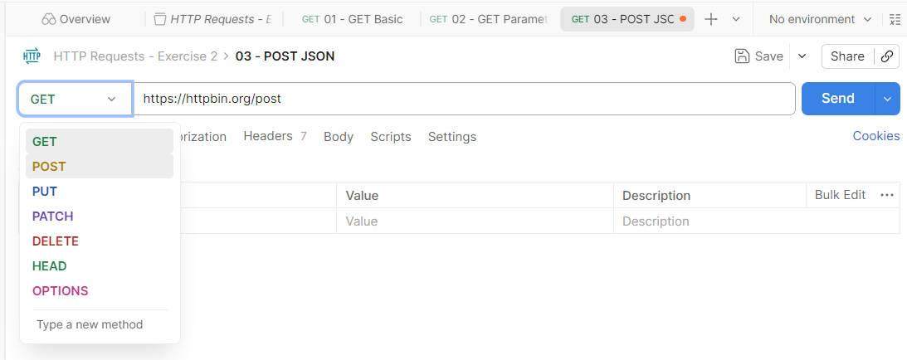

*Фигура 10. Избор на HTTP метод POST от падащото меню.*

### 4.2. Настройване на тялото на заявката

1. Отворете раздела **Body**.
2. Изберете **raw** и формат **JSON**.

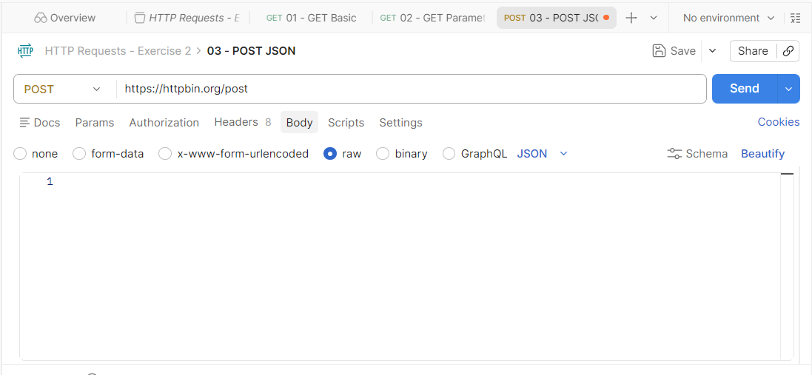

*Фигура 11. Настройване на тялото на POST заявка — Body → raw → JSON.*

3. Въведете следния JSON документ (стойностите и типовете са важни):

```json
{
  "student": "Ivan",
  "class": 12,
  "subject": "Internet Programming",
  "exercise": "HTTP Requests",
  "completed": true
}
```

4. Използвайте **Beautify** при необходимост и натиснете **Save**.

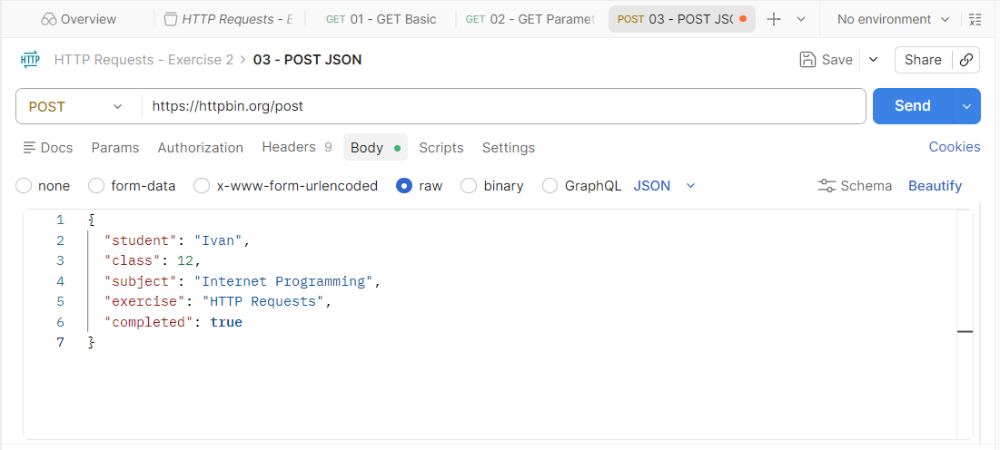

*Фигура 12. JSON документ в тялото на POST заявката.*

| Поле | Примерна стойност | JSON тип |
|---|---|---|
| `student` | `"Ivan"` | string |
| `class` | `12` | number |
| `subject` | `"Internet Programming"` | string |
| `exercise` | `"HTTP Requests"` | string |
| `completed` | `true` | boolean |

**Сравнение:** В Мисия 2 URL параметърът `class=12` се получи като низ `"12"`. В JSON можем да изпратим числото `12` като стойност от тип **number**.

### 4.3. Проверка на HTTP заглавките

1. Отворете **Headers**.
2. Намерете заглавката **`Content-Type: application/json`**. Postman я добавя автоматично при избор на `raw → JSON`.
3. Намерете **`Content-Length`** — Postman изчислява стойността при изпращане. Размерът е в **байтове**, а не в символи.

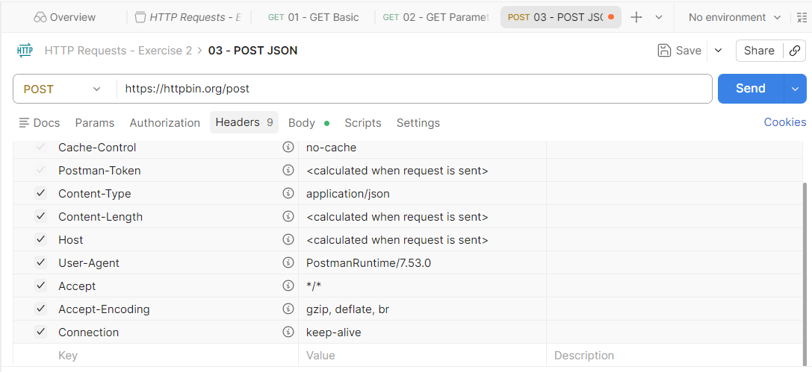

*Фигура 13. HTTP заглавки на POST заявката — Content-Type и Content-Length.*

### 4.4. Изпращане и анализ на отговора

1. Натиснете **Send**.
2. Отворете **Body** в отговора и разгледайте JSON документа.

При проверката получихме **`200 OK`**, **`579 ms`** и **`1003 B`**. Времето и размерът на отговора могат да се различават при други изпълнения.

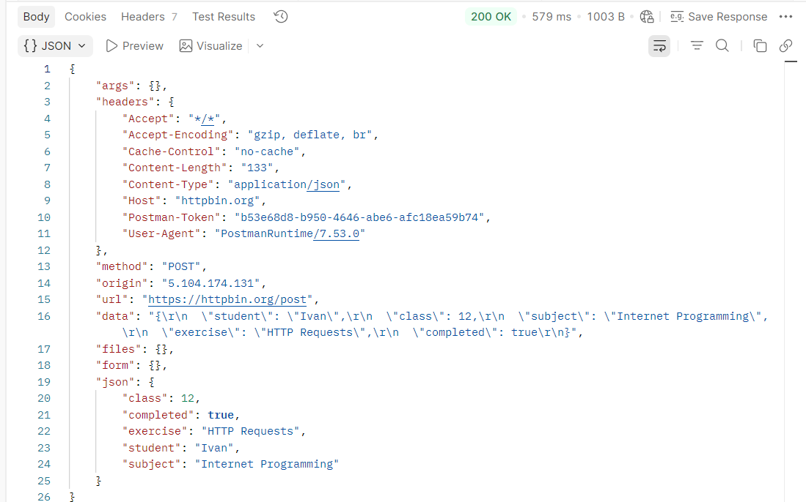

*Фигура 14. Отговор на POST заявка — HTTP статус 200 OK и получените JSON данни.*

В отговора се виждат:

- `"method": "POST"` — сървърът е получил POST заявка;
- `"args": {}` — няма параметри в URL;
- `"headers"` — отразени са заглавките на заявката, включително `Content-Type: application/json` и `Content-Length: 133` в нашия опит;
- `"data"` — изпратеното тяло, представено като **текстов низ**; затова в него се виждат `\"` (екранирани кавички) и `\r\n` (нов ред);
- `"json"` — същите данни, интерпретирани като **JSON обект**.

Откъс от полето `json` в реалния отговор:

```json
"json": {
  "class": 12,
  "completed": true,
  "exercise": "HTTP Requests",
  "student": "Ivan",
  "subject": "Internet Programming"
}
```

**Извод:** HTTP POST позволява изпращане на данни в тялото на заявката. `Content-Type` описва формата им, а `httpbin.org/post` отразява полученото съдържание. **Статусът `200 OK` тук не означава, че е създаден реален запис в база данни.**

### 4.5. Сравнение на GET и POST в нашите мисии

| Характеристика | GET с параметри (Мисия 2) | POST с JSON (Мисия 3) |
|---|---|---|
| URL | `/get?student=Ivan&class=12` | `/post` |
| Къде са изпратените данни? | В URL параметрите | В тялото |
| Къде се виждат в отговора на httpbin? | `args` | `data` и `json` |
| Тип на `class` | string (`"12"`) | number (`12`) |
| Типична употреба | Извличане на информация | Изпращане на данни за обработка |

**Въпроси за анализ:**

1. Защо в тази мисия използваме POST вместо GET?
2. Какво означава `Content-Type: application/json`?
3. Каква е разликата между `data` и `json` в отговора?
4. Защо `args` е празен обект?
5. Каква е разликата между `"class": 12` и `"class": "12"`?
6. Какво означава `Content-Length: 133`?

## 5. Мисия 4 — PUT заявка с JSON тяло

**Цел:** Да изпратите JSON данни чрез PUT и да сравните предназначението на PUT и POST. В реални API PUT се използва за създаване или замяна на представянето на ресурс на конкретен адрес. Тестовият адрес `https://httpbin.org/put` само отразява получената заявка — **не актуализира реален запис**.

### 5.1. Създаване на PUT заявка

1. В колекцията `HTTP Requests - Exercise 2` изберете **Add request**.
2. Задайте име **`04 - PUT JSON`**.
3. Изберете метод **PUT** и URL `https://httpbin.org/put`.
4. Запазете заявката чрез **Save**.

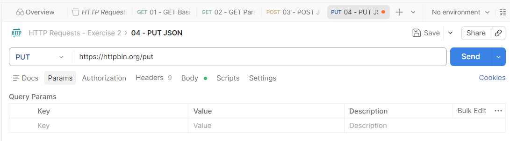

*Фигура 15. Подготвена PUT заявка към тестовия сървър httpbin.org.*

### 5.2. Въвеждане на JSON тяло

1. Отворете **Body** и изберете **raw → JSON**. **Не оставяйте Text**, защото тогава `Content-Type` може да не е `application/json`.
2. Въведете следния JSON документ:

```json
{
  "student": "Ivan",
  "class": 12,
  "subject": "Internet Programming",
  "exercise": "HTTP Requests",
  "completed": false,
  "progress": 75
}
```

3. Проверете в **Headers** заглавката `Content-Type: application/json` и натиснете **Save**.

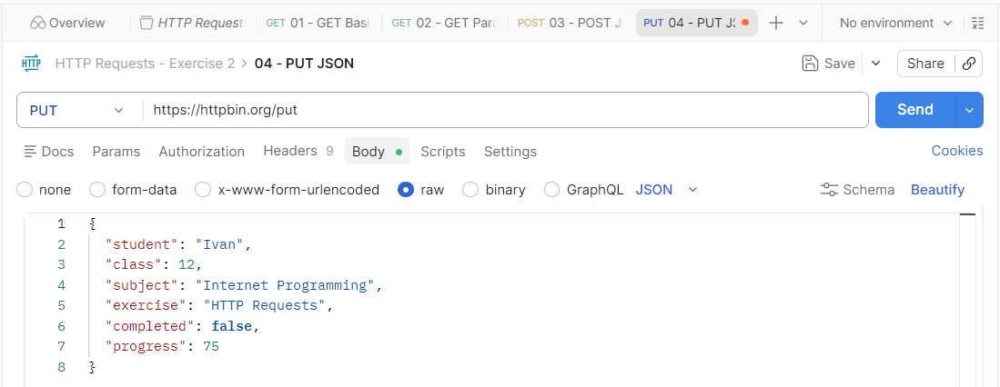

*Фигура 16. Подготовка на PUT заявка с JSON данни — Body → raw → JSON.*

> **Наблюдение:** В предишната POST заявка `completed` беше `true`. Тук изпращаме `completed: false` и добавяме `progress: 75`. Това е учебен пример за различно представяне на данните, а не доказателство за записана промяна на сървъра.

### 5.3. Изпращане и анализ на отговора

1. Натиснете **Send**.
2. Проверете статуса и съдържанието на получения отговор.
3. Намерете полетата `method`, `headers`, `data` и `json`.

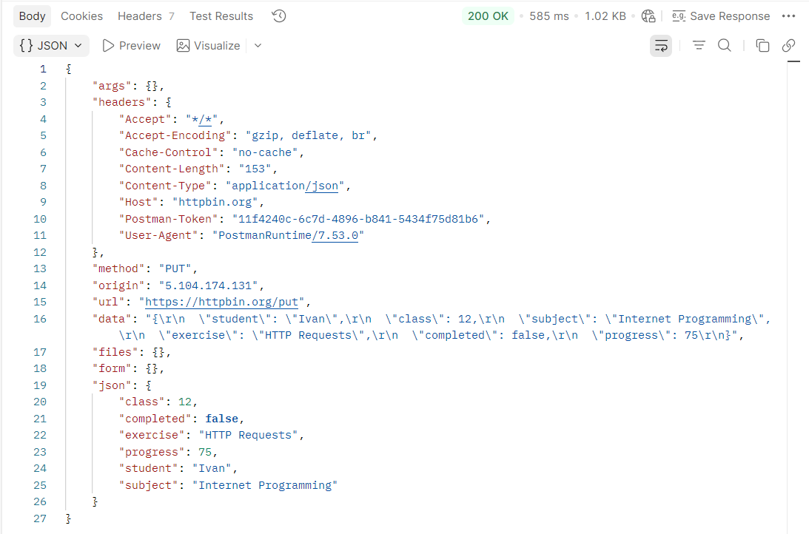

*Фигура 17. Успешно изпълнена PUT заявка — HTTP статус 200 OK и получените JSON данни.*

**Наблюдаван резултат от упражнението:**

| Показател | Стойност | Значение |
|---|---|---|
| HTTP статус | `200 OK` | Заявката е обработена успешно |
| Време | `585 ms` | Време, отчетено от Postman за конкретния опит |
| Размер на отговора | `1.02 KB` | Размер, отчетен от Postman |
| `method` | `PUT` | Сървърът е получил PUT заявка |
| `headers.Content-Type` | `application/json` | Тялото е изпратено като JSON |
| `headers.Content-Length` | `153` | Размер на тялото на заявката в байтове |

Полето `json` съдържа:

```json
{
  "class": 12,
  "completed": false,
  "exercise": "HTTP Requests",
  "progress": 75,
  "student": "Ivan",
  "subject": "Internet Programming"
}
```

Редът на полетата в отговора може да е различен. Полето `data` съдържа същото изпратено тяло като текстов низ, а `args` е празен обект, защото не сме добавили URL параметри.

### 5.4. Сравнение между POST и PUT

| Характеристика | POST | PUT |
|---|---|---|
| Основно предназначение | Предава данни за обработка според правилата на ресурса | Създава или заменя представяне на ресурс на известен адрес |
| Типичен REST пример | `POST /api/books` | `PUT /api/books/5` |
| JSON тяло | Възможно | Възможно |
| Идемпотентност по HTTP семантика | Не е гарантирана | Да |
| Тестов адрес | `/post` | `/put` |

**Идемпотентност** означава, че многократното изпълнение на една и съща PUT заявка трябва да има същия предвиден ефект върху състоянието на сървъра като еднократното изпълнение. Това **не** означава, че отговорите задължително са еднакви.

**Въпроси за анализ:**

1. Каква е основната разлика в предназначението на POST и PUT?
2. Защо и в двете мисии използвахме **Body → raw → JSON**?
3. Какво означава `Content-Length: 153`?
4. Какъв е типът на стойността `false` в JSON?
5. Защо отговорът `200 OK` не доказва, че е актуализиран реален запис?
6. Какво означава идемпотентност при PUT?

## 6. Мисия 5 — DELETE заявка

**Цел:** Да изпратите HTTP DELETE заявка без тяло, да анализирате отговора и да разграничите тестовата заявка от реалното изтриване на ресурс.

### 6.1. Подготовка на заявката

1. В колекцията `HTTP Requests - Exercise 2` изберете **Add request**.
2. Наименувайте заявката **`05 - DELETE`**.
3. Изберете HTTP метод **DELETE** (проверете да не е останал PUT).
4. Въведете URL `https://httpbin.org/delete`.
5. В **Body** изберете **none** — няма да изпращаме тяло.
6. Натиснете **Save**.

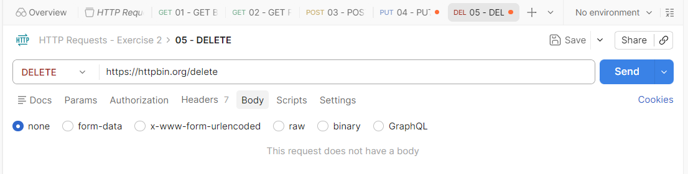

*Фигура 18. Подготовка на HTTP DELETE заявка без тяло в Postman.*

### 6.2. Изпращане и наблюдение

Натиснете **Send**. В проверения пример сървърът върна **`200 OK`**, време **556 ms** и отчетен размер **642 B**. Тези стойности за време и размер са примерни и могат да се различават при други изпълнения.

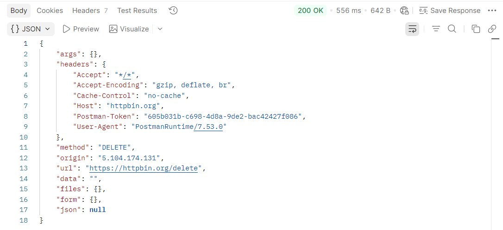

*Фигура 19. HTTP отговор на DELETE заявка — статус 200 OK и JSON с метода DELETE.*

### 6.3. Анализ на получения JSON отговор

В отговора се виждат следните полета (показани са само избрани части):

```json
{
  "args": {},
  "method": "DELETE",
  "url": "https://httpbin.org/delete",
  "data": "",
  "files": {},
  "form": {},
  "json": null
}
```

| Поле | Наблюдавана стойност | Какво означава |
|---|---|---|
| `method` | `"DELETE"` | Сървърът е получил заявка с метод DELETE. |
| `url` | `"https://httpbin.org/delete"` | Адресът, към който е изпратена заявката. |
| `args` | `{}` | Не са изпратени URL параметри. |
| `data` | `""` | Тялото на заявката е празно. |
| `json` | `null` | Не е разпознат JSON документ в тялото. |
| `files`, `form` | `{}` | Няма изпратени файлове или формулярни полета. |

**Разлика между `null`, `{}` и `""`:** `null` е JSON стойност за липса на стойност; `{}` е празен обект; `""` е празен текстов низ. Това са три различни представяния.

!!! warning "Изтрихме ли реален запис?"
    **Не.** `httpbin.org/delete` е тестов адрес, който отразява получената заявка. Статусът `200 OK` тук означава, че тестовият сървър я е обработил успешно, **не** че е изтрит реален ресурс.

В реален REST API често се посочва конкретен ресурс, например:

```http
DELETE /api/books/5
```

Това е искане за изтриване на книга с идентификатор `5`; реалният резултат зависи от реализацията на сървъра и разрешенията на клиента.

### 6.4. Обобщение на четирите HTTP метода

| Метод | Основно предназначение | Тестов адрес |
|---|---|---|
| GET | Извличане на информация | `/get` |
| POST | Изпращане на данни за обработка | `/post` |
| PUT | Създаване или замяна на представянето на ресурс | `/put` |
| DELETE | Искане за премахване на ресурс | `/delete` |

### 6.5. Въпроси за проверка

1. Какво е предназначението на HTTP метода DELETE?
2. Защо полето `data` съдържа празен низ?
3. Каква е разликата между `null` и `{}` в JSON?
4. Защо отговорът `200 OK` в този тест не доказва изтриване на ресурс?
5. Как се посочва конкретен ресурс за изтриване в реален REST API?

## 7. Мисия 6 — HTTP статус кодове (в процес на изпълнение)

**Цел:** Да разпознаваме HTTP статусите, да различаваме грешки от страна на клиента и сървъра и да анализираме реален отговор в Postman. Използваме тестовите адреси на `httpbin.org`, които връщат зададения статус умишлено.

### 7.1. Статус 404 Not Found

1. Създайте заявка **`06 - HTTP Status 404`** в колекцията `HTTP Requests - Exercise 2`.
2. Изберете метод **GET**, адрес `https://httpbin.org/status/404` и **Body → none**.
3. Натиснете **Save**.

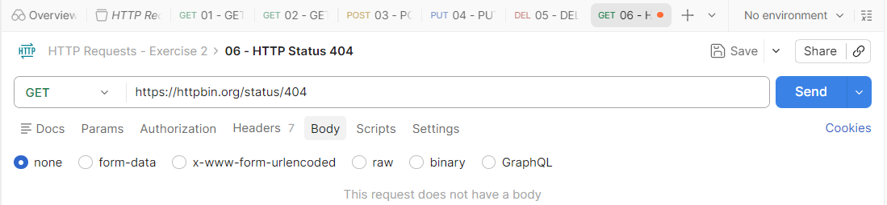

*Фигура 20. Подготовка на GET заявка за проверка на HTTP статус 404 Not Found.*

4. Натиснете **Send** и разгледайте резултата.

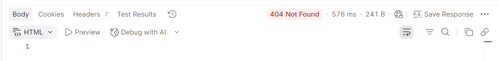

*Фигура 21. Отговор 404 Not Found — ресурсът не е намерен.*

В проверения пример Postman показва **`404 Not Found`**, **576 ms**, **241 B**, **7 заглавки** и **празно тяло**. Времето и размерът могат да се различават при повторение. Статусът `404` показва, че сървърът е върнал HTTP отговор, а не че непременно има проблем с интернет връзката или Postman.

### 7.2. Статус 500 Internal Server Error

1. Създайте заявка **`07 - HTTP Status 500`** в същата колекция.
2. Изберете метод **GET**, адрес `https://httpbin.org/status/500` и **Body → none**.
3. Запазете заявката.

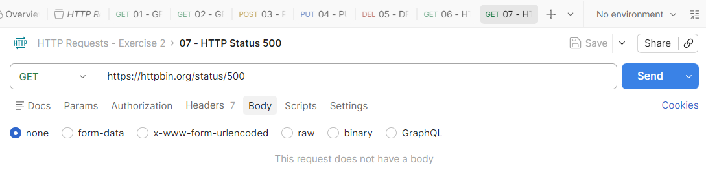

*Фигура 22. Подготовка на GET заявка за проверка на HTTP статус 500 Internal Server Error.*

4. Натиснете **Send** и разгледайте резултата.

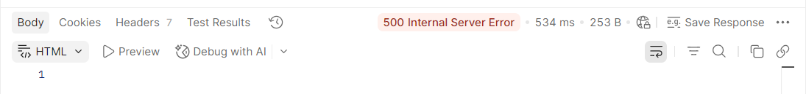

*Фигура 23. Отговор 500 Internal Server Error — сървърът съобщава за вътрешна грешка.*

В проверения пример Postman показва **`500 Internal Server Error`**, **534 ms**, **253 B**, **7 заглавки** и **празно тяло**. `500` принадлежи към групата **5xx — сървърни грешки**. Тук `httpbin.org` връща кода умишлено — не сме повредили сървъра.

### 7.3. Сравнение: 404 и 500

| Признак | 404 Not Found | 500 Internal Server Error |
|---|---|---|
| Група | 4xx — клиентски грешки | 5xx — сървърни грешки |
| Значение | Заявеният ресурс не е намерен | Сървърът е срещнал вътрешен проблем |
| Примерна причина в реална система | Несъществуващ адрес или ресурс | Необработено изключение в сървърния код |
| Обичайна първа проверка | Проверете URL и идентификатора на ресурса | Проверете сървърните логове и приложението |

!!! info "HTTP отговор срещу мрежова грешка"
    При статус `404` или `500` клиентът **е получил HTTP отговор**. При мрежова грешка може изобщо да не се получи HTTP статус (например при невъзможно установяване на връзка).

### 7.4. Следваща проверка: статус 201 Created (предстои)

Подгответе заявка **`08 - HTTP Status 201`**, метод **GET**, URL `https://httpbin.org/status/201`, **Body → none** и я запазете. Изпращането и анализът ще бъдат документирани след проверка на резултата.

<!-- TODO: Изображение 24: postman-24-status-201-request.png -->
<!-- TODO: След потвърждение да се добавят отговорът 201 и останалите планирани статуси. -->

**Мисия 7 (предстои):** Сравнение и самостоятелни задачи — GET, POST, PUT, DELETE, URL параметри, тяло, заглавки и отговори.

> **Методическа бележка:** `httpbin.org` е тестова услуга; заявките за статус кодове демонстрират отговори, а не реални повреди или създаване на ресурси. В реален API статус `201 Created` обикновено е резултат от успешно създаване на ресурс (често след POST), макар че тестовият адрес тук се извиква с GET.

<!-- TODO: Уточняване на разпределението по време между двата учебни часа. -->
<!-- TODO: Самостоятелни задачи, критерии за оценяване, проверка и предаване на колекцията. -->
<!-- Markdown: docs/praktika/razdel-1/uprazhnenie-urok-02-postman.md -->
<!-- Изображенията postman-01 до postman-23 са разположени в docs/images/razdel-1/uprazhnenie-urok-02-postman/. -->

## Проверка на знанията — проект

1. Каква е разликата между Workspace, Collection и Request?
2. Къде Postman показва статус кода на HTTP отговора?
3. Каква е разликата между URL параметри и JSON тяло?
4. Каква е ролята на заглавието `Content-Type`?
5. Защо отговорът `404 Not Found` не означава непременно, че Postman не работи?

---

**Бележка за разработката:** Този Markdown файл е работна основа. Окончателните инструкции и изображения се приемат само след проверка в интерфейса, използван от учениците.
