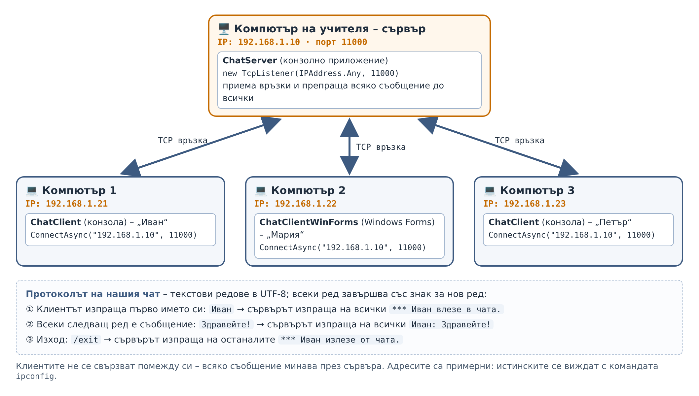
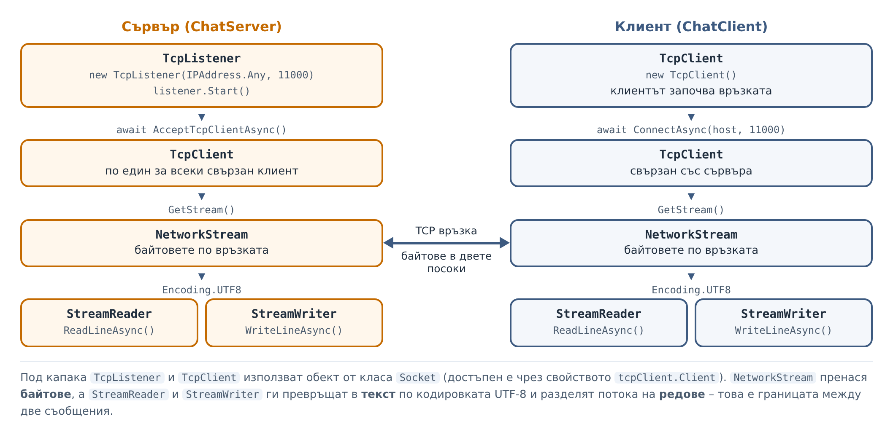

# Упражнение 5. Чат сървър и клиент – конзолни приложения

**Учебна практика:** Интернет програмиране · **Клас:** XII · **Раздел 1:** Въведение в интернет, мрежови протоколи и модел „Клиент–сървър“ · **Продължителност:** 2 учебни часа (90 минути)

!!! abstract "Практически казус"
    Класът ви иска собствен чат, който работи в училищната мрежа без външни услуги. Вие сте екипът програмисти. Пишете **сървър**, който се стартира на един компютър, и **клиент**, който се стартира на всеки от останалите компютри. Накрая на часа си пишете със съучениците от **различни компютри** в класната стая.

**Връзка с теорията:** [Урок 3. Клиент-сървър комуникация](../../teoria/razdel-1/urok-03-klient-sarvar-komunikatsia.md) – роли на клиента и сървъра; [Урок 1. Основи на интернет и мрежови протоколи](../../teoria/razdel-1/urok-01-osnovi-na-internet.md) – IP адреси, портове и TCP.

**Връзка с предходни упражнения:** [Упражнение 1. Мрежов детектив](uprazhnenie-urok-01-osnovi-na-internet.md) – с `ipconfig` и `ping` ще откриете адреса на сървъра и ще проверите връзката; [Упражнение 3](uprazhnenie-urok-02-csharp-http.md) – там `HttpClient` отваряше TCP връзка вместо вас, а сега я управлявате сами.

## Цели на упражнението

След упражнението ученикът трябва да може да:

- обяснява какво е сокет, IP адрес, порт и TCP връзка;
- използва класовете `TcpListener`, `TcpClient`, `NetworkStream`, `StreamReader` и `StreamWriter`;
- създава сървър, който обслужва едновременно много клиенти и препраща съобщенията им;
- създава клиент, който едновременно изпраща и получава съобщения;
- описва прост текстов протокол и го прилага;
- осъществява връзка между два компютъра в локалната мрежа и диагностицира проблеми с нея.

## Необходими инструменти

- **Visual Studio 2026** с работното натоварване **.NET desktop development** и **.NET 10**.
- **Поне два компютъра в една локална мрежа** – за Мисия 4. Мисии 1–3 се изпълняват на един компютър.
- Разрешени входящи връзки на **порт 11000** в защитната стена на Windows на компютъра със сървъра (вижте т. 6 и „За учителя“).
- Протокол за записване на резултатите.

!!! warning "Правила за работа"
    Стартирайте сървъра и клиентите само в училищната мрежа. Съобщенията в нашия чат **не са криптирани** – всеки с подходящ инструмент в същата мрежа може да ги прочете. Не изпращайте пароли и лични данни.

## План на работа

Упражнението е **един проект**, който надграждате мисия след мисия: решение (*solution*) с два проекта – `ChatServer` и `ChatClient`.

| Етап | Време |
|---|---:|
| **Първи учебен час** | |
| 1. Сокети и класовете на .NET | 12 мин |
| 2. Подготовка: едно решение, два проекта | 6 мин |
| Мисия 1. Първа връзка | 12 мин |
| Мисия 2. Много клиенти и препращане на съобщенията | 15 мин |
| **Втори учебен час** | |
| Мисия 3. Имена и известия | 10 мин |
| Мисия 4. Чат между два компютъра | 15 мин |
| Мисия 5. Грешки и прекъснати връзки | 10 мин |
| Сравнителна таблица и предаване | 10 мин |

## 1. Сокети и класовете на .NET (12 мин)

### 1.1. IP адрес, порт и сокет

За да изпрати данни на програма на друг компютър, мрежата трябва да знае **два** адреса:

- **IP адрес** – кой компютър, например `192.168.1.10`;
- **порт** – коя програма на този компютър. Портът е число от 0 до 65535.

Сравнението от пощата: IP адресът е адресът на блока, а портът е номерът на апартамента. Двойката „IP адрес + порт“ се нарича **крайна точка** (*endpoint*), например `192.168.1.10:11000`.

**Сокет** (*socket*) е крайната точка на връзката в една програма – „гнездото“, през което програмата изпраща и получава данни. **TCP връзката** свързва два сокета – на клиента и на сървъра – и пренася байтове **надеждно и в правилния ред** в двете посоки (урок 1).

| Порт | Услуга |
|---:|---|
| 80 | HTTP |
| 443 | HTTPS – към него се свързваше `HttpClient` в упражнение 3 |
| 11000 | нашият чат сървър (свободен порт, избран от нас) |

На един компютър **само една** програма може да слуша на даден порт. Ако стартирате сървъра два пъти, вторият път ще получите грешка, че адресът вече се използва.

### 1.2. От HTTP към собствен протокол

HTTP също работи върху TCP. Разликата е в **правилата** – протокола – по които двете страни разменят съобщения:

| | HTTP (упражнения 2–4) | Нашият чат |
|---|---|---|
| Кой започва връзката? | Клиентът | Клиентът |
| Кой може да изпраща? | Клиентът изпраща заявка, сървърът **отговаря** | И двете страни – **по всяко време** |
| Колко трае връзката? | Обикновено една заявка и един отговор | Докато потребителят не излезе |
| Формат | Начален ред, заглавки, празен ред, тяло | Един ред текст = едно съобщение |

Най-важната разлика: в чата сървърът изпраща съобщение, когато **друг** клиент напише нещо. Затова клиентът трябва **непрекъснато да слуша** за входящи съобщения и **едновременно** да позволява на потребителя да пише.



### 1.3. Класовете, които ще използваме



| Клас | Пространство от имена | Роля | Важни членове |
|---|---|---|---|
| `IPAddress` | `System.Net` | IP адрес | `IPAddress.Any` (всички адреси на компютъра), `IPAddress.Loopback` (127.0.0.1), `IPAddress.Parse("192.168.1.10")` |
| `Dns`, `IPHostEntry` | `System.Net` | Име на компютъра и неговите IP адреси | `Dns.GetHostName()`, `Dns.GetHostEntry(...)`, `AddressList` |
| `TcpListener` | `System.Net.Sockets` | **Сървър:** „слуша“ на порт и приема входящи връзки | `Start()`, `AcceptTcpClientAsync()`, `Stop()` |
| `TcpClient` | `System.Net.Sockets` | Една TCP връзка – от страната на клиента или на сървъра | `ConnectAsync(host, port)`, `GetStream()`, `Client`, `Close()` |
| `Socket` | `System.Net.Sockets` | Сокетът, който `TcpListener` и `TcpClient` използват „под капака“ | `RemoteEndPoint` – адресът и портът на другата страна |
| `NetworkStream` | `System.Net.Sockets` | Поток от **байтове** по връзката | получава се с `tcpClient.GetStream()` |
| `StreamReader` | `System.IO` | Чете **текст** от потока, ред по ред | `ReadLineAsync()` – връща `null`, когато другата страна затвори връзката |
| `StreamWriter` | `System.IO` | Пише **текст** в потока | `WriteLineAsync(...)`, `AutoFlush = true` |
| `Encoding.UTF8`, `UTF8Encoding` | `System.Text` | Превръщане на текст в байтове и обратно | `new UTF8Encoding(false)` – UTF-8 без служебен знак (BOM) в началото |
| `SocketException` | `System.Net.Sockets` | Неуспешно свързване – няма сървър, грешен адрес | `Message`, `SocketErrorCode` |
| `IOException` | `System.IO` | Връзката е прекъсната по време на четене или писане | `Message` |

`System.IO` и `System.Threading.Tasks` се добавят автоматично (*ImplicitUsings*), затова в кода пишем само `using` за `System.Net`, `System.Net.Sockets` и `System.Text`.

### 1.4. Защо редове и защо UTF-8?

TCP пренася **поток от байтове** без граници между съобщенията. Ако изпратите „Здравей“ и „Как си?“, другата страна може да ги получи слепени или на части. Затова протоколът трябва да казва **къде свършва едно съобщение**. Ние използваме **края на реда**: `WriteLineAsync` добавя знак за нов ред, а `ReadLineAsync` чете до него.

Кодировката **UTF-8** записва и латиница, и кирилица, и емоджи. С кодировката ASCII всяка кирилска буква би се превърнала във `?`.

!!! note "Кодирането в мрежата и кодирането в конзолата"
    Текстът минава през **четири** превръщания и всяко има своя настройка:

    | Превръщане | Къде | Настройка в нашия код |
    |---|---|---|
    | натиснати клавиши → `string` | конзолата на изпращача | `Console.InputEncoding` – оставяме стойността по подразбиране |
    | `string` → байтове в мрежата | `StreamWriter` | `new UTF8Encoding(false)` – UTF-8 без BOM |
    | байтове от мрежата → `string` | `StreamReader` | `Encoding.UTF8` |
    | `string` → знаци на екрана | конзолата на получателя | `Console.OutputEncoding = Encoding.UTF8` |

    - **Кодирането в мрежата** (редове 2 и 3) е част от **протокола**. То трябва да е еднакво в сървъра, в конзолния и в графичния клиент от упражнение 6 – иначе кирилицата пристига повредена. Стойността `false` означава „без BOM“ – без трите служебни байта, с които някои програми отбелязват началото на UTF-8 текст. В нашия протокол те не са нужни и само биха объркали клиент, написан на друг език.
    - **Кодирането в конзолата** (редове 1 и 4) засяга само как **този** компютър чете от клавиатурата и изписва на екрана. То не променя байтовете в мрежата, защото програмата работи със `string`, а превръщането в байтове прави `StreamWriter`.

    `Console.InputEncoding` **не е излишна настройка** по принцип – в други среди и програми може да е нужно да се зададе. В нашата среда обаче (конзолата на Windows, стартирана от Visual Studio) задаването му на `Encoding.UTF8` повреди въведената от клавиатурата кирилица при изпитването, а стойността по подразбиране я разчита правилно. Затова в това упражнение задаваме само `Console.OutputEncoding`.

!!! info "Ако сте виждали примери с класа `Socket`"
    В по-старите учебни материали чатът се пише директно с класа `Socket`. Тогава:

    - `listener.Start()` съответства на `socket.Bind(...)` и `socket.Listen(...)`;
    - `AcceptTcpClientAsync()` съответства на `socket.AcceptAsync()`;
    - вместо `ReadLineAsync()` се чете в масив от байтове (`byte[] buffer`), а краят на съобщението се отбелязва с уговорен маркер, например `<EOF>`.

    `TcpListener` и `TcpClient` вършат същото, но поемат част от рутинната работа. Сокетът остава достъпен чрез свойството `tcpClient.Client`.

## 2. Подготовка: едно решение, два проекта (6 мин)

1. В Visual Studio 2026 изберете **Create a new project** → **Console App** (C#). Име на проекта: `ChatServer`. Име на решението (*Solution name*): `ChatApp`. Не поставяйте отметка на *Place solution and project in the same directory*.
2. **Framework:** .NET 10.0 (Long Term Support). Поставете отметка на **Do not use top-level statements**.
3. В **Solution Explorer** щракнете с десния бутон върху решението `ChatApp` → **Add → New Project…** → **Console App** с име `ChatClient` и същите настройки.
4. Щракнете с десния бутон върху решението → **Configure Startup Projects…** (в някои версии **Set Startup Projects…**) → **Multiple startup projects**. За `ChatServer` и `ChatClient` изберете **Start**, като `ChatServer` е **отгоре** – той трябва да стартира пръв.

<!-- СНИМКА (Visual Studio 2026): images/razdel-1/uprazhnenie-urok-03-chat/vs2026-chat-01-solution.png – Solution Explorer с проектите ChatServer и ChatClient -->
<!-- СНИМКА (Visual Studio 2026): images/razdel-1/uprazhnenie-urok-03-chat/vs2026-chat-02-startup.png – прозорецът Multiple startup projects -->

!!! tip "Още един клиент на същия компютър"
    Докато програмата работи, щракнете с десния бутон върху проекта `ChatClient` → **Debug → Start New Instance**. Отваря се още един прозорец на клиента. Така можете да изпробвате чата с няколко „потребители“ на един компютър.

## 3. Мисия 1 — Първа връзка (12 мин)

Започваме с най-простия вариант: сървърът приема **един** клиент и показва всичко, което той изпраща.

**Сървър** – заменете съдържанието на `Program.cs` в проекта `ChatServer`:

```csharp
using System.Net;           // IPAddress
using System.Net.Sockets;   // TcpListener, TcpClient
using System.Text;          // Encoding

namespace ChatServer;

class Program
{
    const int Port = 11000;

    static async Task Main(string[] args)
    {
        Console.OutputEncoding = Encoding.UTF8;

        // IPAddress.Any – сървърът приема връзки на всички мрежови адреси на компютъра
        TcpListener listener = new TcpListener(IPAddress.Any, Port);
        listener.Start();
        Console.WriteLine($"Сървърът слуша на порт {Port}...");

        // Чакаме ЕДИН клиент да се свърже
        using TcpClient client = await listener.AcceptTcpClientAsync();
        Console.WriteLine($"Свърза се клиент от {client.Client.RemoteEndPoint}");

        // Четем ред по ред, докато клиентът не затвори връзката
        StreamReader reader = new StreamReader(client.GetStream(), Encoding.UTF8);
        string? line;
        while ((line = await reader.ReadLineAsync()) != null)
            Console.WriteLine($"> {line}");

        Console.WriteLine("Клиентът затвори връзката.");
    }
}
```

**Клиент** – заменете съдържанието на `Program.cs` в проекта `ChatClient`:

```csharp
using System.Net.Sockets;   // TcpClient
using System.Text;          // Encoding

namespace ChatClient;

class Program
{
    const int Port = 11000;

    static async Task Main(string[] args)
    {
        Console.OutputEncoding = Encoding.UTF8;

        using TcpClient client = new TcpClient();
        await client.ConnectAsync("127.0.0.1", Port);   // 127.0.0.1 – „този компютър“
        Console.WriteLine($"Свързан със {client.Client.RemoteEndPoint}. Пишете съобщения, /exit за изход.");

        StreamWriter writer = new StreamWriter(client.GetStream(), new UTF8Encoding(false)) { AutoFlush = true };

        while (true)
        {
            string? text = Console.ReadLine();
            if (text == null || text == "/exit")
                break;

            await writer.WriteLineAsync(text);
        }
    }
}
```

Стартирайте (**F5**), напишете два реда в прозореца на клиента и вижте прозореца на сървъра. Примерен изход на сървъра:

```text
Сървърът слуша на порт 11000...
Свърза се клиент от 127.0.0.1:36078
> Здравей, сървър!
> Втори ред
Клиентът затвори връзката.
```

**Какво прави кодът?**

| Ред | Обяснение |
|---|---|
| `new TcpListener(IPAddress.Any, Port)` | Сървърът ще слуша на порт 11000 на **всички** мрежови адреси на компютъра. |
| `listener.Start()` | Започва слушането. От този момент клиенти могат да се свързват. |
| `await listener.AcceptTcpClientAsync()` | Чака, докато клиент се свърже, и връща `TcpClient` за тази връзка. |
| `await client.ConnectAsync("127.0.0.1", Port)` | Клиентът се свързва. `127.0.0.1` означава „този компютър“ (*localhost*). |
| `client.GetStream()` | Връща `NetworkStream` – байтовете по връзката. |
| `new StreamReader(...)` / `new StreamWriter(...)` | Превръщат байтовете в текст и обратно. `AutoFlush = true` изпраща всеки ред веднага. |
| `ReadLineAsync()` | Чака следващия ред. Връща `null`, когато клиентът затвори връзката – тогава цикълът `while` спира. |

**Въпроси за протокола:**

1. В реда `Свърза се клиент от 127.0.0.1:36078` какво означава числото след двоеточието? Стартирайте клиента още веднъж – същото ли е? (Това е портът на **клиента**, който операционната система избира автоматично.)
2. Стартирайте само клиента, без сървъра (в **Configure Startup Projects** оставете само `ChatClient`). Какво се случва? Как се казва изключението?
3. Докато първият клиент е свързан, стартирайте втори (**Debug → Start New Instance**). Свързва ли се? Показва ли сървърът съобщенията му? Защо?

!!! info "Отговор на въпрос 3 – след като помислите"
    Вторият клиент **се свързва** – операционната система приема връзката и я поставя в опашка. Сървърът обаче извиква `AcceptTcpClientAsync()` **само веднъж** и чете само от първия клиент. За да обслужва много клиенти, сървърът трябва да приема връзки в цикъл и да обслужва всяка от тях **едновременно** с останалите. Това прави Мисия 2.

## 4. Мисия 2 — Много клиенти и препращане на съобщенията (15 мин)

Сега сървърът ще приема връзки в цикъл, ще обслужва всички клиенти едновременно и ще **препраща** всяко съобщение до **всички** свързани клиенти. Заменете целия `Program.cs` на сървъра:

```csharp
using System.Net;           // IPAddress
using System.Net.Sockets;   // TcpListener, TcpClient, NetworkStream
using System.Text;          // Encoding

namespace ChatServer;

class Program
{
    const int Port = 11000;

    // Всички свързани клиенти. Достъпът до списъка се пази с lock,
    // защото различни клиенти се обслужват едновременно.
    static readonly List<ClientConnection> clients = new List<ClientConnection>();
    static readonly object clientsLock = new object();

    static async Task Main(string[] args)
    {
        Console.OutputEncoding = Encoding.UTF8;

        // IPAddress.Any – сървърът приема връзки на всички мрежови адреси на компютъра
        TcpListener listener = new TcpListener(IPAddress.Any, Port);
        listener.Start();

        Console.WriteLine($"Чат сървърът слуша на порт {Port}.");
        Console.WriteLine("Изчакване на клиенти... (Ctrl+C за спиране)\n");

        while (true)
        {
            TcpClient tcpClient = await listener.AcceptTcpClientAsync();
            _ = HandleClientAsync(tcpClient);   // обслужваме клиента, без да чакаме да приключи
        }
    }

    // Обслужва един клиент от свързването до изключването му
    static async Task HandleClientAsync(TcpClient tcpClient)
    {
        string endPoint = tcpClient.Client.RemoteEndPoint?.ToString() ?? "?";
        ClientConnection? client = null;

        using (tcpClient)
        {
            try
            {
                NetworkStream stream = tcpClient.GetStream();
                StreamReader reader = new StreamReader(stream, Encoding.UTF8);
                StreamWriter writer = new StreamWriter(stream, new UTF8Encoding(false)) { AutoFlush = true };

                client = new ClientConnection(endPoint, tcpClient, writer);   // засега името е адресът на клиента
                lock (clientsLock)
                {
                    clients.Add(client);
                }
                Console.WriteLine($"+ {client.Name} се свърза");

                // Всеки ред е съобщение, което препращаме до всички
                string? line;
                while ((line = await reader.ReadLineAsync()) != null)
                {
                    Console.WriteLine($"{client.Name}: {line}");
                    await BroadcastAsync($"{client.Name}: {line}");
                }
            }
            catch (Exception ex) when (ex is IOException || ex is ObjectDisposedException)
            {
                // Връзката е прекъсната внезапно (затворен прозорец, изключена мрежа)
            }
            catch (Exception ex)
            {
                // Неочаквана грешка – показваме я, но сървърът продължава да обслужва останалите
                Console.WriteLine($"! Грешка при {endPoint}: {ex.Message}");
            }
            finally
            {
                if (client != null)
                {
                    lock (clientsLock)
                    {
                        clients.Remove(client);
                    }
                    Console.WriteLine($"- {client.Name} излезе");
                }
            }
        }
    }

    // Изпраща съобщение до всички свързани клиенти
    static async Task BroadcastAsync(string message)
    {
        ClientConnection[] recipients;
        lock (clientsLock)
        {
            recipients = clients.ToArray();   // копие, за да не държим lock по време на изпращането
        }

        // Изпращаме до всички едновременно – бавен клиент не забавя останалите
        Task[] sends = recipients.Select(recipient => recipient.SendAsync(message)).ToArray();
        await Task.WhenAll(sends);
    }
}

// Един свързан клиент: име, връзка и „канал“ за писане към него
class ClientConnection
{
    private readonly TcpClient tcpClient;
    private readonly StreamWriter writer;
    private readonly SemaphoreSlim sendLock = new SemaphoreSlim(1, 1);

    public string Name { get; }

    public ClientConnection(string name, TcpClient tcpClient, StreamWriter writer)
    {
        Name = name;
        this.tcpClient = tcpClient;
        this.writer = writer;
    }

    // Изпраща един ред до клиента. SemaphoreSlim гарантира, че две съобщения
    // няма да се запишат в потока едновременно.
    public async Task SendAsync(string message)
    {
        await sendLock.WaitAsync();
        try
        {
            // Ако клиентът не приеме реда за 5 секунди, се отказваме
            await writer.WriteLineAsync(message).WaitAsync(TimeSpan.FromSeconds(5));
        }
        catch (Exception)
        {
            // Каквато и да е грешката (връзката е прекъсната, клиентът не чете 5 секунди и др.),
            // проблемът е само на този клиент – затваряме връзката с него.
            // Неговият HandleClientAsync ще го премахне от списъка и ще съобщи на останалите.
            tcpClient.Close();
        }
        finally
        {
            sendLock.Release();
        }
    }
}
```

**Как работи сървърът?**

| Код | Обяснение |
|---|---|
| `while (true) { ... AcceptTcpClientAsync() ... }` | Сървърът непрекъснато приема нови връзки. |
| `_ = HandleClientAsync(tcpClient);` | Стартира обслужването на клиента и **не чака** то да приключи – веднага се връща да приема следващия клиент. `_ =` показва, че нарочно не използваме върнатата задача. |
| `HandleClientAsync` | Обслужва **един** клиент: чете редовете му и ги препраща. Изпълнява се отделно за всеки клиент. |
| `List<ClientConnection> clients` | Списък на свързаните клиенти, за да знаем на кого да препращаме. |
| `lock (clientsLock) { ... }` | Няколко клиента може да се свържат или да излязат **едновременно**. `lock` гарантира, че само един код променя списъка в даден момент. |
| `clients.ToArray()` | `BroadcastAsync` изпраща до **копие** на списъка, за да не държи `lock` по време на изпращането. |
| `Task.WhenAll(...)` | Изпращането до всички клиенти тръгва **едновременно** и `BroadcastAsync` изчаква всички да завършат. Ако изпращахме един по един, един бавен клиент щеше да забави всички след него. Сега останалите получават съобщението веднага. Чака само **изпращачът**: сървърът чете следващия му ред, след като приключи изпращането до всички – най-много 5 секунди. |
| `ClientConnection.SendAsync` и `SemaphoreSlim` | Ако двама напишат едновременно, до един и същ клиент може да тръгнат две съобщения наведнъж. `SemaphoreSlim(1, 1)` пуска само едно записване в потока в даден момент. (В асинхронен код `lock` не може да обгражда `await`, затова се използва `SemaphoreSlim`.) |
| `.WaitAsync(TimeSpan.FromSeconds(5))` | Ако клиентът не приеме реда за 5 секунди (например не чете), се хвърля `TimeoutException`. Внимание: `WaitAsync` спира само **чакането**, а не самото записване – то остава недовършено. Затова в `catch` връзката с този клиент се **затваря** (`tcpClient.Close()`): така недовършеният запис прекъсва и клиентът излиза от чата. |
| `catch (Exception)` в `SendAsync` | **Всяка** грешка при изпращане до даден клиент засяга **само него**: връзката с него се затваря, а неговият `HandleClientAsync` го премахва от списъка. Останалите клиенти не разбират нищо. |
| `finally { clients.Remove(client); }` | Каквото и да се случи – нормален изход или прекъсване – клиентът се премахва от списъка. |
| `catch (... IOException ... ObjectDisposedException)` | Прозорецът на клиента е затворен внезапно, мрежата е прекъсната или връзката е затворена от `SendAsync`. |
| `catch (Exception ex)` в `HandleClientAsync` | Неочаквана грешка при един клиент се показва в конзолата, но сървърът продължава да обслужва останалите. |

**Клиент** – сега клиентът трябва и да **получава** съобщения. Заменете целия `Program.cs` на клиента:

```csharp
using System.Net.Sockets;   // TcpClient, NetworkStream
using System.Text;          // Encoding

namespace ChatClient;

class Program
{
    const int Port = 11000;

    static async Task Main(string[] args)
    {
        Console.OutputEncoding = Encoding.UTF8;

        using TcpClient client = new TcpClient();
        await client.ConnectAsync("127.0.0.1", Port);

        NetworkStream stream = client.GetStream();
        StreamReader reader = new StreamReader(stream, Encoding.UTF8);
        StreamWriter writer = new StreamWriter(stream, new UTF8Encoding(false)) { AutoFlush = true };

        Console.WriteLine($"Свързан със {client.Client.RemoteEndPoint}. Пишете съобщения, /exit за изход.\n");

        // Получаването тече паралелно с въвеждането от клавиатурата
        Task receiveTask = ReceiveMessagesAsync(reader);

        while (true)
        {
            string? text = Console.ReadLine();
            if (text == null || text == "/exit")
                break;
            if (text.Trim() == "")
                continue;

            await writer.WriteLineAsync(text);
        }

        client.Close();
        await receiveTask;
        Console.WriteLine("Програмата приключи.");
    }

    // Чете редовете, които сървърът изпраща, и ги извежда
    static async Task ReceiveMessagesAsync(StreamReader reader)
    {
        try
        {
            string? line;
            while ((line = await reader.ReadLineAsync()) != null)
                Console.WriteLine(line);

            Console.WriteLine("*** Връзката със сървъра е затворена.");
        }
        catch (Exception ex) when (ex is IOException || ex is ObjectDisposedException)
        {
            // Връзката е затворена – от нас (/exit) или от сървъра
        }
    }
}
```

`ReceiveMessagesAsync(reader)` се извиква **без** `await` – задачата започва да чете входящи редове и продължава да работи във фонов режим, докато цикълът в `Main` чете от клавиатурата. Така клиентът **едновременно** слуша и изпраща. Накрая `client.Close()` затваря връзката, четенето приключва и `await receiveTask` изчаква задачата да завърши.

Стартирайте сървъра и **два** клиента. Примерен изход на единия клиент:

```text
Свързан със 127.0.0.1:11000. Пишете съобщения, /exit за изход.

127.0.0.1:59640: Привет от A
127.0.0.1:59646: Привет от B
127.0.0.1:59640: Сам съм
*** Връзката със сървъра е затворена.
Програмата приключи.
```

**Въпроси за протокола:**

1. Получава ли клиентът и **собствените** си съобщения? Защо е полезно това? (Подсказка: ако съобщението се върне, значи сървърът го е получил и препратил.)
2. Какво би се случило, ако `HandleClientAsync(tcpClient)` се извика с `await`?
3. Засега клиентите се различават само по адрес и порт. Кое е неудобното в това?

## 5. Мисия 3 — Имена и известия (10 мин)

Въвеждаме правилата на нашия **протокол**:

1. Първият ред, който клиентът изпраща след свързването, е **името му**.
2. Всеки следващ ред е **съобщение**. Сървърът го изпраща на всички като `Име: текст`.
3. Ред `/exit` означава **изход**.
4. Когато някой влезе или излезе, сървърът изпраща на всички известие, започващо със `***`.

**Сървър** – заменете метода `HandleClientAsync` с тази версия:

```csharp
    // Обслужва един клиент от свързването до изключването му
    static async Task HandleClientAsync(TcpClient tcpClient)
    {
        string endPoint = tcpClient.Client.RemoteEndPoint?.ToString() ?? "?";
        ClientConnection? client = null;

        using (tcpClient)
        {
            try
            {
                NetworkStream stream = tcpClient.GetStream();
                StreamReader reader = new StreamReader(stream, Encoding.UTF8);
                StreamWriter writer = new StreamWriter(stream, new UTF8Encoding(false)) { AutoFlush = true };

                // Първият ред, който клиентът изпраща, е неговото име
                string? name = await reader.ReadLineAsync();
                if (string.IsNullOrWhiteSpace(name))
                    return;

                client = new ClientConnection(name.Trim(), tcpClient, writer);
                lock (clientsLock)
                {
                    clients.Add(client);
                }
                Console.WriteLine($"+ {client.Name} се свърза от {endPoint}");
                await BroadcastAsync($"*** {client.Name} влезе в чата.");

                // Всеки следващ ред е съобщение
                string? line;
                while ((line = await reader.ReadLineAsync()) != null)
                {
                    if (line == "/exit")
                        break;

                    Console.WriteLine($"{client.Name}: {line}");
                    await BroadcastAsync($"{client.Name}: {line}");
                }
            }
            catch (Exception ex) when (ex is IOException || ex is ObjectDisposedException)
            {
                // Връзката е прекъсната внезапно (затворен прозорец, изключена мрежа)
            }
            catch (Exception ex)
            {
                // Неочаквана грешка – показваме я, но сървърът продължава да обслужва останалите
                Console.WriteLine($"! Грешка при {endPoint}: {ex.Message}");
            }
            finally
            {
                if (client != null)
                {
                    lock (clientsLock)
                    {
                        clients.Remove(client);
                    }
                    Console.WriteLine($"- {client.Name} излезе");
                    await BroadcastAsync($"*** {client.Name} излезе от чата.");
                }
            }
        }
    }
```

**Клиент** – две промени в `Main`.

**Стъпка 1.** Преди реда `using TcpClient client = new TcpClient();` поискайте името:

```csharp
        Console.Write("Вашето име: ");
        string name = (Console.ReadLine() ?? "").Trim();
        if (name == "")
            name = "Гост";
```

**Стъпка 2.** Заменете началото на цикъла `while` така, че първо да се изпрати името, а при `/exit` сървърът да бъде уведомен:

```csharp
        await writer.WriteLineAsync(name);   // първият ред е името

        while (true)
        {
            string? text = Console.ReadLine();
            if (text == null || text == "/exit")
            {
                await writer.WriteLineAsync("/exit");
                break;
            }
```

Примерен изход на клиента на Иван:

```text
Вашето име: Иван
Свързан със 127.0.0.1:11000. Пишете съобщения, /exit за изход.

*** Иван влезе в чата.
*** Мария влезе в чата.
Иван: Здравей, Мария
*** Мария излезе от чата.
```

## 6. Мисия 4 — Чат между два компютъра (15 мин)

Досега клиентът се свързваше към `127.0.0.1` – към **същия** компютър. Сега сървърът работи на един компютър, а клиентите – на други.

| Какво въвеждате | Кога | Пример |
|---|---|---|
| `127.0.0.1` | Сървърът работи на **същия** компютър като клиента. От друг компютър този адрес не води до сървъра, а обратно към самия клиент. | `127.0.0.1` |
| Реален IPv4 адрес | Сървърът работи на **друг** компютър. Адресът се вижда в прозореца на сървъра или с `ipconfig` на компютъра със сървъра. | `192.168.1.10` |
| Порт `11000` | Не се въвежда – записан е в кода (`const int Port = 11000;`) и трябва да е **еднакъв** в сървъра и в клиента. | – |

**Стъпка 1. Сървърът показва адресите си.** В `Main` на сървъра, след реда `Console.WriteLine($"Чат сървърът слуша на порт {Port}.");`, добавете:

```csharp
        Console.WriteLine("IPv4 адреси на този компютър:");
        foreach (IPAddress address in Dns.GetHostEntry(Dns.GetHostName()).AddressList)
        {
            if (address.AddressFamily == AddressFamily.InterNetwork)
                Console.WriteLine($"  {address}");
        }
```

Класът `Dns` е в пространството от имена `System.Net`, което вече е добавено.

**Стъпка 2. Клиентът пита за адреса на сървъра.** В `Main` на клиента, преди въпроса за името, добавете:

```csharp
        Console.Write("IP адрес на сървъра (Enter = 127.0.0.1): ");
        string host = (Console.ReadLine() ?? "").Trim();
        if (host == "")
            host = "127.0.0.1";
```

и в реда за свързване заменете `"127.0.0.1"` с `host`:

```csharp
        await client.ConnectAsync(host, Port);
```

**Стъпка 3. Стартирайте сървъра на компютъра на учителя** (или на един компютър от вашата група). Сървърът показва IPv4 адресите си, например:

```text
Чат сървърът слуша на порт 11000.
IPv4 адреси на този компютър:
  192.168.1.10
Изчакване на клиенти... (Ctrl+C за спиране)
```

При първото стартиране Windows може да покаже прозорец **Windows Security Alert**. Поставете отметка на **Private networks** и натиснете **Allow access**. Нужни са права на администратор – ако ги нямате, повикайте учителя. Ако училищната мрежа е от тип **Domain** или **Public**, разрешението само за **Private networks** не е достатъчно – тогава учителят разрешава порта с командата от „За учителя“.

**Стъпка 4. Свържете се от друг компютър.** Стартирайте **само** `ChatClient` и въведете адреса на сървъра (напр. `192.168.1.10`). Пишете си със съучениците.

Ако връзката не се осъществява, проверете последователно:

| Проверка | Команда | Какво означава резултатът |
|---|---|---|
| Правилен ли е адресът? | `ipconfig` на компютъра със сървъра | Използвайте **IPv4 Address** на мрежовия адаптер, свързан с училищната мрежа. |
| Достига ли се компютърът? | `ping 192.168.1.10` от клиента | Има отговор – компютърът се достига по мрежата. Няма отговор – друга мрежа, грешен адрес или защитната стена блокира `ping` (ICMP). |
| Отворен ли е портът? | `Test-NetConnection 192.168.1.10 -Port 11000` в **PowerShell** | `TcpTestSucceeded : True` – портът е достъпен. `False` – сървърът не работи или защитната стена блокира порта. |
| Работи ли сървърът? | прозорецът на сървъра | Ако не е стартиран, клиентът получава `SocketException` за отказана връзка (*actively refused*). |

!!! warning "Успешният `ping` не означава, че чатът ще се свърже"
    `ping` използва протокола **ICMP** и проверява само дали **компютърът** отговаря. Той не знае нищо за порт 11000: компютърът може да отговаря на `ping`, а сървърът да не е стартиран или защитната стена да блокира порта. Възможно е и обратното – `ping` да е блокиран, а чатът да работи. Дали **TCP портът** е достъпен, показва само `Test-NetConnection ... -Port 11000` (или самият опит за свързване).

**Запишете в протокола:** IP адреса на сървъра, IP адресите на поне два клиента (от реда `+ Иван се свърза от ...` в прозореца на сървъра) и кои съученици сте видели в чата.

!!! question "Защо `IPAddress.Any`?"
    В някои примери сървърът слуша на `Dns.GetHostEntry(Dns.GetHostName()).AddressList[0]` – първия адрес от списъка. Често това е IPv6 адрес или адрес, до който другите компютри нямат достъп, и връзката от друг компютър не се осъществява. `IPAddress.Any` кара сървъра да слуша на **всички** адреси на компютъра – и на `127.0.0.1`, и на адреса в училищната мрежа. Списъкът `AddressList` ни трябва само за да **покажем** адресите.

## 7. Мисия 5 — Грешки и прекъснати връзки (10 мин)

Проверете какво се случва в следните ситуации и запишете резултата:

| № | Ситуация | Какво се случва? |
|---|---|---|
| 1 | Клиентът се стартира, а сървърът **не работи** | |
| 2 | Въвежда се адрес на несъществуващ компютър, напр. `10.255.255.1` | |
| 3 | Сървърът се спира, докато клиентите са свързани | |
| 4 | Прозорецът на един клиент се затваря с **✕** (без `/exit`) | |
| 5 | В прозореца на един конзолен клиент се маркира текст с мишката и се оставя така, докато останалите пишат | |

В случай 4 сървърът се справя: `ReadLineAsync` хвърля `IOException` или връща `null`, блокът `finally` премахва клиента, а останалите получават `*** ... излезе от чата.` В случай 5 Windows спира извеждането в маркирания прозорец и клиентът престава да чете. Докато входящите данни се побират в буферите на мрежата, нищо не се забелязва. Ако той не приеме поредното съобщение до 5 секунди, сървърът затваря връзката **само с него** – останалите продължават да си пишат. (При малко съобщения това може и да не се случи – буферите поемат стотици килобайти.) В случаи 1 и 2 обаче **клиентът спира** с необработено изключение, а в случай 2 чака дълго, преди да се откаже. В случай 3 клиентът показва, че връзката е затворена, но спира с изключение при следващия опит за изпращане.

**Поправка на клиента.** Заменете целия `Program.cs` на клиента с окончателната версия по-долу. Промените са две:

- **Свързването е в `try`–`catch`.** `SocketException` означава отказана връзка. `CancellationTokenSource` с 5 секунди прекратява опита, ако сървърът не отговори – тогава възниква `OperationCanceledException`, както при изтеклия `Timeout` в упражнение 3.
- **Цикълът за изпращане е в `try`–`catch (IOException)`.** Ако сървърът спре, програмата не се срива при следващото изпращане.

```csharp
using System.Net.Sockets;   // TcpClient, NetworkStream, SocketException
using System.Text;          // Encoding

namespace ChatClient;

class Program
{
    const int Port = 11000;

    static async Task Main(string[] args)
    {
        Console.OutputEncoding = Encoding.UTF8;

        Console.Write("IP адрес на сървъра (Enter = 127.0.0.1): ");
        string host = (Console.ReadLine() ?? "").Trim();
        if (host == "")
            host = "127.0.0.1";

        Console.Write("Вашето име: ");
        string name = (Console.ReadLine() ?? "").Trim();
        if (name == "")
            name = "Гост";

        using TcpClient client = new TcpClient();
        try
        {
            // Ако сървърът не отговори за 5 секунди, се отказваме
            using CancellationTokenSource cts = new CancellationTokenSource(TimeSpan.FromSeconds(5));
            await client.ConnectAsync(host, Port, cts.Token);
        }
        catch (SocketException ex)
        {
            Console.WriteLine($"Неуспешно свързване: {ex.Message}");
            return;
        }
        catch (OperationCanceledException)
        {
            Console.WriteLine($"Сървърът {host} не отговори за 5 секунди.");
            return;
        }

        NetworkStream stream = client.GetStream();
        StreamReader reader = new StreamReader(stream, Encoding.UTF8);
        StreamWriter writer = new StreamWriter(stream, new UTF8Encoding(false)) { AutoFlush = true };

        Console.WriteLine($"Свързан със {client.Client.RemoteEndPoint}. Пишете съобщения, /exit за изход.\n");

        // Получаването тече паралелно с въвеждането от клавиатурата
        Task receiveTask = ReceiveMessagesAsync(reader);

        try
        {
            await writer.WriteLineAsync(name);   // първият ред е името

            while (true)
            {
                string? text = Console.ReadLine();
                if (text == null || text == "/exit")
                {
                    await writer.WriteLineAsync("/exit");
                    break;
                }
                if (text.Trim() == "")
                    continue;

                await writer.WriteLineAsync(text);
            }
        }
        catch (IOException)
        {
            Console.WriteLine("Връзката със сървъра е прекъсната.");
        }

        client.Close();
        await receiveTask;
        Console.WriteLine("Програмата приключи.");
    }

    // Чете редовете, които сървърът изпраща, и ги извежда
    static async Task ReceiveMessagesAsync(StreamReader reader)
    {
        try
        {
            string? line;
            while ((line = await reader.ReadLineAsync()) != null)
                Console.WriteLine(line);

            Console.WriteLine("*** Връзката със сървъра е затворена.");
        }
        catch (Exception ex) when (ex is IOException || ex is ObjectDisposedException)
        {
            // Връзката е затворена – от нас (/exit) или от сървъра
        }
    }
}
```

Повторете петте ситуации. В ситуация 3 клиентът показва `*** Връзката със сървъра е затворена.`, но главният цикъл още чака да въведете ред с `Console.ReadLine()`. Натиснете **Enter** (или напишете съобщение) – програмата съобщава, че връзката е прекъсната, и приключва. За да се свържете отново след рестартиране на сървъра, **стартирайте клиента отново**. Конзолният клиент нарочно не се свързва повторно сам – в графичния клиент от упражнение 6 това става с бутона **Свържи**.

## 8. Пълният код на сървъра

Сравнете своя `Program.cs` в проекта `ChatServer` с пълния код:

```csharp
using System.Net;           // IPAddress, Dns
using System.Net.Sockets;   // TcpListener, TcpClient, NetworkStream
using System.Text;          // Encoding

namespace ChatServer;

class Program
{
    const int Port = 11000;

    // Всички свързани клиенти. Достъпът до списъка се пази с lock,
    // защото различни клиенти се обслужват едновременно.
    static readonly List<ClientConnection> clients = new List<ClientConnection>();
    static readonly object clientsLock = new object();

    static async Task Main(string[] args)
    {
        Console.OutputEncoding = Encoding.UTF8;

        // IPAddress.Any – сървърът приема връзки на всички мрежови адреси на компютъра
        TcpListener listener = new TcpListener(IPAddress.Any, Port);
        listener.Start();

        Console.WriteLine($"Чат сървърът слуша на порт {Port}.");
        Console.WriteLine("IPv4 адреси на този компютър:");
        foreach (IPAddress address in Dns.GetHostEntry(Dns.GetHostName()).AddressList)
        {
            if (address.AddressFamily == AddressFamily.InterNetwork)
                Console.WriteLine($"  {address}");
        }
        Console.WriteLine("Изчакване на клиенти... (Ctrl+C за спиране)\n");

        while (true)
        {
            TcpClient tcpClient = await listener.AcceptTcpClientAsync();
            _ = HandleClientAsync(tcpClient);   // обслужваме клиента, без да чакаме да приключи
        }
    }

    // Обслужва един клиент от свързването до изключването му
    static async Task HandleClientAsync(TcpClient tcpClient)
    {
        string endPoint = tcpClient.Client.RemoteEndPoint?.ToString() ?? "?";
        ClientConnection? client = null;

        using (tcpClient)
        {
            try
            {
                NetworkStream stream = tcpClient.GetStream();
                StreamReader reader = new StreamReader(stream, Encoding.UTF8);
                StreamWriter writer = new StreamWriter(stream, new UTF8Encoding(false)) { AutoFlush = true };

                // Първият ред, който клиентът изпраща, е неговото име
                string? name = await reader.ReadLineAsync();
                if (string.IsNullOrWhiteSpace(name))
                    return;

                client = new ClientConnection(name.Trim(), tcpClient, writer);
                lock (clientsLock)
                {
                    clients.Add(client);
                }
                Console.WriteLine($"+ {client.Name} се свърза от {endPoint}");
                await BroadcastAsync($"*** {client.Name} влезе в чата.");

                // Всеки следващ ред е съобщение
                string? line;
                while ((line = await reader.ReadLineAsync()) != null)
                {
                    if (line == "/exit")
                        break;

                    Console.WriteLine($"{client.Name}: {line}");
                    await BroadcastAsync($"{client.Name}: {line}");
                }
            }
            catch (Exception ex) when (ex is IOException || ex is ObjectDisposedException)
            {
                // Връзката е прекъсната внезапно (затворен прозорец, изключена мрежа)
            }
            catch (Exception ex)
            {
                // Неочаквана грешка – показваме я, но сървърът продължава да обслужва останалите
                Console.WriteLine($"! Грешка при {endPoint}: {ex.Message}");
            }
            finally
            {
                if (client != null)
                {
                    lock (clientsLock)
                    {
                        clients.Remove(client);
                    }
                    Console.WriteLine($"- {client.Name} излезе");
                    await BroadcastAsync($"*** {client.Name} излезе от чата.");
                }
            }
        }
    }

    // Изпраща съобщение до всички свързани клиенти
    static async Task BroadcastAsync(string message)
    {
        ClientConnection[] recipients;
        lock (clientsLock)
        {
            recipients = clients.ToArray();   // копие, за да не държим lock по време на изпращането
        }

        // Изпращаме до всички едновременно – бавен клиент не забавя останалите
        Task[] sends = recipients.Select(recipient => recipient.SendAsync(message)).ToArray();
        await Task.WhenAll(sends);
    }
}

// Един свързан клиент: име, връзка и „канал“ за писане към него
class ClientConnection
{
    private readonly TcpClient tcpClient;
    private readonly StreamWriter writer;
    private readonly SemaphoreSlim sendLock = new SemaphoreSlim(1, 1);

    public string Name { get; }

    public ClientConnection(string name, TcpClient tcpClient, StreamWriter writer)
    {
        Name = name;
        this.tcpClient = tcpClient;
        this.writer = writer;
    }

    // Изпраща един ред до клиента. SemaphoreSlim гарантира, че две съобщения
    // няма да се запишат в потока едновременно.
    public async Task SendAsync(string message)
    {
        await sendLock.WaitAsync();
        try
        {
            // Ако клиентът не приеме реда за 5 секунди, се отказваме
            await writer.WriteLineAsync(message).WaitAsync(TimeSpan.FromSeconds(5));
        }
        catch (Exception)
        {
            // Каквато и да е грешката (връзката е прекъсната, клиентът не чете 5 секунди и др.),
            // проблемът е само на този клиент – затваряме връзката с него.
            // Неговият HandleClientAsync ще го премахне от списъка и ще съобщи на останалите.
            tcpClient.Close();
        }
        finally
        {
            sendLock.Release();
        }
    }
}
```

## 9. Самостоятелни задачи (за бързо напредналите или за домашна работа)

### 9.1. Команда `/time`

Когато клиент изпрати `/time`, сървърът отговаря **само на него** с текущия час – `client.SendAsync($"Часът е {DateTime.Now:HH:mm:ss}")` – и не препраща реда до останалите.

### 9.2. Колко души са в чата?

В известието за влизане добавете броя на свързаните: `*** Иван влезе в чата. В чата сте 3.` Внимание: броят се чете от списъка, затова го вземете в `lock`.

### 9.3. Дневник на сървъра

Сървърът записва всяко съобщение с дата и час във файла `chat-log.txt` (`File.AppendAllTextAsync`). Помислете: какво може да стане, ако два клиента пишат едновременно и двете записвания във файла започнат по едно и също време? Как ще го предотвратите?

### 9.4. Порт от командния ред

Сървърът и клиентът приемат номера на порта като аргумент (`args[0]`). Ако аргумент няма, се използва 11000. Така на един компютър могат да работят два сървъра на различни портове.

## 10. Сравнителна таблица в протокола (5 мин)

| | HTTP клиент (упражнение 3) | Чат клиент (упражнение 5) |
|---|---|---|
| Клас за връзката | `HttpClient` | |
| Кой отваря TCP връзката? | `HttpClient` – автоматично | |
| Как се изпраща? | `PostAsync(uri, content)` | |
| Как се получава? | `ReadAsStringAsync()` върху отговора | |
| Кога пристигат данни от сървъра? | Само като отговор на заявка | |
| Как се разделят съобщенията? | По правилата на HTTP (заглавки, `Content-Length`) | |
| Как се обработва липса на сървър? | `HttpRequestException` | |

## 11. Предаване

1. Затворете Visual Studio. Изтрийте подпапките `bin` и `obj` на двата проекта и скритата папка `.vs` в папката на решението.
2. Архивирайте папката на решението `ChatApp` в ZIP файл: `ChatApp-<име>-<фамилия>.zip`.
3. В протокола приложете **екранни снимки**:
    - на прозореца на сървъра с поне два клиента от **различни** компютри (адресите им се виждат);
    - на прозореца на един клиент с разговора;
    - на поне един от случаите от Мисия 5.

!!! success "Готов си, когато…"
    Сървърът обслужва едновременно няколко клиента, препраща съобщенията с имената им и съобщава кой влиза и излиза. Клиентът се свързва към сървъра на **друг** компютър, едновременно изпраща и получава и не спира при липсващ сървър или прекъсната връзка.

## Проверка на знанията

1. Какво е порт и защо IP адресът сам не е достатъчен, за да се свържем с програма?
2. Каква е ролята на `TcpListener` и каква – на `TcpClient`? Кой от тях има и сървърът, и клиентът?
3. Защо сървърът извиква `HandleClientAsync` без `await`?
4. Защо е нужен `lock` около списъка с клиенти?
5. Защо TCP сам по себе си не знае къде свършва едно съобщение и как го решава нашият протокол?
6. Защо сървърът слуша на `IPAddress.Any`, а не на `127.0.0.1`?
7. Какво означава `null` от `ReadLineAsync()`?
8. Компютърът със сървъра отговаря на `ping`, но клиентът не може да се свърже. Кои са възможните причини и как ще проверите порта?

## Оценяване — 12 точки

| Критерий | Точки |
|---|---:|
| Мисия 1 — първа връзка; отговори на въпросите | 2 |
| Мисия 2 — сървър с много клиенти и препращане; клиент, който едновременно изпраща и получава | 2 |
| Мисия 3 — имена, известия за влизане и излизане, `/exit` | 2 |
| Мисия 4 — работеща връзка между **два компютъра**; записани адреси | 2 |
| Мисия 5 — обработка на грешките в клиента; описани четирите случая | 2 |
| Протокол — сравнителна таблица и екранни снимки | 2 |
| **Общо** | **12** |

## Ключови понятия

**сокет**, **IP адрес**, **порт**, **крайна точка (endpoint)**, **TCP връзка**, **`TcpListener`**, **`TcpClient`**, **`NetworkStream`**, **`StreamReader`**, **`StreamWriter`**, **UTF-8**, **протокол**, **`IPAddress.Any`**, **`127.0.0.1` (localhost)**, **`lock`**, **`SemaphoreSlim`**, **`SocketException`**, **`IOException`**, **защитна стена (firewall)**.

!!! note "За учителя"
    Упражнението е за **Visual Studio 2026 и .NET 10**. Кодът на всяка мисия е компилиран и изпълнен с .NET 10 SDK: сървърът и няколко клиента едновременно, кирилица и емоджи, `/exit`, внезапно затворен клиент, спрян сървър, отказана връзка и изтекло време. Сървърът е проверен и под натоварване: 10 клиента изпращат по 50 съобщения едновременно, докато трима се прекъсват внезапно – всички съобщения пристигат цели и в реда, в който всеки ги е изпратил, а сървърът продължава да работи; клиент, който спира да чете, се изключва след 5 секунди, без да засегне останалите. Решението е изпитано и **между два физически компютъра с Windows** в локална мрежа: сървър на `192.168.100.89:11000`, отдалечен клиент от `192.168.100.2`. Потвърдени са свързване на локален и отдалечен клиент, двупосочен обмен, кирилица, известия за влизане и излизане, разпознаване на спрян сървър и повторно свързване след рестартирането му. Преди часа стартирайте сървъра на своя компютър и клиент на един ученически компютър.

    **Защитна стена.** При първото стартиране на `ChatServer.exe` Windows иска разрешение за входящи връзки, а за него са нужни права на администратор. Ако учениците нямат такива права, предварително разрешете порта на компютрите, които ще бъдат сървъри (команден ред като администратор):

    `netsh advfirewall firewall add rule name="ChatApp 11000" dir=in action=allow protocol=TCP localport=11000`

    **Мрежа.** Компютрите трябва да са в една локална мрежа. В безжични мрежи с изолация на клиентите (*client isolation*) устройствата не се виждат помежду си – използвайте кабелната мрежа на кабинета. Ако времето за Мисия 4 е малко, стартирайте сървъра на своя компютър, покажете адреса му на екрана и всички ученици се свързват към него. Ако часът не стига за всички мисии, Мисия 5 и сравнителната таблица могат да се довършат в началото на упражнение 6 или като домашна работа.

## Следваща стъпка

В [Упражнение 6. Чат клиент с графичен интерфейс (Windows Forms)](uprazhnenie-urok-03-chat-winforms.md) ще създадете прозорец за чата, който се свързва към същия сървър. Двете упражнения са основата на [практическия проект „Чат приложение в модел „Клиент-сървър““](proekt-chat-prilozhenie.md).

[Към Раздел 1 на учебната практика](index.md) · [Към началото на модула](../index.md)
