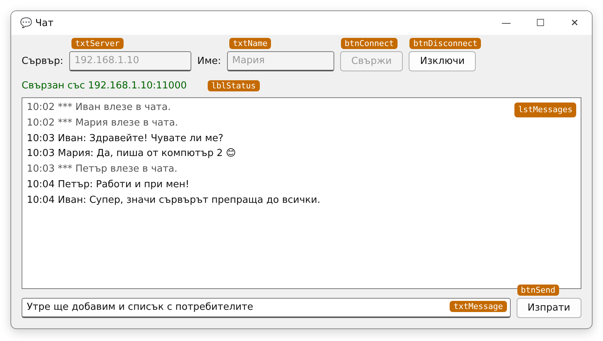

# Упражнение 6. Чат клиент с графичен интерфейс (Windows Forms)

**Учебна практика:** Интернет програмиране · **Клас:** XII · **Раздел 1:** Въведение в интернет, мрежови протоколи и модел „Клиент–сървър“ · **Продължителност:** 2 учебни часа (90 минути)

!!! abstract "Практически казус"
    Конзолният чат работи, но съобщенията се смесват с текста, който пишете. Сега създавате **прозорец за чата**: поле за адрес на сървъра и име, бутони за свързване, списък със съобщенията и поле за писане. Клиентът се свързва към **същия** сървър от упражнение 5, така че конзолни и графични клиенти си пишат помежду си.

**Връзка с практиката:** [Упражнение 5. Чат сървър и клиент – конзолни приложения](uprazhnenie-urok-03-chat-konzola.md) – сървърът, протоколът и класовете `TcpClient`, `StreamReader`, `StreamWriter` се използват без промяна; [Упражнение 4](uprazhnenie-urok-02-csharp-winforms.md) – асинхронни обработчици на събития в Windows Forms.

**Връзка с теорията:** [Урок 3. Клиент-сървър комуникация](../../teoria/razdel-1/urok-03-klient-sarvar-komunikatsia.md).

## Цели на упражнението

След упражнението ученикът трябва да може да:

- проектира форма за чат клиент;
- свързва се към сървър от асинхронен обработчик на събитие;
- получава съобщения в цикъл, без прозорецът да замръзва, и ги показва в `ListBox`;
- изпраща съобщения с бутон и с клавиша **Enter**;
- управлява състоянието на формата (свързан / несвързан) и обработва грешките при връзката;
- обяснява защо връзката се отделя в собствен клас (`ChatSession`) и как „номерът на опита“ (`generation`) пази новата връзка от стария код;
- публикува клиента като самостоятелна програма, която работи без Visual Studio.

## Необходими инструменти

- **Visual Studio 2026** с работното натоварване **.NET desktop development** и **.NET 10**.
- Решението `ChatApp` от [упражнение 5](uprazhnenie-urok-03-chat-konzola.md) – сървърът от него ще ви трябва.
- Поне два компютъра в една локална мрежа (за Мисия 5).

## План на работа

| Етап | Време |
|---|---:|
| **Първи учебен час** | |
| Мисия 1. Проект и форма | 20 мин |
| Мисия 2. Свързване и получаване на съобщения | 20 мин |
| Мисия 3. Изпращане | 5 мин |
| **Втори учебен час** | |
| Мисия 4. Изключване, грешки и окончателна версия | 20 мин |
| Публикуване на клиента | 5 мин |
| Мисия 5. Общ чат в класната стая | 15 мин |
| Предаване (самостоятелните задачи – за бързо напредналите или за домашна работа) | 5 мин |

## 1. Мисия 1 — Проект и форма (20 мин)

### 1.1. Създаване на проекта

1. Отворете решението `ChatApp`. Щракнете с десния бутон върху решението → **Add → New Project…** → **Windows Forms App** (C#, не *.NET Framework*).
2. Име: `ChatClientWinForms`. **Framework:** .NET 10.0 (Long Term Support).
3. Във формата `Form1` задайте `Text` = `Чат`, `Size` = `800; 520` и `MinimumSize` = `700; 400` (по-малък прозорец не побира контролите).
4. В **Configure Startup Projects…** изберете `ChatServer` и `ChatClientWinForms` (сървърът – отгоре).

### 1.2. Контролите



*Макет на формата. Оранжевите етикети показват свойството **Name** на всяка контрола – те не са част от прозореца.*

| Контрола | Name | Свойства |
|---|---|---|
| `Label` | – | `Text` = `Сървър:` |
| `TextBox` | `txtServer` | `Text` = `127.0.0.1` |
| `Label` | – | `Text` = `Име:` |
| `TextBox` | `txtName` | `MaxLength` = `20` |
| `Button` | `btnConnect` | `Text` = `Свържи` |
| `Button` | `btnDisconnect` | `Text` = `Изключи` |
| `Label` | `lblStatus` | `Text` = празно; `AutoSize` = `False`; `AutoEllipsis` = `True`; ширина почти колкото формата; `Anchor` = `Top, Left, Right` |
| `ListBox` | `lstMessages` | `HorizontalScrollbar` = `True`; `IntegralHeight` = `False`; `Anchor` = `Top, Bottom, Left, Right` |
| `TextBox` | `txtMessage` | `MaxLength` = `300`; `Anchor` = `Bottom, Left, Right` |
| `Button` | `btnSend` | `Text` = `Изпрати`; `Anchor` = `Bottom, Right` |

Задайте на формата `AcceptButton` = `btnSend` – така **Enter** в полето за съобщение натиска бутона **Изпрати**.

!!! tip "Защо `ListBox`, а не многоредов `TextBox`?"
    Всяко съобщение е отделен **елемент** на `ListBox` – добавя се с `Items.Add(...)` и не се налага да се грижим за знаците за нов ред (`\r\n`), както в упражнение 4. Списъкът може да се превърта автоматично до последното съобщение чрез свойството `TopIndex`.

### 1.3. Обработчици на събития

Щракнете **два пъти** върху бутона `btnConnect` – създава се `btnConnect_Click`. Останалите обработчици ще създадете в следващите мисии по същия начин.

## 2. Мисия 2 — Свързване и получаване на съобщения (20 мин)

Отворете кода на формата (**F7**) и заменете съдържанието на `Form1.cs`:

```csharp
using System.Net.Sockets;   // TcpClient, NetworkStream, SocketException
using System.Text;          // Encoding

namespace ChatClientWinForms;

public partial class Form1 : Form
{
    private const int Port = 11000;

    private TcpClient? client;        // връзката със сървъра (null, когато не сме свързани)
    private StreamWriter? writer;     // за изпращане на редове към сървъра

    public Form1()
    {
        InitializeComponent();
        SetConnected(false);
    }

    private async void btnConnect_Click(object? sender, EventArgs e)
    {
        string host = txtServer.Text.Trim();
        string name = txtName.Text.Trim();
        if (host == "" || name == "")
        {
            MessageBox.Show("Въведете адрес на сървъра и име.", "Чат",
                MessageBoxButtons.OK, MessageBoxIcon.Warning);
            return;
        }

        client = new TcpClient();
        await client.ConnectAsync(host, Port);

        NetworkStream stream = client.GetStream();
        StreamReader reader = new StreamReader(stream, Encoding.UTF8);
        writer = new StreamWriter(stream, new UTF8Encoding(false)) { AutoFlush = true };
        await writer.WriteLineAsync(name);   // първият ред е името

        SetConnected(true);
        SetStatus($"Свързан със {client.Client.RemoteEndPoint}");

        // Получаваме съобщения, докато връзката е отворена
        await ReceiveMessagesAsync(reader);

        SetStatus("Връзката е затворена.");
        SetConnected(false);
    }

    // Чете редовете от сървъра и ги добавя в списъка със съобщения
    private async Task ReceiveMessagesAsync(StreamReader reader)
    {
        try
        {
            string? line;
            while ((line = await reader.ReadLineAsync()) != null)
                AddMessage(line);
        }
        catch (Exception ex) when (ex is IOException || ex is ObjectDisposedException)
        {
            // Връзката е затворена – от нас или от сървъра
        }
    }

    // Добавя ред в списъка и превърта до него
    private void AddMessage(string message)
    {
        if (IsDisposed)   // формата вече е затворена
            return;

        lstMessages.Items.Add($"{DateTime.Now:HH:mm}  {message}");
        lstMessages.TopIndex = lstMessages.Items.Count - 1;
    }

    // Показва текст в реда за състояние
    private void SetStatus(string text)
    {
        if (!IsDisposed)
            lblStatus.Text = text;
    }

    // Разрешава и забранява контролите според състоянието на връзката
    private void SetConnected(bool connected)
    {
        if (IsDisposed)
            return;

        txtServer.Enabled = !connected;
        txtName.Enabled = !connected;
        btnConnect.Enabled = !connected;
        btnDisconnect.Enabled = connected;
        txtMessage.Enabled = connected;
        btnSend.Enabled = connected;
    }
}
```

Стартирайте сървъра и клиента. Въведете име и натиснете **Свържи**. Стартирайте и един **конзолен** клиент (**Debug → Start New Instance** върху `ChatClient`) и напишете съобщение от него – то се появява в прозореца.

**Как работи получаването?**

- **`btnConnect_Click` „живее“, докато сме свързани.** След свързването методът извиква `await ReceiveMessagesAsync(reader)`. Тази задача завършва едва когато връзката се затвори. Дотогава методът е „на пауза“ на реда с `await`.
- **Прозорецът не замръзва.** `await` освобождава нишката на интерфейса, докато чака следващия ред от сървъра – можете да местите прозореца и да натискате бутоните.
- **`AddMessage` може да променя `lstMessages` директно.** След всяко `await` в обработчик на събитие кодът продължава в **нишката на интерфейса**. Ако четенето беше пуснато в отделна нишка (например с `Task.Run`), щеше да е нужно `Invoke`, за да се промени контролата.
- **`SetConnected(bool)`** събира на едно място кои контроли са активни при всяко състояние. Така не може да се натисне **Свържи** два пъти или **Изпрати** без връзка.

!!! question "Сравнете с упражнение 5"
    В конзолния клиент получаването беше отделна задача, пусната **без** `await`, защото `Main` трябваше да продължи с четенето от клавиатурата. Защо тук може да използваме `await`? (Подсказка: кой „чете от клавиатурата“ във Windows Forms?)

## 3. Мисия 3 — Изпращане (5 мин)

Щракнете два пъти върху `btnSend` и попълнете обработчика:

```csharp
    private async void btnSend_Click(object? sender, EventArgs e)
    {
        string text = txtMessage.Text.Trim();
        if (writer == null || text == "")
            return;

        try
        {
            await writer.WriteLineAsync(text);
            txtMessage.Clear();
            txtMessage.Focus();
        }
        catch (Exception ex) when (ex is IOException || ex is ObjectDisposedException)
        {
            SetStatus("Съобщението не е изпратено – връзката е прекъсната.");
        }
    }
```

Изпратете няколко съобщения с бутона и с **Enter**. Опитайте да изпратите празно съобщение – какво се случва?

## 4. Мисия 4 — Изключване, грешки и окончателна версия (20 мин)

Първата версия на клиента работи, докато всичко върви добре. В тази мисия ще я изпитате в трудни ситуации, ще видите **какво се обърква** и ще я замените с окончателната версия. Тя е изпитана в истинска мрежа между два компютъра.

### 4.1. Изпитайте първата версия

Стартирайте сървъра и клиента с кода от Мисии 2–3. Проверете какво се случва и го запишете в протокола:

| № | Ситуация | Какво се случва? |
|---|---|---|
| 1 | **Свържи**, когато сървърът не работи | |
| 2 | **Свържи** към `10.255.255.1` (адрес, на който няма компютър) | |
| 3 | Сървърът се спира, докато клиентът е свързан | |
| 4 | **Свържи** към `10.255.255.1`, после **веднага** сменете адреса на `127.0.0.1` и натиснете **Свържи** отново | |
| 5 | Искате да излезете от чата, без да затваряте прозореца | |

### 4.2. Какви са проблемите?

| № | Какво видяхте | Защо се случва |
|---|---|---|
| 1 | Програмата **спира** с грешка (във Visual Studio – прекъсване на реда с `ConnectAsync`). | `ConnectAsync` хвърля `SocketException`, а никой не я обработва. В `async void` обработчик необработеното изключение спира цялата програма. |
| 2 | Около 20 секунди нищо не става, после програмата спира. | Windows чака дълго, преди да се откаже от адрес, който не отговаря. Нямаме собствено ограничение на времето. |
| 3 | Работи: показва „Връзката е затворена.“ и бутоните се връщат в начално състояние. | `ReadLineAsync` връща `null`, цикълът спира. Тук първата версия се справя. |
| 4 | Вторият опит се свързва, но след около 20 секунди програмата спира – заради **първия**, отдавна забравен опит. | Всяко натискане на **Свържи** стартира **отделно** изпълнение на `btnConnect_Click`. Старото изпълнение не знае, че вече има нова връзка, и когато най-сетне завърши, пречи на новата. |
| 5 | Няма как. | Липсва бутон **Изключи**. |

Има и два проблема, които трудно се виждат с просто око, но се случват в истинска мрежа:

- **Две записвания наведнъж.** Ако натиснете **Изпрати** точно когато програмата изпраща `/exit`, двете операции пишат в **един и същ** поток едновременно. .NET не позволява това и хвърля `InvalidOperationException`.
- **Код след затварянето на прозореца.** Ако затворите прозореца, докато трае свързване, започнатата операция продължава. Когато завърши, кодът се опитва да промени контроли на прозорец, който вече не съществува.

Ще решим проблемите с **две идеи**:

1. **Една връзка – един обект.** Всичко, което принадлежи на една връзка (`TcpClient`, `StreamReader`, `StreamWriter`), събираме в клас `ChatSession`. Той изпраща, получава и затваря връзката по правилен начин.
2. **Номер на опита (`generation`).** Всяко натискане на **Свържи** получава нов номер – като номерче на опашка. Когато един стар опит завърши, той сравнява номера си с текущия. Ако номерът му е стар, той **не пипа** формата и не разваля новата връзка.

### 4.3. Стъпка 1 — класът `ChatSession`

В **Solution Explorer** щракнете с десния бутон върху проекта `ChatClientWinForms` → **Add → Class…** → име `ChatSession.cs` → **Add**. Заменете съдържанието на новия файл:

```csharp
using System.Net.Sockets;
using System.Text;

namespace ChatClientWinForms;

internal sealed class ChatSession : IDisposable
{
    private readonly TcpClient client;
    private readonly StreamReader reader;
    private readonly StreamWriter writer;
    private readonly string remoteEndPoint;
    private readonly SemaphoreSlim sendLock = new(1, 1);
    private readonly CancellationTokenSource closed = new();
    private int isClosed;

    internal ChatSession(TcpClient client)
    {
        this.client = client;
        remoteEndPoint = client.Client.RemoteEndPoint?.ToString() ?? "?";
        NetworkStream stream = client.GetStream();
        reader = new StreamReader(stream, Encoding.UTF8);
        writer = new StreamWriter(stream, new UTF8Encoding(false)) { AutoFlush = true };
    }

    internal string RemoteEndPoint => remoteEndPoint;

    internal async Task SendAsync(string message, CancellationToken cancellationToken = default)
    {
        using CancellationTokenSource linked =
            CancellationTokenSource.CreateLinkedTokenSource(closed.Token, cancellationToken);
        await sendLock.WaitAsync(linked.Token);
        try
        {
            linked.Token.ThrowIfCancellationRequested();
            await writer.WriteLineAsync(message.AsMemory(), linked.Token);
        }
        finally
        {
            sendLock.Release();
        }
    }

    internal async Task ReceiveAsync(Action<string> onMessage)
    {
        try
        {
            string? line;
            while ((line = await reader.ReadLineAsync(closed.Token)) != null)
                onMessage(line);
        }
        catch (Exception ex) when (ex is IOException or ObjectDisposedException or OperationCanceledException)
        {
        }
    }

    internal async Task DisconnectAsync()
    {
        try
        {
            using CancellationTokenSource deadline = new(TimeSpan.FromMilliseconds(300));
            await SendAsync("/exit", deadline.Token).WaitAsync(deadline.Token);
        }
        catch (Exception ex) when (ex is IOException or ObjectDisposedException or OperationCanceledException or SocketException)
        {
        }
        finally
        {
            Close();
        }
    }

    internal void Close()
    {
        if (Interlocked.Exchange(ref isClosed, 1) != 0)
            return;
        closed.Cancel();
        client.Close();
    }

    public void Dispose() => Close();
}
```

| Елемент | Какъв проблем решава |
|---|---|
| Конструкторът | Създава `StreamReader` и `StreamWriter` за потока на връзката. Кодирането е същото като в сървъра и в конзолния клиент: чете се с `Encoding.UTF8`, пише се с `new UTF8Encoding(false)` (UTF-8 без BOM). Така кирилицата пристига правилно във всички посоки. |
| `sendLock` (`SemaphoreSlim`) в `SendAsync` | **Две записвания наведнъж.** Само едно записване може да е в потока в даден момент – второто изчаква. Същото решение използва сървърът в упражнение 5. |
| `closed` (`CancellationTokenSource`) | „Сигнал за край“ на връзката. Когато се затвори, всичко, което чака – четене или изпращане, – се прекратява веднага. |
| `CancellationToken` в `SendAsync` | Позволява на формата да каже „откажи изпращането“, например ако времето за свързване е изтекло. |
| `ReceiveAsync(Action<string> onMessage)` | Чете редове, докато връзката е отворена, и за всеки ред извиква подадения метод. `ChatSession` не знае нищо за формата – **формата** решава какво да прави с реда. Грешките при затворена връзка се обработват тук. |
| `DisconnectAsync()` | Опитва се да изпрати `/exit` (за да съобщи сървърът на останалите, че сме излезли), но чака най-много 300 милисекунди. После затваря връзката – дори ако сървърът не отговаря. |
| `Close()` с `Interlocked.Exchange` | Затварянето се изпълнява **само веднъж**, дори ако бъде поискано от няколко места едновременно (бутон **Изключи**, затваряне на прозореца, грешка). |

!!! tip "`Action<string>` – метод като параметър"
    `ReceiveAsync` получава като параметър **метод**, който приема `string`. Във формата ще го подадем като ламбда израз: `line => AddMessage(line)`. Така един и същ клас `ChatSession` може да се използва и във форма, и в конзолна програма.

### 4.4. Стъпка 2 — обработчиците за изключване и затваряне

1. Щракнете два пъти върху бутона `btnDisconnect` – създава се `btnDisconnect_Click`.
2. Изберете формата. В прозореца **Properties** натиснете бутона със светкавицата (**Events**) и щракнете два пъти върху събитието `FormClosing` – създава се `Form1_FormClosing`.

Така Visual Studio свързва бутона и събитието с обработчиците. Кодът им ще попълните в следващата стъпка.

### 4.5. Стъпка 3 — формата използва `ChatSession`

Сега променяте `Form1.cs`. Промените са по-долу, част по част. Всяка част **заменя** съществуващ код. Ако се объркате, заменете целия файл с окончателния код от раздел 5.

**а) Полетата.** Заменете двете полета `client` и `writer` с:

```csharp
    private const int Port = 11000;
    private readonly CancellationTokenSource formClosing = new();
    private TcpClient? pendingClient;
    private ChatSession? current;
    private int generation;
    private bool closing;
```

| Поле | Роля |
|---|---|
| `current` | Текущата връзка (`ChatSession`) или `null`, ако не сме свързани. Замества `client` и `writer`. |
| `generation` | Номерът на последния опит за свързване или изключване. |
| `pendingClient` | Връзката, която **още** се свързва. Трябва ни, за да я прекъснем, ако прозорецът се затвори точно тогава. |
| `formClosing`, `closing` | Сигнал и отметка „прозорецът се затваря“. След тях кодът не пипа контролите. |

**б) Свързването.** Заменете целия метод `btnConnect_Click` и **изтрийте** метода `ReceiveMessagesAsync` – четенето вече е в `ChatSession.ReceiveAsync`:

```csharp
    private async void btnConnect_Click(object? sender, EventArgs e)
    {
        string host = txtServer.Text.Trim();
        string name = txtName.Text.Trim();
        if (host.Length == 0 || name.Length == 0)
        {
            MessageBox.Show("Въведете адрес на сървъра и име.", "Чат",
                MessageBoxButtons.OK, MessageBoxIcon.Warning);
            return;
        }

        int myGeneration = ++generation;
        btnConnect.Enabled = false;
        SetStatus("Свързване...");
        TcpClient newClient = new();
        pendingClient = newClient;
        ChatSession? session = null;
        try
        {
            using CancellationTokenSource timeout =
                CancellationTokenSource.CreateLinkedTokenSource(formClosing.Token);
            timeout.CancelAfter(TimeSpan.FromSeconds(5));
            await newClient.ConnectAsync(host, Port, timeout.Token);
            if (closing || myGeneration != generation)
                return;

            session = new ChatSession(newClient);
            await session.SendAsync(name, timeout.Token);
            if (closing || myGeneration != generation)
                return;

            pendingClient = null;
            current = session;
            SetConnected(true);
            SetStatus($"Свързан със {session.RemoteEndPoint}");
            await session.ReceiveAsync(line =>
            {
                if (ReferenceEquals(current, session) && !closing)
                    AddMessage(line);
            });
            if (ReferenceEquals(current, session))
                SetStatus("Връзката е затворена.");
        }
        catch (Exception ex) when (ex is SocketException or IOException or ObjectDisposedException or OperationCanceledException)
        {
            if (!closing && myGeneration == generation)
                SetStatus(ex switch
                {
                    OperationCanceledException => $"Сървърът {host} не отговори за 5 секунди.",
                    SocketException => $"Неуспешно свързване: {ex.Message}",
                    _ => "Връзката със сървъра е прекъсната."
                });
        }
        finally
        {
            if (ReferenceEquals(pendingClient, newClient))
                pendingClient = null;
            if (ReferenceEquals(current, session) && session != null)
                current = null;
            session?.Dispose();
            newClient.Dispose();
            if (!closing && myGeneration == generation)
                SetConnected(false);
        }
    }
```

| Ред | Какъв проблем решава |
|---|---|
| `int myGeneration = ++generation;` | Този опит запомня **своя** номер. |
| `btnConnect.Enabled = false;` | Бутонът не може да се натисне втори път, докато трае свързването. |
| `CancelAfter(TimeSpan.FromSeconds(5))` | **Проблем 2.** Ако сървърът не отговори за 5 секунди, свързването се прекратява. |
| `CreateLinkedTokenSource(formClosing.Token)` | Свързването се прекратява и ако прозорецът се затвори. |
| Проверката на `closing` и `myGeneration != generation` | **Проблем 4.** След всяко `await` проверяваме: прозорецът затваря ли се, натиснато ли е междувременно **Изключи** или **Свържи**? Ако да, този опит е остарял и спира тихо. |
| `session.ReceiveAsync(line => { ... })` | Получените редове се показват само ако това е **текущата** връзка. Старата връзка не може да добави редове в списъка. |
| `catch (... SocketException or IOException ...)` | **Проблем 1.** Програмата не спира, а показва в `lblStatus` защо няма връзка. Изразът `ex switch` избира текста според вида на грешката. Съобщението се показва само за текущия опит. |
| `finally` | Изпълнява се винаги: затваря връзката на **този** опит и връща бутоните в начално състояние – но само ако никой друг опит не е започнал междувременно. |

**в) Изпращането.** Заменете `btnSend_Click`:

```csharp
    private async void btnSend_Click(object? sender, EventArgs e)
    {
        string draft = txtMessage.Text;
        string message = draft.Trim();
        ChatSession? session = current;
        if (session == null || message.Length == 0 || !btnSend.Enabled)
            return;
        btnSend.Enabled = false;
        try
        {
            await session.SendAsync(message);
            if (ReferenceEquals(current, session) && !closing)
            {
                if (txtMessage.Text == draft)
                    txtMessage.Clear();
                txtMessage.Focus();
            }
        }
        catch (Exception ex) when (ex is IOException or ObjectDisposedException or OperationCanceledException or SocketException)
        {
            if (ReferenceEquals(current, session))
                SetStatus("Съобщението не е изпратено – връзката е прекъсната.");
        }
        finally
        {
            if (ReferenceEquals(current, session) && !closing)
                btnSend.Enabled = true;
        }
    }
```

Първата версия изпращаше текста и после винаги изчистваше полето. Това крие два проблема: бързо двойно натискане може да изпрати едно и също съобщение два пъти, а текст, който сте започнали да пишете, докато първото съобщение се изпраща, може да бъде изтрит. Новата версия решава и двата:

| Ред | Какъв проблем решава |
|---|---|
| `string draft = txtMessage.Text;` | Запомняме **точно** какво е било в полето в момента на натискането. По-късно ще сравним с него, за да разберем дали потребителят е писал нещо ново. |
| `if (session == null` … `return;` | Не изпращаме нищо в три случая: няма връзка (`session == null`), съобщението е празно (`message.Length == 0`) или предишното изпращане още не е приключило (`!btnSend.Enabled`). Третата проверка е допълнителна защита: ако обработчикът все пак бъде извикан, докато изпращането тече, той не прави нищо. |
| `btnSend.Enabled = false;` | **Двойно изпращане.** Докато съобщението се записва, бутонът е забранен и не може да се натисне втори път. |
| `await session.SendAsync(message);` | Изпращаме съобщението през `ChatSession`. Методът е асинхронен: докато записът трае, прозорецът не замръзва и можете да пишете. Записът минава през `sendLock`, затова не се смесва с друго записване, например с `/exit`. |
| `ReferenceEquals(current, session)` | Докато чакахме изпращането, потребителят може да е натиснал **Изключи** или да се е свързал отново. Тогава `current` вече сочи друга връзка (или е `null`) и не бива да пипаме полето заради старата. Проверката `!closing` пази от промяна на прозорец, който се затваря. |
| `if (txtMessage.Text == draft)` `txtMessage.Clear();` | **Изтрит нов текст.** Изчистваме полето само ако в него е все още изпратеният текст. Ако междувременно сте започнали ново съобщение, то остава. |
| `catch (...)` | Ако връзката е прекъсната, изпращането хвърля изключение. Програмата не спира, а показва в `lblStatus`, че съобщението не е изпратено. Текстът остава в полето и може да се изпрати отново след ново свързване. |
| `finally { ... btnSend.Enabled = true; }` | `finally` се изпълнява независимо дали изпращането е успешно. Бутонът се разрешава отново само ако връзката все още е текуща и прозорецът не се затваря. При прекъсната връзка той правилно остава неактивен, а при изключване и ново свързване бутоните се управляват от `SetConnected`. |

**г) Изключването и затварянето.** Попълнете двата обработчика от Стъпка 2:

```csharp
    private async void btnDisconnect_Click(object? sender, EventArgs e)
    {
        ChatSession? session = current;
        if (session == null)
            return;
        ++generation;
        current = null;
        btnDisconnect.Enabled = false;
        SetConnected(false);
        SetStatus("Изключен.");
        await session.DisconnectAsync();
    }

    private void Form1_FormClosing(object? sender, FormClosingEventArgs e)
    {
        closing = true;
        ++generation;
        formClosing.Cancel();
        pendingClient?.Close();
        current?.Close();
        current = null;
    }
```

- **`btnDisconnect_Click`** увеличава `generation`, така че старият `btnConnect_Click` разбира, че връзката му вече не е текуща. Веднага връща бутоните в начално състояние и показва „Изключен.“, после изпраща `/exit` и затваря връзката. Затварянето прекъсва `ReceiveAsync`, а старият `btnConnect_Click` стига до `finally`. Благодарение на `generation` той не пипа бутоните на евентуална нова връзка.
- **`Form1_FormClosing`** вдига отметката `closing`, прекъсва започнатото свързване (`pendingClient`) и текущата връзка. Сървърът разбира, че клиентът е излязъл, и съобщава на останалите.

**д) Помощните методи.** Заменете `AddMessage`, `SetStatus` и `SetConnected`:

```csharp
    private void AddMessage(string message)
    {
        if (closing || IsDisposed || Disposing)
            return;
        lstMessages.Items.Add($"{DateTime.Now:HH:mm}  {message}");
        lstMessages.TopIndex = lstMessages.Items.Count - 1;
    }

    private void SetStatus(string text)
    {
        if (!closing && !IsDisposed && !Disposing)
            lblStatus.Text = text;
    }

    private void SetConnected(bool connected)
    {
        if (closing || IsDisposed || Disposing)
            return;
        txtServer.Enabled = !connected;
        txtName.Enabled = !connected;
        btnConnect.Enabled = !connected;
        btnDisconnect.Enabled = connected;
        txtMessage.Enabled = connected;
        btnSend.Enabled = connected;
    }
```

Проверката `closing || IsDisposed || Disposing` не позволява на код, който завършва **след** затварянето на прозореца, да промени контроли, които вече не съществуват.

Най-горе във файла остава само `using System.Net.Sockets;`. Редът `using System.Text;` вече не е нужен, защото кодирането е в `ChatSession`, и можете да го изтриете.

### 4.6. Изпитайте окончателната версия

Повторете ситуациите от 4.1 и добавете още няколко. Запишете в протокола какво показва `lblStatus`:

| № | Ситуация | Очакван резултат |
|---|---|---|
| 1 | **Свържи**, когато сървърът не работи | „Неуспешно свързване: …“ – програмата продължава да работи. |
| 2 | **Свържи** към `10.255.255.1` | След 5 секунди: „Сървърът 10.255.255.1 не отговори за 5 секунди.“ |
| 3 | Сървърът се спира, докато клиентът е свързан | „Връзката е затворена.“ или „Връзката със сървъра е прекъсната.“; активен е само **Свържи**. |
| 4 | Сървърът се стартира отново, клиентът натиска **Свържи** | „Свързан със …“. **Старите съобщения остават** в списъка, а новите се добавят под тях. Изпращането работи отново. |
| 5 | **Изключи** | „Изключен.“; другите участници виждат `*** ... излезе от чата.` |
| 6 | **Изключи** и веднага **Свържи** | Новата връзка работи нормално – старият опит не я разваля. |
| 7 | **Изпрати** (или **Enter**) два пъти много бързо | Съобщението се изпраща **веднъж**: докато трае изпращането, бутонът е забранен. |
| 8 | Затваряне на прозореца, докато пристигат съобщения или докато трае свързване към `10.255.255.1` | Прозорецът се затваря без грешка. |

Състоянието на бутоните винаги отговаря на връзката:

| Състояние | Активни контроли |
|---|---|
| Не сме свързани | `txtServer`, `txtName`, **Свържи** |
| Свързване (до 5 секунди) | нито един бутон |
| Свързани | **Изключи**, `txtMessage`, **Изпрати** |

!!! note "Историята на разговора"
    `lstMessages` не се изчиства при изключване и повторно свързване. Ако сървърът спре и после се свържете отново, виждате целия разговор от началото на часа. Сървърът **не пази** история: съобщенията, писани докато бяхте изключени, не пристигат.

## 5. Пълният код на формата

Окончателният `Form1.cs` (пълният `ChatSession.cs` е в 4.3):

```csharp
using System.Net.Sockets;

namespace ChatClientWinForms;

public partial class Form1 : Form
{
    private const int Port = 11000;
    private readonly CancellationTokenSource formClosing = new();
    private TcpClient? pendingClient;
    private ChatSession? current;
    private int generation;
    private bool closing;

    public Form1()
    {
        InitializeComponent();
        SetConnected(false);
    }

    private async void btnConnect_Click(object? sender, EventArgs e)
    {
        string host = txtServer.Text.Trim();
        string name = txtName.Text.Trim();
        if (host.Length == 0 || name.Length == 0)
        {
            MessageBox.Show("Въведете адрес на сървъра и име.", "Чат",
                MessageBoxButtons.OK, MessageBoxIcon.Warning);
            return;
        }

        int myGeneration = ++generation;
        btnConnect.Enabled = false;
        SetStatus("Свързване...");
        TcpClient newClient = new();
        pendingClient = newClient;
        ChatSession? session = null;
        try
        {
            using CancellationTokenSource timeout =
                CancellationTokenSource.CreateLinkedTokenSource(formClosing.Token);
            timeout.CancelAfter(TimeSpan.FromSeconds(5));
            await newClient.ConnectAsync(host, Port, timeout.Token);
            if (closing || myGeneration != generation)
                return;

            session = new ChatSession(newClient);
            await session.SendAsync(name, timeout.Token);
            if (closing || myGeneration != generation)
                return;

            pendingClient = null;
            current = session;
            SetConnected(true);
            SetStatus($"Свързан със {session.RemoteEndPoint}");
            await session.ReceiveAsync(line =>
            {
                if (ReferenceEquals(current, session) && !closing)
                    AddMessage(line);
            });
            if (ReferenceEquals(current, session))
                SetStatus("Връзката е затворена.");
        }
        catch (Exception ex) when (ex is SocketException or IOException or ObjectDisposedException or OperationCanceledException)
        {
            if (!closing && myGeneration == generation)
                SetStatus(ex switch
                {
                    OperationCanceledException => $"Сървърът {host} не отговори за 5 секунди.",
                    SocketException => $"Неуспешно свързване: {ex.Message}",
                    _ => "Връзката със сървъра е прекъсната."
                });
        }
        finally
        {
            if (ReferenceEquals(pendingClient, newClient))
                pendingClient = null;
            if (ReferenceEquals(current, session) && session != null)
                current = null;
            session?.Dispose();
            newClient.Dispose();
            if (!closing && myGeneration == generation)
                SetConnected(false);
        }
    }

    private async void btnSend_Click(object? sender, EventArgs e)
    {
        string draft = txtMessage.Text;
        string message = draft.Trim();
        ChatSession? session = current;
        if (session == null || message.Length == 0 || !btnSend.Enabled)
            return;
        btnSend.Enabled = false;
        try
        {
            await session.SendAsync(message);
            if (ReferenceEquals(current, session) && !closing)
            {
                if (txtMessage.Text == draft)
                    txtMessage.Clear();
                txtMessage.Focus();
            }
        }
        catch (Exception ex) when (ex is IOException or ObjectDisposedException or OperationCanceledException or SocketException)
        {
            if (ReferenceEquals(current, session))
                SetStatus("Съобщението не е изпратено – връзката е прекъсната.");
        }
        finally
        {
            if (ReferenceEquals(current, session) && !closing)
                btnSend.Enabled = true;
        }
    }

    private async void btnDisconnect_Click(object? sender, EventArgs e)
    {
        ChatSession? session = current;
        if (session == null)
            return;
        ++generation;
        current = null;
        btnDisconnect.Enabled = false;
        SetConnected(false);
        SetStatus("Изключен.");
        await session.DisconnectAsync();
    }

    private void Form1_FormClosing(object? sender, FormClosingEventArgs e)
    {
        closing = true;
        ++generation;
        formClosing.Cancel();
        pendingClient?.Close();
        current?.Close();
        current = null;
    }

    private void AddMessage(string message)
    {
        if (closing || IsDisposed || Disposing)
            return;
        lstMessages.Items.Add($"{DateTime.Now:HH:mm}  {message}");
        lstMessages.TopIndex = lstMessages.Items.Count - 1;
    }

    private void SetStatus(string text)
    {
        if (!closing && !IsDisposed && !Disposing)
            lblStatus.Text = text;
    }

    private void SetConnected(bool connected)
    {
        if (closing || IsDisposed || Disposing)
            return;
        txtServer.Enabled = !connected;
        txtName.Enabled = !connected;
        btnConnect.Enabled = !connected;
        btnDisconnect.Enabled = connected;
        txtMessage.Enabled = connected;
        btnSend.Enabled = connected;
    }
}
```

`Program.cs` и `Form1.Designer.cs` не се пишат на ръка: първият остава такъв, какъвто го създава Visual Studio (`Application.Run(new Form1());`), а вторият се попълва от дизайнера.

## 6. Публикуване на клиента (5 мин)

Досега стартирахте клиента от Visual Studio. За общия чат е удобно клиентът да е **един файл**, който се копира и стартира на всеки компютър, дори ако на него няма Visual Studio и .NET.

1. В **Solution Explorer** щракнете с десния бутон върху проекта `ChatClientWinForms` → **Publish…**
2. **Target:** **Folder** → **Next** → **Folder** → **Finish**. Създава се профил за публикуване.
3. Натиснете **Show all settings** (или иконата с молива до настройките) и задайте:

    | Настройка | Стойност |
    |---|---|
    | Configuration | `Release` |
    | Target framework | `net10.0-windows` |
    | Deployment mode | **Self-contained** |
    | Target runtime | `win-x64` |
    | File publish options → **Produce single file** | включено |

4. **Save** → **Publish**. След като приключи, натиснете **Open folder** (или отворете папката от реда **Target location**). При тези настройки тя обикновено е `bin\Release\net10.0-windows\publish\win-x64\`.

| Файл | Копира ли се? |
|---|---|
| `ChatClientWinForms.exe` (около 116 MB) | **Да** – това е цялата програма. |
| `ChatClientWinForms.pdb` | Не – служи само за откриване на грешки. |
| Междинната папка `bin\Release\net10.0-windows\win-x64\` с много `.dll` файлове | Не – това са работни файлове на компилацията. |

На другия компютър копирайте `ChatClientWinForms.exe`, например на работния плот или от USB памет, и го стартирайте с двоен щрак. **Visual Studio и отделно инсталиран .NET Runtime не са нужни** – при *Self-contained* .NET е вграден в самия файл. Затова файлът е голям.

!!! info "За кои компютри е публикуваният файл?"
    Настройката `win-x64` означава: **64-битов Windows** на процесор x64 (Intel или AMD) – Windows 10 или Windows 11, каквито са компютрите в кабинета. Файлът **не** работи на 32-битов Windows, на macOS или на Linux. За друга система клиентът се публикува отново с друг *Target runtime* (например `win-x86` или `win-arm64`).

!!! warning "Предупреждение на Windows"
    При първото стартиране Windows SmartScreen може да покаже „Windows protected your PC“, защото файлът не е подписан. Натиснете **More info** → **Run anyway**. Защитната стена засяга само компютъра, на който работи **сървърът** – клиентът сам започва връзката и не се нуждае от разрешение за входящи връзки.

## 7. Мисия 5 — Общ чат в класната стая (15 мин)

1. Учителят стартира `ChatServer` на своя компютър и показва адреса му на екрана.
2. Всеки ученик стартира **само** клиента – `ChatClientWinForms` от Visual Studio, публикувания `ChatClientWinForms.exe` или конзолния `ChatClient`. Въвежда **IPv4 адреса** на сървъра (не `127.0.0.1`) и името си и натиска **Свържи**.
3. Изпълнете задачите и запишете наблюденията в протокола:
    - Всеки изпраща по едно съобщение. Пристигат ли всички съобщения при всички?
    - Двама ученици натискат **Изпрати** едновременно. Объркват ли се съобщенията?
    - Учителят спира сървъра за момент и го стартира отново. Какво виждате? Как се свързвате отново? Остават ли старите съобщения в списъка?
    - Колко клиента е обслужил сървърът едновременно? (Пребройте редовете `+ ... се свърза`.)

!!! tip "Ако няма връзка"
    Използвайте таблицата за диагностика от [упражнение 5, Мисия 4](uprazhnenie-urok-03-chat-konzola.md): `ipconfig`, `ping` и `Test-NetConnection <адрес> -Port 11000`. Не забравяйте: успешният `ping` показва само, че компютърът се достига – не и че порт 11000 е отворен.

## 8. Конзолен и графичен клиент

| | Конзолен клиент (упражнение 5) | Графичен клиент (упражнение 6) |
|---|---|---|
| Въвеждане на адрес и име | `Console.ReadLine()` | `txtServer.Text`, `txtName.Text` |
| Получаване на съобщения | Задача, пусната без `await`, работи успоредно с `Main` | `await session.ReceiveAsync(...)` в `btnConnect_Click` |
| Показване на съобщенията | `Console.WriteLine` | `lstMessages.Items.Add` |
| Изпращане | Цикъл с `Console.ReadLine()` | Събитие `Click` на `btnSend` |
| Изход | `/exit` | Бутон **Изключи** или затваряне на прозореца |
| Повторно свързване | Програмата се стартира отново | Бутон **Свържи**; старите съобщения остават |
| Мрежови класове | `TcpClient`, `NetworkStream`, `StreamReader`, `StreamWriter` | **същите**, събрани в класа `ChatSession` |

## 9. Самостоятелни задачи

Изпълнете поне **една** задача.

1. **Брояч в заглавието.** Заглавието на формата показва броя на получените съобщения: `Чат – 12 съобщения`.
2. **Изчисти.** Бутон **Изчисти**, който изтрива съобщенията от `lstMessages`, без да прекъсва връзката.
3. **Запиши разговора.** Бутон **Запиши…**, който със `SaveFileDialog` записва всички редове от `lstMessages` в текстов файл (`File.WriteAllLines`).
4. **Известията в отделен вид.** Редовете, които започват със `***`, се показват със скоби: `[Иван влезе в чата.]` – за да се отличават от съобщенията.
5. **Помни последния сървър.** При затваряне програмата записва адреса и името във файл, а при стартиране ги зарежда в `txtServer` и `txtName`.

## 10. Предаване

1. Затворете Visual Studio. Изтрийте подпапките `bin` и `obj` на трите проекта и скритата папка `.vs`.
2. Архивирайте папката на решението `ChatApp` в ZIP файл: `ChatApp-<име>-<фамилия>.zip`.
3. В протокола приложете **екранни снимки** на графичния клиент по време на общия чат (Мисия 5) и след прекъсната връзка (Мисия 4), както и снимка на публикувания клиент, стартиран на друг компютър.

!!! success "Готов си, когато…"
    Графичният клиент се свързва към сървъра на друг компютър, показва всички съобщения, изпраща с бутон и с **Enter**, не замръзва и не спира при грешка, а бутоните са активни само когато имат смисъл.

## Проверка на знанията

1. Защо прозорецът не замръзва, докато `btnConnect_Click` чака съобщения?
2. Защо `AddMessage` може да промени `lstMessages` без `Invoke`?
3. Какво прекъсва цикъла в `ChatSession.ReceiveAsync`, когато натиснем **Изключи** или затворим прозореца?
4. Какъв проблем решава броячът `generation`? Опишете ситуация, в която без него новата връзка би била развалена.
5. Защо `ChatSession` използва `SemaphoreSlim` при изпращане? Къде видяхме същото решение в упражнение 5?
6. Кои файлове копирате на друг компютър, за да стартирате публикувания клиент, и защо там не е нужно да се инсталира .NET?

## Оценяване — 12 точки

| Критерий | Точки |
|---|---:|
| Мисия 1 — форма с всички контроли, правилни имена и свойства | 2 |
| Мисия 2 — свързване и получаване без замръзване | 2 |
| Мисия 3 — изпращане с бутон и с **Enter** | 2 |
| Мисия 4 — `ChatSession`, изключване, обработка на грешките, правилно състояние на бутоните, повторно свързване | 2 |
| Мисия 5 — участие в общия чат; записани наблюдения | 2 |
| Публикуван клиент, самостоятелна задача и протокол с екранни снимки | 2 |
| **Общо** | **12** |

## Ключови понятия

**Windows Forms**, **`ListBox`**, **`AcceptButton`**, **обработчик на събитие**, **`async void`**, **нишка на интерфейса**, **`Invoke`**, **`CancellationTokenSource`**, **`CancellationToken`**, **`SemaphoreSlim`**, **`finally`**, **състояние на формата**, **сесия (`ChatSession`)**, **номер на опита (`generation`)**, **публикуване (*Publish*)**, **самостоятелно приложение (*self-contained*)**.

!!! note "За учителя"
    Упражнението е за **Visual Studio 2026 и .NET 10** и изисква Windows. Кодът на Мисии 2–3 е междинен и нарочно непълен – в Мисия 4 учениците наблюдават проблемите му. Окончателният код (`ChatSession.cs` в 4.3 и `Form1.cs` в раздел 5) е **изпитан между два физически компютъра** в локална мрежа: сървър на `192.168.100.89:11000`, отдалечен клиент от `192.168.100.2`. Потвърдени са свързване на локален и отдалечен клиент, двупосочен обмен, кирилица, известия за влизане и излизане, разпознаване на спрян сървър, повторно свързване след рестартирането му и изпращане след това, както и стартиране на публикувания клиент на компютър **без Visual Studio**. Макетът на формата е схема, а не екранна снимка.

    **Мисия 4** е най-трудната част на упражнението. Препоръчително е първо да покажете на екрана ситуации 1 и 4 от 4.1 (срив при спрян сървър и „забравения“ първи опит) и едва тогава учениците да въвеждат новия код. Ако някой изостане, той може да замени целия `Form1.cs` с кода от раздел 5.

    **Публикуване.** Публикуваният файл е около 116 MB, защото съдържа и .NET. Можете да го подготвите предварително и да го разпространите през споделена папка. За Мисия 5 стартирайте сървъра на своя компютър и проектирайте прозореца му – учениците виждат как се свързват.

## Следваща стъпка

Упражнения 5 и 6 са основата на [практическия проект „Чат приложение в модел „Клиент-сървър““](proekt-chat-prilozhenie.md), в който разширявате чата в екип.

[Към Раздел 1 на учебната практика](index.md) · [Към началото на модула](../index.md)
