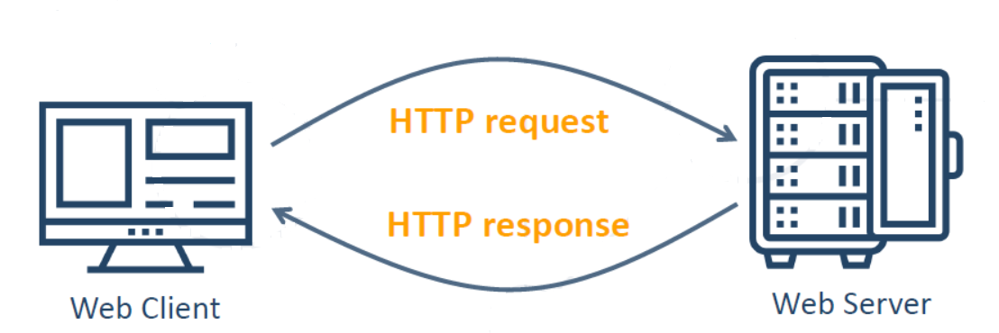

# Урок 2. HTTP. Видове HTTP заявки

**Раздел 1. Въведение в интернет програмирането**

!!! abstract "Какво ще научите"
    След този урок ще можете да обяснявате ролята на HTTP в уеб комуникацията; да различавате HTTP заявка от HTTP отговор; да разпознавате методите GET, POST, PUT, PATCH, DELETE и HEAD; да тълкувате статус кодове; да разглобявате URL адрес; да определяте MIME типове и да конструирате примерни HTTP съобщения.

## 1. Какво представлява HTTP?

**HTTP** (*HyperText Transfer Protocol* — протокол за пренос на хипертекст) определя правилата, по които уеб клиентите и уеб сървърите обменят заявки и отговори. Макар името да съдържа думата „хипертекст“, HTTP пренася не само HTML страници, но и изображения, стилове, JavaScript файлове, PDF документи, видео и структурирани данни като JSON.

HTTP принадлежи към **приложния слой (слой 7) на OSI модела**. В Урок 1 разгледахме мрежите, пакетното предаване и взаимодействието между клиент и сървър. Сега ще проследим какво точно съдържат съобщенията, които те обменят.

HTTP е **безсъстояниен (stateless)** протокол: по правило всяка заявка има собствено значение и сървърът не е длъжен автоматично да помни предишните заявки на същия клиент. Уеб приложенията могат да поддържат потребителски сесии чрез бисквитки (cookies), токени и съхранено на сървъра състояние.

!!! note "HTTP и HTTPS"
    **HTTPS** е HTTP комуникация, защитена с TLS криптиране. То осигурява поверителност и защита срещу подмяна на данните по пътя. Обичайните портове са **80 за HTTP** и **443 за HTTPS**, но могат да се използват и други. В съвременните системи HTTP/1.1 и HTTP/2 обикновено работят върху TCP, а HTTP/3 използва QUIC върху UDP.

## 2. Как протича HTTP комуникацията?



1. Потребителят въвежда URL адрес или избира хипервръзка.
2. Браузърът установява необходимата мрежова връзка със сървъра.
3. **Клиентът изпраща HTTP заявка** (*HTTP request*), която указва желаното действие и ресурс.
4. **Сървърът обработва заявката** — например намира файл, проверява данни или изпълнява програмен код.
5. **Сървърът изпраща HTTP отговор** (*HTTP response*) със статус и евентуално съдържание.
6. Браузърът обработва отговора и показва резултата. За изображения, стилове и други ресурси може да изпрати допълнителни заявки.

**Пример:** При отваряне на началната страница на училищен сайт браузърът може първо да получи HTML документ, след което отделно да поиска неговите изображения и CSS файлове.

## 3. HTTP методи — какво иска клиентът?

HTTP методът се записва в началото на заявката и обозначава действието, което клиентът желае да извърши.

| Метод | Предназначение | Пример |
|---|---|---|
| **GET** | Получаване на представяне на ресурс | Отваряне на страница с курс |
| **POST** | Изпращане на данни за обработка; често създаване на ресурс | Регистрация на потребител |
| **PUT** | Създаване или цялостна замяна на ресурс на указан адрес | Замяна на данните на профил |
| **PATCH** | Частична промяна на ресурс | Промяна само на телефон |
| **DELETE** | Заявка за премахване на ресурс | Изтриване на публикация |
| **HEAD** | Получаване на заглавките на отговор, без неговото тяло | Проверка на метаданни за файл |

### 3.1. GET — получаване на информация

При GET клиентът иска информация, без самата заявка да предполага промяна на състоянието на сървъра.

```http
GET /courses/javascript HTTP/1.1
Host: school.bg
Accept: text/html
```

Тук браузърът иска ресурса `/courses/javascript` от сървъра `school.bg`. Обичайните GET заявки **нямат тяло**. Параметри за търсене могат да се предават в URL адреса, например `/search?q=html`.

### 3.2. POST — изпращане на данни

POST се използва, когато клиентът изпраща данни за обработка. Често това е формуляр или JSON документ.

```http
POST /users HTTP/1.1
Host: school.bg
Content-Type: application/json

{"name":"Ivan"}
```

Празният ред разделя заглавките от тялото. Сървърът може да създаде нов потребител и да върне статус **201 Created**.

### 3.3. PUT, PATCH и DELETE

```http
PUT /users/8 HTTP/1.1
Host: school.bg
Content-Type: application/json

{"name":"Maria","class":"11A"}
```

PUT указва пълна замяна на представянето на ресурса `/users/8`. За промяна само на едно поле е по-подходящ **PATCH**. Методът **DELETE** заявява премахване на ресурс, например `DELETE /posts/17 HTTP/1.1`.

!!! tip "Връзка с CRUD"
    CRUD обозначава четири основни операции с данни: **Create** (създаване), **Read** (четене), **Update** (актуализиране) и **Delete** (изтриване). Често те се свързват съответно с **POST**, **GET**, **PUT/PATCH** и **DELETE**, но HTTP методите и операциите CRUD не са напълно тъждествени.

!!! info "Други HTTP методи"
    **OPTIONS** описва налични комуникационни възможности, **TRACE** е диагностичен метод, а **CONNECT** се използва за създаване на тунел през прокси. В този урок основният практически акцент е върху GET, POST, PUT и DELETE.

## 4. Структура на HTTP заявката (HTTP Request)

В HTTP/1.1 текстовото представяне на заявката включва четири логически части:

1. **Request Line** — метод, път до ресурса и версия на протокола.
2. **Request Headers** — заглавки с допълнителна информация.
3. **Празен ред** — отделя заглавките от тялото.
4. **Request Body** — незадължително тяло с данни.

```http
POST /login HTTP/1.1
Host: school.bg
Content-Type: application/x-www-form-urlencoded

username=ivan&class=11
```

| Част | Значение |
|---|---|
| `POST` | Метод на заявката |
| `/login` | Път до ресурса |
| `HTTP/1.1` | Версия на HTTP |
| `Host: school.bg` | Име на сървъра |
| `Content-Type: application/x-www-form-urlencoded` | Формат на изпратеното тяло |
| Празен ред | Край на заглавките |
| `username=ivan&class=11` | Данни в тялото |

### 4.1. Често използвани заглавки

- **Host** — посочва името на хоста, към който е адресирана заявката.
- **User-Agent** — информация за клиентския софтуер.
- **Accept** — предпочитани типове съдържание за отговора.
- **Accept-Language** — предпочитан език.
- **Accept-Encoding** — поддържани кодирания на съдържанието, например `gzip`.
- **Content-Type** — формат на тялото, което се изпраща.
- **Content-Length** — размер на тялото в байтове, когато е указан.

!!! warning "Важно за структурата"
    В някои схеми и стари учебни примери се показва GET заявка с тяло. За началното обучение ще използваме **GET без тяло**, а за изпращане на формулярни данни — **POST**. В HTTP/2 и HTTP/3 съобщенията се пренасят в двоични рамки, но логическите понятия „метод“, „заглавки“ и „тяло“ остават полезни.

### Лаборатория 1. Построй HTTP заявката

Сглобете заявка, като поставите правилните карти за **метод, път, версия, заглавки, празен ред и тяло**. Решете четирите мисии и обяснете защо някои карти са излишни.

[**Отвори интерактивната лаборатория „Построй заявката“**](https://ilkoiliev.github.io/internet-programirane/interaktivni/http-postroi-zayavkata.html){: target="_blank" }

## 5. HTTP отговор (HTTP Response)

След обработка на заявката сървърът изпраща отговор. В HTTP/1.1 той се представя чрез:

1. **Status Line** — версия, числов статус код и текстово описание.
2. **Response Headers** — метаданни за отговора.
3. **Празен ред**.
4. **Response Body** — незадължително съдържание.

```http
HTTP/1.1 200 OK
Content-Type: text/html

<!doctype html>
<html lang="bg">
  <body><h1>Добре дошли!</h1></body>
</html>
```

В този пример `200 OK` означава успешно обработена заявка, а `Content-Type: text/html` показва, че тялото съдържа HTML.

### 5.1. Класове HTTP статус кодове

| Клас | Значение | Примери |
|---|---|---|
| **1xx** | Информационни | `100 Continue` |
| **2xx** | Успешно изпълнение | `200 OK`, `201 Created` |
| **3xx** | Пренасочване или допълнителна стъпка | `301 Moved Permanently`, `302 Found` |
| **4xx** | Проблем със заявката от страна на клиента | `400 Bad Request`, `401 Unauthorized`, `404 Not Found` |
| **5xx** | Проблем при обработката от сървъра | `500 Internal Server Error`, `503 Service Unavailable` |

**Примери от практиката:**

- `200 OK` — успешно заредена страница.
- `201 Created` — създаден е нов ресурс.
- `301 Moved Permanently` — ресурсът е преместен трайно.
- `401 Unauthorized` — необходимо е удостоверяване.
- `404 Not Found` — исканият ресурс не е намерен.
- `500 Internal Server Error` — възникнал е вътрешен проблем в сървъра.
- `503 Service Unavailable` — услугата временно не е достъпна.

!!! question "Помислете"
    Ако браузърът изпрати правилна заявка, но търсената страница липсва, кой код очаквате? А ако сървърната програма прекъсне поради непредвидена грешка?

### Лаборатория 2. Построй HTTP отговора

Влезте в ролята на сървър. За всяка ситуация сглобете **статус ред, заглавки и тяло**. Лабораторията включва шест мисии.

[**Отвори интерактивната лаборатория „Построй отговора“**](https://ilkoiliev.github.io/internet-programirane/interaktivni/http-postroi-otgovora.html){: target="_blank" }

## 6. URL — адресът на ресурса

**URL** (*Uniform Resource Locator*) указва местоположението на ресурс и начина за достъп до него. URL е вид URI (*Uniform Resource Identifier*).

Разгледайте адреса:

```text
http://mysite.com:8080/demo/index.php?id=27&lang=en#lectures
```

| Част | Стойност | Роля |
|---|---|---|
| Схема (*scheme*) | `http` | Начин на достъп |
| Хост (*host*) | `mysite.com` | Име на сървъра |
| Порт (*port*) | `8080` | Номер на използваната услуга |
| Път (*path*) | `/demo/index.php` | Адрес на ресурса |
| Низ за заявка (*query*) | `id=27&lang=en` | Допълнителни параметри |
| Фрагмент (*fragment*) | `lectures` | Обозначение на част от документа |

**Символите имат значение:** `://` следва схемата при уеб адресите; `:` въвежда порта; `?` започва низа за заявка; `&` разделя параметри; `#` въвежда фрагмент.

### 6.1. Параметри в URL

```text
https://school.bg/search?subject=html&class=11
```

Тук `subject=html` и `class=11` са два параметъра. Сървърът може да ги използва, за да филтрира резултатите.

!!! note "URL фрагментът"
    Частта след `#` обичайно се обработва от браузъра и **не се изпраща като част от HTTP заявката** към сървъра.

### 6.2. URL и формуляри

HTML формуляр с метод GET може да поставя данните си в низа за заявка:

```html
<form action="/search" method="get">
  <input name="q" placeholder="Търси">
  <button type="submit">Търси</button>
</form>
```

При търсене на `http` браузърът може да отвори `/search?q=http`.

При POST данните обикновено се изпращат в тялото на заявката. **Пароли и друга чувствителна информация не бива да се поставят в URL**, тъй като адресите могат да попадат в историята на браузъра и в логове.

### Лаборатория 3. URL — шест мисии

Разглобете URL, сглобете адрес от компоненти и откривайте грешки. Обърнете внимание на схемата, порта, параметрите и фрагмента.

[**Отвори интерактивната URL лаборатория**](https://ilkoiliev.github.io/internet-programirane/interaktivni/url-laboratoria.html){: target="_blank" }

## 7. MIME типове и HTTP заглавката Content-Type

Когато сървърът изпрати ресурс, браузърът трябва да знае какъв вид съдържание получава. Това се обозначава чрез **медиен тип (MIME type)**, обикновено записан в заглавката `Content-Type`.

Медийните типове имат форма **`тип/подтип`**, например `image/png`.

| Ресурс | MIME тип |
|---|---|
| HTML страница | `text/html` |
| Обикновен текст | `text/plain` |
| PNG изображение | `image/png` |
| GIF изображение | `image/gif` |
| PDF документ | `application/pdf` |
| JSON данни | `application/json` |
| MP4 видео | `video/mp4` |
| CSS стилове | `text/css` |
| JavaScript | `text/javascript` |

**Пример за отговор с изображение:**

```http
HTTP/1.1 200 OK
Content-Type: image/png

[двоични данни на PNG изображение]
```

### 7.1. Content-Type и Accept — каква е разликата?

- **`Accept`** е заглавка в заявката: клиентът съобщава кои формати предпочита да получи.
- **`Content-Type`** описва формата на тялото на съобщението — както в заявка, така и в отговор.

Например клиентът може да изпрати `Accept: application/json`, а сървърът да върне `Content-Type: application/json`.

!!! tip "Допълнително понятие: Content-Disposition"
    Заглавката `Content-Disposition` може да указва дали даден ресурс да бъде показан в браузъра или предложен за изтегляне като файл.

### Лаборатория 4. MIME и Content-Type

Свържете файловете с правилните MIME типове, определете заглавката на отговор и диагностицирайте неправилен `Content-Type`. Лабораторията съдържа четири мисии.

[**Отвори интерактивната MIME лаборатория**](https://ilkoiliev.github.io/internet-programirane/interaktivni/mime-laboratoria.html){: target="_blank" }

## 8. Цялостен пример: заявка и отговор

Ученик отваря учебна страница:

**Заявка на браузъра:**

```http
GET /lessons/http.html HTTP/1.1
Host: school.bg
Accept: text/html
```

**Отговор на сървъра:**

```http
HTTP/1.1 200 OK
Content-Type: text/html

<!doctype html>
<html lang="bg">
  <body><h1>Урок по HTTP</h1></body>
</html>
```

**Анализ:**

1. Методът е `GET`, защото клиентът иска да получи ресурс.
2. Пътят е `/lessons/http.html`.
3. Заглавката `Accept` показва предпочитания формат на клиента.
4. Статусът `200 OK` означава успешно изпълнение.
5. `Content-Type: text/html` позволява на браузъра да разпознае HTML съдържанието.

## 9. Практически задачи

**Задача 1. Разпознай метода.** За всяка ситуация посочете подходящ HTTP метод: а) отваряне на новина; б) изпращане на регистрационен формуляр; в) замяна на всички данни за профил; г) промяна само на телефонен номер; д) изтриване на коментар.

**Задача 2. Разглоби заявката.** В следното съобщение посочете метода, пътя, версията, заглавките и тялото:

```http
POST /feedback HTTP/1.1
Host: school.bg
Content-Type: text/plain

Много полезен урок!
```

**Задача 3. Обясни статуса.** Каква е разликата между `200 OK`, `201 Created`, `404 Not Found` и `500 Internal Server Error`?

**Задача 4. Анализирай URL.** Разделете `https://school.bg:8443/library/book.html?id=15#chapter2` на компоненти. Коя част обичайно не достига до сървъра?

**Задача 5. Избери MIME тип.** Посочете правилен `Content-Type` за `report.pdf`, `logo.png`, `data.json` и `index.html`.

**Задача 6. Минипроект.** Начертайте схема „Клиент → HTTP заявка → Сървър → HTTP отговор → Клиент“. Добавете примерен метод, URL, статус код и MIME тип.

## 10. Въпроси за самопроверка

1. Какво означава HTTP и за какво служи?
2. В кой слой на OSI модела се намира HTTP?
3. Какво означава, че HTTP е безсъстояниен протокол?
4. Каква е разликата между HTTP и HTTPS?
5. Кои са четирите логически части на HTTP/1.1 заявка?
6. Каква е разликата между GET и POST?
7. По какво се различават PUT и PATCH?
8. Какво означават CRUD операциите?
9. От кои части се състои HTTP отговорът?
10. Каква е разликата между кодовете от класове 4xx и 5xx?
11. За какво служат `Host`, `Accept` и `Content-Type`?
12. Кои са основните компоненти на URL?
13. Каква е ролята на `?`, `&` и `#` в URL адрес?
14. Какво означава MIME типът `application/json`?
15. Защо браузърът може да изпрати няколко HTTP заявки за една уеб страница?

## 11. Обобщение

HTTP е основен протокол за обмен на информация в уеб. Клиентът изпраща **заявка**, съдържаща метод, адрес и заглавки, а сървърът връща **отговор** със статус код, заглавки и евентуално тяло. **URL** указва ресурса, а **MIME типът** описва вида на съдържанието. Познаването на тези понятия е необходимо за разработване, използване и диагностика на интернет приложения.

---

**Източници за разработката:** предоставените учебни материали „HTTP. Видове HTTP заявки“ (Word и презентация), „Протокол за пренос на хипертекст (HTTP)“, „Какво точно е URL“, двете схеми и четирите интерактивни HTML лаборатории. Текстът е редактиран и допълнен с пояснения за съвременните версии на HTTP и коректни учебни примери.
