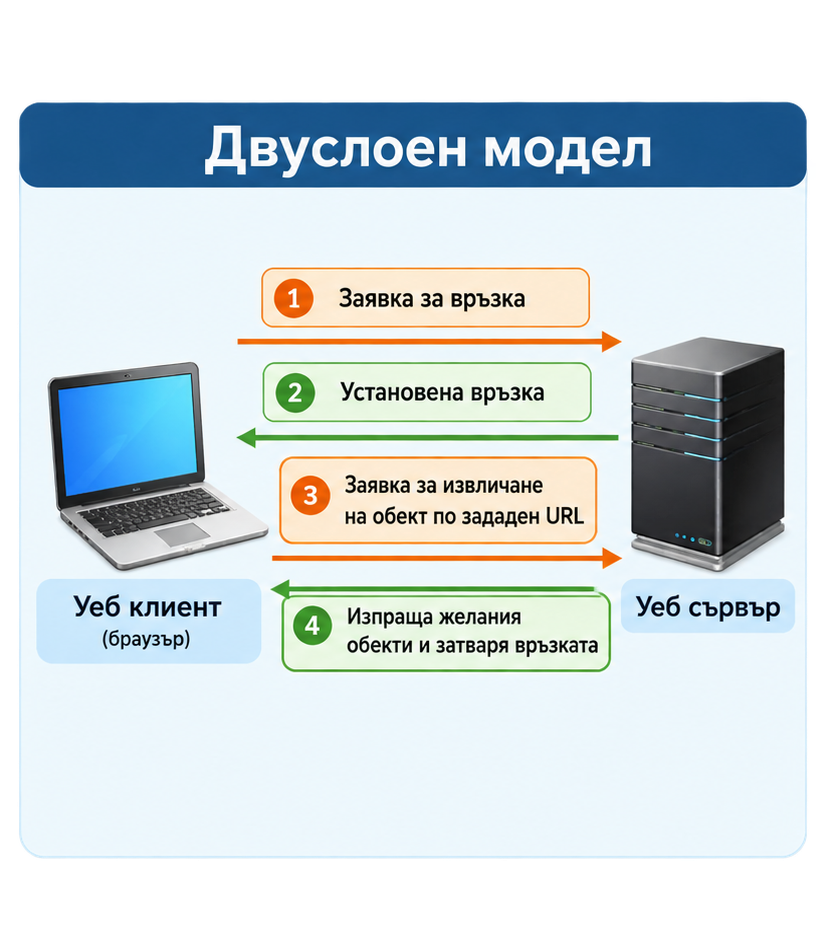
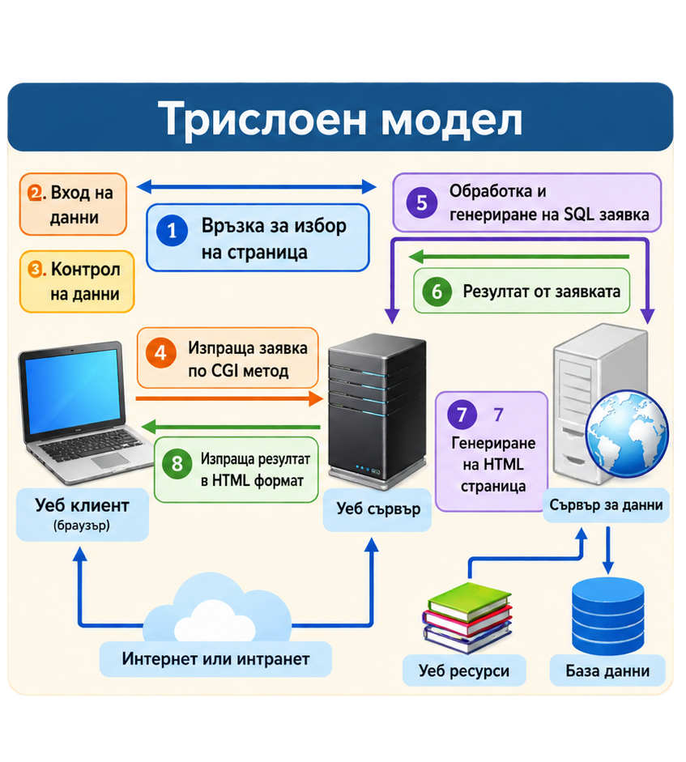

# Урок 3. Клиент-сървър комуникация

**Предмет:** Интернет програмиране · **Клас:** XII · **Модул:** Теория · **Раздел:** Основи на интернет и мрежовите протоколи

> **Основен въпрос:** Как си взаимодействат клиентът, уеб сървърът и системата за данни, за да изпълнят действието на потребителя в едно уеб приложение?

## Какво ще научите

След изучаването на урока ще можете да:

- обяснявате същността на архитектурата **клиент–сървър** и да различавате устройство от изпълняван процес;
- посочвате функциите на **клиентския процес** и **сървърния процес**;
- проследявате обработката на заявка от браузъра до отговора на сървъра;
- разграничавате **уеб сървър**, **приложна логика**, **уеб ресурси** и **база данни**;
- сравнявате **двуслойния** и **трислойния** модел;
- описвате ролята на HTTP и на основните мрежови технологии;
- анализирате архитектурата на примерна училищна информационна система.

## 1. Същност на клиент-сървър модела

**Клиент-сървър моделът** е архитектурен подход, при който предоставянето и използването на ресурси са разпределени между две роли: **клиент** и **сървър**. Клиентът инициира искане за ресурс или услуга, а сървърът приема заявката, обработва я и връща резултат. Това е основата на много уебсайтове, мобилни приложения, електронни дневници, системи за електронна търговия и онлайн услуги.

**Клиент** може да бъде браузър, мобилно приложение или настолна програма. **Сървър** може да означава както компютър, предоставящ услуга, така и програма, която приема и обработва заявки. Важно е да различаваме **хардуерната машина** от **софтуерния процес**: един компютър може едновременно да изпълнява клиентски и сървърни програми; една сървърна услуга може да работи на няколко машини.

```text
КЛИЕНТ                                      СЪРВЪР
Браузър ─────────── заявка ────────────────► Уеб услуга
        ◄────────── отговор ────────────────
```

**Пример.** Когато ученик отвори електронния дневник, браузърът е клиент. Той изпраща заявка до сървъра на системата, който проверява достъпа, извлича необходимата информация и връща резултат за показване.

### Предимства и ограничения

Моделът позволява централизирано управление на данни и услуги, споделяне на ресурси и обслужване на множество потребители. В същото време системата зависи от достъпността на сървърните услуги и мрежовата връзка. При голямо натоварване може да са необходими допълнителни сървъри, кеширане или разпределяне на задачите.

## 2. Клиентски процес – предният край на приложението

**Клиентският процес** е работеща програма, която взаимодейства с потребителя и комуникира със сървъра. Често го наричаме **преден край (frontend)** на приложението.

Основни функции:

1. Представя **потребителски интерфейс** – полета, бутони, менюта, изображения и съобщения.
2. Приема действия и въведени данни от потребителя.
3. Може да извършва **първоначална проверка** на данните – например дали е попълнено задължително поле.
4. Изпраща заявки към сървъра.
5. Получава отговорите и визуализира резултата.
6. Използва локални ресурси – памет, процесор, клавиатура, екран и други устройства.

**Пример: записване в училищен клуб.** Ученикът избира клуб и натиска „Запиши ме“. Браузърът проверява дали е избран клуб и изпраща заявка. Показването на съобщението „Успешно записване“ също е задача на клиентската част, но само **след потвърждение от сървъра**.

!!! warning "Важно разграничение"
    Проверка само в браузъра **не е достатъчна за сигурност**. Потребителят може да заобиколи клиентската проверка. Сървърът трябва самостоятелно да провери правата, валидността на данните и правилата на приложението.

## 3. Сървърен процес – задният край на приложението

**Сървърният процес** е програма, която получава клиентски заявки, изпълнява необходимите действия и връща отговори. Обработката на приложната логика често се нарича **заден край (backend)**.

Основни функции:

- приема заявки от един или повече клиенти;
- проверява входните данни и потребителските права;
- изпълнява **бизнес логика** – правилата на конкретното приложение;
- чете, добавя или променя данни, когато е необходимо;
- осигурява съгласуваност и защита на информацията;
- изпраща отговор с резултат или съобщение за грешка.

**Пример.** При заявка за записване в клуб сървърът проверява дали ученикът има право да се запише, дали има свободни места и дали вече не е записан. Едва тогава създава запис и връща потвърждение.

Сървърният процес не е задължително да работи на „много мощен компютър“. В учебна среда той може да се изпълнява дори на същата машина, на която е браузърът – например чрез `localhost`.

## 4. Работен модел на уеб сървъра

В материалите за урока работният модел включва **уеб клиент**, **уеб сървър**, **технология за обработка**, **уеб ресурси** и **отговор**.

| Компонент | Основна роля | Пример |
|---|---|---|
| Уеб клиент | Изпраща заявка и показва резултат | Chrome, Firefox, мобилен браузър |
| Уеб сървър | Приема HTTP заявки и връща HTTP отговори | Apache, Nginx, IIS, Kestrel |
| Приложна логика | Изпълнява правилата на системата | Проверка за свободни места в клуб |
| Уеб ресурси | Съдържание, което се предоставя на клиента | HTML, CSS, JavaScript, PDF, изображения |
| База данни | Съхранява и организира данните | Ученици, клубове, записвания |

```text
                  HTTP заявка
[Браузър] ──────────────────────► [Уеб сървър]
    ▲                                  │
    │                                  ▼
    │                           [Приложна логика]
    │                                  │
    │                             заявка/резултат
    │                                  ▼
    │                              [База данни]
    │                                  │
    └──────── HTTP отговор ◄───────────┘
```

Схемата е **логическа**: компонентите не е задължително да са на различни физически компютри. При заявка за статичен ресурс, например изображение, може изобщо да не е необходим достъп до база данни.

### Статично и динамично съдържание

**Статичният ресурс** е готов файл, който сървърът може да върне директно – например `logo.png` или `style.css`. **Динамичното съдържание** се формира в зависимост от заявката, потребителя или текущите данни – например списък с клубове със свободни места.

**Пример:** началната страница може да използва статични изображения, а броят свободни места в клубовете да се извлича динамично от база данни.

## 5. Как протича клиент-сървър комуникацията?

Разгледайте последователността при отваряне на списък с училищни клубове:

1. **Действие на потребителя.** Ученикът отваря страницата „Клубове“.
2. **Формиране на заявка.** Браузърът съставя HTTP заявка за необходимия ресурс.
3. **Предаване по мрежата.** Заявката достига до сървъра чрез мрежовите протоколи.
4. **Получаване и обработка.** Уеб сървърът приема заявката и при необходимост я предава на приложната логика.
5. **Достъп до данни.** Приложението извлича списъка с клубове от база данни.
6. **Формиране на отговор.** Сървърът изпраща HTTP отговор, например с HTML или JSON.
7. **Визуализация.** Браузърът обработва получения отговор и показва списъка.

```text
Ученик        Браузър           Уеб приложение         База данни
  │               │                     │                   │
  │ Отвори клубове│                     │                   │
  ├──────────────►│                     │                   │
  │               │── GET /clubs ──────►│                   │
  │               │                     │── извлечи ───────►│
  │               │                     │◄── резултат ──────│
  │               │◄── 200 + данни ─────│                   │
  │◄── списък ────│                     │                   │
```

Това е **модел заявка–отговор (request–response)**. Една уеб страница често предизвиква **множество заявки** – отделно за HTML документа, стиловете, скриптовете и изображенията.

## 6. Двуслоен модел



*Фигура 1. Двуслоен модел — схема на двуслойната архитектура.*

!!! note "Как да четем схемата"
    Схемата показва примерна последователност на свързване, заявка и отговор. В съвременния HTTP връзката не се затваря задължително след всеки отговор; възможно е повторното ѝ използване.

При **двуслойната архитектура (two-tier architecture)** клиентската част комуникира непосредствено със сървърната част, която предоставя данни или услуги.

```text
┌──────────────────┐          ┌──────────────────────┐
│  Клиентски слой  │◄────────►│     Сървърен слой   │
│  интерфейс       │          │  услуги и/или данни  │
└──────────────────┘          └──────────────────────┘
```

**Пример:** настолна програма в училищната администрация, която се свързва директно към сървър за база данни. Друг пример е просто уеб приложение, при което разглеждаме браузъра и уеб сървъра като два логически слоя.

**Предимства:** по-проста организация, по-малко компоненти, лесно проследяване на комуникацията при малки системи.

**Ограничения:** ако клиентите са тясно свързани със структурата на данните, промените и управлението на достъпа се усложняват. При увеличаване на потребителите натоварването може да наложи архитектурни промени.

!!! note "Уточнение"
    Двуслойният модел **не е ограничен до точно определен брой потребители**. Подходящата архитектура зависи от натоварването, изискванията и реализацията, а не от универсален праг като „50 потребители“.

## 7. Трислоен модел



*Фигура 2. Трислоен модел — схема на трислойната архитектура.*

!!! note "Исторически контекст на схемата"
    Надписът „CGI метод“ отразява технология, използвана в по-ранни уеб приложения. CGI е интерфейс, а не HTTP метод или мрежов протокол. Днес подобна обработка често се реализира чрез съвременни уеб платформи и API.

При **трислойната архитектура (three-tier architecture)** функционалността се разделя на три логически слоя:

1. **Представяне (presentation layer)** – интерфейсът, с който работи потребителят.
2. **Приложна логика (application/business layer)** – обработва заявки и прилага правилата.
3. **Данни (data layer)** – съхранява и предоставя информация.

```text
┌──────────────────────┐
│ 1. Представяне       │  Браузър / интерфейс
└──────────┬───────────┘
           │ HTTP(S)
           ▼
┌──────────────────────┐
│ 2. Приложна логика   │  Уеб приложение / API
└──────────┬───────────┘
           │ заявки към данните
           ▼
┌──────────────────────┐
│ 3. Данни             │  База данни
└──────────────────────┘
```

**Пример: електронна система за училищни клубове.** Браузърът показва формуляр за записване. Приложният слой проверява дали има свободни места и дали ученикът вече е записан. Слоят за данни съхранява информацията за учениците, клубовете и участията.

### Защо използваме три слоя?

- **Разделяне на отговорностите.** Промяна в интерфейса не налага непременно промяна в базата данни.
- **Централизирани правила.** Проверки като „един ученик не може да се запише два пъти“ се изпълняват на сървъра.
- **По-добра поддръжка.** Частите могат да се разработват и тестват поотделно.
- **Възможности за мащабиране.** При нужда могат да се добавят екземпляри на приложния слой или да се оптимизира достъпът до данните.

Трислойната архитектура не гарантира автоматично по-висока сигурност или производителност: това зависи от конкретната реализация. **Логически слой** не означава непременно **отделна физическа машина**.

### Сравнение на двата модела

| Признак | Двуслоен модел | Трислоен модел |
|---|---|---|
| Логически части | Клиент и сървър | Представяне, логика и данни |
| Достъп до данни | Възможен пряк достъп от клиента | Обичайно чрез приложния слой |
| Организация | По-проста | По-ясно разделени отговорности |
| Промени в бизнес правилата | Може да засягат клиента | Концентрирани в приложния слой |
| Подходящ пример | Малка вътрешна система | Училищен портал с много функции |

## 8. HTTP и мрежовите слоеве в клиент-сървър модела

От **Урок 2** вече познавате HTTP заявките и отговорите. Тук разглеждаме тяхното място в цялостната архитектура.

- **HTTP** описва как клиентът заявява ресурс или действие и как сървърът отговаря. Това е протокол от приложния слой.
- **HTTPS** означава HTTP комуникация, защитена с TLS.
- **TCP** предоставя надежден подреден поток от данни; използва се от HTTP/1.1 и HTTP/2.
- **QUIC** е транспортен протокол върху UDP, използван от HTTP/3.
- **IP** осигурява адресиране и маршрутизиране на пакетите между мрежи.
- **Ethernet и Wi-Fi** са технологии за комуникация в локалната мрежа; данните могат да се пренасят по медни кабели, оптични влакна или чрез радиосигнали.

```text
ПРИЛОЖЕНИЕ:     HTTP / HTTPS
ТРАНСПОРТ:     TCP (HTTP/1.1, HTTP/2) или QUIC (HTTP/3)
МРЕЖА:         IP
ЛОКАЛНА ВРЪЗКА: Ethernet / Wi-Fi
ФИЗИЧНА СРЕДА: кабел / оптика / радиовълни
```

**Пример за HTTP заявка:**

```http
GET /clubs HTTP/1.1
Host: school.example
Accept: application/json

```

**Пример за отговор:**

```http
HTTP/1.1 200 OK
Content-Type: application/json; charset=utf-8

{"clubs":["Роботика","Спортен бридж"]}
```

Това е учебен пример за **HTTP/1.1**, чийто текстов формат е удобен за анализ. В HTTP/2 и HTTP/3 съобщенията се пренасят с различно кодиране, но смисълът на методите, статусите и заглавките се запазва.

## 9. Технологии на уеб сървъра — кратък обзор

Уеб сървъри като **Apache HTTP Server**, **Nginx** и **Microsoft IIS** приемат HTTP заявки и предоставят ресурси или препращат заявки към уеб приложение. **ASP.NET Core** е платформа за изграждане на сървърни уеб приложения и API с .NET; **Kestrel** е уеб сървърът, който може да обслужва тези приложения.

**Пример:** браузърът изпраща `GET /clubs` → уеб сървърът приема заявката → приложението проверява какви клубове са налични → връща HTML или JSON → браузърът показва резултата. При по-сложна конфигурация Nginx може да препрати заявката към приложение, обслужвано от Kestrel.

При ASP.NET Core **middleware** са компоненти, през които преминават заявките и отговорите, например за обработка на грешки и удостоверяване. Други технологии, споменати в изходните материали — Dependency Injection, Razor Pages и MVC — са средства за организиране на приложението; подробното им изучаване не е цел на този урок.

!!! info "Исторически контекст"
    В по-стари учебни схеми се срещат **CGI**, **Java аплети** и **ActiveX**. CGI е интерфейс за изпълнение на сървърни програми, **не е HTTP метод или протокол**. Java аплетите и ActiveX са остарели браузърни технологии и не се препоръчват за нови уеб приложения.

## 10. Приложение на модела в интернет

Клиент-сървър архитектурата позволява различни устройства и операционни системи да използват общи услуги чрез стандартизирани протоколи. Именно тази **оперативна съвместимост** е важна, когато се свързват разнородни информационни системи.

**Примери:**

- **Електронен дневник:** клиентът показва оценки и отсъствия; сървърът проверява правата и извлича данните.
- **Онлайн магазин:** клиентът показва продукти; сървърът проверява наличности и обработва поръчки.
- **Облачни документи:** множество клиенти използват услуга за съхранение и синхронизиране.
- **Училищна система за клубове:** ученици разглеждат клубове, а приложният слой обработва записванията.

### Цялостен пример: записване в училищен клуб

**Ситуация:** Ученик избира клуб „Arduino роботика“ и натиска „Запиши ме“.

| Стъпка | Кой я изпълнява? | Какво се случва? |
|---|---|---|
| 1 | Клиент | Показва списъка с клубове и формуляра |
| 2 | Клиент | Проверява дали е избран клуб |
| 3 | Клиент | Изпраща HTTP заявка за записване |
| 4 | Приложен слой | Проверява потребителя и свободните места |
| 5 | Слой за данни | Записва участието при успешно изпълнение |
| 6 | Приложен слой | Връща резултат – успех или причина за отказ |
| 7 | Клиент | Показва съобщение на ученика |

**Въпрос за размисъл:** Какво би се случило, ако два ученика едновременно се опитат да заемат последното свободно място? Защо проверката само в браузъра не е достатъчна? Сървърът и базата данни трябва да гарантират правилното изпълнение на операцията.

## 11. Интерактивни лаборатории

Изпълнете трите лаборатории последователно. Всяка се отваря в браузъра, работи без външен сървър и предоставя проверка, обяснения и резултат.

### Лаборатория 1. Кой каква роля изпълнява?

**Цел:** Разпознаване на клиентски, сървърни и споделени действия. Четири мисии с практически ситуации.

[Отвори лаборатория 1 — Кой каква роля изпълнява?](../../interaktivni/klient-sarvar-roli.html){ .md-button }

### Лаборатория 2. Пътят на една заявка

**Цел:** Подреждане на стъпките от действие на потребителя до получаване на отговор. Пет мисии.

[Отвори лаборатория 2 — Пътят на една заявка](../../interaktivni/patyat-na-zayavkata.html){ .md-button }

### Лаборатория 3. Архитектурно предизвикателство: 2 или 3 слоя?

**Цел:** Разпределяне на компоненти по архитектурни слоеве и сравнение на моделите. Четири мисии.

[Отвори лаборатория 3 — Архитектурно предизвикателство](../../interaktivni/arhitekturno-predizvikatelstvo.html){ .md-button }

## 12. Въпроси за самопроверка

1. Какво представлява клиент-сървър моделът?
2. Каква е разликата между клиентско устройство и клиентски процес?
3. Може ли един компютър да изпълнява едновременно клиент и сървър? Обяснете.
4. Кои са основните функции на клиентския процес?
5. Защо сървърът трябва да проверява данните, дори когато браузърът вече ги е проверил?
6. Какво е бизнес логика? Дайте пример от училищна система.
7. Какво прави уеб сървърът при получаване на HTTP заявка?
8. Каква е разликата между статичен ресурс и динамично съдържание?
9. Подредете основните етапи на една клиент-сървър комуникация.
10. Защо една уеб страница може да предизвика повече от една HTTP заявка?
11. Кои са двата логически слоя в двуслойния модел?
12. Кои са трите слоя в трислойния модел и каква е ролята на всеки?
13. Защо трислойната архитектура улеснява поддръжката?
14. Означават ли трите логически слоя непременно три физически компютъра?
15. Каква е ролята на HTTP в комуникацията клиент–сървър?
16. Каква е разликата между уеб сървър и платформа за уеб приложения?
17. Какво представлява Kestrel и с коя платформа е свързан?
18. Как стандартизираните протоколи подпомагат различните операционни системи да комуникират?
19. Кой компонент трябва да провери дали има свободно място в училищен клуб?
20. Какво може да се обърка, ако двама потребители едновременно заявят последното свободно място?

## 13. Задачи за прилагане

### Задача 1. Разпознайте ролите

За всяко действие посочете **клиент**, **сървър** или **взаимодействие между тях**: показване на бутон; проверка на потребителски права; изпращане на заявка; записване в база данни; визуализиране на съобщение за успех. Обосновете отговорите.

### Задача 2. Начертайте последователността

Създайте схема с поне шест стъпки за отваряне на страница „Моите оценки“ в електронен дневник. Отбележете мястото на HTTP заявката, приложната логика и базата данни.

### Задача 3. Два архитектурни варианта

Начертайте двуслойна и трислойна архитектура за училищна библиотека. За всеки модел посочете къде се извършват търсенето на книги, проверката за наличност и съхраняването на заеманията.

### Задача 4. Анализ на грешка

Ученик вижда бутон „Запиши ме“, но след натискане получава съобщение „Няма свободни места“. Обяснете защо това не е непременно грешка на браузъра. Посочете поне две възможни причини за отказа от сървъра.

### Задача 5. Минипроект „Клубове в училище“

Работете по двойки. Подгответе схема на система с три слоя и опишете: два екрана за потребителя, три действия на сървъра, три вида съхранявани данни и два възможни отказа. Представете пътя на една заявка за записване.

### Задача 6. Наблюдение в браузъра

Отворете инструмента за разработчици (**F12 → Network**) и презаредете достъпен уебсайт. Открийте заявката за основния HTML документ и поне две заявки за други ресурси. Запишете типа на ресурса и HTTP статуса. **Не изпращайте лични данни и не променяйте чужди ресурси.**

## 14. Обобщение

Клиент-сървър комуникацията е основен начин за организиране на интернет приложения. **Клиентът** предоставя интерфейс, приема действията на потребителя и изпраща заявки. **Сървърът** обработва заявките, изпълнява правила, работи с ресурси и данни и връща отговори. **Двуслойният модел** разглежда директното взаимодействие между клиент и сървър, а **трислойният модел** разделя представянето, приложната логика и данните. **HTTP** е основен приложен протокол за обмен между уеб клиент и уеб сървър. Разделянето на отговорностите прави системите по-разбираеми, поддържаеми и пригодни за развитие.

**Запомнете:** браузърът показва резултата, но сървърът е този, който трябва надеждно да приложи правилата на системата.

## Ключови понятия

**Клиент**, **сървър**, **клиентски процес**, **сървърен процес**, **заявка**, **отговор**, **HTTP**, **уеб ресурс**, **приложна логика**, **база данни**, **двуслойна архитектура**, **трислойна архитектура**, **ASP.NET Core**, **Kestrel**.
