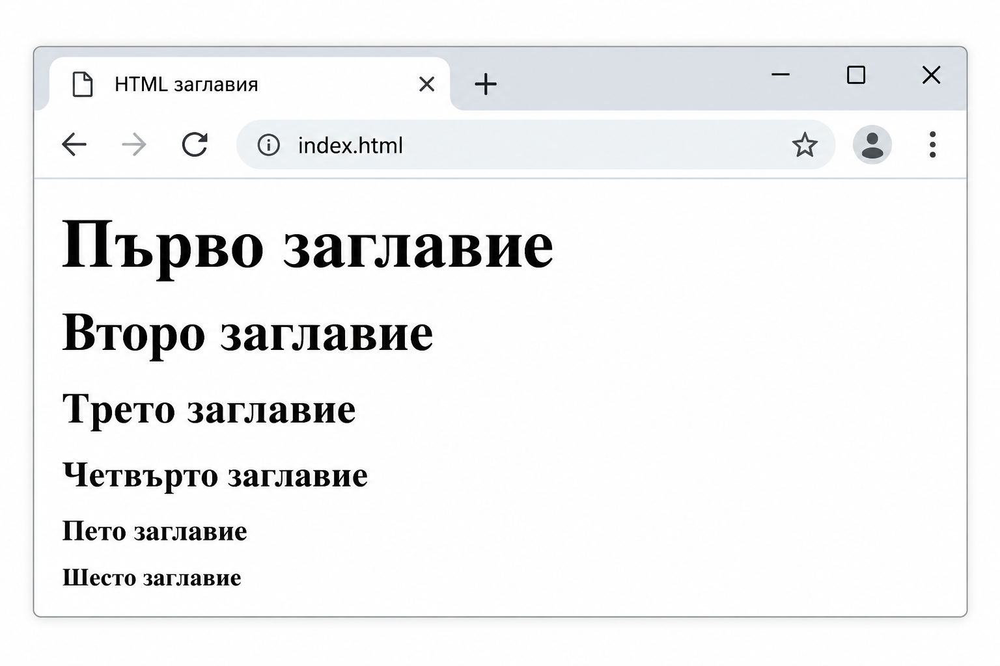
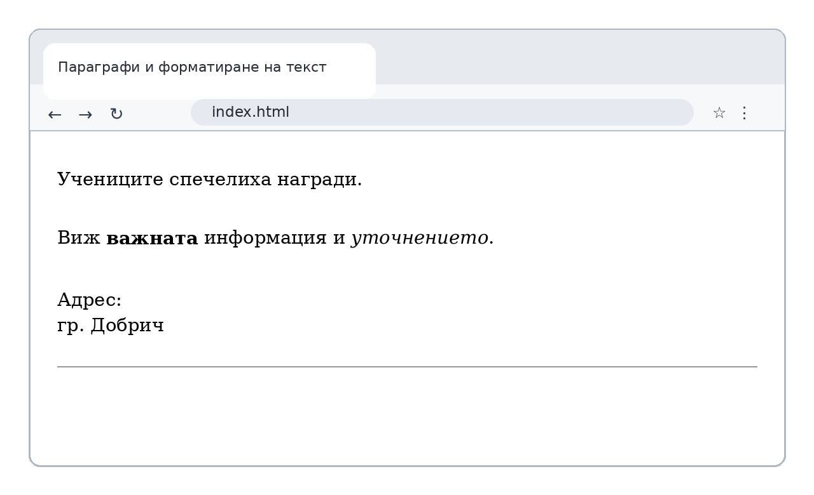
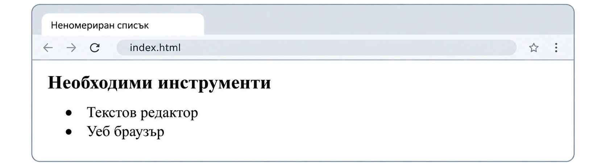
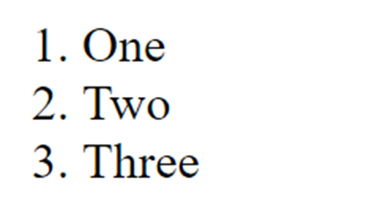
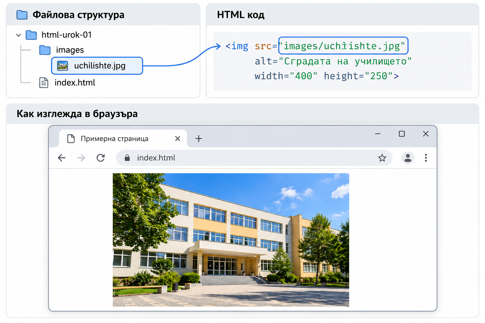
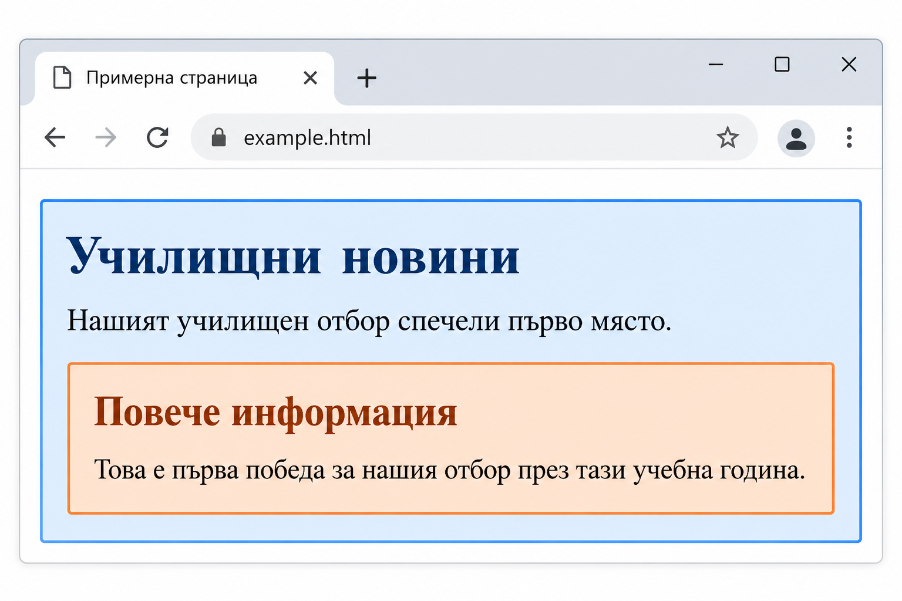
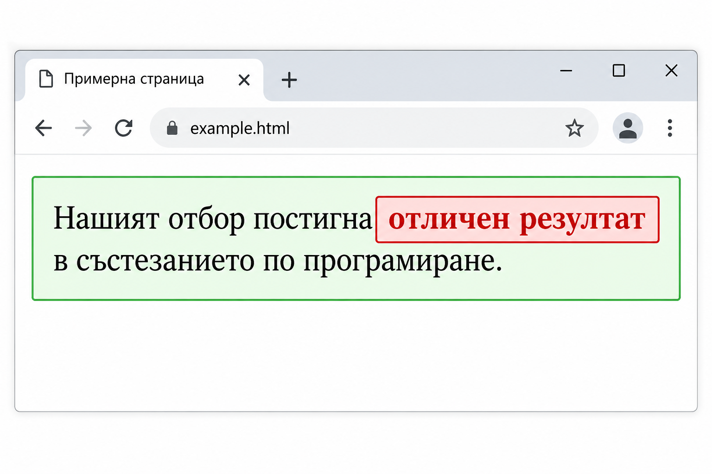
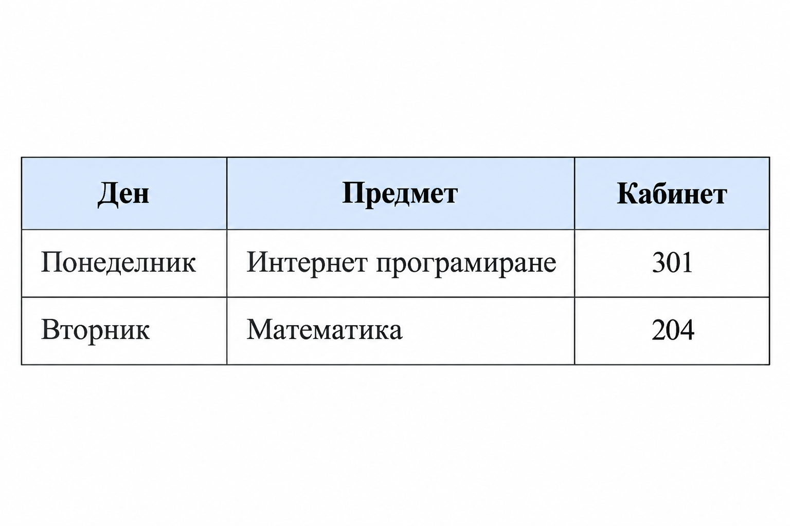
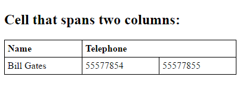
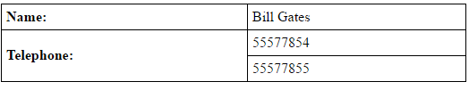

# Урок 1. Работа с HTML. Основни тагове

**Раздел 2: Разработка на външен интерфейс (front-end) на уеб приложения**  
**Времетраене:** 2 учебни часа (90 минути)  
**Предварителни знания:** уеб браузър, клиент–сървър комуникация, URL.

## Цели на урока

След урока ще можеш да:

- обясняваш предназначението на HTML и ролята му при създаването на уеб страници;
- различаваш HTML таг, елемент и атрибут;
- създаваш валиден основен HTML документ;
- използваш заглавия, параграфи, списъци, връзки и изображения;
- разпознаваш блокови и вградени елементи;
- създаваш таблици и обединяваш клетки;
- разпознаваш и използваш основни семантични елементи.

## 1. Въведение в HTML

**HTML** (*HyperText Markup Language*, език за маркиране на хипертекст) описва **структурата и смисъла на съдържанието** в уеб страницата. HTML не е език за програмиране: той указва кое е заглавие, параграф, списък, изображение, връзка или таблица.

В началото на развитието на World Wide Web Тим Бърнърс-Лий създава основите на HTML и системата от свързани хипертекстови документи. Днес браузърите интерпретират HTML и визуализират съдържанието, а **CSS** отговаря основно за оформлението и **JavaScript** – за интерактивното поведение.

**Пример:** HTML задава, че даден текст е заглавие; CSS може да промени цвета му; JavaScript може да го промени след натискане на бутон.

!!! question "Помисли"
    Защо само с промяна на цвета и размера на текста не можем да заместим смисъла на HTML заглавие?

## 2. Тагове, елементи и атрибути

**Таг** е означение в ъглови скоби, например `<p>` или `</p>`. **Елемент** е цялата конструкция с началния таг, съдържанието и крайния таг, когато такъв е необходим. **Атрибут** задава допълнителна информация в началния таг.

```html
<a href="https://www.wikipedia.org/">Посети Уикипедия</a>
```

Тук `<a>` е начален таг, `</a>` – краен, `href` – атрибут, а текстът между таговете е съдържанието на елемента.

Елементите могат да се **влагат**, но трябва да се затварят в правилен ред:

```html
<p>Това е <strong>важна</strong> информация.</p>
```

Някои елементи, например `<br>`, `<hr>` и ``, са **празни елементи** (*void elements*) и нямат краен таг. HTML коментар се записва така:

```html
<!-- Този текст не се показва в страницата. -->
```

!!! question "Провери разбирането"
    Кое е атрибутът в ``? Защо елементът няма затварящ таг?

## 3. Структура на HTML документ

```html
<!DOCTYPE html>
<html lang="bg">
<head>
    <meta charset="UTF-8">
    <meta name="viewport" content="width=device-width, initial-scale=1.0">
    <title>Моята първа страница</title>
</head>
<body>
    <h1>Здравей, HTML!</h1>
    <p>Това е моята първа уеб страница.</p>
</body>
</html>
```

| Част | Предназначение |
|---|---|
| `<!DOCTYPE html>` | Декларация за HTML документ; включва стандартния режим на браузъра. |
| `<html lang="bg">` | Коренен елемент; `lang` указва основния език. |
| `<head>` | Метаданни и информация за документа. |
| `<meta charset="UTF-8">` | Правилно кодиране, включително на кирилицата. |
| `<meta name="viewport" ...>` | Настройка за мащабиране при мобилни устройства. |
| `<title>` | Заглавие на раздела (таба) в браузъра. |
| `<body>` | Видимото съдържание на страницата. |

**Опитай:** запиши примера като `index.html` в кодировка UTF-8 и отвори файла с браузър. Сравни текста в таба с текста в самата страница.

!!! question "Помисли"
    Защо `<title>` се поставя в `<head>`, а `<h1>` – в `<body>`?

### Как изглежда в браузъра

Следващите изображения са от презентацията към урока и показват визуалния резултат от HTML елементите.

**Как браузърът показва съдържанието от `body`**


## 4. Заглавия, параграфи и текст

Пример 1. Шест нива на HTML заглавия

HTML предлага шест нива на заглавия: от `<h1>` до `<h6>`. Те изразяват **йерархия**, а не просто различни размери на шрифта.

```html
<h1>Първо заглавие</h1>
<h2>Второ заглавие</h2>
<h3>Трето заглавие</h3>
<h4>Четвърто заглавие</h4>
<h5>Пето заглавие</h5>
<h6>Шесто заглавие</h6>
```

### Как изглежда в браузъра



### Пример 2. Параграфи и форматиране на текст

- `<p>` обособява параграф; `<br>` прекъсва ред там, където това има смисъл (например в адрес).
- `<strong>` обозначава силна значимост, а `<em>` – смислово подчертаване.
- `<hr>` обозначава тематично разделяне на съдържанието.
- Не използвай множество `<br>` за празни пространства – за оформление служи CSS.

**HTML пример:**

```html
<p>Учениците спечелиха награди.</p>

<p>
  Виж <strong>важната</strong> информация
  и <em>уточнението</em>.
</p>

<p>Адрес:<br>гр. Добрич</p>

<hr>
```

**Как изглежда в браузъра**



## 5. Списъци

HTML позволява да организираме информацията в списъци. Използваме **неномериран списък** (`<ul>`), когато редът на елементите няма значение, и **номериран списък** (`<ol>`), когато последователността е важна. Всеки елемент се обозначава с `<li>`.

### Пример 1. Неномериран списък

Неномерираният списък е подходящ за изброяване на предмети, инструменти или характеристики, при които няма определена последователност.

**HTML код:**

```html
<h2>Необходими инструменти</h2>
<ul>
    <li>Текстов редактор</li>
    <li>Уеб браузър</li>
</ul>
```

**Как изглежда в браузъра**



### Пример 2. Номериран списък

Номерираният списък се използва за инструкции и действия, които трябва да бъдат изпълнени в определен ред.

**HTML код:**

```html
<h2>Стъпки</h2>
<ol>
    <li>Създай файл index.html.</li>
    <li>Напиши HTML кода.</li>
    <li>Отвори файла в браузър.</li>
</ol>
```

**Как изглежда в браузъра**



!!! question "Провери разбирането"
    Кой списък ще използваш за инструкции за инсталиране и кой – за изброяване на учебни предмети? Защо?

## 6. Хипервръзки

Елементът `<a>` създава хипервръзка. Атрибутът `href` указва адреса на целта.

```html
<a href="https://www.wikipedia.org/">Уикипедия</a>
<a href="za-nas.html">За нас</a>
<a href="#kontakti">Към контакти</a>

<h2 id="kontakti">Контакти</h2>
<p>Свържете се с нас.</p>
```

**Абсолютен адрес** включва схемата и домейна (`https://...`). **Относителен адрес** сочи спрямо текущия документ (`za-nas.html`, `images/logo.png`). Адрес с `#` препраща към елемент със съответния `id` в страницата.

При връзка, която се отваря в нов раздел с `target="_blank"`, е добра практика да се използва и `rel="noopener"`.

### Пример. Хипервръзки в браузъра


## 7. Изображения

Елементът `` се използва за включване на изображения в HTML страница. Той няма затварящ таг.

- `src` указва пътя до файла с изображението.
- `alt` задава алтернативен текст, който описва изображението.
- `width` и `height` определят размерите на изображението в CSS пиксели.

### Пример. Добавяне на изображение от папка

Да разгледаме уеб проект, в който HTML файлът и изображението се намират на различни места.

**Файлова структура на проекта:**

```text
Моят сайт/
├── index.html
└── images/
    └── uchilishte.jpg
```

Файлът `index.html` се намира в основната папка на проекта, а изображението `uchilishte.jpg` — в подпапката `images`.

**HTML код:**

```html

```

Пътят `images/uchilishte.jpg` е **относителен път**. Браузърът го търси спрямо местоположението на HTML документа `index.html`.

### Как изглежда в браузъра

Следващата схема показва връзката между файловата структура, HTML кода и визуализираното изображение.



!!! question "Помисли"
    Какво ще се случи, ако преместим `uchilishte.jpg` извън папката `images`, без да променим стойността на `src`? Защо е важно да задаваме смислен `alt` текст?


## 8. Блокови и вградени елементи

HTML елементите се различават и по начина, по който се разполагат в страницата.

**Блоковите елементи** като `<div>`, `<p>` и заглавията обикновено започват на нов ред и заемат наличната ширина на контейнера.

**Вградените елементи** като `<span>` и `<a>` се разполагат в рамките на текстовия поток, без да започват задължително нов ред.

Това поведение може да бъде променяно чрез CSS.

### Пример 1. Блокови елементи

В примера външният `<div>` обединява заглавие, параграф и още един вложен `<div>`. Външният контейнер е със син фон, а вътрешният – с оранжев. Така ясно се вижда, че един блоков елемент може да съдържа други блокови елементи.

**HTML код:**

```html
<div style="background-color: #e8f5e9; border: 2px solid green; padding: 15px;">
    <p>
        Нашият отбор постигна
        <span style="color: red; font-weight: bold; background-color: #ffe5e5; border: 1px solid red;">отличен резултат</span>
        в състезанието по програмиране.
    </p>
</div>.
```

**Как изглежда в браузъра:**



### Пример 2. Вграден елемент в блоков контейнер

Елементът `<div>` създава блоков контейнер, а `<span>` позволява да оформим само част от текста, без да прекъсваме реда.

**HTML код:**

```html
<div style="background-color: #e8f5e9; border: 2px solid green; padding: 15px;">
    <p>
        Нашият отбор постигна
        <span style="color: red; font-weight: bold; background-color: #ffe5e5; border: 1px solid red;">
            отличен резултат
        </span>
        в състезанието по програмиране.
    </p>
</div>
```

**Как изглежда в браузъра:**



**Обяснение:** Външният `<div>` оформя зеления контейнер. В него е разположен параграф `<p>`, а вложеният `<span>` променя само външния вид на думите „отличен резултат“. Останалият текст запазва обичайното си оформление.

!!! question "Провери разбирането"
    Защо заглавието и параграфът в първия пример се показват един под друг, а оцветените думи във втория остават в същия текстов ред?

## 9. HTML таблици

Таблиците представят **таблични данни**, а не се използват за разполагане на цялата страница.

| Елемент / атрибут | Роля |
|---|---|
| `<table>` | Таблица |
| `<caption>` | Заглавие на таблицата |
| `<tr>` | Ред |
| `<th>` | Заглавна клетка |
| `<td>` | Клетка с данни |
| `colspan` | Клетка, обхващаща няколко колони |
| `rowspan` | Клетка, обхващаща няколко реда |

```html
<table>
    <caption>Седмична програма</caption>
    <tr>
        <th scope="col">Ден</th>
        <th scope="col">Предмет</th>
        <th scope="col">Кабинет</th>
    </tr>
    <tr>
        <td>Понеделник</td>
        <td>Интернет програмиране</td>
        <td>301</td>
    </tr>
    <tr>
        <td>Вторник</td>
        <td>Математика</td>
        <td>204</td>
    </tr>
</table>
```
**Как изглежда в браузъра:**



`<th>` обозначава заглавна клетка; `scope="col"` пояснява, че тя е заглавие на колона. Рамките и цветовете се задават чрез CSS, а не с остарелия атрибут `border`.

**Обединяване на колони:**

```html
<table>
    <tr>
        <th>Ученик</th>
        <th colspan="2">Телефони</th>
    </tr>
    <tr>
        <td>Иван</td>
        <td>0888 111 111</td>
        <td>0888 222 222</td>
    </tr>
</table>
```

**Как изглежда в браузъра:**



**Обединяване на редове:**

```html
<table>
    <tr>
        <th>Ден</th>
        <th>Предмет</th>
    </tr>
    <tr>
        <th rowspan="2">Понеделник</th>
        <td>Интернет програмиране</td>
    </tr>
    <tr>
        <td>Математика</td>
    </tr>
</table>
```

**Как изглежда в браузъра:**



!!! question "Провери разбирането"
    Каква е разликата между `colspan="2"` и `rowspan="2"`? Защо таблицата не е подходяща за основното оформление на сайт?

## 10. Семантични HTML елементи

**Семантиката** е значението на елементите. Например `<nav>` означава област за навигация, докато `<div>` не уточнява какво съдържа. Семантичната структура подпомага разбирането на документа от хора, браузъри и помощни технологии.

| Елемент | Предназначение |
|---|---|
| `<header>` | Въвеждащо съдържание на страница или раздел |
| `<nav>` | Основна група навигационни връзки |
| `<main>` | Основното съдържание на страницата |
| `<section>` | Тематична част, обикновено със заглавие |
| `<article>` | Самостоятелно съдържание, например новина |
| `<aside>` | Допълнително или странично съдържание |
| `<footer>` | Завършваща информация за страница или раздел |
| `<figure>` и `<figcaption>` | Илюстрация и нейният надпис |
| `<time>` | Дата или час с машинночетима стойност |
| `<address>` | Контактна информация за съответния автор или организация |
| `<details>` и `<summary>` | Разгъващ се блок с кратко заглавие |

### Пример: семантична страница

```html
<!DOCTYPE html>
<html lang="bg">
<head>
    <meta charset="UTF-8">
    <meta name="viewport" content="width=device-width, initial-scale=1.0">
    <title>Училищни новини</title>
</head>
<body>
    <header>
        <h1>Училищни новини</h1>
        <nav>
            <a href="index.html">Начало</a>
            <a href="za-nas.html">За нас</a>
        </nav>
    </header>
    <main>
        <article>
            <h2>Успех на олимпиада</h2>
            <p>Публикувано на <time datetime="2026-10-20">20 октомври 2026 г.</time></p>
            <p>Наши ученици спечелиха награди.</p>
            <figure>
                
                <figcaption>Отборът след награждаването</figcaption>
            </figure>
        </article>
        <aside>
            <h2>Още новини</h2>
            <p>Следете училищния календар.</p>
        </aside>
    </main>
    <footer>
        <address>Контакт: school@example.org</address>
    </footer>
</body>
</html>
```

**Важно:** семантичните елементи не определят сами по себе си как точно ще изглежда страницата. Външният ѝ вид ще управляваме със CSS. По-подробно семантичната организация ще упражняваме и в темата „Създаване на семантични страници“.

!!! question "Помисли"
    Защо за самостоятелна новина е по-подходящ `<article>`, отколкото универсален `<div>`? Къде би поставил менюто на сайта?

## 11. Самостоятелна проверка

1. Какво описва HTML и каква е разликата му с CSS?
2. Посочи началния таг, крайния таг и атрибута в пример с хипервръзка.
3. Какво е предназначението на `head`, `title` и `body`?
4. Кога използваме `ul` и кога `ol`?
5. Какво означава `alt` при изображение?
6. Как се създава ред в таблица и как се обединяват две колони?
7. Каква е разликата между `<div>` и `<section>`?
8. Защо `<main>` не е заместител на `<body>`?

## 12. Практическа лаборатория

**Задача:** Създай файл `index.html` за училищен клуб. Включи заглавие, два параграфа, списък с дейности, връзка към друга страница, изображение с `alt`, таблица с график и семантични области `header`, `nav`, `main`, `section` и `footer`.

**Провери:** отваря ли се страницата в браузъра; правилно ли се показва кирилицата; работят ли връзките; зареждат ли се изображенията; има ли правилно вложени и затворени елементи.

!!! tip "Връзка с практиката"
    Това е начална страница, която по-късно ще надграждаш със CSS, формуляри и JavaScript. Запази файловете в отделна папка на проекта.

## 13. Обобщение

HTML определя структурата и значението на съдържанието. Вече познаваш основните елементи за текст, списъци, връзки, изображения и таблици, както и семантичните елементи за организация на страница. В следващите теми ще добавим оформление със CSS и поведение с JavaScript.

## 14. Домашна работа

Създай страница **„Моят клас“** с правилна HTML5 структура, минимум две нива заглавия, списък, две връзки (външна и вътрешна), изображение с алтернативен текст, таблица с поне три реда и семантична структура. Добави HTML коментар, в който обясняваш избора на `<section>` или `<article>`.

## 15. Ключови понятия

**HTML**, **таг**, **елемент**, **атрибут**, **HTML5**, **DOCTYPE**, **метаданни**, **UTF-8**, **параграф**, **хипервръзка**, **относителен адрес**, **алтернативен текст**, **блоков елемент**, **вграден елемент**, **таблица**, **ред**, **клетка**, **colspan**, **rowspan**, **семантичен елемент**, **header**, **nav**, **main**, **section**, **article**, **footer**.
