# Урок 2. Работа със CSS. Селектори и основни правила

**Раздел 2: Разработка на външен интерфейс (front-end) на уеб приложения**  
**Времетраене:** 2 учебни часа (90 минути)  
**Предварителни знания:** Урок 1 – HTML документ, тагове и атрибути, блокови и вградени елементи, семантични елементи.

## Цели на урока

След урока ще можеш да:

- обясняваш предназначението на CSS и защо съдържанието се отделя от оформлението;
- разчиташ и записваш CSS правило – селектор, свойство и стойност;
- добавяш CSS по трите начина и избираш подходящия;
- използваш селектори по таг, клас, `id`, група, вложеност и състояние;
- обясняваш каскадата, наследяването и приоритета на правилата;
- оформяш текст, цветове, граници, фонове и таблици;
- прилагаш кутиения модел – `margin`, `border`, `padding`, `width`, `box-sizing`;
- проверяваш стиловете с инструментите за разработчика в браузъра.

## 1. Въведение в CSS

**CSS** (*Cascading Style Sheets*, каскадни стилови таблици) е език, който описва **как** да се покажат HTML елементите – на екран, на хартия или на друго устройство. HTML определя *какво* е съдържанието (заглавие, параграф, списък), а CSS определя *как изглежда* то: шрифт, цвят, размер, отстояния, рамки, фон и разположение.

**Малко история.** Норвежецът **Хокон Виум Ли** (*Håkon Wium Lie*) предлага идеята за CSS през **1994 г.**, докато работи с Тим Бърнърс-Лий в CERN. Целта е да се отдели оформлението на уеб страниците от тяхната структура. Първата препоръка на W3C – CSS 1 – излиза през 1996 г. Днес CSS се развива на отделни модули и се използва дори за оформяне на PDF документи и печатни материали.

**Защо отделяме оформлението от съдържанието?**

- един CSS файл може да оформи **всички страници** на сайта – промяната е на едно място;
- една и съща HTML страница може да изглежда напълно различно само със смяна на стиловия файл;
- HTML кодът остава кратък, четим и със смисъл;
- външният CSS файл се изтегля веднъж и браузърът го **кешира** – при преминаване към другите страници на сайта той се използва повторно, без да се зарежда наново.

Първият пример използва атрибута `style`, за да оцвети един параграф:

**HTML код:**

```html
<p style="color: red;">Това е червен параграф.</p>
<p>Този параграф е с цвета по подразбиране.</p>
```

**Как изглежда в браузъра:**

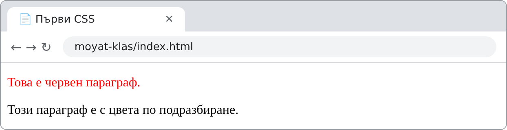

!!! question "Помисли"
    В урок 1 видяхме, че заглавието `<h1>` има смисъл, а не само голям шрифт. Защо е по-правилно да направим текста голям и удебелен чрез CSS, вместо да използваме `<h1>` само заради размера?

## 2. Синтаксис на CSS правило

CSS се състои от **правила**. Всяко правило има **селектор** и **декларационен блок**:

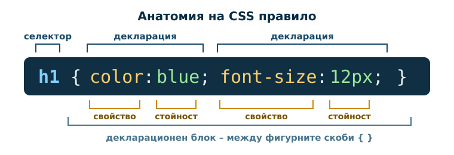

- **Селекторът** посочва кои HTML елементи оформяме (тук – всички `<h1>`).
- **Декларационният блок** е между фигурните скоби `{ }`.
- Всяка **декларация** има вида `свойство: стойност;`. Свойството и стойността се разделят с **двоеточие**, а декларациите – с **точка и запетая**.

```css
p {
    color: red;
    text-align: center;
}
```

Всички параграфи ще бъдат с червен текст, подравнен в центъра: `color` е **свойство**, а `red` е неговата **стойност**; `text-align` е свойство със стойност `center`.

!!! tip "Запомни"
    CSS не променя HTML таговете и съдържанието. Той само указва на браузъра **как** да ги покаже.

**Коментар** в CSS се записва между `/*` и `*/`. Браузърът го пропуска:

```css
/* Оформление на основното заглавие */
h1 {
    color: #174967;
}
```

!!! warning "Чести грешки"
    - Липсваща `;` между две декларации – втората декларация не се прилага.
    - `=` вместо `:` (`color = red`) или кавички около стойността (`color: "red"`).
    - Грешно изписано свойство (`colour`, `font-colour`) – браузърът го пропуска **без съобщение за грешка**.
    - Незатворена фигурна скоба `}` – „поврежда“ и следващите правила.

## 3. Начини за добавяне на CSS

Когато браузърът прочете стиловете, той оформя HTML документа според тях. Стиловете се добавят по три начина: **външен**, **вътрешен** и **вграден** CSS.

### Външен CSS (препоръчителен)

Стиловете са в отделен файл с разширение `.css`, а HTML страницата го свързва чрез елемента `<link>` в `<head>`. Така **с един файл променяме облика на целия сайт**.

```text
moyat-klas/
├── index.html
├── css/
│   └── style.css
└── images/
```

**Файл `index.html`:**

```html
<!DOCTYPE html>
<html lang="bg">
<head>
    <meta charset="UTF-8">
    <meta name="viewport" content="width=device-width, initial-scale=1.0">
    <title>Моят клас</title>
    <link rel="stylesheet" href="css/style.css">
</head>
<body>
    <h1>Моят клас</h1>
    <p>Стиловете на тази страница са във файла css/style.css.</p>
</body>
</html>
```

**Файл `css/style.css`:**

```css
body {
    font-family: Arial, sans-serif;
    background-color: #eef6fb;
}

h1 {
    color: #174967;
}
```

**Как изглежда в браузъра:**

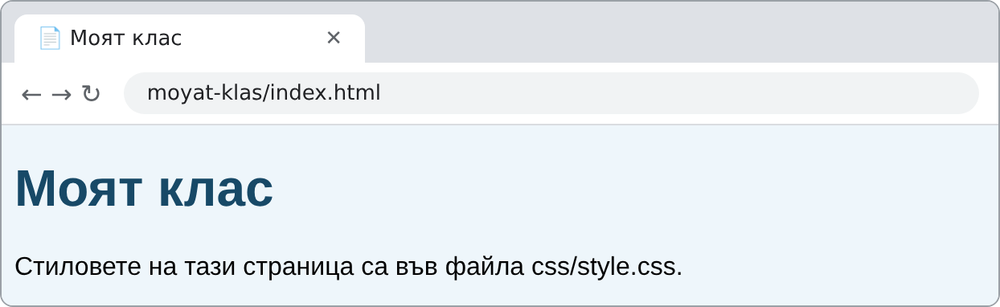

- Пътят в `href` е **относителен** – спрямо HTML файла, точно както при ``.
- CSS файлът съдържа **само CSS** – без HTML тагове и без `<style>`.
- В HTML5 атрибутът `type="text/css"` не е нужен.

### Вътрешен CSS

Стиловете са в елемента `<style>`, поставен в `<head>`. Подходящ е за една страница с уникално оформление или за бързи опити.

**HTML код:**

```html
<!DOCTYPE html>
<html lang="bg">
<head>
    <meta charset="UTF-8">
    <meta name="viewport" content="width=device-width, initial-scale=1.0">
    <title>Вътрешен стил</title>
    <style>
        body {
            background-color: linen;
        }

        h1 {
            color: maroon;
            margin-left: 40px;
        }
    </style>
</head>
<body>
    <h1>Новини от класа</h1>
    <p>Заглавието е отместено на 40 пиксела надясно.</p>
</body>
</html>
```

**Как изглежда в браузъра:**

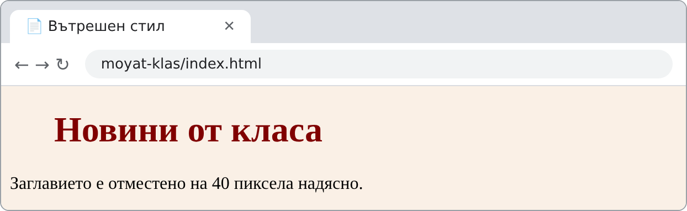

### Вграден CSS

Стилът е записан в атрибута `style` на конкретен елемент и важи **само за него**.

**HTML код:**

```html
<h1 style="color: blue; text-align: center;">Заглавие в синьо</h1>
<p style="color: red;">Параграф в червено.</p>
```

**Как изглежда в браузъра:**

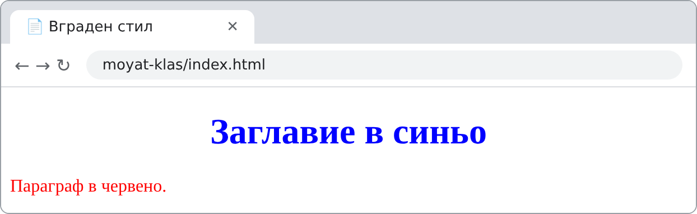

Вграденият стил смесва съдържанието с оформлението и не може да се използва повторно. Използвай го пестеливо – за бърз тест или единична промяна.

### Сравнение на трите начина

| Начин | Къде е CSS | Предимства | Недостатъци |
|---|---|---|---|
| **Външен** | Отделен `.css` файл, свързан с `<link>` в `<head>` | Отделя съдържание и стил; един файл оформя целия сайт; браузърът го кешира | Допълнителна HTTP заявка; грешен път = страница без стил |
| **Вътрешен** | Елемент `<style>` в `<head>` | Не изисква отделен файл; подходящ за една страница | Не се споделя между страници; трудна поддръжка при големи сайтове |
| **Вграден** | Атрибут `style` на елемента | Бърз за единична промяна или тест | Лоша четимост; не се преизползва; смесва съдържание и стил; висок приоритет сред обикновените авторски декларации и труден за отмяна |

!!! question "Провери разбирането"
    Сайтът на училището има 40 страници. Искаме да сменим цвета на всички заглавия. Кой начин за добавяне на CSS ще ни спести най-много работа и защо?

## 4. Основни селектори

Селекторът определя **към кои елементи** се прилага правилото.

| Селектор | Запис | Избира | Пример |
|---|---|---|---|
| По таг (тип) | `p` | Всички елементи от този вид | `p { color: #333; }` |
| По клас | `.ime` | Всички елементи с `class="ime"` | `.vazhno { font-weight: bold; }` |
| По `id` | `#ime` | Единствения елемент с `id="ime"` | `#glavno-zaglavie { text-align: center; }` |
| Универсален | `*` | Всички елементи | `* { box-sizing: border-box; }` |
| Група | `h2, h3` | Всички изброени | `h2, h3 { font-family: Georgia, serif; }` |
| Вложеност (наследник) | `nav a` | `<a>` **вътре в** `<nav>` (на произволна дълбочина) | `nav a { color: green; }` |
| Пряко дете | `ul > li` | `<li>`, които са **преки** деца на `<ul>` | `ul > li { margin-bottom: 4px; }` |
| Псевдоклас | `a:hover` | Елемент в определено **състояние** | `a:hover { color: red; }` |

**Клас или `id`?**

- **Клас** (`class`) се използва многократно – много елементи могат да имат един и същ клас, а един елемент може да има няколко класа: `class="kutiya platna"`.
- **`id`** е **уникален** – в страницата има само един елемент с дадено `id`. Използва се и за вътрешни връзки (`href="#programa"`).
- В CSS класът се пише с **точка** (`.vazhno`), а `id` – с **диез** (`#glavno-zaglavie`). В HTML атрибутът е без точката и без диеза: `class="vazhno"`, `id="glavno-zaglavie"`.
- За оформление предпочитаме **класове** – те са гъвкави и лесни за преизползване.

### Пример. Селектори в действие

**CSS:**

```css
p {
    color: #333333;
}

.vazhno {
    background-color: #fff3c4;
    font-weight: bold;
}

#glavno-zaglavie {
    color: #174967;
    text-align: center;
}

h2, h3 {
    font-family: Georgia, serif;
}

nav a {
    color: #0a7d3b;
}

a:hover {
    color: #c0392b;
}
```

**HTML (в `<body>`):**

```html
<h1 id="glavno-zaglavie">Моят клас</h1>
<nav>
    <a href="#novini">Новини</a>
    <a href="#programa">Програма</a>
</nav>
<h2>Новини</h2>
<p>Утре има <span class="vazhno">контролна работа</span> по математика.</p>
<p class="vazhno">Срокът за проекта е петък.</p>
<h3>Програма</h3>
<p>Програмата е обновена.</p>
<a href="#">Връзка извън менюто</a>
```

**Как изглежда в браузъра** (мишката е върху връзката „Програма“):

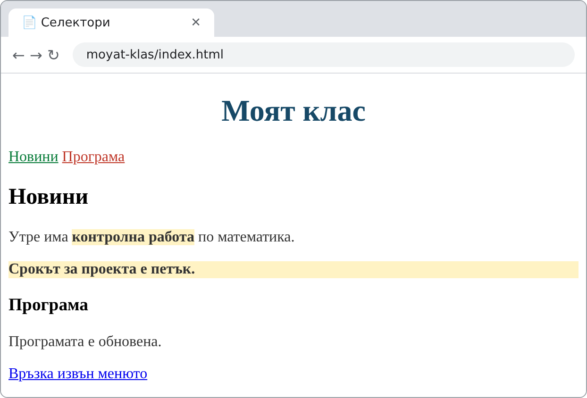

**Обяснение:**

- `#glavno-zaglavie` центрира и оцветява само главното заглавие;
- `.vazhno` е приложен **и** към цял параграф, **и** към думи в `<span>` – един клас за различни елементи;
- `nav a` оцветява в зелено само връзките в менюто – връзката извън `<nav>` остава синя;
- `a:hover` прави връзката червена, докато мишката е върху нея.

Други полезни псевдокласове: `a:visited` (посетена връзка), `:first-child` (първото дете), `:nth-child(2n)` (всеки втори елемент – напр. редове на таблица).

!!! question "Помисли"
    Каква е разликата между `p.notice` и `p .notice`? Първият избира **параграф с клас** `notice`, а вторият – **елемент с клас** `notice`, който се намира **вътре в** параграф. Един интервал променя значението на селектора!

!!! question "Провери разбирането"
    Какво ще избере селекторът `section p`? А `section > p`? Кой от двата ще избере параграф, който е вътре в `<div>`, поставен в `<section>`?

## 5. Каскада, наследяване и приоритет

Думата „каскадни“ в името на CSS означава, че към един елемент може да се отнасят **няколко правила** и браузърът решава кое да приложи.

### Приоритет (специфичност)

Когато две обикновени авторски декларации задават едно и също свойство на един елемент, обикновено печели **по-специфичната**. Опростената таблица по-долу сравнява такива декларации – без `!important` и без допълнителните механизми на каскадата:

| Източник на правилото | Сила |
|---|---|
| Вграден стил (`style="..."`) | най-силен |
| Селектор по `id` (`#ime`) | силен |
| Клас, псевдоклас (`.ime`, `:hover`) | среден |
| Таг (`p`, `h1`) | слаб |
| Универсален селектор (`*`) | без тежест |

Ако правилата имат **еднаква сила**, печели **по-късно записаното**. Затова редът на правилата във файла и редът на `<link>` и `<style>` в `<head>` имат значение.

**CSS:**

```css
p {
    color: green;
}

.belezhka {
    color: blue;
}

#vazhna-belezhka {
    color: red;
}
```

**HTML (в `<body>`):**

```html
<p>Обикновен параграф – прилага се правилото за p.</p>
<p class="belezhka">Параграф с клас – .belezhka е по-силно от p.</p>
<p class="belezhka" id="vazhna-belezhka">Параграф с клас и id – печели #vazhna-belezhka.</p>
<p class="belezhka" style="color: purple;">Вграденият стил е по-силен от правилата по-горе.</p>
```

**Как изглежда в браузъра:**

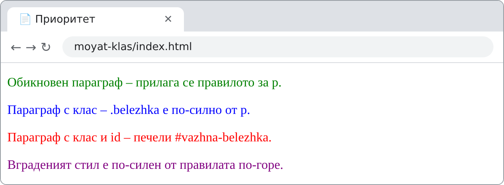

Пълното правило е по-сложно: браузърът сравнява последователно **произхода и важността** на декларациите (стилове на браузъра, на потребителя, на автора; отбелязани ли са с `!important`), после **специфичността** на селекторите и накрая **реда** им. За нашите проекти са достатъчни таблицата и правилото за реда.

!!! warning "Внимание"
    Декларацията `!important` (`color: red !important;`) надделява над обикновените декларации, дори над вградения стил. Тя прави кода труден за поддръжка – избягвай я. По-добре използвай по-точен селектор.

### Наследяване

Някои свойства се **наследяват** от родителя към вложените елементи – предимно свойствата за текст: `color`, `font-family`, `font-size`, `line-height`, `text-align`. Други **не се наследяват** – `border`, `margin`, `padding`, `background`, `width`.

**CSS:**

```css
section {
    color: #174967;
    font-family: Georgia, serif;
    border: 2px solid #174967;
    padding: 10px;
}
```

**HTML (в `<body>`):**

```html
<section>
    <h2>Нашите дейности</h2>
    <p>Цветът и шрифтът се наследяват от section, а рамката – не.</p>
</section>
```

**Как изглежда в браузъра:**

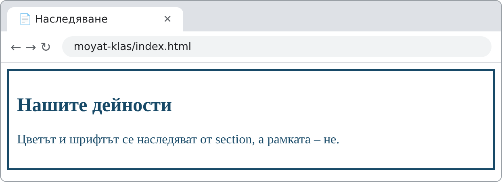

Затова е удобно шрифтът и основният цвят на текста да се зададат веднъж – на `body`.

!!! question "Помисли"
    Защо би било неудобно, ако `border` се наследяваше? Как би изглеждала страница, в която рамката на `<body>` се предава на всеки вложен елемент?

## 6. Цветове и мерни единици

### Цветове

| Запис | Пример | Обяснение |
|---|---|---|
| Име на цвят | `tomato`, `lightblue` | над 140 имена, удобни за бързи опити |
| Шестнадесетичен код | `#1c8cbd`, `#AA77FF` | `#RRGGBB` – червено, зелено, синьо от `00` до `FF` |
| RGB | `rgb(10, 159, 63)` | червено, зелено, синьо от 0 до 255 |
| RGBA | `rgba(10, 159, 63, 0.4)` | RGB + прозрачност (alpha) от 0 до 1 |
| HSL | `hsl(45, 100%, 60%)` | цветен тон (0–360°), наситеност, светлина |

**CSS:**

```css
p {
    padding: 8px;
    color: #082d46;
}
```

**HTML (в `<body>`):**

```html
<p style="background-color: tomato;">tomato – име на цвят</p>
<p style="background-color: #1c8cbd;">#1c8cbd – шестнадесетичен код</p>
<p style="background-color: rgb(10, 159, 63);">rgb(10, 159, 63)</p>
<p style="background-color: rgba(10, 159, 63, 0.4);">rgba(10, 159, 63, 0.4) – 40% плътност</p>
<p style="background-color: hsl(45, 100%, 60%);">hsl(45, 100%, 60%)</p>
```

**Как изглежда в браузъра:**

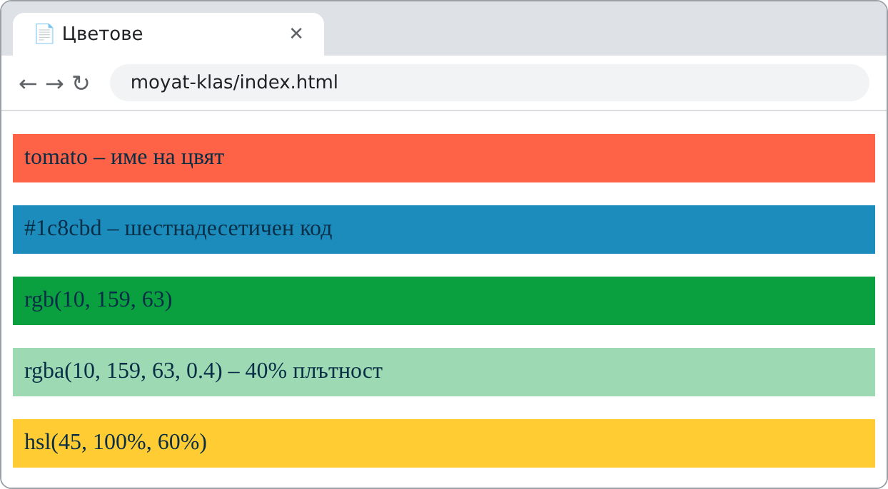

Тук за краткост цветовете са във вграден стил. В реален проект ги записваме в CSS файла.

Избирай цветове с **достатъчен контраст** между текста и фона – светлосив текст на бял фон е труден за четене.

### Мерни единици

| Единица | Вид | Спрямо какво | Пример | Кога |
|---|---|---|---|---|
| `px` | абсолютна | пиксел на екрана | `border: 2px solid red;` | рамки, точни размери |
| `%` | относителна | размера на родителя | `width: 80%;` | ширини, които се променят с екрана |
| `em` | относителна | при `font-size` – шрифта на **родителя**; при другите свойства – шрифта на **самия елемент** | `padding: 1em;` | отстояния, свързани с текста |
| `rem` | относителна | размера на шрифта на **`<html>`** (обикновено 16px) | `font-size: 1.5rem;` | размери на шрифта – по-предвидима от `em` |
| `vw` / `vh` | относителна | 1% от ширината / височината на прозореца | `height: 50vh;` | секции на цял екран |

Между числото и единицата **няма интервал**: `16px`, а не `16 px`. Само при стойност `0` единицата може да се пропусне: `margin: 0;`.

Единицата `pt` (точка) идва от печата. За екран използвай `px` и `rem`, а `pt` – при стилове за печат.

## 7. Оформление на текст

| Свойство | Какво задава | Примерни стойности |
|---|---|---|
| `color` | цвят на текста | `#AA77FF`, `navy` |
| `font-family` | шрифт – списък с резервни варианти | `Arial, Helvetica, sans-serif` |
| `font-size` | размер на шрифта | `16px`, `1.25rem` |
| `font-weight` | дебелина | `normal`, `bold`, `600` |
| `font-style` | наклон | `normal`, `italic` |
| `line-height` | височина на реда | `1.5` (1,5 пъти размера на шрифта) |
| `text-align` | подравняване | `left`, `center`, `right`, `justify` |
| `text-decoration` | подчертаване | `none`, `underline` |
| `text-transform` | главни/малки букви | `uppercase`, `lowercase` |
| `letter-spacing` | разстояние между буквите | `2px` |

**Добра практика е `font-family` да съдържа няколко шрифта**, разделени със запетаи. Ако първият липсва на компютъра на потребителя, браузърът опитва следващия. Списъкът завършва с **общо семейство**: `serif` (със засечки), `sans-serif` (без засечки) или `monospace` (с еднаква ширина на буквите). Имена с интервал се пишат в кавички: `"Times New Roman"`.

**CSS:**

```css
h1 {
    font-family: Georgia, "Times New Roman", serif;
    font-size: 32px;
    text-align: center;
}

p {
    font-family: Arial, Helvetica, sans-serif;
    font-size: 16px;
    line-height: 1.6;
}

.etiket {
    font-weight: bold;
    text-transform: uppercase;
    letter-spacing: 2px;
    color: #AA77FF;
}

.podpis {
    font-style: italic;
    text-align: right;
}

a {
    text-decoration: none;
}
```

**HTML (в `<body>`):**

```html
<h1>Моят клас</h1>
<p class="etiket">12 клас • Приложно програмиране</p>
<p>Ние сме 26 ученици, които обичат програмирането, математиката и спорта. Тази година подготвяме уебсайт за училищния празник. Повече информация има на <a href="#">сайта на училището</a>.</p>
<p class="podpis">Класният ръководител</p>
```

**Как изглежда в браузъра:**

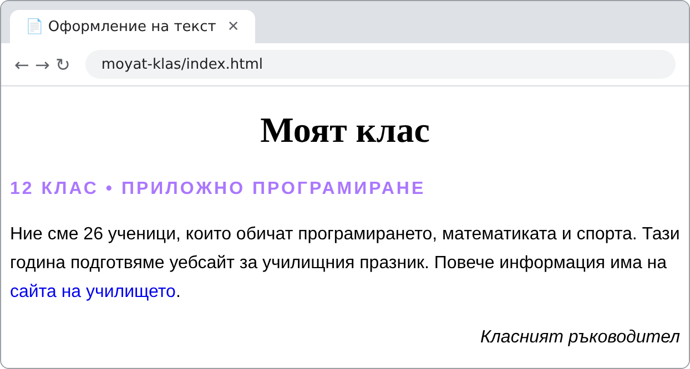

!!! question "Провери разбирането"
    Защо `font-family: Consolas;` е по-лош запис от `font-family: Consolas, monospace;`? Какво ще види потребител, на чийто компютър няма шрифт Consolas?

## 8. Граници

Свойството `border` задава **дебелина, стил и цвят** на рамката с един запис: `border: 2px solid red;`.

| Свойство | Какво задава | Пример |
|---|---|---|
| `border` | дебелина, стил и цвят | `border: 2px solid red;` |
| `border-style` | вид на линията | `solid`, `dashed`, `dotted`, `double`, `none` |
| `border-radius` | закръгляне на ъглите | `border-radius: 10px;` |
| `border-top`, `border-bottom` … | рамка само от една страна | `border-bottom: 1px solid #ccc;` |

**CSS:**

```css
.kutiya {
    padding: 10px;
    margin-bottom: 12px;
}

.platna  { border: 2px solid red; }
.punktir { border: 2px dashed #1c8cbd; }
.tochki  { border: 3px dotted green; }
.dvoyna  { border: 4px double #174967; }

.kartichka {
    border: 2px solid red;
    border-radius: 10px;
    background: lightgray;
    text-align: center;
}
```

**HTML (в `<body>`):**

```html
<div class="kutiya platna">solid – плътна линия</div>
<div class="kutiya punktir">dashed – пунктир</div>
<div class="kutiya tochki">dotted – точки</div>
<div class="kutiya dvoyna">double – двойна линия</div>
<div class="kutiya kartichka">Закръглени ъгли и светлосив фон</div>
```

**Как изглежда в браузъра:**

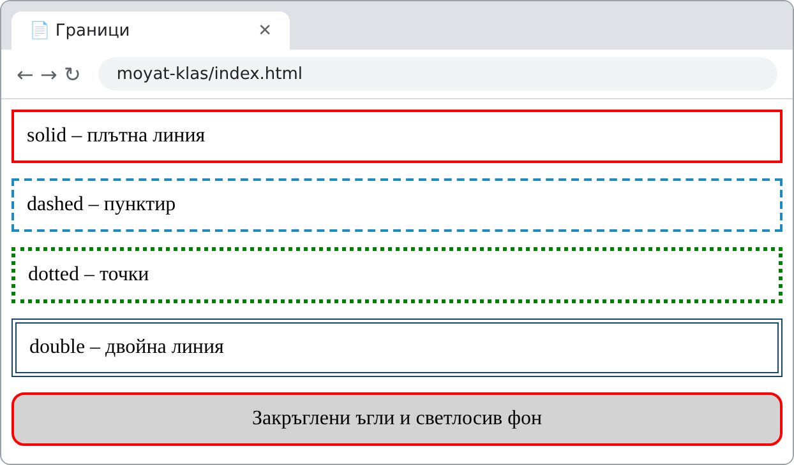

Забележи, че всеки `<div>` има **два класа** – общия `kutiya` и клас за вида на рамката.

### Рамки на таблица

В урок 1 видяхме, че атрибутът `border` на `<table>` е остарял. Решетката на таблицата се задава с CSS. Свойството `border-collapse: collapse;` слива двойните рамки на съседните клетки в една линия.

**CSS:**

```css
table {
    border-collapse: collapse;
}

th, td {
    border: 1px solid #555555;
    padding: 6px 12px;
}

th {
    background-color: #174967;
    color: white;
}

caption {
    font-weight: bold;
    margin-bottom: 6px;
}
```

**HTML (в `<body>`):**

```html
<table>
    <caption>Седмична програма</caption>
    <tr>
        <th scope="col">Ден</th>
        <th scope="col">Предмет</th>
        <th scope="col">Кабинет</th>
    </tr>
    <tr>
        <td rowspan="2">Понеделник</td>
        <td>Интернет програмиране</td>
        <td>301</td>
    </tr>
    <tr>
        <td>Математика</td>
        <td>204</td>
    </tr>
    <tr>
        <td>Вторник</td>
        <td>Български език и литература</td>
        <td>105</td>
    </tr>
</table>
```

**Как изглежда в браузъра:**

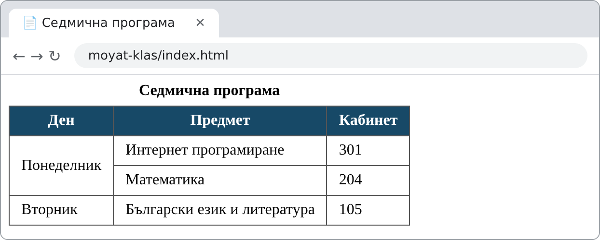

## 9. Фонове

| Свойство | Какво задава | Пример |
|---|---|---|
| `background-color` | цвят на фона | `background-color: lightblue;` |
| `background-image` | фоново изображение | `background-image: url("../images/fon.png");` |
| `background-repeat` | повтаряне на изображението | `repeat` (по подразбиране), `no-repeat`, `repeat-x` |
| `background-size` | размер на изображението | `cover` (покрива целия елемент), `contain`, `100px` |
| `background-position` | позиция | `center`, `top right` |
| `background` | кратък запис на всички | `background: lightgray;` |

По подразбиране фоновото изображение **се повтаря** и запълва елемента като плочки. С `no-repeat` се показва само веднъж. С `cover` се мащабира така, че да покрие целия елемент – ако пропорциите на изображението и елемента се различават, част от изображението се **изрязва**. С `contain` се вижда цялото изображение, но може да остане празно място.

**Файл `css/style.css`:**

```css
body {
    background-color: lightblue;
}

.banner {
    background-image: url("../images/fon.png");
    background-repeat: no-repeat;
    background-size: cover;
    background-position: center;
    color: white;
    padding: 40px 20px;
    text-align: center;
}
```

**HTML код:**

```html
<div class="banner">
    <h1>Училищен празник</h1>
    <p>Заповядайте на 15 ноември!</p>
</div>
<p>Фонът на страницата е светлосин.</p>
```

**Как изглежда в браузъра:**

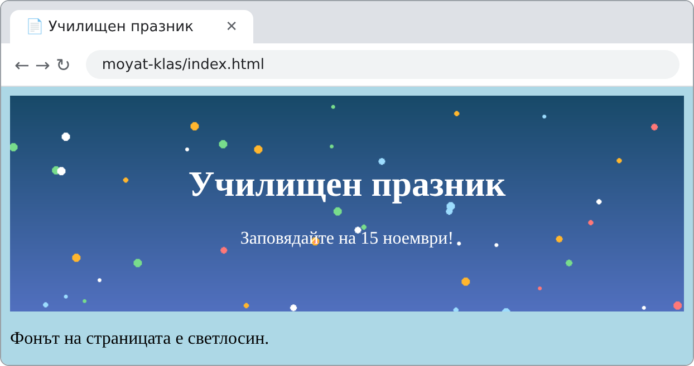

!!! warning "Внимание: пътят в url() е спрямо CSS файла"
    Пътят във `url()` се търси **спрямо CSS файла**, а не спрямо HTML страницата. Файлът `style.css` е в папка `css`, затова до папката `images` се стига с `../images/fon.png` (`..` означава „една папка нагоре“). Това е една от най-честите причини фоновото изображение да не се показва.

Когато има текст върху фоново изображение, задай и `background-color` с близък цвят – той се вижда, докато изображението се зарежда, и запазва текста четим, ако изображението липсва.

## 10. Кутиен модел

За CSS **всеки HTML елемент е правоъгълна кутия**. Тя се състои от четири слоя – от вътре навън:

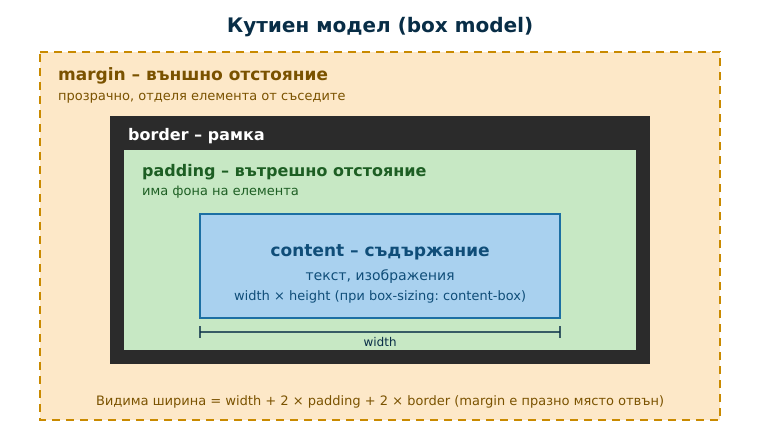

| Слой | Свойство | Описание |
|---|---|---|
| Съдържание | `width`, `height` | текстът и изображенията |
| Вътрешно отстояние | `padding` | празно място **между съдържанието и рамката**; оцветено е във фона на елемента |
| Рамка | `border` | линията около вътрешното отстояние |
| Външно отстояние | `margin` | празно място **извън рамката**; прозрачно е и отделя елемента от съседните |

### `margin` и `padding`

**CSS:**

```css
body {
    background-color: #eef3f6;
}

p {
    background-color: white;
    border: 5px solid black;
}

.s-margin {
    margin: 30px;
}

.s-padding {
    padding: 20px;
}
```

**HTML (в `<body>`):**

```html
<p>Без допълнителни отстояния.</p>
<p class="s-margin">margin: 30px – празно място извън рамката.</p>
<p class="s-padding">padding: 20px – празно място между текста и рамката.</p>
```

**Как изглежда в браузъра:**

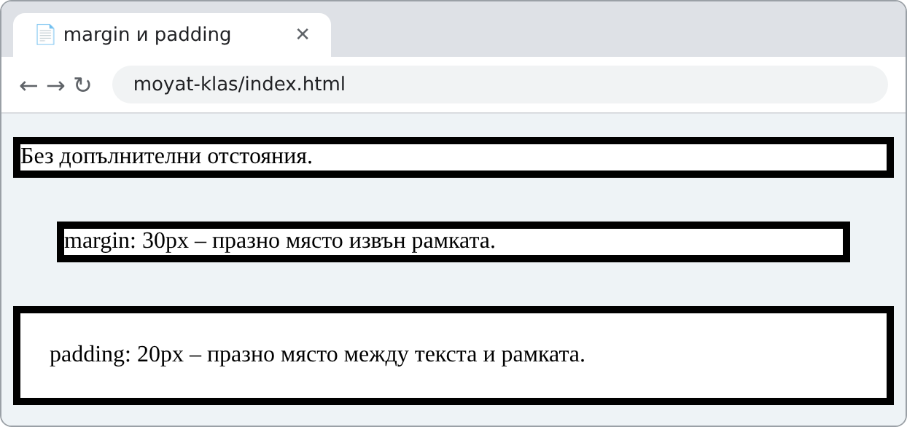

Вторият параграф е отдалечен от краищата (външно отстояние), а при третия текстът е отдалечен от рамката (вътрешно отстояние).

**Отделни страни и кратък запис.** Всяка страна може да се зададе поотделно: `margin-top`, `margin-right`, `margin-bottom`, `margin-left` (аналогично `padding-top` и т.н.). Краткият запис приема от една до четири стойности, които се четат **по часовниковата стрелка, започвайки отгоре**:

| Запис | Значение |
|---|---|
| `margin: 20px;` | всички страни – 20px |
| `margin: 10px 20px;` | горе и долу – 10px; ляво и дясно – 20px |
| `margin: 10px 20px 30px;` | горе – 10px; ляво и дясно – 20px; долу – 30px |
| `margin: 10px 20px 30px 40px;` | горе, дясно, долу, ляво |

Когато два блокови елемента в обичайния поток на страницата са един под друг, техните вертикални външни отстояния обикновено **не се събират**, а се **сливат** – между тях остава по-голямото от двете. Затова между параграфите няма двойно празно място. (Сливането не важи например за елементи в един ред, за `inline-block` и при някои специални оформления.)

### Ширина, `box-sizing` и центриране

По подразбиране (`box-sizing: content-box`) свойството `width` задава ширината **само на съдържанието**, а `padding` и `border` се **добавят** към нея. С `box-sizing: border-box` ширината включва и тях – размерите стават предвидими. Затова много проекти започват с правилото `* { box-sizing: border-box; }`.

Блок със зададена ширина се центрира хоризонтално с `margin: 0 auto;` – браузърът разпределя свободното място поравно отляво и отдясно.

**CSS:**

```css
.kutiya {
    width: 200px;
    padding: 20px;
    border: 5px solid #174967;
    margin-bottom: 10px;
    background-color: #eaf4f9;
}

.border-box {
    box-sizing: border-box;
}

.centrirano {
    margin: 0 auto;
}
```

**HTML (в `<body>`):**

```html
<div class="kutiya">content-box: широк 250px</div>
<div class="kutiya border-box">border-box: широк 200px</div>
<div class="kutiya border-box centrirano">margin: 0 auto – центриран</div>
```

**Как изглежда в браузъра:**

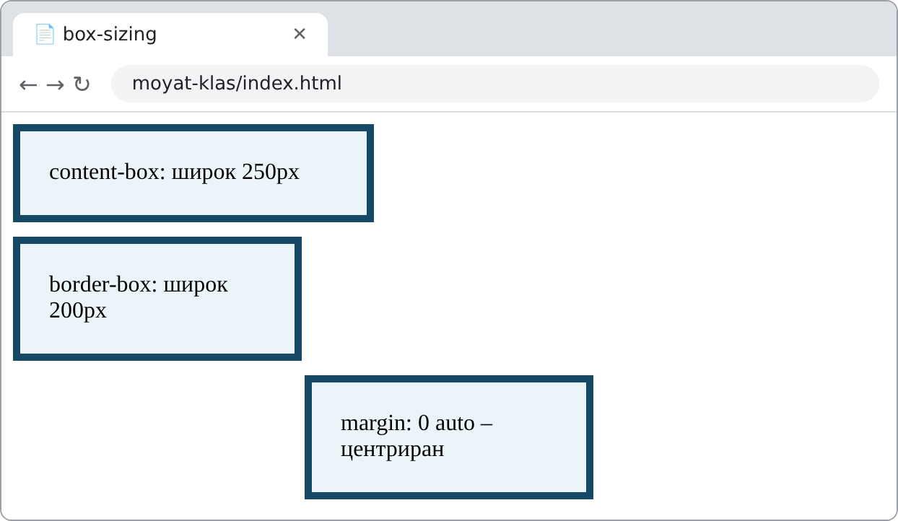

Първата кутия е широка 200 + 2 × 20 + 2 × 5 = **250px**, а втората – точно **200px**, въпреки че и двете имат `width: 200px`.

### Фиксирана или гъвкава ширина

Ширината на екрана е различна – телефон, лаптоп, проектор. Фиксираната ширина е удобна, но на тесен екран блокът излиза извън прозореца и се появява хоризонтален плъзгач:

```css
/* Фиксирана ширина – на телефон блокът не се побира */
.sadarzhanie {
    width: 800px;
}

/* Гъвкава ширина – до 800px, а на тесен екран се свива */
.sadarzhanie {
    box-sizing: border-box;
    width: 100%;
    max-width: 800px;
    margin: 0 auto;
}
```

С `max-width` блокът е широк до 800px на голям екран и заема наличната ширина на по-малък. Свойството `box-sizing: border-box` е важно: без него `padding` и `border` се **добавят** към `width: 100%` и блокът отново може да излезе извън екрана. Затова в примера „Моят клас“ (раздел 12) основното съдържание е с `max-width`, а не с `width`. Подробно оформяне за различни екрани ще разгледаме в следващите уроци.

### Свойството `display`

В урок 1 видяхме, че блоковите елементи заемат цял ред, а вградените остават в реда на текста. Свойството `display` променя това поведение:

| Стойност | Поведение |
|---|---|
| `block` | заема цялата ширина, започва на нов ред; приема `width`, `height`, `margin` |
| `inline` | остава в реда на текста; `width` и `height` не се прилагат, вертикалните `margin` не изместват съседите |
| `inline-block` | остава в реда, но приема `width`, `height`, `padding` и `margin` като блок |
| `none` | елементът не се показва |

Така връзките в меню могат да станат „бутони“ в един ред:

**CSS:**

```css
nav a {
    display: inline-block;
    padding: 8px 14px;
    margin-right: 4px;
    background-color: #174967;
    color: white;
    text-decoration: none;
    border-radius: 6px;
}

nav a:hover {
    background-color: #ffb62e;
    color: #082d46;
}

nav a:focus-visible {
    outline: 3px solid #ffb62e;
    outline-offset: 3px;
}
```

**HTML (в `<body>`):**

```html
<nav>
    <a href="#novini">Новини</a>
    <a href="#deynosti">Дейности</a>
    <a href="#programa">Програма</a>
</nav>
```

**Как изглежда в браузъра** (мишката е върху „Програма“):

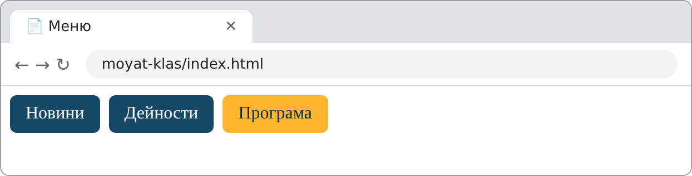

#### Достъпност: `:hover` и `:focus-visible`

`:hover` се активира при посочване с **мишка или друго посочващо устройство** и не е надежден заместител на клавиатурния фокус. Много потребители обаче се придвижват по страницата с **клавиатура** (клавиш **Tab**) – например хора с двигателни затруднения или такива, които използват екранен четец. Псевдокласът `:focus-visible` оформя елемента, когато е избран с клавиатурата, така че потребителят да вижда къде се намира. Правилото `nav a:focus-visible` в примера добавя жълт контур около връзката, на която е фокусът.

**Как изглежда в браузъра** (с клавиша Tab е избрана връзката „Дейности“):

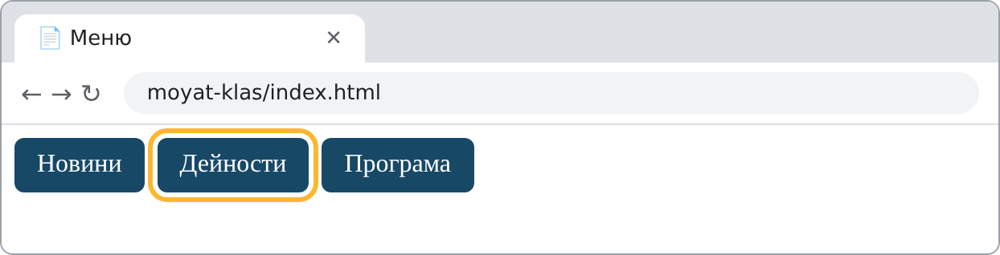

Никога не премахвай контура на фокуса (`outline: none`), без да го замениш с друго ясно видимо оформление – иначе страницата става неизползваема с клавиатура. Псевдокласът `:focus` действа при всеки фокус (и с мишка), а `:focus-visible` – само когато браузърът прецени, че фокусът трябва да се вижда, най-често при работа с клавиатура.

!!! question "Провери разбирането"
    Кутия има `width: 300px; padding: 10px; border: 2px solid; margin: 20px;`. Колко пиксела е видимата ѝ ширина при `content-box` и колко – при `border-box`? Влияе ли `margin` на видимата ширина?

## 11. Инструменти за разработчика

Всеки съвременен браузър има **инструменти за разработчика** (DevTools). Те показват кои CSS правила се прилагат към даден елемент и позволяват промени „на живо“, без да се записва файлът.

1. Отвори страницата и натисни **F12** (или десен бутон върху елемента → **Inspect** / **Проверка**).
2. В панела **Elements** избери елемента в HTML дървото.
3. В панела **Styles** се виждат всички правила за него – по реда на приоритета. **Задраскана** декларация означава, че друго, по-силно правило я е отменило.
4. В панела **Computed** се вижда кутиеният модел с точните стойности на `margin`, `border`, `padding` и размерите на съдържанието.
5. Можеш да промениш стойност направо в **Styles** и да видиш резултата веднага. Промените изчезват при презареждане – пренеси успешните в CSS файла.

### Пример. Защо цветът не се прилага?

**CSS:**

```css
.zaglavie {
    colour: blue;
    font-size: 28px;
}
```

**HTML (в `<body>`):**

```html
<h2 class="zaglavie">Нашите дейности</h2>
<p>Размерът на заглавието се промени, но цветът – не.</p>
```

**Как изглежда в браузъра:**

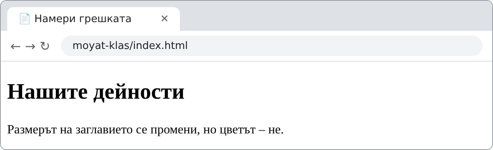

Размерът на заглавието се промени, но то остана черно. Браузърът не показва съобщение за грешка – той просто **пропуска** декларацията, която не разбира, и прилага останалите.

**Как да открием грешката с DevTools:** избери заглавието (десен бутон → **Inspect**). В панела **Styles** браузърът обозначава декларацията `colour: blue;` като **невалидна** – може да се появи предупредителна икона или пояснение за невалидно свойство (изгледът зависи от браузъра) (невалидно име на свойство). Внимание: самото задраскване на декларация в **Styles** най-често означава, че тя е **отменена** от по-силно правило. Невалидната декларация се разпознава по предупреждението на DevTools, а не само по задраскването. Правилното име е `color` – CSS използва американския правопис. След поправката заглавието става синьо.

!!! tip "Ако стилът не се прилага"
    Провери: (1) правилен ли е пътят в `<link href="...">` – в панела **Network** файлът не трябва да е с грешка 404; (2) съвпада ли селекторът с HTML – точка за клас, диез за `id`, еднакво изписване; (3) няма ли по-силно правило, което го отменя (задраскано в **Styles**); (4) няма ли синтактична грешка – липсваща `;` или `}`.

## 12. Пример: оформяне на страницата „Моят клас“

Да приложим наученото към страницата от упражнение 1. Структурата и съдържанието на HTML **остават същите** – добавяме само връзката `<link rel="stylesheet" href="css/style.css">` в `<head>` и създаваме файла `css/style.css`.

**Преди – само HTML:**

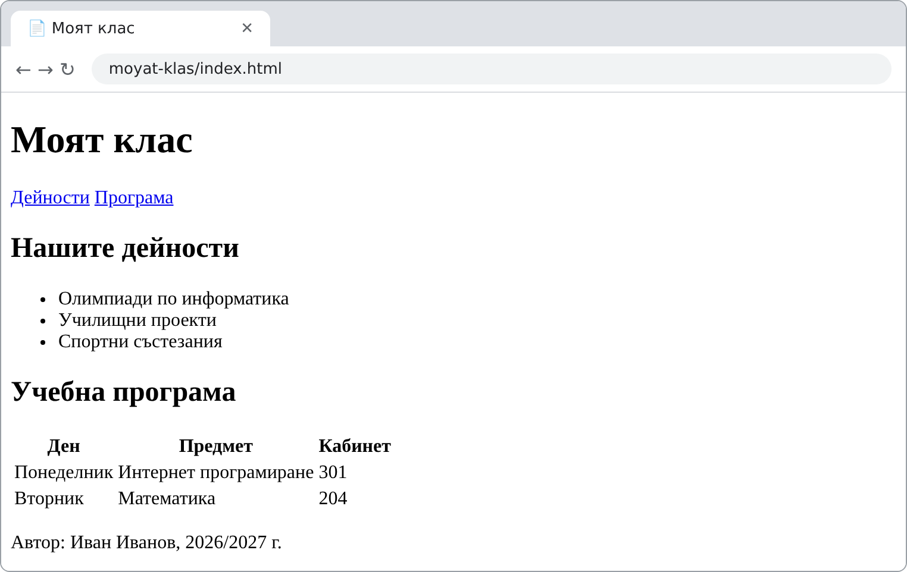

**Файл `css/style.css`:**

```css
* {
    box-sizing: border-box;
}

body {
    margin: 0;
    font-family: Arial, Helvetica, sans-serif;
    line-height: 1.5;
    color: #082d46;
    background-color: #eef6fb;
}

header {
    background-color: #174967;
    color: white;
    padding: 16px 24px;
}

header h1 {
    margin: 0 0 8px;
}

nav a {
    display: inline-block;
    padding: 6px 12px;
    margin-right: 6px;
    border-radius: 6px;
    background-color: #ffb62e;
    color: #082d46;
    text-decoration: none;
}

nav a:hover {
    background-color: white;
}

nav a:focus-visible {
    outline: 3px solid white;
    outline-offset: 2px;
}

main {
    max-width: 800px;
    margin: 20px auto;
    padding: 0 16px;
}

section {
    background-color: white;
    border-radius: 10px;
    padding: 16px 20px;
    margin-bottom: 16px;
}

table {
    border-collapse: collapse;
}

th, td {
    border: 1px solid #9fbfd2;
    padding: 6px 12px;
}

th {
    background-color: #eaf4f9;
}

footer {
    text-align: center;
    font-size: 14px;
    color: #46738d;
}
```

**След – със стиловия файл:**

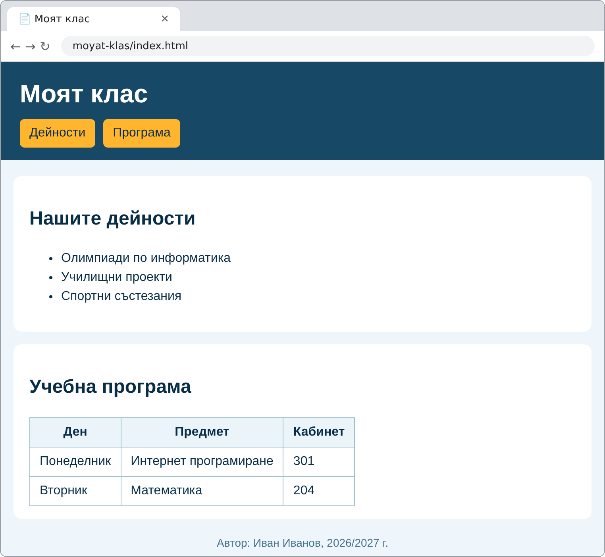

**Наблюдавай:** кои правила действат върху всички елементи, кои – само върху заглавието в `<header>`, и кои – само върху връзките в `<nav>`?

**Какво използвахме:** универсален селектор и `box-sizing`; наследяване на шрифта и цвета от `body`; вложени селектори `header h1` и `nav a`; `display: inline-block`, `:hover` и `:focus-visible` за менюто; центриране на `main` с `max-width` и `margin: 20px auto`; `border-radius` и `padding` за секциите; `border-collapse` за таблицата.

## 13. Самостоятелна проверка

1. Какво означава съкращението CSS и каква е разликата между HTML и CSS?
2. Посочи селектора, свойствата и стойностите в правилото `h1 { color: blue; font-size: 2rem; }`.
3. Кои са трите начина за добавяне на CSS? Кой е препоръчителен за сайт с много страници и защо?
4. Каква е разликата между селекторите `.menu`, `#menu` и `menu`?
5. Към кои елементи се отнася селекторът `nav a`? А `h2, h3`?
6. Параграф има клас и `id`, а за двата има правила с различен цвят. Кое правило печели и защо?
7. Кои свойства се наследяват? Дай два примера за свойства, които не се наследяват.
8. Каква е разликата между `margin` и `padding`? Кое от двете има цвета на фона на елемента?
9. Какво прави `box-sizing: border-box`? Защо `max-width` често е по-подходящо от `width`?
10. Фоновото изображение не се показва, а в CSS файла пише `url("images/fon.png")`. Файлът е в `moyat-klas/images/`, а CSS файлът – в `moyat-klas/css/`. Къде е грешката?

## 14. Практическа лаборатория

**Задача:** Създай уебстраница с **три вложени `<div>` елемента**, както на изображението. Работи на етапи – всяка мисия надгражда предишната. Ако работиш по-бързо, продължи с допълнителните задачи.

**Очакван резултат:**

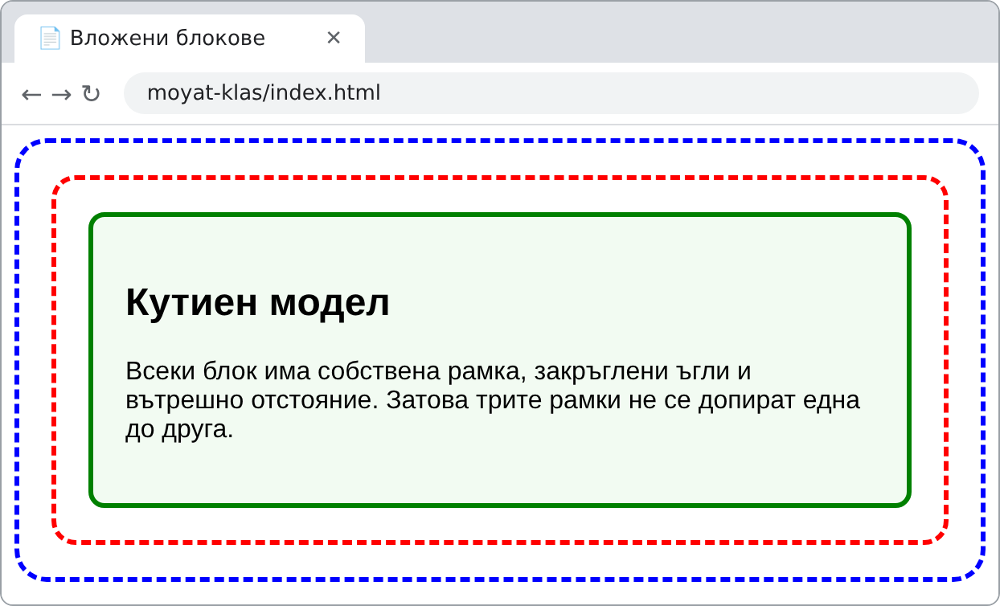

| Мисия | Дейност | Какво проверява |
|---|---|---|
| **1. HTML структура** | Създай `index.html` с три вложени `<div>`. Във вътрешния постави заглавие `<h2>` и параграф. Създай празен файл `css/style.css` и го свържи с `<link>`. | Правилно влагане; свързан CSS файл |
| **2. Класове и рамки** | Дай на блоковете класове `vanshen`, `sreden` и `vatreshen`. Задай: външен – синя пунктирана рамка; среден – червена пунктирана рамка; вътрешен – зелена плътна рамка и светлозелен фон. Не използвай атрибута `style`. | Селектори по клас; `border`, `background-color` |
| **3. Отстояния и ъгли** | Добави `padding` на трите блока, за да не се допират рамките, и `border-radius` за закръглени ъгли. Задай шрифт на `body`. | Кутиен модел; наследяване на шрифта |
| **4. Изследване с DevTools** | Избери вътрешния блок (F12 → Elements). В **Computed** запиши стойностите на `padding` и `border`. Премахни временно `padding` на средния блок в **Styles** и опиши какво се промени. | Анализ на кутиения модел |

**Провери:** свързан ли е CSS файлът; използвани ли са класове, а не вграден стил; съвпада ли резултатът с изображението.

### Допълнителни задачи

**Задача 1 – Разпознай правилото.** Посочи селектора, свойствата и стойностите в `h2 { color: green; font-size: 24px; }`.

**Задача 2 – Използвай клас.** Добави два параграфа, но открои само единия чрез клас `.vazhno`. Не използвай атрибута `style`.

**Задача 3 – Промени кутиения модел.** На вътрешния блок от лабораторията задай `padding: 30px`, `border: 4px solid green` и `margin: 20px`. Сравни стойностите в DevTools (**F12 → Elements → Computed**) преди и след промяната.

**Задача 4 – Намери грешката.** HTML съдържа `<link rel="stylesheet" href="styles.css">`, а файлът е записан като `style.css`. Защо стиловете не се прилагат? Как ще откриеш грешката в DevTools? Какво друго може да бъде причина – напр. CSS файлът е в папка `css`, а в `href` няма папка?

**Предизвикателство – смяна на темата.** Създай втори CSS файл (`tamna-tema.css`) с различни цветове на фона, текста и рамките. Смени само `href` в `<link>` и сравни двата резултата. HTML съдържанието трябва да остане **непроменено** – така проверяваш, че оформлението е напълно отделено от съдържанието.

!!! tip "Връзка с практиката"
    В следващото упражнение ще създадеш файл `css/style.css` за своята страница „Моят клас“ и ще я оформиш с наученото в този урок.

## 15. Обобщение

CSS описва външния вид на HTML елементите и позволява оформлението да е отделено от съдържанието. Всяко CSS правило се състои от селектор и декларации във вида `свойство: стойност;`. Стиловете се добавят чрез външен файл (препоръчително), елемента `<style>` или атрибута `style`. Селекторите избират елементи по таг, клас, `id`, вложеност и състояние. Когато няколко правила си противоречат, браузърът прилага каскадата – по-специфичното и по-късно записаното правило печели, а някои свойства се наследяват от родителя. Всеки елемент е кутия със съдържание, вътрешно отстояние, рамка и външно отстояние.

## 16. Домашна работа

Създай файл `css/style.css` за страницата си **„Моят клас“** и го свържи с `index.html`. Използвай:

- шрифт с резервни варианти и основен цвят на текста, зададени на `body`;
- поне един селектор по клас, един по `id` и един вложен селектор;
- оформено меню в `<nav>` с ефект при `:hover`;
- рамки и вътрешни отстояния за секциите и `border-collapse` за таблицата;
- центрирано основно съдържание чрез `max-width` и `margin: 0 auto`.

Добави CSS коментар над всяка група правила, който обяснява какво оформя тя.

## 17. Ключови понятия

**CSS**, **каскада**, **`:focus-visible`**, **достъпност**, **правило**, **селектор**, **декларация**, **свойство**, **стойност**, **външен CSS**, **вътрешен CSS**, **вграден CSS**, **клас**, **id**, **псевдоклас**, **вложен селектор**, **приоритет (специфичност)**, **наследяване**, **HEX/RGB цвят**, **px**, **rem**, **%**, **кутиен модел**, **margin**, **padding**, **border**, **box-sizing**, **display**, **инструменти за разработчика**.

---

*Урокът е разработен по материалите „Работа със CSS. Селектори и основни правила“ от курса на [ИТ Кариера](https://it-kariera.mon.bg/e-learning/), разпространявани под лиценз [CC BY-NC-SA 4.0](https://creativecommons.org/licenses/by-nc-sa/4.0/deed.bg), като е допълнен и преработен.*
