# Урок 3. Работа с инструментите за разработчици на съвременните уеб браузъри

**Раздел 2: Разработка на външен интерфейс (front-end) на уеб приложения**  
**Времетраене:** 2 учебни часа (90 минути)  
**Предварителни знания:** Урок 1 (HTML) и Урок 2 (CSS) от Раздел 2. От Раздел 1: HTTP заявка и отговор, методи и статус кодове.

## Какво ще научите

След урока ще можеш да:

- обясняваш какво са инструментите за разработчици и кои промени в тях са временни и кои – не;
- отваряш инструментите по няколко начина и намираш кода на конкретен елемент;
- разглеждаш и променяш HTML и CSS в панела **Elements** и откриваш кое CSS правило е отменено и защо;
- проверяваш кутиения модел и крайните стойности на свойствата в **Computed**;
- разчиташ съобщенията за грешки в **Console** и намираш реда, на който са възникнали;
- проследяваш HTTP заявките на страницата в **Network** и разпознаваш липсващ файл (404);
- намираш локално съхранените данни в **Application**;
- проследяваш изпълнението на JavaScript в **Sources** с точка на прекъсване и стъпково изпълнение;
- обясняваш за какво служат **Performance**, **Memory**, **Recorder**, **Lighthouse** и **Privacy and security**;
- избираш подходящия панел според проблема, който търсиш.

## 1. Какво са инструментите за разработчици?

**Инструментите за разработчици** (*Developer Tools*, съкратено **DevTools**) са вградени във всички съвременни браузъри – Google Chrome, Microsoft Edge, Mozilla Firefox, Safari. Те показват „отвътре“ какво прави браузърът със страницата:

- каква е **HTML структурата** ѝ в момента и кои **CSS правила** се прилагат към всеки елемент;
- какви **грешки и съобщения** е получил браузърът;
- кои **файлове** е изтеглил страницата, с какви **HTTP заявки** и за колко време;
- какви **данни** пази сайтът в браузъра;
- колко **бързо** и колко **достъпно** е направена страницата.

В урока използваме **Google Chrome**, както препоръчва учебната програма по „Интернет програмиране“ (Обяснителни бележки: „Google Chrome + Google Chrome DevTools за предпочитан уеб браузър за работа“). Microsoft Edge е изграден на същата основа и инструментите му са почти еднакви. Firefox има свои инструменти със същите идеи, но с други имена на някои панели (вижте т. 11).

!!! info "Кои промени в DevTools са временни?"
    Промените в HTML (**Elements**) и в CSS (**Styles**) се правят **само в паметта на браузъра** на твоя компютър. Файловете на диска и на сървъра **не се променят**, а при презареждане (**F5**) страницата се връща в оригиналния си вид. Затова DevTools е безопасно място за експерименти, а успешната промяна трябва да **пренесеш** в своя файл във VS Code.

    Не всичко обаче изчезва: записите в **Local storage** и **бисквитките** (т. 8) остават и след презареждане, а DevTools има и механизми за трайно запазване на промени – например **Local Overrides** в **Sources**, които заменят файл от сайта с твое локално копие. В този урок не ги използваме.

## 2. Как се отварят?

| Начин | Действие | Кога е удобен |
|---|---|---|
| Клавиш | **F12** или **Ctrl + Shift + I** (на macOS **Cmd + Option + I**) | Най-бързият начин. Прозорецът на браузъра трябва да е активен. |
| Десен бутон | Десен бутон върху елемент → **Инспектиране** (*Inspect*) | Отваря директно панела **Elements** и маркира кода точно на този елемент. |
| Меню на браузъра | **⋮** горе вдясно → **Още инструменти** (*More tools*) → **Инструменти за програмисти** (*Developer tools*) | Ако не помниш клавишите или **F12** на лаптопа е заета (тогава опитай **Fn + F12**). |
| Направо в конзолата | **Ctrl + Shift + J** | Отваря панела **Console**. |
| Режим „посочи елемент“ | **Ctrl + Shift + C** | Посочваш елемент в страницата с мишката и DevTools показва кода му. |

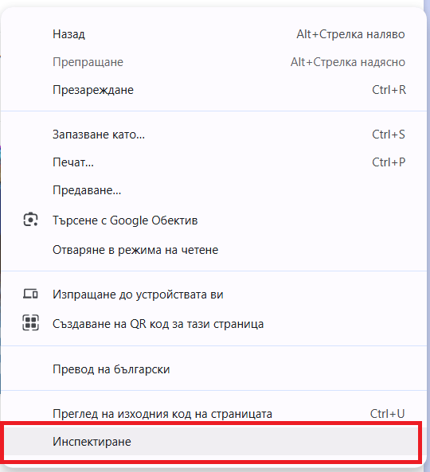

*Десен бутон върху елемент → **Инспектиране**. Това е най-бързият начин да стигнеш до кода на конкретен елемент.*

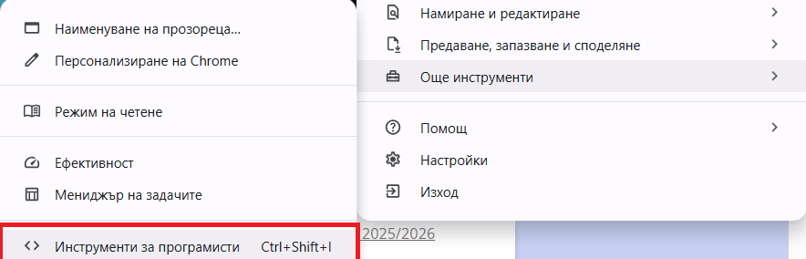

*Отваряне през менюто ⋮ → **Още инструменти** → **Инструменти за програмисти**.*

**Подредба на прозореца.** Чрез **⋮** в горния десен ъгъл на DevTools (*Dock side*) избираш дали инструментите да са долу, вдясно, вляво или в отделен прозорец. Ширината се променя с влачене на границата.

**Език на интерфейса.** Менютата на браузъра може да са на български („Инспектиране“), а имената на панелите в DevTools обикновено остават на английски (**Elements**, **Console**, **Network**). В урока използваме английските имена, защото така ги срещаш и в документацията.

## 3. Панелите – обзор

DevTools е разделен на **панели** (раздели). Отгоре е редът с имената им. Панелите, които не се побират, са скрити зад **»**.

| Панел | За какво служи | Ниво в урока |
|---|---|---|
| **Elements** (с **Styles** и **Computed**) | HTML структура и CSS стилове на страницата, кутиен модел | **основно умение**, т. 4 |
| **Console** | Съобщения за грешки и изпълнение на команди | **основно умение**, т. 5 |
| **Network** | Всички HTTP заявки на страницата | **основно умение**, т. 7 |
| **Sources** | Файловете на страницата и проследяване на JavaScript ред по ред | начално запознаване, т. 6 |
| **Application** | Данни, които сайтът пази в браузъра | начално запознаване, т. 8 |
| **Performance**, **Memory**, **Recorder**, **Lighthouse**, **Privacy and security** | Скорост, памет, запис на действия, автоматична проверка, сигурност | обзор, т. 9 |

**Основните умения** ще използваш във всеки следващ урок и в упражнението. С панелите за **начално запознаване** ще работиш подробно в уроците по JavaScript и в Раздел 3. **Обзорните** панели е достатъчно да разпознаваш и да знаеш за какво служат.

!!! note "Раздели от разширения"
    Някои разширения на браузъра добавят свои раздели в DevTools. На снимките в урока има например раздел **Adblock Plus**. Той е част от разширение за блокиране на реклами, а не от самите инструменти за разработчици.

## 4. Панел Elements

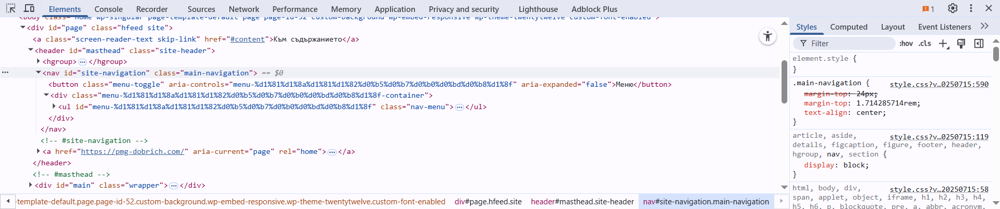

*Панелът **Elements**: вляво е HTML дървото, вдясно – стиловете на избрания елемент. Редът `<nav id="site-navigation" …> == $0` е избраният елемент. Най-долу е „пътят“ до него: `div#page` › `header#masthead` › `nav#site-navigation`.*

### 4.1. HTML дървото

Вляво е **HTML дървото** на страницата. Триъгълникът ▸ разгъва и сгъва вложените елементи. Когато задържиш мишката върху ред, браузърът осветява съответния елемент в страницата.

| Действие | Как |
|---|---|
| Промяна на текст или атрибут | Двоен клик върху текста или стойността на атрибута |
| Промяна на цял елемент | Десен бутон → **Edit as HTML** |
| Скриване на елемент | Избери го и натисни **H** |
| Изтриване на елемент | Избери го и натисни **Delete** |
| Търсене в дървото | **Ctrl + F** – по текст, таг, клас или `id` |

!!! tip "Elements не е изходният код"
    **Elements** показва страницата **такава, каквато е сега** – след като браузърът е поправил някои грешки в HTML (например липсващ затварящ таг) и след промените от JavaScript. Изходният файл, както е изтеглен от сървъра, виждаш с **Ctrl + U** (десен бутон → **Преглед на изходния код на страницата**). Ако двете се различават, причината е или в поправка от браузъра, или в JavaScript.

### 4.2. Стилове (Styles)

Вдясно, в раздела **Styles**, са **всички CSS правила**, които се отнасят до избрания елемент – **най-силното е най-отгоре**.

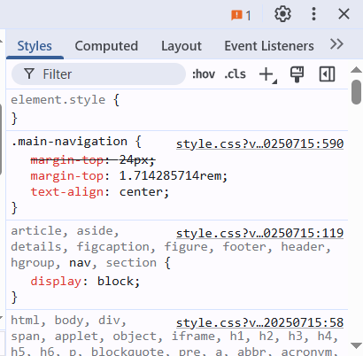

*В правилото `.main-navigation` декларацията `margin-top: 24px` е **задраскана** – отменена е от следващата `margin-top: 1.714285714rem` в същото правило. Вдясно е източникът: файлът `style.css` и номерът на реда (`:590`).*

| Какво виждаш | Какво означава |
|---|---|
| `element.style { }` | Вградените стилове на елемента (атрибута `style`) – тук можеш да добавиш бързо стил само за него. Те са много високо в каскадата и обикновено печелят пред правилата от CSS файла, но не безусловно: приложима декларация с `!important` от CSS файла има предимство пред обикновен вграден стил. |
| Селектор и `{ … }` | Правило от CSS файл или от `<style>` |
| `style.css:42` вдясно | Файлът и редът, от които идва правилото. Кликът води до кода в **Sources**. |
| **Задраскана** декларация | Декларацията е **отменена** – не тя определя крайната стойност. Най-често: друго приложимо правило има предимство (каскада и приоритет от Урок 2) или **по-късна декларация** за същото свойство в същото правило (както на снимката по-долу). |
| Предупредителна икона ⚠ до декларацията | Свойството или стойността е **невалидна** – например `colour` вместо `color`. Браузърът я пропуска. |
| Отметка пред декларацията | Временно **изключва** или **включва** декларацията. |
| **Inherited from …** | Стилове, **наследени** от родител (например шрифт и цвят от `body`). |
| **:hov** | Принудително състояние `:hover`, `:focus`, `:active` – за да видиш стиловете при посочване, без да държиш мишката. |
| **.cls** | Добавяне или махане на клас, за да видиш как ще изглежда елементът с него. |

**Пример. Защо активната връзка не е бяла?** В менюто връзката към текущата страница `<a class="aktivna">` трябва да е с бял фон, но е оранжева като останалите:

```css
.menu a {
    background-color: #ffb62e;
}

.aktivna {
    background-color: white;
}
```

В **Styles** правилото `.menu a` е над `.aktivna`, а декларацията `background-color: white` е задраскана. Причината е **приоритетът**: `.menu a` има един клас и един таг, а `.aktivna` – само един клас, затова `.menu a` има предимство, въпреки че е записано по-рано. Поправката е да направиш селектора по-специфичен, например `.menu .aktivna`. Можеш първо да я изпиташ в DevTools: кликни върху селектора `.aktivna` в **Styles**, промени го и виж резултата веднага.

!!! tip "Отменена или невалидна декларация?"
    **Отменената** декларация е **валидна**, но не определя крайната стойност – друго приложимо правило има предимство или по-късна декларация в същото правило задава същото свойство. Тя е само задраскана. Поправката е в селектора, в реда на правилата или в излишната декларация. **Невалидната** декларация има **грешка** в името на свойството или в стойността (например `colour: blue` или `width: 100 px`) – освен задраскана, тя е отбелязана с ⚠. Поправката е в самата декларация. Пример за невалидна декларация видя в [Урок 2, т. 11](urok-02-css-selektori-i-pravila.md#11).

### 4.3. Изчислени стойности (Computed)

Разделът **Computed** показва **крайните стойности**, които браузърът използва – след каскадата, наследяването и приоритета. Отгоре е **схемата на кутиения модел**.

**Styles или Computed?** **Styles** отговаря на въпроса „**кои правила** се опитват да оформят елемента и кое от тях печели“. **Computed** отговаря на въпроса „**каква е крайната стойност** на всяко свойство“. Ако цветът е неочакван, в **Computed** виждаш каква е стойността, а в **Styles** – откъде идва и кое правило е отменено.

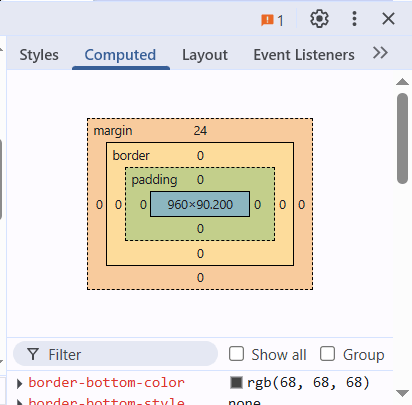

*Схемата на кутиения модел: отвън навътре **margin** (24 px отгоре), **border**, **padding** и в средата размерът на **съдържанието** – 960 × 90,2 px.*

- Двоен клик върху число в схемата позволява да го промениш.
- Под схемата са всички свойства по азбучен ред. **Show all** показва и тези със стойности по подразбиране.
- Стрелката ▸ пред свойство показва **кое правило** е дало стойността.

**Пример.** Карта с `width: 100%` в контейнер, широк 600 px, има `padding: 16px` и `border: 2px`. При стандартното `box-sizing: content-box` реалната ширина е 600 + 2 × 16 + 2 × 2 = **636 px** – картата излиза **от контейнера** си. Дали ще излезе и от прозореца (и ще се появи хоризонтална лента за превъртане), зависи от ширината на прозореца: при широк прозорец картата просто стърчи вдясно от останалото съдържание. В **Computed** причината се вижда веднага: съдържанието е 600 px, а рамката и отстоянията се добавят **отвън**. С `box-sizing: border-box` съдържанието става 564 px, а общата ширина остава 600 px.

### 4.4. Подредба (Layout)

Разделът **Layout** показва подредбите с **Flexbox** и **Grid** в страницата и включва помощни линии върху тях. Ако страницата не използва такива подредби, той показва *No flexbox layouts found on this page*. Ще го използваме в урока за адаптивно оформление.

### 4.5. Други раздели в Elements

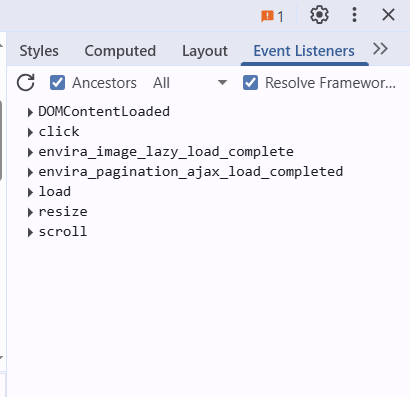

*Разделът **Event Listeners** показва кои събития (`click`, `load`, `scroll` …) „слушат“ избрания елемент или неговите родители.*

| Раздел | За какво служи |
|---|---|
| **Event Listeners** | Кои JavaScript функции се изпълняват при събития върху елемента. Ще го използваме в уроците по JavaScript. |
| **Properties** | Елементът като JavaScript обект – всичките му свойства и стойности. |
| **Accessibility** | Как четците на екрана „виждат“ елемента: роля, име, състояние. |
| **DOM Breakpoints** | Спира JavaScript, когато елементът бъде променен или изтрит. |

**Мини-конзолата и `$0`.** Клавишът **Esc** отваря долу малка конзола (*Console drawer*), без да напускаш **Elements**. В нея `$0` е **избраният** в момента елемент. Например `$0.textContent` показва текста му. Подробно за конзолата – в т. 5.

### 4.6. Режим за мобилни устройства

Бутонът с телефон и таблет в горния ляв ъгъл на DevTools (или **Ctrl + Shift + M**) показва страницата с размерите на телефон или таблет. Можеш да избереш устройство или да зададеш произволна ширина. Режимът е основният инструмент в урока за **адаптивно оформление**.

## 5. Панел Console

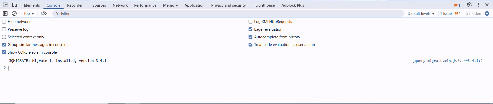

*Панелът **Console**. Горе са филтрите и настройките. Вдясно от всяко съобщение е файлът и редът, от които идва (тук `jquery-migrate.min.js`). Най-долу, след знака `>`, се пишат команди.*

**Console** е мястото, където браузърът съобщава за **грешки** и където можеш да изпълниш **JavaScript команда** веднага.

### 5.1. Съобщенията

| Вид | Как изглежда | Пример |
|---|---|---|
| **Грешка** (*Error*) | червен ред с ⛔ | `Uncaught TypeError: Cannot read properties of null (reading 'addEventListener')` |
| **Предупреждение** (*Warning*) | жълт ред с ⚠ | остаряла функция, проблем с бисквитка |
| **Информация** (*Info*, *Log*) | обикновен ред | съобщение от `console.log(…)` |

Вдясно от всяко съобщение е **връзка** `script.js:12` – кликът отваря файла в **Sources** точно на реда с грешката. Филтърът **Default levels** показва или скрива съобщенията по вид. Иконата 🚫 (или **Ctrl + L**) изчиства конзолата.

**Липсващ файл в конзолата.** Ако изображение, CSS или JavaScript файл не е намерен, в конзолата има червен ред `Failed to load resource: the server responded with a status of 404 (Not Found)`. Когато страницата е отворена направо от диска (`file:///…`), съобщението е `net::ERR_FILE_NOT_FOUND`.

### 5.2. Команди

След знака `>` пишеш команда и натискаш **Enter**. Резултатът се показва веднага:

```javascript
document.title                       // заглавието на страницата
2 + 3 * 4                            // конзолата е и калкулатор: 14
$0.style.color = "red"               // избраният в Elements елемент става червен
document.querySelectorAll("a").length  // колко връзки има в страницата
console.table([{ден: "Понеделник", час: "HTML"}, {ден: "Сряда", час: "CSS"}])
```

### 5.3. Съобщения от кода: `console.log`, `console.warn`, `console.error`

Програмистът може сам да пише съобщения в конзолата, за да проследи как работи кодът му:

```javascript
console.log("Страницата е заредена.");             // обикновено съобщение
console.warn("Липсва описание на страницата.");    // жълто предупреждение
console.error("Неуспешно зареждане на данните.");  // червена грешка
```

Трите реда се показват в конзолата в съответния цвят, а вдясно от всеки е файлът и редът, от които идва. Филтърът **Default levels** позволява да виждаш например само грешките. Ще използваме тези команди в уроците по JavaScript.

!!! danger "Не поставяй непознат код в конзолата"
    Кодът в конзолата се изпълнява **от твое име** на отворения сайт. Ако някой те подкани да поставиш код „за бонус“ или „за да видиш скрито съдържание“, той може да открадне профила ти. Затова Chrome при първо поставяне иска да напишеш `allow pasting`. Поставяй само код, който разбираш.

## 6. Панел Sources

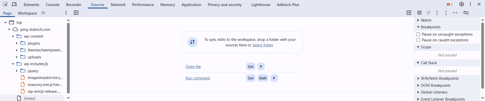

*Панелът **Sources**. Вляво е дървото с файловете на страницата, в средата е редакторът (тук още празен), вдясно са **Watch**, **Breakpoints**, **Scope** и **Call Stack** за проследяване на JavaScript.*

| Част | За какво служи |
|---|---|
| Вляво – дървото с файлове | Всички HTML, CSS, JavaScript файлове и изображения, които страницата е заредила, подредени по сървъри и папки |
| В средата – редакторът | Съдържанието на избрания файл. Бутонът `{ }` подрежда („разкрасява“) сбит код. |
| Вдясно – проследяване | **Breakpoints** (точки на прекъсване), **Scope** (стойностите на променливите), **Call Stack** (кой какво е извикал) |

Когато кликнеш върху връзка `script.js:17` в конзолата, **Sources** се отваря точно на този ред.

### 6.1. Какво е дебъгване?

**Дебъгване** (*debugging*) е търсенето и отстраняването на грешки (*bugs*) в програма. Вместо да гадаеш защо кодът не работи, **спираш** изпълнението му на избрано място и разглеждаш какво се случва: кой ред се изпълнява, какви стойности имат променливите, коя функция коя е извикала. **Sources** е панелът за това.

### 6.2. Точка на прекъсване (breakpoint)

**Точката на прекъсване** (*breakpoint*) е ред, на който браузърът **спира** изпълнението на JavaScript, **преди** да изпълни този ред. Докато програмата стои спряна, страницата „замръзва“ и можеш спокойно да я изследваш.

Как се поставя:

1. В **Sources** отвори JavaScript файла от дървото вляво (или с **Ctrl + P** и името на файла).
2. **Кликни върху номера на реда.** Номерът се оцветява в синьо, а точката се появява и в списъка **Breakpoints** вдясно.
3. Предизвикай изпълнението на реда – презареди страницата (**F5**) или натисни бутона, който изпълнява този код.
4. Браузърът спира. Редът е осветен, а над страницата се появява лента *Paused in debugger*.

Нов клик върху синия номер маха точката. Отметката пред нея в списъка **Breakpoints** я изключва временно.

### 6.3. Управление на изпълнението

Когато програмата е спряна, продължаваш с бутоните над **Breakpoints** или с клавишите:

| Бутон | Клавиш | Какво прави |
|---|---|---|
| ▶ **Resume** (продължи) | **F8** | Продължава изпълнението до следващата точка на прекъсване или до края. |
| ↷ **Step over** (прескочи) | **F10** | Изпълнява текущия ред **изцяло** и спира на следващия. Ако на реда се извиква функция, тя се изпълнява, без да влизаш в нея. |
| ↓ **Step into** (влез) | **F11** | Ако на текущия ред се извиква функция, **влиза в нея** и спира на първия ѝ ред. |
| ↑ **Step out** (излез) | **Shift + F11** | Изпълнява докрай текущата функция и спира в кода, който я е извикал – след връщането от нея. |

### 6.4. Как се наблюдават стойностите?

| Място | Какво показва |
|---|---|
| **Scope** | Всички променливи, достъпни в момента, с текущите им стойности. **Local** са тези на текущата функция, **Global** – общите за страницата. |
| **Watch** | Изрази, които добавяш сам (бутон **+**), за да ги следиш на всяка стъпка – например `broy + 1`. |
| **Call Stack** | Пътят до текущия ред: коя функция коя е извикала. Най-горе е текущата. |
| Задържане на мишката | Задръж мишката върху променлива в кода – показва се стойността ѝ. |
| **Console** | Докато програмата е спряна, командите в конзолата „виждат“ локалните променливи. |

### 6.5. Пример. Брояч, който брои „01“

Страницата има бутон „Харесва ми“, който трябва да увеличава брояча 0 → 1 → 2. Вместо това броячът показва 01, 011, 0111. Ето целия пример – можеш да го запишеш като `brojach.html` и да го отвориш в Chrome:

```html
<!DOCTYPE html>
<html lang="bg">
<head>
    <meta charset="UTF-8">
    <title>Брояч</title>
</head>
<body>
    <button type="button" id="like-btn">👍 Харесва ми</button>
    Харесвания: <span id="like-count">0</span>

    <script>
        document.querySelector("#like-btn").addEventListener("click", function () {
            const broyach = document.querySelector("#like-count");
            const broy = broyach.textContent;
            broyach.textContent = broy + 1;
        });
    </script>
</body>
</html>
```

**Проследяване стъпка по стъпка:**

1. Отвори страницата и натисни **F12** → **Sources**. Вляво избери файла `brojach.html` – скриптът е в него.
2. Кликни върху номера на реда `broyach.textContent = broy + 1;` – поставяш **точка на прекъсване**.
3. Натисни бутона „Харесва ми“ в страницата. Изпълнението спира на маркирания ред, **преди** да го изпълни.
4. Вдясно, в **Scope → Local**, виж стойностите: `broy: "0"` – **в кавички**, т.е. **текст**, а не число. За елементи като `<span>` свойството `textContent` връща съдържанието им като текст.
5. В **Watch** натисни **+** и добави израза `broy + 1`. Стойността му е `"01"` – текстът и числото са се **слепили**. Можеш да задържиш мишката и върху `broy` в кода – стойността се показва в изскачащо поле.
6. Натисни **Step over** (**F10**). Редът се изпълнява и броячът в страницата показва `01`.
7. Натисни **Resume** (**F8**), за да продължи програмата, и махни точката на прекъсване.
8. Провери в **Console**: `"0" + 1` дава `"01"`, а `Number("0") + 1` дава `1`. Поправката във файла е `broyach.textContent = Number(broy) + 1;`.

Не е нужно още да разбираш всеки ред от JavaScript кода – ще го изучаваме в следващите уроци. Важен е подходът: **спираш, гледаш стойностите, сравняваш с очакваното.**

## 7. Панел Network

**Network** показва **всяка HTTP заявка**, която браузърът изпраща, за да покаже страницата. Това е същият протокол, който изучихме в Раздел 1, но този път го наблюдаваш в истинския браузър. Страницата, CSS файлът, изображенията, шрифтовете и скриптовете са отделни заявки.

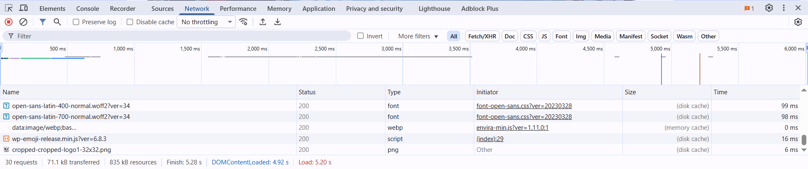

*Панелът **Network** след презареждане. Горе е времевата линия, отдолу е таблицата със заявките. Най-долу е обобщението: 30 заявки, 71,1 kB прехвърлени, зареждане за 5,20 s.*

!!! warning "Отвори DevTools, после презареди"
    Заявките се записват, докато **DevTools е отворен** и записването е включено – кръглият бутон ⏺ горе вляво в **Network** е **червен**. Не е нужно **Network** да е избраният панел, но заявките отпреди отварянето на DevTools не се виждат. Затова отвори DevTools и натисни **F5**, за да видиш всички заявки на страницата.

### 7.1. Таблицата със заявките

| Колона | Какво показва |
|---|---|
| **Name** | Името на файла (адреса на ресурса) |
| **Status** | HTTP статус кодът – `200` (успех), `304` (непроменен, взет от кеша), `404` (не е намерен), `500` (грешка на сървъра) |
| **Type** | Видът: `document` (HTML страницата), `stylesheet`, `script`, `png`, `font`, `fetch` |
| **Initiator** | Кой е предизвикал заявката – например `index.html:8`, ако е от `<link>` на ред 8 |
| **Size** | Размерът. `(disk cache)` или `(memory cache)` означава, че файлът е взет от **кеша** на браузъра, без нова заявка. |
| **Time** | Колко време е отнела заявката |
| **Waterfall** | Графика: кога е започнала и колко е продължила всяка заявка спрямо останалите |

Редовете с грешка (статус 4xx и 5xx) са **червени**. Най-долу е обобщението: брой заявки, прехвърлени данни и време за зареждане.

### 7.2. Подробности за една заявка

Клик върху ред отваря подробностите:

| Раздел | Какво съдържа |
|---|---|
| **Headers** | **General**: адрес (*Request URL*), метод (*Request Method*, напр. `GET`) и статус. После заглавките на отговора (**Response Headers**, напр. `Content-Type: text/css`) и на заявката (**Request Headers**, напр. `User-Agent`). |
| **Preview** | Отговорът в разчетен вид – изображение, форматиран JSON |
| **Response** | Отговорът като текст – HTML, CSS, JavaScript |
| **Timing** | На какви етапи е минала заявката: изчакване, DNS, връзка, изчакване на сървъра, изтегляне |

Сравни с Раздел 1: там построявахме заявката сами, а тук браузърът я изпраща, а ние я наблюдаваме.

### 7.3. Полезни настройки

| Настройка | За какво |
|---|---|
| Филтри **All**, **Doc**, **CSS**, **JS**, **Img**, **Font**, **Fetch/XHR** | Показват само заявките от даден вид |
| **Preserve log** | Запазва заявките и след преминаване към друга страница |
| **Disable cache** | Изключва кеша, докато DevTools е отворен – винаги се изтегля най-новата версия на файловете. Удобно, когато промяната в CSS „не се вижда“. |
| **No throttling** ▾ | Симулира бавна мрежа (напр. *Slow 4G*) – как изглежда сайтът при слаб интернет |

**Пример. Стиловете не се прилагат.** В страницата е записано `<link rel="stylesheet" href="styles.css">`, а файлът е `css/style.css`. В **Network** редът `styles.css` е червен със статус **404**, а колоната **Initiator** показва реда в `index.html`. Сървърът е отговорил, но на този адрес **няма ресурс**. Тук причината е грешният път – поправката е `href="css/style.css"`.

**Статус 404** означава, че сървърът **не е намерил заявения ресурс**. Причината може да е грешен адрес, липсващ (неизкачен) файл, преместен ресурс или неправилна настройка на сървъра. Грешното име на файл е най-честата, но не единствената.

!!! note "Страница от диска или от сървър"
    Ако отвориш HTML файла направо от папката (адресът започва с `file:///`), няма сървър и няма HTTP статус кодове. Тогава липсващият файл е с **Status** `(failed)` и грешка `net::ERR_FILE_NOT_FOUND`. Статус **404** виждаш, когато страницата е заредена от уеб сървър (`http://` или `https://`).

## 8. Панел Application

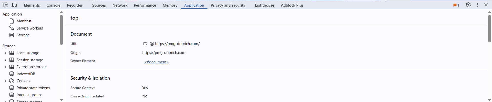

*Панелът **Application**. Вляво са видовете хранилища: **Local storage**, **Session storage**, **IndexedDB**, **Cookies**. В средата са данните за документа.*

Уеб сайтовете могат да пазят данни **в браузъра на потребителя**. **Application** показва тези данни и позволява да ги променяш или изтриваш.

### 8.1. Бисквитки, Local storage и Session storage

| | **Cookies** (бисквитки) | **Local storage** | **Session storage** |
|---|---|---|---|
| Предназначение | Данни, които **сървърът** трябва да получава – напр. че си влязъл в профила си | Настройки и данни само за страницата в браузъра | Временни данни за една работна сесия |
| Докога се пазят | До срока, зададен от сайта (или до затваряне на браузъра, ако няма срок) | Докато не бъдат изтрити – остават и след затваряне на браузъра | До затваряне на раздела |
| Изпращат ли се към сървъра? | **Да** – автоматично, със заявките, за които отговарят условията им (виж по-долу) | Не | Не |
| Достъп от JavaScript | Да, чрез `document.cookie` – освен ако са с атрибут `HttpOnly` | Да, чрез `localStorage` | Да, чрез `sessionStorage` |
| Типично приложение | Вход в профил, кошница в онлайн магазин | Тъмна тема, избран език, запомнено име | Попълнен наполовина формуляр, текуща стъпка в тест |

Освен тях **Application** показва и **IndexedDB** (база данни в браузъра за по-големи данни) и **Cache storage** (запазени файлове за работа без интернет).

**Кога се изпраща бисквитка?** Браузърът я прикрепя към заявка, само ако съвпадат нейният **домейн** (*Domain*) и **път** (*Path*), ако не е изтекъл **срокът** ѝ и ако го позволяват атрибутите ѝ и политиките на браузъра (например блокиране на бисквитки от трети страни). `SameSite=None` премахва само ограничението за заявки от други сайтове – останалите условия остават.

**Атрибути на бисквитките.** В таблицата с бисквитки в **Application** има колони и за три важни атрибута:

| Атрибут | Какво означава |
|---|---|
| `HttpOnly` | Бисквитката **не може да се прочете от JavaScript** – само браузърът я изпраща на сървъра. Така зловреден скрипт в страницата не може да я открадне. |
| `Secure` | Бисквитката се изпраща **само по HTTPS** – никога по незащитен HTTP. |
| `SameSite` | Определя дали бисквитката се изпраща, когато заявката идва **от друг сайт**: `Strict` – не, `Lax` – само при обикновено отваряне на връзка, `None` – и от други сайтове (изисква и `Secure`). Защитава от атаки, при които чужд сайт „действа от твое име“. |

!!! danger "Не пази пароли в Local storage и Session storage"
    Всеки скрипт в страницата може да прочете **Local storage** и **Session storage**, а всеки, който седне на компютъра, ги вижда в **Application**. Там **не се пазят** пароли, номера на карти или други лични данни. Данните за вход в профил се пазят от сървъра, а браузърът получава само бисквитка с `HttpOnly` и `Secure`.

**Как се използва:** избери хранилище вляво → адреса на сайта. Вдясно се показва таблица **Key** – **Value**. Двоен клик променя стойност, а клавишът **Delete** изтрива запис. Разделът **Storage** има бутон **Clear site data**, който изтрива всички данни на сайта – удобно, когато трябва да „започнеш на чисто“.

Бисквитките и сесиите ще разгледаме подробно в Раздел 3.

## 9. Други панели – накратко

### Performance

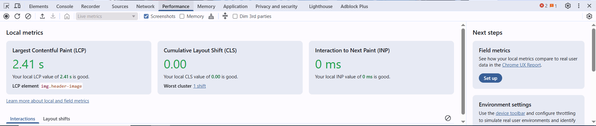

*Панелът **Performance** показва основните показатели за скорост: **LCP** – колко бързо се показва най-голямото съдържание (тук 2,41 s), **CLS** – колко „подскача“ съдържанието при зареждане (0,00), **INP** (*Interaction to Next Paint*) – колко време минава от взаимодействие с мишка, докосване или клавиатура до следващото изобразяване на страницата. Тук е 0 ms, защото в записания интервал почти няма взаимодействия – това не доказва, че цялото приложение реагира мигновено.*

**Performance** записва какво прави браузърът (бутон ⏺ – запис, после ⏹ – стоп) и го показва като времева линия: зареждане, изпълнение на JavaScript, изчертаване. Използва се, когато страницата е **бавна** или „накъсва“.

### Memory

**Memory** показва колко памет използва страницата и кои обекти я заемат (*Heap snapshot* – „снимка“ на паметта). Използва се, когато приложение става все по-бавно, защото **изтича памет** (*memory leak*) – създава обекти, които никога не се освобождават. При малки страници рядко е нужен.

### Recorder

**Recorder** записва поредица от действия в страницата – кликове, въвеждане, превъртане – и после я **възпроизвежда**. Така една проверка (например „попълни формуляра и натисни Изпрати“) се повтаря еднакво много пъти, без да я правиш ръчно.

### Lighthouse

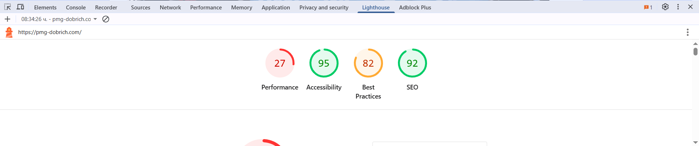

*Отчет на **Lighthouse** за училищния сайт: производителност 27, достъпност 95, добри практики 82, SEO 92.*

**Lighthouse** прави **автоматична проверка** на страницата и дава оценка от 0 до 100 в четири категории:

| Категория | Какво проверява |
|---|---|
| **Performance** | Скорост на зареждане и реакция |
| **Accessibility** | Достъпност: алтернативен текст на изображенията, контраст на текста, етикети на полетата |
| **Best Practices** | Добри практики: HTTPS, липса на грешки в конзолата, правилни изображения |
| **SEO** | Видимост в търсачките: заглавие, описание (`<meta name="description">`), четим текст |

Цветовете: **зелено** (90–100) – добре, **оранжево** (50–89) – може да се подобри, **червено** (0–49) – слабо. Под оценките са **конкретни препоръки** – какво да поправиш и защо. Отчетът се стартира с **Analyze page load**, като избираш **Mobile** или **Desktop**.

!!! tip "Как да тълкуваш оценките"
    Оценката за **Performance** зависи от компютъра и мрежата в момента. Две поредни проверки може да дадат различни числа. Сравнявай резултати на един и същ компютър, а най-полезни са **препоръките**, не самото число.

### Privacy and security

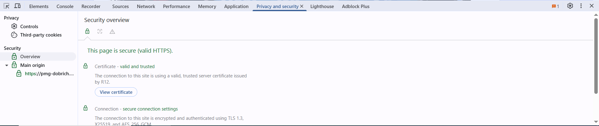

*Панелът **Privacy and security**: страницата е заредена по защитен HTTPS, сертификатът е валиден, а връзката е криптирана с TLS 1.3.*

Панелът показва дали връзката е **защитена** (HTTPS), кой е издал **сертификата** на сайта и докога е валиден, както и какви **бисквитки от трети страни** използва страницата. Ако защитена страница зарежда файл по незащитен `http://`, тук се появява предупреждение за **смесено съдържание** (*mixed content*).

## 10. Кой панел за кой проблем?

Опитният разработчик не търси грешката „на око“, а **знае къде да погледне**.

| Проблем | Къде гледаш | Какво търсиш |
|---|---|---|
| Стилът не се прилага | **Elements → Styles** | Задраскана декларация (отменена) или ⚠ (невалидна) |
| Елементът е с грешен размер или „излиза“ | **Elements → Computed** | Кутиения модел: `padding`, `border`, `box-sizing` |
| CSS файлът изобщо не действа | **Network** | Ред за CSS файла със статус 404 – провери пътя в `<link>` |
| Изображението не се показва | **Network** и **Console** | 404 за изображението; правилен ли е пътят в `src` и има ли такъв файл |
| Бутонът не прави нищо | **Console** | Червена грешка и връзка към реда в JavaScript |
| Промяната в CSS „не се вижда“ | **Network** | **Disable cache** и презареждане (**Ctrl + Shift + R**) |
| Страницата е бавна | **Network** и **Lighthouse** | Големи файлове, дълго време; препоръките в отчета |
| Сайтът „помни“ стари данни | **Application** | Записи в **Local storage** или бисквитки |
| Как изглежда на телефон | Режим за мобилни устройства | **Ctrl + Shift + M** |

## 11. Други браузъри

Идеите са едни и същи във всички браузъри. Различават се имената на някои панели и клавишите:

| Chrome и Edge | Firefox | Safari |
|---|---|---|
| **Elements** | **Inspector** | **Elements** |
| **Console** | **Console** | **Console** |
| **Sources** | **Debugger** | **Sources** |
| **Network** | **Network** | **Network** |
| **Application** | **Storage** | **Storage** |
| **F12** / **Ctrl + Shift + I** | **F12** / **Ctrl + Shift + I** | първо се включва от **Settings → Advanced → Show features for web developers** |

## 12. Интерактивна лаборатория

В **симулатора на DevTools** изследваш учебна страница с „повреди“ в безопасна среда: намираш отменено CSS правило, изчисляваш размер от кутиения модел, откриваш грешка в конзолата и липсващ файл в **Network** и променяш данни в **Application**.

[**Отвори симулатора на DevTools**](../../interaktivni/razdel-2/devtools-simulator.html){: target="_blank" }

!!! tip "Симулаторът и истинският браузър"
    Симулаторът е **опростен модел** на Chrome DevTools за обучение. Истинските инструменти имат много повече възможности. След симулатора отвори истинския DevTools (**F12**) върху произволна страница и намери същите панели.

## 13. Обобщение

Инструментите за разработчици показват какво прави браузърът със страницата: HTML структурата и CSS стиловете (**Elements**), съобщенията и грешките (**Console**), файловете и проследяването на JavaScript (**Sources**), HTTP заявките (**Network**) и локално съхранените данни (**Application**). **Performance**, **Memory**, **Recorder**, **Lighthouse** и **Privacy and security** помагат за скоростта, паметта, автоматичните проверки и сигурността. Промените в **Elements** и **Styles** са временни и не засягат файловете – успешните решения се пренасят в кода, а данните в **Application** могат да останат и след презареждане. Най-важното умение е да избереш правилния панел според проблема.

## 14. Ключови понятия

| Понятие | Определение |
|---|---|
| **Инструменти за разработчици (DevTools)** | Вградени в браузъра инструменти за изследване, промяна и проверка на уеб страница. |
| **Инспектиране** | Избиране на елемент от страницата, за да се видят HTML кодът и стиловете му. |
| **HTML дърво (DOM)** | Текущата структура на страницата като дърво от елементи – така, както я „вижда“ браузърът в момента. |
| **Elements** | Панел с HTML дървото и стиловете на избрания елемент. |
| **Styles** | Списък с CSS правилата, които се отнасят до избрания елемент, подредени по сила. |
| **Отменена декларация** | Валидна декларация, която не определя крайната стойност – друго правило или по-късна декларация има предимство. В Styles е задраскана. |
| **Невалидна декларация** | Декларация с невалидно име на свойство или стойност, която браузърът не може да приложи (⚠). |
| **Computed** | Крайните стойности на CSS свойствата и схемата на кутиения модел на елемента. |
| **Кутиен модел** | Съдържание, вътрешно отстояние (padding), рамка (border) и външно отстояние (margin) на всеки елемент. |
| **`$0`** | Елементът, избран в момента в Elements, достъпен от конзолата. |
| **Console** | Панел със съобщенията на браузъра и поле за изпълнение на JavaScript команди. |
| **Sources** | Панел с файловете на страницата и инструментите за дебъгване на JavaScript. |
| **Дебъгване (debugging)** | Търсене и отстраняване на грешки в програма чрез проследяване на изпълнението ѝ. |
| **Точка на прекъсване (breakpoint)** | Ред, на който браузърът спира изпълнението на JavaScript, преди да го изпълни. |
| **Scope и Watch** | Scope показва променливите и стойностите им в спряната програма; Watch – избрани от теб изрази. |
| **Resume / Step over / Step into / Step out** | Продължи до следваща точка / изпълни реда / влез във функцията / излез от функцията. |
| **Network** | Панел с всички HTTP заявки на страницата: адрес, метод, статус, тип, размер, време. |
| **HTTP статус код** | Трицифрен код в отговора на сървъра: 200 – успех, 304 – взет от кеша, 404 – няма такъв ресурс. |
| **Кеш** | Запазени копия на файлове в браузъра, които се използват без ново изтегляне. |
| **Application** | Панел с данните, които сайтът пази в браузъра. |
| **Local storage** | Хранилище ключ – стойност в браузъра, което остава и след затваряне. |
| **Session storage** | Хранилище ключ – стойност, което се изтрива при затваряне на раздела. |
| **Бисквитка (cookie)** | Малък запис, който браузърът изпраща автоматично на сървъра със заявките, за които отговарят домейнът, пътят, срокът и атрибутите ѝ. |
| **`HttpOnly`, `Secure`, `SameSite`** | Атрибути на бисквитка: недостъпна за JavaScript / само по HTTPS / ограничава изпращането от чужди сайтове. |
| **Lighthouse** | Автоматична проверка на качеството на страницата с оценки от 0 до 100. |
| **HTTPS** | Защитен вариант на HTTP – връзката е криптирана, а сайтът е удостоверен със сертификат. |

## 15. Контролни въпроси

1. Какво се случва с промените, които си направил в DevTools, когато презаредиш страницата? Защо?
2. Посочи три начина да отвориш инструментите за разработчици. Кой води директно до кода на конкретен елемент?
3. В **Styles** декларация е задраскана. Какво означава това? А предупредителна икона ⚠ до декларация?
4. Каква е разликата между **Styles** и **Computed**?
5. Карта е с `width: 300px`, `padding: 10px` и `border: 2px solid`. Колко е общата ѝ ширина при `box-sizing: content-box` и колко при `border-box`?
6. Защо **Elements** понякога показва различен HTML от изходния код (**Ctrl + U**)?
7. В конзолата има ред `script.js:12`. Какво ще стане, ако кликнеш върху него?
8. Отворил си **Network** след зареждането на страницата и таблицата е празна. Какво трябва да направиш?
9. Какво означават статус кодовете `200`, `304` и `404` в **Network**? Какво означава `(disk cache)` в колоната **Size**?
10. Изображението не се показва. В кои два панела ще потърсиш причината и какво ще видиш там?
11. Каква е разликата между **Local storage** и **Session storage**?
12. Кои са четирите категории в отчета на **Lighthouse**? Защо две поредни проверки може да дадат различна оценка за **Performance**?
13. Какво прави **Step over** и с какво се различава от **Step into**? Кога ще използваш **Resume**?

## 16. Домашна работа

Отвори своята страница **„Моят клас“** от упражнения 1 и 2 в Chrome и изследвай я с DevTools:

1. В **Network** презареди страницата и запиши колко заявки прави тя, кои файлове изтегля и с какви статус кодове.
2. В **Elements** избери заглавието на страницата. Запиши от **Computed** стойностите на `font-size`, `margin` и `color` и кои правила са ги дали.
3. Пусни **Lighthouse** (режим **Desktop**, категории **Accessibility**, **Best Practices** и **SEO**). Запиши трите оценки и препоръките, ако има такива.
4. Ако има препоръки, поправи поне една от тях във VS Code, провери отново и запиши новата оценка. Ако няма – запиши коя от проверките на Lighthouse смяташ за най-важна за твоята страница и защо.

## 17. Какво да запомните

- Промените в **Elements** и **Styles** са **временни** – пренеси успешните във файловете си. Данните в **Local storage** и бисквитките остават и след презареждане.
- Най-бързият път до кода на елемент е **десен бутон → Инспектиране**.
- **Задраскано** в Styles значи **отменено** – друго правило или по-късна декларация има предимство. Задраскано с **⚠** значи **невалидно**.
- **Computed** показва крайните стойности и кутиения модел – там проверяваш размерите.
- Червените съобщения в **Console** водят с един клик до реда с грешката.
- Заявките се записват, докато **DevTools е отворен** – отвори го и презареди. Статус **404** значи, че сървърът не е намерил ресурса; най-честата причина е грешен път.
- **Точката на прекъсване** спира JavaScript, за да видиш стойностите; продължаваш с **Resume** (F8) или ред по ред със **Step over** (F10).
- Първо избери **правилния панел** според проблема – това е най-важното умение.

## 18. Свързани уроци и упражнения

- [Урок 1. Работа с HTML. Основни тагове](urok-01-html-osnovni-tagove.md) – елементите, които виждаш в **Elements**.
- [Урок 2. Работа със CSS. Селектори и основни правила](urok-02-css-selektori-i-pravila.md) – каскада, приоритет и кутиен модел, които проверяваш в **Styles** и **Computed**.
- [Раздел 1, Урок 2. HTTP. Видове HTTP заявки](../razdel-1/urok-02-http-vidove-zayavki.md) – методите и статус кодовете, които виждаш в **Network**.
- [Упражнение 3. Детектив в DevTools](../../praktika/razdel-2/uprazhnenie-03-devtools.md) – практическото упражнение към урока.
- [Симулатор на DevTools](../../interaktivni/razdel-2/devtools-simulator.html){: target="_blank" } – интерактивни мисии.

---

*Урокът е разработен по материалите „Работа с инструментите за разработчици на съвременните уеб браузъри“ от курса на [ИТ Кариера](https://it-kariera.mon.bg/e-learning/), разпространявани под лиценз [CC BY-NC-SA 4.0](https://creativecommons.org/licenses/by-nc-sa/4.0/deed.bg), като е допълнен и преработен.*
